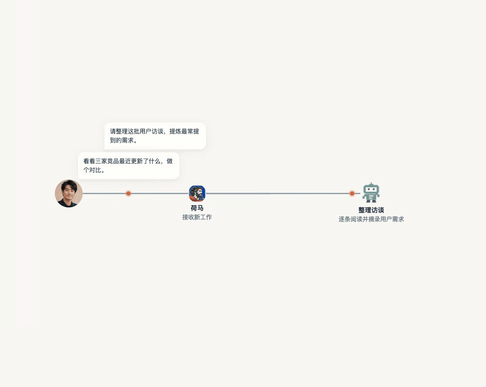

# Homer

**English** | [简体中文](README.zh-CN.md)

Homer coordinates AI assistants to carry out your tasks, reviews their work, and delivers the results. Give instructions, add context, and request changes in one conversation.

## Install and start

**Desktop installers are being prepared.** Download links and installation steps will be added after the packages are published and verified.

Developers can [build and run from source](docs/public/getting-started.en.md) now. This is a development preview with [known limitations](docs/public/getting-started.en.md#source-preview-status).

Once running, connect an available model service, describe what you want done, and provide the relevant materials. Answer questions and request changes in the same conversation. See the [user guide](docs/public/using-homer.en.md).

## Models and costs

The client is planned to be free; model usage is billed separately. Homer's optional pay-as-you-go service and access through your ChatGPT plan are being prepared. Availability and eligibility remain to be confirmed. See [Costs and data](docs/public/data-and-costs.en.md).

## How Homer works

Workflow illustration; demo text is in Chinese.

## Links and license

- [Website](https://super-tree.com/homer)
- [User guide](docs/public/using-homer.en.md) · [Source setup](docs/public/getting-started.en.md)
- [Report a problem](https://github.com/wolf3c/homer/issues): exclude credentials and private materials.

Homer's own code uses [Apache-2.0](LICENSE). [Third-party licenses](THIRD_PARTY_NOTICES.md) apply separately; the additional permission inquiry for Agentation is awaiting a reply.
