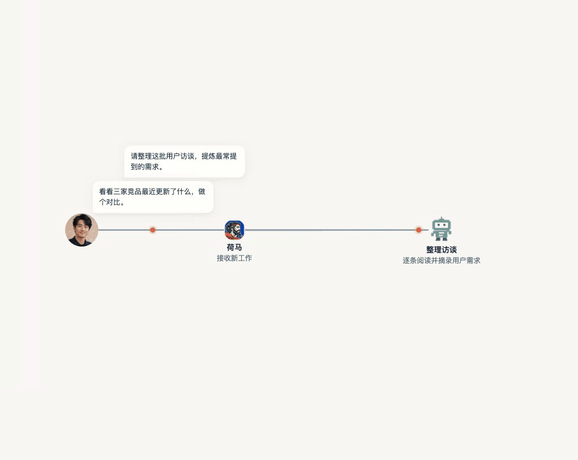

# 荷马 Homer

[English](README.md) | **简体中文**

> 统驭 AI 军团，帮你搞定一切。

[产品首页](https://super-tree.com/homer)

与荷马对话，随时交办多项工作。荷马调度 AI 助手分工协作、审核成果，让你的目标持续向前。过程中，你可以补充想法、提出调整，由荷马协调推进。

## 开始使用荷马

**桌面安装包准备中。** 安装包发布并完成下载、安装验证后，这里再提供下载链接；支持的平台以实际验证通过的版本为准。

1. **先准备：**阅读[使用指南](docs/public/using-homer.md)，了解安装状态、模型接入和费用。
2. **启动荷马：**开发者目前可按[源码运行指南](docs/public/getting-started.md)操作，同时留意预览版的已知限制。
3. **完成第一个任务：**复制[示例任务](docs/public/using-homer.md#第一个任务)，检查交付文件，再提出一次修改。

## 你来交代，军团协同开工

- 一个对话，交办多项工作，减少在不同会话间反复解释背景。
- AI 助手分工协作，由荷马协调进度、审核成果，再带回给你。
- 随时补充和调整，围绕已有工作继续推进、修改成果。
- 查看文件和网页成果，直接批注，说明哪里需要修改。

协作流程示意：交办多项工作 → 助手分工协作 → 荷马审核并交付。

例如，交给荷马几份项目材料，请它整理需求、找出缺失信息并形成执行方案，再根据你的反馈修订。这是场景示例；重要结论和最终成果仍需你确认。

## 不论在哪，工作都在继续

电脑前展开工作，离开电脑后用手机接着交代、查看进展、收取成果，是荷马的多端使用方向。

当前源码以 macOS / Apple Silicon 桌面端为主要开发与验证范围，同时包含移动端工程。Windows、iPhone、Android 及跨设备体验仍需分别验证，首页设备展示为示意。

## 模型怎么用，由你选择

客户端计划免费提供，模型调用费用另计：

| 方式 | 说明 |
| --- | --- |
| 荷马会员服务 | 可选的按量模型服务，按需购买额度；具体价格和可用性以正式发布为准。 |
| 我的 ChatGPT 套餐 | 计划通过 Codex 接入已有套餐，具体方式和使用资格仍待确认。 |

执行任务时，资料可能发送给所选模型或工具服务。[费用与数据说明](docs/public/data-and-costs.md)介绍具体边界。

## 当前进展与入口

**源码现已公开，当前为开发预览，正式安装包尚未发布。** 自有代码采用 [Apache-2.0](LICENSE)，[第三方许可](THIRD_PARTY_NOTICES.md)单独适用；Agentation 额外授权询问仍待答复。已知检查失败与验证边界见[当前源码状态](docs/public/getting-started.md#当前源码状态)。

- [使用指南](docs/public/using-homer.md)：首次使用、示例任务、修改成果和问题处理。
- [构建与运行指南](docs/public/getting-started.md)：开发者环境、运行方式和已知限制。
- [费用与数据说明](docs/public/data-and-costs.md)：了解模型选择、费用和资料处理。
- [GitHub Issues](https://github.com/wolf3c/homer/issues)：提问与反馈，请使用可公开的虚构材料。
