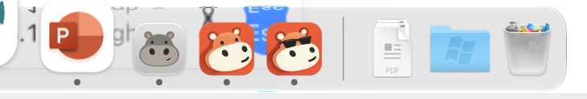
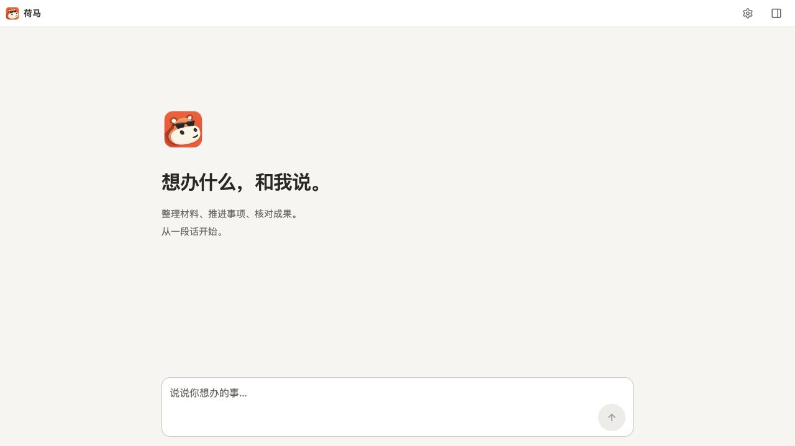

# Homer 朱橙图标精修与酷感对照

日期：2026-10-29（Asia/Shanghai）。

## 目标和范围

用户选定上一轮方案 2「朱橙剪影」，要求继续精修、做出正式图标文件、放进真实 Dock 看效果，并增加一点酷感作对照。

本次新增两组资产：[目录与交付链接](../assets/branding/vermilion-20261029/README.md)。标准版强化头部与底板的分区、保留奶白宽吻和微侧姿态；酷感版在同一构图中加深色墨镜和较短的挑起笑意。用户随后明确决定：两版长期保留，标准版作为未来衍生基础，近期使用酷感版。

首阶段采用范围为 macOS 桌面图标：修改 `scripts/build-desktop.mjs` 的图标源，补充资产说明、清单及 `ui/DESIGN.md` 的范围约定，更新本机已安装图标。随后用户明确要求全应用统一使用酷感版，第二阶段的实施和验证见文末。两个阶段均保留入场前的其他修改，未创建提交、分支或发布远程版本。

## 已完成的检查

- 两份 1254px RGBA 生成母图原样保留，并导出每组 16/32/48/64/128/256/512/1024px PNG。
- 逐个解码全部 16 个导出 PNG，核对尺寸、模式和 SHA-256。
- 两份母图 alpha 范围为 0–255，四角 alpha 为 0。alpha ≥8 的主体边界均有安全留白；低 alpha 外缘未人为阈值修整。
- 复用 `scripts/desktop-icon.mjs` 生成两份 ICNS，验证容器总长度、每个数据块长度、边界以及完整的 12 档块类型。
- 临时 AppKit 预览程序已成功读取各自 ICNS 并保持运行。程序只显示临时应用的 Dock 图标，不连接 Homer 服务、读写用户业务数据或修改安装包；有 10 分钟自动退出保护。
- Codex in-app Browser 实际打开各导出 PNG，检查浅色及深色背景下的 16/32/48/64 CSS px 呈现。32–64px 可分辨宽吻、微笑及酷感版墨镜；16px 主要呈现色块和轮廓，细微表情明显减弱。这是浏览器位图检查，不等同于 Dock 系统渲染验收。

本地小尺寸评审位于 `.codex/scratch/icon-refinement-20261029/web-review/`，浏览器截图位于同目录上一级的 `small-size-review.png`。这些是临时检查材料；正式来源是上述资产目录、提示词及清单。

## 真实 Dock：已实拍

首次拍摄时主屏幕处于锁屏界面，无法观察 Dock；该次截图已删除。用户随后明确回复已解锁，继续启动两个独立临时预览应用，分别读取本次导出的标准版与酷感版 ICNS。

已通过实际系统截图确认：Dock 中现有灰色 Homer、标准精修版、墨镜酷感版依次并排显示，两个候选均使用真正的 ICNS 经 AppKit 与 Dock 渲染。主屏幕为 1470 × 956pt、2× Retina，当前 Dock tilesize 为 40pt；没有修改 Dock 偏好或固定项。附近 Zed 图标在调出 Dock 时有悬停放大，三个河马比较目标没有该放大。

保留画面是原始系统截图的 730 × 124px 局部裁切，包含 PowerPoint、三个河马及相邻文档/文件夹/废纸篓；未合成、重新生成或缩放。不保留包含其他聊天或应用内容的整屏及调查截图。采集时间、裁切坐标和 SHA-256 见资产 [manifest](../assets/branding/vermilion-20261029/manifest.json) 的 `dockReview`。

观察：朱橙色块比现有灰色图标更突出；标准版的宽吻、眼睛和微笑可辨；酷感版的深色墨镜在当前 Dock 尺寸下仍有清晰轮廓，与鼻孔分离。墨镜版个性更强，但遮住了亲切的眼神；用户选择近期使用酷感版。

该次拍摄后已退出两个临时预览程序；当时没有替换已安装 Homer。该图是候选并排对照，采用后的实际安装与运行证据如下。

## 首阶段采用：酷感桌面图标

- 两版 1254px 原图、实际提示词、各 8 档 PNG 和 ICNS 全部保留。标准原图作为衍生母版，后续变体另存，不能覆盖原图；尚未实现自动换肤或轮换功能。
- 本机从原已安装 build 123（`0833d08b085e43003ebefac62cb7a2bac6903392`）制作 APFS 克隆，只替换 `Contents/Resources/electron.icns`，更新对应资源清单及 `iconAdoption` 来源，再重新作本机 ad-hoc 顶层签名。没有构建或安装工作区其他修改。
- 全包逐文件比对仅 4 个文件变化：上述图标、`desktop-manifest.json`、签名相关的 `Contents/MacOS/Homer` 与 `Contents/_CodeSignature/CodeResources`。1716 个资源、2 个运行时代码文件核对通过，原 entitlements 完全相同；安装前后严格深度签名校验均通过。
- 自定义 Finder 图标的隔离试验使严格签名失败，故未用于实际 Homer；采用的是经过完整性验证的图标资源包。
- 切换前实际状态为无主回复、无待发送队列、无待答交互，输入框为空。通过应用原生退出与确认完成正常停机，没有强制结束进程或清锁；原安装包保留于 `.codex/scratch/icon-refinement-20261029/previous-Homer.app`，供本机图标回退。
- `/Applications/Homer.app` 已采用酷感版并正常重新打开。只读状态确认原主会话一致，消息数前后均为 1647，`accepting=true`、`reviewRequired=false`；未发送模型验证消息。
- 通过 `NSRunningApplication.icon` 实际读取已运行 Homer 的系统图标，确认显示墨镜河马。macOS 在系统图标呈现中加入浅色底板；这与临时预览程序直接设置 Dock 图标的呈现方式有差异。本次自动调出隐藏 Dock 的尝试未得到采用后截图，不把旧并排对照当作采用后实拍。完整应用或桌面截图均已删除。
- `node --test tests/desktop-icon.test.mjs`：2/2 通过；两版资产清单的 SHA 与解码检查保留。完整安装验证的非敏感元数据见资产 `manifest.json` 的 `adoption`，本机详细回退记录位于 `.codex/scratch/icon-refinement-20261029/cool-adoption-verification.json`。

桌面构建源已指向酷感 1024px PNG；构建流程从指定已提交来源取材，当前尚未提交此修改，不能据此声称未来任意旧提交构建都会采用新图标。

## 第二阶段采用：全应用统一酷感版

用户进一步明确要求“将全应用统一使用酷感版”。当前桌面图标、页头、欢迎图、16/32/64px favicon 和渠道设置页的 `/branding/homer.png` 均统一；标准母版和原有候选继续保留。页面布局、24px 页头、桌面 70px／窄屏 58px 欢迎图、可访问名称及状态配色不变。

维护改动仅替换 `ui/homer-app.tsx` 的两处图源与对应变量、`ui/index.html` 的三档 favicon，以及 `scripts/dev.mjs` 的兼容 Logo 路径；桌面图标延用第一阶段。测试／合成宿主里用于协议样本的历史图片、归档文件和旧版本回退资源不作批量替换。

本机候选从已安装 build 123 的同一提交导出隔离源码。先重新构建旧 UI，确认全部 73 个网页文件与已安装版逐字节一致，再只应用以上 Logo 源码修改和四档 PNG，重新运行 Vite 与 UI TypeScript 检查。对 6 个 JS/CSS 产物按资源文件名和 UI URL 前缀归一化后逐字节比较一致，确认没有混入工作区其他程序修改。新 UI 资源前缀为 `3db44ec62b2c4520fcc30c663c43bf791d05fc38850cb0b37a207a0855b776bb`。

采用包基于原安装包的 APFS 克隆，只接入这份隔离 UI、兼容 Logo 路径与新图片，并重新生成 trusted build 与桌面资源清单、更新来源哈希后签名。`gitSha`／build 保留为基线身份，`logoAdoption` 明确记录本地覆盖，`publishable=false`，没有声称这是新的已提交或可发布版本。1720 个资源、2 个运行时代码文件和 trusted build 校验通过，严格深度签名通过，entitlements 不变。第一阶段酷感 ICNS 字节保持一致。

验证结果：

- Codex in-app Browser 打开实际生产 UI 的合成空会话：1280px 桌面及 390px 窄屏均加载酷感页头与欢迎图，无横向溢出、框架错误覆盖层或控制台错误。草稿输入后发送按钮可用，清空后恢复禁用；没有提交消息或调用模型。
- 渠道设置页实际显示由兼容接口加载的新 Logo；三档 favicon 与兼容接口的 4 个 HTTP 响应逐字节等于正式酷感 PNG。
- 正常退出空闲、空输入框的 Homer 后安装并重开；没有强制终止或清锁。只读状态核对同一主会话，消息数前后均为 1647，`accepting=true`、`reviewRequired=false`。
- 对已安装运行服务再次核对 4 个 Logo HTTP 响应全部正确，并在浏览器确认页头显示酷感图像、三档 favicon 使用新资源前缀，无控制台错误。只保留不含聊天内容的 44px 页头截图。
- 原安装包保留于 `.codex/scratch/icon-unification-20261029/previous-Homer.app`，只供应用文件回退，不回写用户数据库或凭据。阶段一的旧灰色图标回退包也保留。

隔离构建与签名记录位于 `.codex/scratch/icon-unification-20261029/`；正式非敏感身份和校验元数据见资产 manifest 的 `unifiedAdoption`。下图为实际构建的合成空会话预览，非用户会话：

