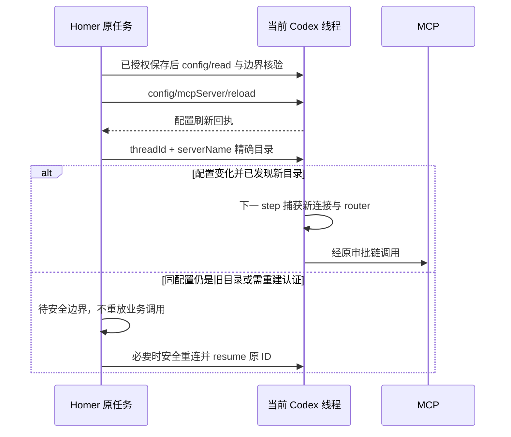

# 优先复用 Codex 原生 MCP 刷新的评估

## 决定与复核条件（2026-11-17）

用户决定：**暂缓 MCP 运行中刷新优化，以后再考虑；本次只保留调研与验证材料，不实施产品修改。** 下文的阶段方案和验收建议是备选研究，不是已批准实施计划，也不代表 Homer 已支持该能力。现有轮次边界刷新、忙碌保护及必要时重连原线程的行为保持。

收尾复核时仓库 HEAD 为 `3fe89416`（思考深度菜单变更），工作区仍有并行未提交修改；重新读取 `src/engine.ts` 的 refreshCapabilities 与 `src/service.ts` 的主轮刷新入口，相关保护及 reload/Skill 强刷/必要时 resume 链仍在。本次未重新启动引擎或重跑合成/真实模型实验；下文版本、官方资料和实验结果均为当时快照，不表示未来版本仍然如此。

已验证：固定打包 Codex `0.171.0-alpha.7` 的隔离原生路径中，同配置 list_changed 和普通 reload 保留旧目录；连接配置变化可使同一 turn 后续 step 采用新目录；精确线程查询需 threadId + serverName；调用仍受审批约束。未验证：Homer 活动轮接入、HTTP/认证及撤权竞态、在途 MCP 长调用保活、真实模型自主发现与成功调用、安装包产品行为。dynamicTools 持久声明替换是独立问题，不能视作 MCP 刷新已解决。

以后只有在用户重新提出相关需求或明确同意重启评估时再推进。届时先核对实际安装及运行引擎版本、对应固定官方协议/源码和 Homer 刷新入口，再用隔离 HOME、合成 MCP 与 loopback 模型复验精确线程目录及后续 step 采用；同配置更新、权限和在途调用专项通过后，才决定是否实施。真实模型、账号及日常实例操作需另行获得对应授权。版本升级、通知或 ACK 本身不构成采用证据，也不触发自动实施。

2026-11-17。结论：**值得优先接入原生 reload，能够保留原对话，并在同一原生 turn 的后续 step 采用配置变化；但当前版本无法依靠 list_changed 或普通 reload 可靠刷新“连接配置不变”的工具目录。** 这种情况仍需要安全边界重连，不能承诺所有 MCP 更新都无需重启引擎子进程。Homer 应先复用现有入口，再小范围拆出不关闭进程的刷新分支；无需新增注册中心、版本实体或迁移框架。

此结论比上一份[更新调研](2026-11-17-tool-refresh-research.md)多了固定安装引擎的隔离实证，并修正其中一个验收条件：**mcpServerStatus/list 必须同时传 threadId 和 serverName，才走该线程的指定连接。只传 threadId 仍可能另外启动发现连接。** 官方在线说明的概括不足以替代固定源码分支检查。

## 范围和版本

- 实际工作目录 `/Users/wolf3c/Project/homer`，HEAD `83967e8fe06dc48e6e5c0f2b0540dc25c498c2b5`，有大量并行修改。未改动产品源码、测试入口、架构正文或用户配置，未提交、推送、安装工具。
- 当前磁盘打包二进制实测 `codex-cli 0.171.0-alpha.7`：`/Applications/Homer.app/Contents/Resources/runtime/codex/vendor/aarch64-apple-darwin/bin/codex`。这不证明日常运行进程已经加载该版本；未检查或重启日常进程。
- 固定公开源码提交 `73c4af9125a8d5e9aabe5aa900eecf70214ba856`，对应 [alpha.7 release](https://github.com/openai/codex/releases/tag/rust-v0.171.0-alpha.7)。下载并读取了协议、MCP processor、config refresh、step context、runtime 和通知 handler；版本对应不等于二进制可复现构建证明。
- 测试只启动本任务自己的隔离 app-server：独立 HOME、CODEX_HOME、TMPDIR、合成线程、自建 stdio MCP；模型端点是本机脚本 HTTP 服务或不可用的 loopback 地址。没有真实模型、账号、付费服务、凭据或日常会话读取，没有唤醒旧 Worker。
- 公开资料使用 openai-docs 技能；收尾遵循 work-cleanup。没有适用且需额外安装的调研技能。

## 已执行的隔离验证

完整结构化回执及可复验脚本在 [证据目录](tool-refresh-research-20261117/)。其中 `evidence.json` SHA-256 为 `99d560a3854f1ae32ffa1aba27dbed798379a34f69b4dc6ae653ab2728ccf035`。表中“确认”只表示列明的隔离路径，不外推到真实模型自主采用。

| 用例 | 实际结果 | 证据边界 |
|---|---|---|
| 同线程首次连接 | 得到 echo(text)、removed | threadId + serverName 精确查询 |
| MCP 声明 listChanged 并主动通知；新增 added、删除 removed、echo 必填改为 value | 原线程仍是 echo(text)、removed | 假服务记录已发送通知；固定 handler 仅日志，无重取目录路径 |
| 同配置 config/mcpServer/reload | ACK 成功，精确线程目录仍旧 | 不可把 ACK 当硬刷新；该结论有源码路径配合，不只凭短时等待 |
| 改变 stdio args 标记，并增加另一服务 | 原线程 probe 得到 echo(value)、added；新连接初始化 | 标记仅用于合成对照。**不建议产品伪造配置变化强制重连** |
| 删除新增的 extra 服务后 reload | 广泛发现清单不再含 extra | 尚未通过模型调用证明运行中撤权即时生效，不把清单消失当撤权验收 |
| 原生 mcpServer/tool/call 直调合成 echo | 返回 synthetic-2，服务记录一次 tools/call | 仅原生 RPC 与 MCP 通信，不等于模型调用审批链通过 |
| 关闭本任务 app-server，再恢复原合成 threadId | 同一 ID，目录为 v2 | 只操作本任务新线程与子进程；注入合成 marker 使其具备可恢复历史 |
| 只带 threadId 的全量状态查询 | 每次另建发现连接，可显示新目录 | 探索性结果与精确查询相反，解释了容易出现的假阳性 |

另外执行了真正经过 Codex 推理循环、但服务端完全由脚本回复的实验：**一个 thread、一次 turn/start、三次 loopback Responses 请求**。

1. 第一次模型请求到达本机脚本后，先改合成 MCP 配置并调用 reload，再返回 `functions.exec` 工具调用。
2. 该 exec 枚举 `ALL_TOOLS`，仍看到 step 1 捕获的 v1：echo(text)、removed。其输出进入请求 2。
3. 请求 2 返回第二个 exec，枚举到 v2：echo(value)、added；尝试新 echo(value)。结果进入请求 3。
4. 新 echo 调用被原生明确拒绝：`MCP tool call requires approval, but approval policy is never`。MCP 日志没有 tools/call。脚本服务随后结束合成回答。

由此确认：**reload 不追溯修改已发请求的工具绑定；后续 step 能获得配置更新后的可调用目录；目录采用不会自动授权调用。** MCP 在该模型路径按延迟工具暴露，不能只检查 HTTP 顶层 `tools` 数组；此次实际证据来自 exec 的 ALL_TOOLS 输出进入后续模型请求。未观察到模型“自主选择工具”，因为所有回复由脚本固定生成。

初版合成探针仅用动态 gate 让循环继续，不能检查延迟 MCP schema；因此另补上述 exec 探针，以后者支持 step 采用结论。没有将初版的请求计数冒充 schema 证据。

## 能力与时间边界

这里同一“对话”指同一 thread；一个 turn 可包含多个模型 step；用户的一个业务任务还可能包含多个 turn。三者不能混用。

| 变化 | 同 turn 后续 step | 下一 turn | 重连后 resume 原 thread | Homer 当前状态 |
|---|---|---|---|---|
| 新增 MCP / 有效端点或配置变化 | 原生机制成立；合成 stdio 连接变化已验证 | 原生可采用；仍受配置层、启动和权限影响 | 可重新发现 | 现有 refreshCapabilities 在 active 时拒绝 |
| 同配置工具新增/删除/schema 变化 | list_changed 不触发重新发现；普通 reload 实测保留旧目录 | 单纯等下一 turn 不保证重取 | 新进程连接可重取；本轮实证原 ID 恢复 | 需要现有安全重连兜底，不能只清 Homer 缓存 |
| 新增/修改 Skill 发现信息 | watcher/forceReload 清缓存，不保证替换已建 turn 的 Skill snapshot | 新 turn 获取快照 | 可重新发现 | 已有 skills/list(forceReload:true) |
| Skill 正文修改 | 可沿获准路径重新读取，已注入旧正文仍在历史 | 新读取/显式 skill 输入采用新正文 | 历史仍保留旧内容 | 需区分目录刷新与正文采用 |
| thread/start 的 dynamicTools | 内部替换机制不是当前公共 RPC | 等一轮不能修复旧 schema | 持久化旧声明仍恢复 | 与 MCP reload 分开；不能靠此修复旧 worker_open.title |
| 内置工具实现 | 无法热换二进制代码 | 依引擎版本/配置 | 新引擎可重新构建能力 | 不属于 MCP/Skill reload 承诺 |

MCP 规范只定义服务器声明 `tools.listChanged`、发送 `notifications/tools/list_changed` 及客户端 tools/list 的协议。模型请求何时换目录由客户端实现决定。[MCP Tools 规范](https://modelcontextprotocol.io/specification/2025-11-25/server/tools)

Codex 官方公开 reload 的含义是重读磁盘配置并给已加载线程排队刷新；不能据此承诺连接已就绪、完整目录已重取或模型已实际调用。[App Server 官方说明](https://learn.chatgpt.com/docs/app-server)

## 固定官方源码链

以下均固定 alpha.7 提交；不把浮动 main 的能力当成本机能力。

| 位置 | 可据此确认的行为 |
|---|---|
| [mcp_processor.rs:103](https://github.com/openai/codex/blob/73c4af9125a8d5e9aabe5aa900eecf70214ba856/codex-rs/app-server/src/request_processors/mcp_processor.rs#L103) | 公共 config/mcpServer/reload 调用 reload_mcp_config，无通用 force-reconnect 参数 |
| [mcp_refresh.rs:47](https://github.com/openai/codex/blob/73c4af9125a8d5e9aabe5aa900eecf70214ba856/codex-rs/app-server/src/mcp_refresh.rs#L47) | 遍历已加载线程，重新加载其配置层；有有界重试，部分线程可能已发布后整体报错；不是全局原子事务 |
| [config_refresh.rs:195](https://github.com/openai/codex/blob/73c4af9125a8d5e9aabe5aa900eecf70214ba856/codex-rs/core/src/session/config_refresh.rs#L195) | 发布配置、mark dirty、调度 prewarm。保留 session layers，不保证磁盘值覆盖线程固定层 |
| [mcp.rs:435](https://github.com/openai/codex/blob/73c4af9125a8d5e9aabe5aa900eecf70214ba856/codex-rs/core/src/session/mcp.rs#L435) | step 建绑定前刷新 dirty runtime |
| [step_context.rs:25](https://github.com/openai/codex/blob/73c4af9125a8d5e9aabe5aa900eecf70214ba856/codex-rs/core/src/session/step_context.rs#L25) | 每 step 捕获准确 MCP 连接、配置、目录和 tool router；旧请求持有旧绑定 |
| [runtime.rs:383](https://github.com/openai/codex/blob/73c4af9125a8d5e9aabe5aa900eecf70214ba856/codex-rs/codex-mcp/src/runtime.rs#L383) | replace 可复用已有连接；replace_fresh 与 reconnect_on_next_refresh 是内部能力，不是公共通用重连 RPC |
| [logging_client_handler.rs:86](https://github.com/openai/codex/blob/73c4af9125a8d5e9aabe5aa900eecf70214ba856/codex-rs/rmcp-client/src/logging_client_handler.rs#L86) | tool list changed 只记日志 |
| [mcp_processor.rs:420](https://github.com/openai/codex/blob/73c4af9125a8d5e9aabe5aa900eecf70214ba856/codex-rs/app-server/src/request_processors/mcp_processor.rs#L420)、[参数定义](https://github.com/openai/codex/blob/73c4af9125a8d5e9aabe5aa900eecf70214ba856/codex-rs/app-server-protocol/src/protocol/v2/mcp.rs#L49) | threadId + serverName 复用线程连接；只传 threadId 走另外的 discovery 分支。环境重名时还应使用准确 environmentId |
| [thread.rs](https://github.com/openai/codex/blob/73c4af9125a8d5e9aabe5aa900eecf70214ba856/codex-rs/app-server-protocol/src/protocol/v2/thread.rs)、[公共请求表](https://github.com/openai/codex/blob/73c4af9125a8d5e9aabe5aa900eecf70214ba856/codex-rs/app-server-protocol/src/protocol/common.rs) | start 有 dynamicTools，resume/settings 没有公共替换字段或对应 RPC |

`mcpServer/event/stream/start` 不是通用目录刷新接口，不能因为名字包含 event 就当作 Homer 已能接收并处理全部 tools/list_changed。Apps 专用 fresh 路径同样不能冒充普通第三方 MCP 的公共硬刷新。

成熟产品对照：Claude Code 当前文档描述收到目录变化后重取工具，以及连接完成后在后续请求通知模型。这是值得借鉴的行为，但并不是 Codex 当前 handler 的行为；本轮未安装或运行 Claude Code，也不指定其二进制版本。[Claude Code 动态工具更新](https://code.claude.com/docs/en/mcp#dynamic-tool-updates)

## Homer 最少接入点

当前链路在 [engine.ts:1116](../src/engine.ts)：忙碌保护 → config/read 与内部 MCP 边界检查 → reload → skills/list(forceReload:true) → 视 force/配置版本安全关闭子进程并 resume 原 ID。主轮在 [service.ts:1342](../src/service.ts)、[service.ts:1415](../src/service.ts) 调用。它已经具备应复用的基础，不需要另造刷新服务。

建议分两小步，均为后续实施建议，本轮没有修改：

**第一步：完善现有轮次边界刷新，先得到可靠的下一 turn 采用。**

- 保留 config/read、reload、Skill 强刷和现有互斥、background 检查、原 ID 恢复；保留用户配置变化时现有保守重连，暂不仅凭这次 stdio 实验删除它。认证、项目/会话覆盖、managed requirements 和长调用尚未全面验证。
- 在现有安装/保存回执后记录“待刷新”；在安全边界用精确线程 + 服务目录确认目标变化。不要每轮为了验收遍历所有服务；全目录查询可能启动额外连接与资源发现。受影响服务查询仍可能等待启动，应有超时和失败归属。
- 刷新响应使用现有流程所需的少量状态：完成刷新、待安全边界、失败；模型采用未经验证时明确说明。`pending:false` 不再在产品话术中等价为“已可用”。这不需要增加持久版本表。
- 必须重连时只重连相关 Codex 子进程，resume 同一 native thread；不得切换 provider、fork 或新建用户对话。模型绑定存在 logical/native 映射时沿现有 Engine.request 使用正确 ID。

**第二步：小范围开放不关闭进程的运行中刷新。**

- 从 refreshCapabilities 提取现有“边界校验 + 原生 reload + Skill 强刷”操作，允许在满足互斥条件的活动 turn 中执行；现有 closeProcess/resume 分支继续只在安全边界运行。不是直接删除 `if(this.active...)`，也不在刷新中改 active、turnId、工具请求桥或原交付归属。
- 首先只在本次已获授权安装/保存明确结束、且当前任务确需新能力的路径调用。刷新多个写入时合并待处理意图，禁止重复安装或新建业务输入；外部未知变化仍可在下一正常主轮强刷。不能承诺自动感知任意远端 schema 变化。
- 先验证新增 MCP 和有效连接变化。对同配置 schema 更新，精确目录仍旧时标记待重连；等待当前调用/审批/后台任务安全结束，再复用现有重连。不要为强制连接而添加随机 argv、伪版本字段或临时禁用再启用服务。
- 当前任务已经终态、但还未完成原业务目标时，可在原 request/reply/process/generation 内继续一个必要 turn；复用原停止、审批及一次最终交付，不重放原输入或未知结果的命令。不要仅因通知而无目标地启动模型。
- [engine.ts:870](../src/engine.ts) 的线程过滤会丢弃无 threadId 的 skills/changed。若需要实时发现 UI，可在过滤前仅使 Skill 目录失效；不将其当“当前 turn 正文已更新”，也无需新增 watcher 框架。

现有 Worker 的配置和活动状态独立处理。reload 遍历的是**该 app-server 的已加载线程**，不能推断主进程 reload 自动更新了所有独立 Worker 进程；本轮不唤醒旧 Worker，也不建议为了统一目录中断它们。

## 安全、故障和不兼容变化

| 风险 | 必须保留的行为与验收 |
|---|---|
| 安装授权与调用授权混同 | 安装/连接保存、工具发现、调用审批、实际成功分别记录。合成模型调用被拒说明原生 gate 仍在，不证明所有 Homer 宿主审批路由都已验收 |
| 连接更新和在途操作 | 保留原 callId、thread/turn 和旧 step 绑定。新目录影响后续请求；不能把旧参数静默交给新语义。后台 stdio/HTTP 长调用在更新时是否保活、完成回执如何到达仍需专项 |
| 删除、禁用、撤权 | 下次捕获不得继续提供已撤工具；在途旧绑定不等于被授予撤权后的执行许可。撤权必须沿现行执行校验阻断，必要时等停止确认，不能拿“保留旧快照”作权限保证 |
| 同名/多环境 | 按 server + environment + tool 识别，不仅看裸工具名；保留内部 homer_interactions 来源、命令、参数及准确目录校验。重名/不兼容 schema 明确失败或延期，不偷偷覆盖 |
| 新增服务启动失败 | ACK 不表示初始化成功；区分 starting、failed、authenticationRequired、disabled、toolsError，工具清单为空不一定是合法删除。可选能力失败不扩大授权；必需能力阻止受影响工作 |
| reload 部分成功/超时 | 固定实现不是跨线程事务；先核对各受影响线程结果，不能用宿主快照回滚覆盖并发配置。未知 RPC 结果不自动重装、重放或循环重启 |
| OAuth、trust、配置层 | 不重新登录整账号，不复制凭据，不授予 project trust。用户已批准的连接变化仍不能绕过项目层、session 层和 managed requirements；不盲目清除覆盖层 |
| 不兼容 schema | 加必填参数、删参数、改返回语义均要求新请求使用新合同；历史仍含旧 schema。第三方服务器是否按 schema 校验需单独核对，不能依赖服务端自动兼容 |

## 最小验收清单与下一实验

本轮已确认 stdio 的目录刷新、连接变化、原线程恢复、单 turn 后续 step 采用和原生审批拒绝。以下仍未完成，实施前按范围补充，使用独立 HOME 和本机脚本服务，不纳入默认 npm test：

1. **Homer 适配器路径**：通过实际 CodexEngine 执行，而不是只用原生 RPC。覆盖 active/compaction/preparation/background/pending、stop、close 未确认、logical/native ID 映射；不能换主线程、重复交付或重放调用。
2. **同 turn 完整回执**：暂停第一步 MCP 长调用，同时更新配置；验证旧调用完成及旧回执归属、下一步新 schema、新工具获准调用一次、删除工具不再可调用。分别测试允许和拒绝，测试服务器日志计数，不能把本轮直调成功代替模型路径成功。
3. **同配置远端目录更新**：对通知、无通知普通 reload、原 ID 冷重连分别采样 ALL_TOOLS/延迟工具获取及调用输出，证明哪些仍旧；重连失败不得循环。HTTP transport 另建本机模拟，不把 stdio 的实证泛化到 HTTP。
4. **失败及权限**：启动失败、401/重新授权需要、tools/list 失败/分页/非法 schema、通知突发、配置写冲突、同名跨环境、disabled/enabled_tools 收窄、managed/session 覆盖、撤权与在途审批竞态。确认已有宿主权限校验未被刷新分支绕过。
5. **Skill**：新增/编辑/删除/禁用后新 turn 目录和正文；正在执行的旧 snapshot 不强换，历史旧正文保留。用同一个 thread 的真实发出请求验证，而不仅看 skills/list。
6. **真实模型采用，后续另行授权**：用隔离账号/配置、无副作用 nonce echo，先不告知精确工具名，再热新增工具；让模型发现并实际调用带新必填参数的工具一次。记录请求/延迟目录、模型 call、MCP nonce 回执、审批与最终答复的关联。若经搜索延迟加载，应记录发现过程。真实模型自主发现是概率行为，需要有限重复与明确失败记录，不可由 ACK、标签或脚本输出代替。

本轮无需调用真实模型即可确定“原生有后续 step 更新机制”和“list_changed + 普通 reload 不是通用目录热刷新”。是否向用户承诺运行中无感更新，仍取决于第 1—4 项的 Homer 接入及安全验收；动态工具 worker_open.title 是另一份持久合同问题，不应混入 MCP 验收。

## 交付与清理

保留本报告、结构化合成回执及三份复验脚本，供本次评审和后续实施验收使用；它们不含用户凭据、真实会话或业务数据。脚本是显式隔离专项，不登记或运行默认测试。运行方法：将三份脚本复制到新建的临时目录，再依次运行 probe.py、probe-strict.py、step-exec-probe.py；依赖系统 Python 和已存在的固定打包 Codex，不安装依赖。脚本中的固定临时目录和二进制路径需按实际位置检查，不能拿日常 HOME 代入。

下载的公开源码、隔离 HOME、合成会话及日志已按本任务临时资源回收；任务 app-server 已退出，19 个记录到的 MCP 子进程均已确认不存在。原报告、并行修改和日常数据保留。未运行全量测试、安装包 UI 验收或真实模型实验；未宣称产品已实现热更新。
