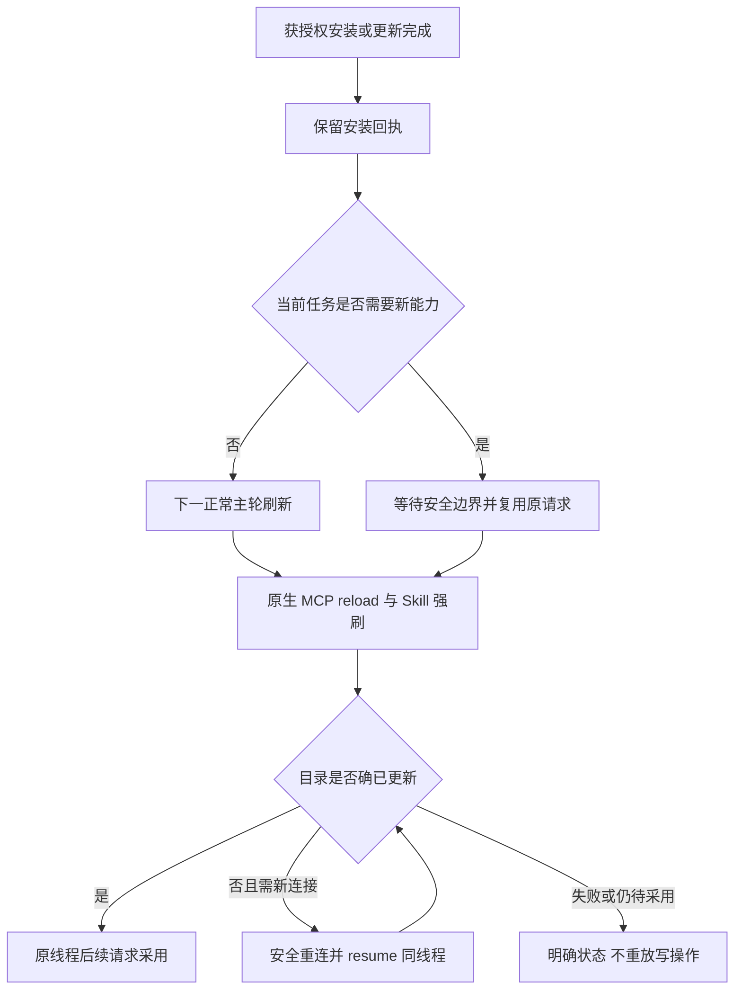

# 工具动态更新复核（2026-11-17）

## 决定与复核条件（2026-11-17）

用户决定：**暂缓 MCP 运行中刷新优化，以后再考虑；本次只保留调研与验证材料，不实施产品修改。** 下文的阶段方案和验收建议是备选研究，不是已批准实施计划，也不代表 Homer 已支持该能力。现有轮次边界刷新、忙碌保护及必要时重连原线程的行为保持。

收尾复核时仓库 HEAD 为 `3fe89416`（思考深度菜单变更），工作区仍有并行未提交修改；重新读取 `src/engine.ts` 的 refreshCapabilities 与 `src/service.ts` 的主轮刷新入口，相关保护及 reload/Skill 强刷/必要时 resume 链仍在。本次未重新启动引擎或重跑合成/真实模型实验；下文版本、官方资料和实验结果均为当时快照，不表示未来版本仍然如此。

已验证：固定打包 Codex `0.171.0-alpha.7` 的隔离原生路径中，同配置 list_changed 和普通 reload 保留旧目录；连接配置变化可使同一 turn 后续 step 采用新目录；精确线程查询需 threadId + serverName；调用仍受审批约束。未验证：Homer 活动轮接入、HTTP/认证及撤权竞态、在途 MCP 长调用保活、真实模型自主发现与成功调用、安装包产品行为。dynamicTools 持久声明替换是独立问题，不能视作 MCP 刷新已解决。

以后只有在用户重新提出相关需求或明确同意重启评估时再推进。届时先核对实际安装及运行引擎版本、对应固定官方协议/源码和 Homer 刷新入口，再用隔离 HOME、合成 MCP 与 loopback 模型复验精确线程目录及后续 step 采用；同配置更新、权限和在途调用专项通过后，才决定是否实施。真实模型、账号及日常实例操作需另行获得对应授权。版本升级、通知或 ACK 本身不构成采用证据，也不触发自动实施。

建议继续采用原线程、原任务，在安全边界刷新能力。最新版没有提供足够证据，支持 Homer 直接替换旧线程的 `dynamicTools`；安装 Skill/MCP 无需重启整个应用的方向仍然成立。先补刷新结果和下一请求的采用验证，再决定是否开放运行中刷新。暂不升级引擎、不迁移线程、不引入注册中心。

本次为只读调研及报告交付。未唤醒或重启原 Worker，未重启应用或引擎，未调用模型、安装工具、读取凭据或日常会话，未修改源码配置。原报告为 2026-11-13 的本机历史材料；本仓库保留本次版本复核及后续隔离评估，不依赖该本机路径。后续实证及状态查询条件修正见[原生 MCP 刷新评估](2026-11-17-native-mcp-refresh-evaluation.md)。

## 版本与证据范围

| 对象 | 本次结果 | 证据及限制 |
|---|---|---|
| 已安装 Homer 打包 Codex | `codex-cli 0.171.0-alpha.7` | 实际执行打包二进制 `--version`；有无法创建 PATH aliases 的警告，但退出码 0、版本输出正常 |
| 对应官方固定源码 | `73c4af9125a8d5e9aabe5aa900eecf70214ba856` | 官方 `rust-v0.171.0-alpha.7` annotated tag 解引用；版本映射不等于逐字节供应链证明 |
| GitHub latest 正式 release | `0.169.0`，2026-11-13 08:37:05 UTC | 本轮查询 `/releases/latest`；“最新正式”与“版本号最高的预发布”不同 |
| 本轮列表中最新预发布 | `0.171.0-alpha.11`，2026-11-17 04:24:57 UTC | 固定提交 `57da98c18f84311dc23abfe1cda8f2c0dbd41cb9` |
| 上游 main 对照 | `61f59108263da04deaacd51f12991b454d6b6b52` | 提交时间 2026-11-17 06:18:06 UTC；不是本机版本 |
| Homer 当前工作区 | HEAD `83967e8fe06dc48e6e5c0f2b0540dc25c498c2b5`，存在大量并行修改 | 结论以实际读取文件为准，不归因于干净 HEAD；没有改动这些文件 |
| 已安装 Homer 适配器 | 已对照 `Resources/homer/dist/engine.js` 与 `service.js` 的相关链路 | 与当前工作区在 dynamicTools、resume、refresh 的关键行为一致；不表示整个安装包与工作区一致 |
| 正在运行的进程 | **未核实版本** | 进程观察被沙箱拒绝；没有扩大权限或读取日常运行资料。磁盘二进制、源码常量都不能证明旧进程已加载新二进制 |

本机二进制：`/Applications/Homer.app/Contents/Resources/runtime/codex/vendor/aarch64-apple-darwin/bin/codex`。桌面启动路径选用打包二进制，见 [desktop-runtime.mjs](../scripts/desktop-runtime.mjs)；普通配置还允许自选二进制，见 [config.ts](../src/config.ts)。

官方入口：[正式 release](https://github.com/openai/codex/releases/tag/rust-v0.169.0)、[alpha.7](https://github.com/openai/codex/releases/tag/rust-v0.171.0-alpha.7)、[alpha.11](https://github.com/openai/codex/releases/tag/rust-v0.171.0-alpha.11)、[main 固定快照](https://github.com/openai/codex/tree/61f59108263da04deaacd51f12991b454d6b6b52)。

## 相对原报告的变化与修正

1. **版本基线已变化。** 不能继续把 0.163.0 当成本机引擎。架构简化文档 A1/A2 仍是 0.163.0 的历史验收，不能给新版本背书。
2. **动态工具替换的内部实现已进入本机版本对应源码。** 原报告称它仅在当时主干存在；现在 alpha.7 已有 `Op::ReplaceDynamicTools`、先持久化后发布的实现。但它仍不是 app-server 公共 RPC，持久线程允许开关仍默认 false，不能据此认定旧 `worker_open.title` 已修复。
3. **必须区分一个用户任务、一个原生 turn、一次模型请求（step）。** Codex 的 MCP 目录可以在同一 turn 的后续 step 重新捕获；已经发出的请求不能被修改。0.163.0 也有 `mcp_runtime_for_step`，所以这不是 alpha.7 才突然支持的能力。原报告“等原生终态再刷新续轮”适合作为 Homer 当前最保守方案，不应被读作 Codex 引擎的普遍限制。
4. **MCP 原配置不变的 schema 热更新仍无公开保证。** 新源码有 `reconnect_on_next_refresh`，但公共 reload 链只标记 dirty，普通 runtime replace 仍允许复用连接。`list_changed` handler 仍只记日志；不能把内部重连机制当成公共 reload 必然硬刷新。
5. **当前在线官方文档比已安装协议更新。** 例如当前 `skills/list` 文档有 `perCwdExtraUserRoots`；alpha.7 的实际处理参数仍是 `cwds, force_reload`。实施必须按固定协议核验，不能照抄在线最新示例。

对比 alpha.7、alpha.11 和固定 main：本次检查的 app-server 请求清单、thread 协议、MCP 通知 handler、动态工具替换实现、MCP config reload 与 config refresh 文件在三者间内容一致。runtime 文件 alpha.11 有其他变化，但普通 replace 的连接复用条件保持不变。因此没有发现“只升级到 alpha.11 就解决旧线程工具替换”的依据。这是限定文件及调用链的结论，不是对整个仓库无变化的声明。

## 能力矩阵

以下“支持”表示固定源码路径成立，不代表本轮已做安装包运行验收。

| 类型 | 重启子进程后恢复原线程 | 运行中下一次模型请求 | 下一原生 turn | 当前 Homer 接入 |
|---|---|---|---|---|
| 引擎内置工具 | 按新引擎及有效配置重新构建 | 仅支持相应运行时设置的部分能力；不能热替换二进制实现 | 依引擎配置 | 不属于 Skill/MCP reload 的统一承诺 |
| `dynamicTools` | 保留持久历史声明；resume 没有替换字段 | 内部替换存在；app-server 未开放对应 RPC | 仅等下一 turn 不会自动更新旧声明 | 只在 thread/start 传入；resume 不传 |
| 本地 Skill 发现目录 | 按恢复时环境和配置发现 | watcher 可使缓存失效；已建 turn 的 Skill 快照不能据此保证被替换 | forceReload 后新 turn 建快照 | 每主轮强刷；没有单独消费 skills/changed |
| Skill 正文 | 文件读取/显式 skill 输入采用新内容 | 已知获准路径可重新读取；旧历史仍在 | 新调用读取或显式注入 | 文件可读性和安装授权独立检查 |
| MCP 新增/端点配置变化 | 按配置加载，受保留的 session 层影响 | reload 发布配置后，后续 step 可捕获新 runtime；连接及发现要完成 | 可采用刷新结果 | 忙碌时 refreshCapabilities 拒绝，常规主轮开始前刷新 |
| 同 URL、同配置、远端工具 schema 改变 | 新连接可重新发现；仍需验证 | list_changed 不足以自动重取工具；普通 reload 可能复用旧目录 | 单纯下一 turn 也不能保证重取 | 必要时现有安全重连原线程兜底，不能假称无子进程重启 |
| Plugin 里的 Skill/MCP | 分别遵循对应机制 | 不能按一个“插件安装成功”合并判定 | 分别核对 | 不建议依赖官方仍标 under development 的 plugin RPC 新建产品流程 |

官方文档将 `skills/changed` 定义为失效信号；MCP reload 是重读配置并为已加载线程排队刷新。后续固定版本源码及隔离实验修正：只有同时传 `threadId + serverName` 的状态查询才复用该线程的指定连接；只传 threadId 可能另建发现连接，见[后续评估](2026-11-17-native-mcp-refresh-evaluation.md)。它们都没有承诺模型实际采用。参见 [App Server](https://learn.chatgpt.com/docs/app-server)。

## 固定源码证据

以下链接均固定为 alpha.7 对应提交，避免 main 漂移。

- **dynamicTools：** [thread.rs](https://github.com/openai/codex/blob/73c4af9125a8d5e9aabe5aa900eecf70214ba856/codex-rs/app-server-protocol/src/protocol/v2/thread.rs#L147) 仅 start 字段；resume 从 L367 开始、settings update 从 L238 开始，均无该字段。[公共请求清单](https://github.com/openai/codex/blob/73c4af9125a8d5e9aabe5aa900eecf70214ba856/codex-rs/app-server-protocol/src/protocol/common.rs) 未出现 replace RPC。不要向 resume 塞未知字段后把成功 ACK 当成替换成功。
- **内部替换：** [ReplaceDynamicTools op](https://github.com/openai/codex/blob/73c4af9125a8d5e9aabe5aa900eecf70214ba856/codex-rs/protocol/src/protocol.rs#L820)、[持久化后发布](https://github.com/openai/codex/blob/73c4af9125a8d5e9aabe5aa900eecf70214ba856/codex-rs/core/src/session/thread_settings.rs#L24)、[默认关闭](https://github.com/openai/codex/blob/73c4af9125a8d5e9aabe5aa900eecf70214ba856/codex-rs/core/src/config/mod.rs#L4763)。这是 Rust 内部路径，不是 Homer 可用的 app-server 方法。
- **Skill：** [watcher 清缓存并通知](https://github.com/openai/codex/blob/73c4af9125a8d5e9aabe5aa900eecf70214ba856/codex-rs/app-server/src/skills_watcher.rs#L162)、[forceReload 清 Skill/Plugin 缓存](https://github.com/openai/codex/blob/73c4af9125a8d5e9aabe5aa900eecf70214ba856/codex-rs/app-server/src/request_processors/catalog_processor.rs#L548)、[构建 turn 的 Skill snapshot](https://github.com/openai/codex/blob/73c4af9125a8d5e9aabe5aa900eecf70214ba856/codex-rs/core/src/session/turn_context.rs#L1383)。快照更新、正文更新和历史内容是三层。
- **MCP reload：** [入口](https://github.com/openai/codex/blob/73c4af9125a8d5e9aabe5aa900eecf70214ba856/codex-rs/app-server/src/request_processors/mcp_processor.rs#L102) → [重读配置并遍历已加载线程](https://github.com/openai/codex/blob/73c4af9125a8d5e9aabe5aa900eecf70214ba856/codex-rs/app-server/src/mcp_refresh.rs#L47) → [发布配置、mark dirty、prewarm](https://github.com/openai/codex/blob/73c4af9125a8d5e9aabe5aa900eecf70214ba856/codex-rs/core/src/session/config_refresh.rs#L195)。它保留 session 层；被该层固定的值不会因为改磁盘就自然覆盖。
- **请求边界：** [MCP step 刷新及扩展目录刷新](https://github.com/openai/codex/blob/73c4af9125a8d5e9aabe5aa900eecf70214ba856/codex-rs/core/src/session/mcp.rs#L435)、[step 捕获准确连接/目录/router](https://github.com/openai/codex/blob/73c4af9125a8d5e9aabe5aa900eecf70214ba856/codex-rs/core/src/session/step_context.rs#L25)。说明后续请求可更新，不能追溯改变在途请求。
- **复用及通知：** [replace 可复用，replace_fresh 才明确 fresh](https://github.com/openai/codex/blob/73c4af9125a8d5e9aabe5aa900eecf70214ba856/codex-rs/codex-mcp/src/runtime.rs#L383)、[内部 reconnect 标记](https://github.com/openai/codex/blob/73c4af9125a8d5e9aabe5aa900eecf70214ba856/codex-rs/codex-mcp/src/runtime.rs#L535)、[list_changed 只记日志](https://github.com/openai/codex/blob/73c4af9125a8d5e9aabe5aa900eecf70214ba856/codex-rs/rmcp-client/src/logging_client_handler.rs#L86)。不能把 Apps 专用 fresh 路径泛化为所有 MCP 的公开接口。

## Homer 现状与最少改动点

当前链路仍是 `config/read → config/mcpServer/reload → skills/list(forceReload:true) → 必要时安全重连并 resume 原线程 → 后续准备及 turn/start`。

| 位置 | 本轮核查 | 后续最小建议 |
|---|---|---|
| [engine.ts:665](../src/engine.ts) | 只有新线程传 dynamicTools；已有线程 resume/fork 不传 | 保留旧 schema 兼容，别靠重启修复；需要新参数时先复用已有接口 |
| [engine.ts:1116](../src/engine.ts) | active、compaction、preparation 时拒绝刷新；pending:false 只表示此流程完成 | 明确“刷新完成/待采用/失败”，不要当模型可用确认；首期不拆忙碌保护 |
| [service.ts:1342](../src/service.ts)、[service.ts:1415](../src/service.ts) | 主轮开始前刷新；nativeReconnect 延续待重连意图 | 复用入口和原请求归属；不减少已有逐轮准备 RPC |
| [engine.ts:870](../src/engine.ts) | 无 threadId 的 skills/changed 会被线程过滤忽略 | 可在过滤前失效目录/UI 缓存；不需立即启动模型，不要高频重启 |
| [recursive-tools.ts:19](../src/recursive-tools.ts) | task_create 已有 title，worker_open 也有现行 title | 旧线程若具有 task_create.title，可先建带标题事项再 worker_open(taskId,message)；本轮未读取旧会话，未验证其具体目录 |
| [check-worker-tool-compatibility.ts:18](../scripts/check-worker-tool-compatibility.ts) | 已有固定 alpha.7 的隔离协议探针，显式禁止 turn/start | 可复用边界校验；本轮未运行，不能当模型可见性证据 |

已安装适配器的对应位置：[engine.js:716](/Applications/Homer.app/Contents/Resources/homer/dist/engine.js:716)、[engine.js:1276](/Applications/Homer.app/Contents/Resources/homer/dist/engine.js:1276)、[service.js:1681](/Applications/Homer.app/Contents/Resources/homer/dist/service.js:1681)。

分阶段建议：

1. **先做可确认的下一 turn 可用。** 复用现有强刷和安全重连入口，保留原 threadId。安装完成仅记回执；完成 reload 后核对该线程目录，下一正常请求采用。失败保留明确状态。新服务可选连接失败与撤权失败分开处理。
2. **原任务需要新能力时，复用原请求继续。** 在原生终态后必要时补一个 turn，保留请求、停止、审批及交付归属；用户不用重发、不新建用户对话。不是重新执行安装或原业务命令。遇 pending 等安全边界，不强行关闭 Worker。
3. **同 turn 后续 step 热采用留作后续专项。** 原生具备机制，但 Homer 忙碌保护、session overrides、目录捕获和调用归属尚需隔离验证。若验证证实可用，只拆出无需关闭进程的 reload/Skill 缓存刷新；重连分支仍等安全边界。不能现在承诺所有 Skill/MCP 都在当前 turn 可用。
4. **dynamicTools 不做通用改造。** 优先旧接口兼容或现有 MCP 扩展。只有上游提供可用公共替换协议并验证持久化/回退兼容，才考虑原线程替换。没有理由把透明迁移或新对话列作现在的用户方案。

图中的重连最多做一次必要尝试；仍旧目录或失败后转待采用/失败，不能循环重启。`dynamicTools` 不进入该 MCP 更新闭环。

## 成熟产品借鉴

当前 Claude Code 官方文档明确支持：Skill 文件变化在当前会话被监听，顶层目录后来新建时用 `/reload-skills`；插件其他组成独立 reload。MCP 收到 list_changed 会重取目录，刷新失败保留先前发现结果。其 tool search 模式也明确允许服务器连接完成后，在同一 turn 的下一请求通知模型。可借鉴的是“失效、重取、请求边界采用、显式重连兜底”这条短链，而不是复制产品内部架构。

证据：[Skill 编辑](https://code.claude.com/docs/en/skills#edit-a-skill-during-a-session)、[正文生命周期](https://code.claude.com/docs/en/skills#skill-content-lifecycle)、[MCP 动态更新](https://code.claude.com/docs/en/mcp#dynamic-tool-updates)、[工具可用性](https://code.claude.com/docs/en/mcp#tool-availability)。这是当前公开产品文档行为，未检查本机 Claude Code 或固定其客户端源码版本。不要把 Claude 的完整通知处理能力归给 Codex，也不要将保留旧目录理解为允许继续执行已撤权工具。

## 权限、在途操作与错误边界

- 发现新能力不增加安装、网络、目录或业务权限；安装授权、可发现、可调用、真实执行成功必须分开。
- 在途调用保留其已捕获的连接和调用身份；撤权按现行权限校验阻止后续执行。不能将旧参数静默交给不兼容新语义。
- 重名采用明确命名空间或拒绝；移除/禁用不能因刷新失败偷偷恢复；可选服务失败可继续已有获准工作，但需告知该能力未采用。
- reload ACK、skills/list、thread-scoped inventory、直调工具均不等于模型已收到 schema。状态查询本身可能等待初始化，也不能当无副作用的永久轮询。
- 在途写操作断线、审批未决或回执未知，先查原回执；不自动重装、不重放用户输入、不伪造新授权。

## 后续验收建议与未完成项

本轮不执行下列专项。优先复用现有隔离探针，使用独立 HOME/CODEX_HOME、合成配置与 loopback 模型，不接入日常凭据。

| 用例 | 最少验收证据 |
|---|---|
| Skill 新增/编辑/删除/禁用 | 同 threadId；目录变化；下一 turn 实际模型输入正确；新正文重新读取，历史旧正文仍存在 |
| MCP 新增/端点变化 | reload、带 threadId 的目录、真正发出 schema 与合成调用都一致 |
| 配置不变远端 schema 改变 | 独立比较 list_changed、普通 reload、安全重连，分别记录是否更新，不能预设前两者成功 |
| 同 turn 后续 step | 暂停合成模型 step A，在边界 reload，再采样 step B；确认新 schema 与 handler 配对，step A 在途调用不被改写 |
| 旧 dynamicTools 冷恢复 | 原历史和 threadId 保留；确认 title 没有被 resume 悄悄更新；公共协议未知字段不当成功 |
| pending、失败、超时、撤权、重名 | 不死等、不绕权、不自动重放，失败归属清楚 |
| 原请求续轮 | 停止和审批有效、最多一次必要续轮、仅一次最终交付，原 Worker 不被强换 |

目前缺口：未确认正在运行进程版本，未运行上述隔离协议/合成模型专项，未做真实模型和安装包交互验收；不能宣称热更新已落地。本轮源码足以否定“升至 alpha.11 自然修好旧 dynamicTools”，也足以支持保留现有刷新链、先验证下一请求采用的最小方向。

本节为前一调研阶段的收尾记录；后续评估和证据现随本文一并保留，当前以文首暂缓决定为准。下载的公开源码临时副本按 work-cleanup 回收；原报告、日常数据和并行修改保留。
