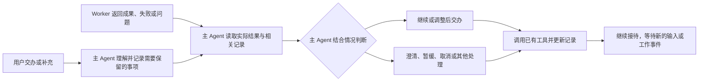

> 本文保留 2026-10-19 的历史需求和候选状态。2026-11-06 收敛方案将待办并入同一工作表，不再单设 Pending 实体或转换流程；动态判断、可靠记录及记录不等于授权的要求保留。当前目标与实施状态见[主 Agent 与 Worker 会话架构](architecture/main-worker-chat-architecture.md)。

# 主 Agent 动态协调与待处理事项：需求方案

更新日期：2026-10-19  
状态：已在隔离候选实现并作合成验证；未采用、未部署，真实主 Agent 验收尚待准确候选审阅。技术建议另见 [技术方案](35-main-agent-pending-items-design.md)。

## 1. 目标与已确认方向

用户需要的是：新需求和后续事项可靠保存，主 Agent 结合 Worker 的实际结果、用户最新意图及其他工作，动态决定继续交办、调整后交办或其他处理。

Homer 提供可靠的记录和操作能力；主 Agent 负责理解、判断和协调。处理策略属于 Agent 的工作方法，不编码成固定流程。

已确认的方向：
- 沿用现有 SQLite 保存待处理事项，避免依赖上下文、压缩摘要或另建 Markdown 状态清单。
- 避免不断向未完成 Worker 追加需求或 steer；主 Agent 在收到结果后综合安排后续工作。
- 不把“必须前轮成功”“必须交付确认”“指定版本通过才释放”写成这项功能的处理条件。
- 保留现有任务工具、执行保护和用户授权边界。记录一个想法不等于授权执行它。

本文件替代此前稿件中固定验收放行、修正版本释放、渠道确认阻塞及自动推进的设计。原审阅是在旧前提上提出的补丁，不作为本方案的实现要求。

## 2. 简明工作原则

拟写入主 Agent 的原则：

> **稳定范围，动态协调。** 执行期间的新需求先持久记录，避免反复打断 Worker；收到工作结果后，主 Agent 结合实际情况和待处理事项决定后续安排，并更新记录。

这是默认工作习惯。必要澄清、明确停止/改向、实质风险和独立并行工作由主 Agent 结合用户要求处理，不用“稳定范围”拒绝合理交流。

候选已在工具接线后向主提示词加入此工作原则，保留原有 YAGNI、知识沉淀及用户编辑。

## 3. 职责边界

| 部分 | 负责 | 不承担 |
| --- | --- | --- |
| 用户 | 提出目标、补充需求和决定，明确授权与偏好 | 手工维护 SQL 或需求文件 |
| 主 Agent | 读取事实、解释需求、判断优先事项和后续安排、调用工具并检查回执 | 用口头承诺代替保存或执行 |
| Worker | 执行明确任务、自检、返回成果、失败或阻塞信息 | 擅自扩大目标或替用户批准 |
| 持久化与工具 | 保存、查询、更新和必要关联，校验真实来源、并发冲突与已有权限 | 判断失败后该返工还是放弃、替 Agent 选择下一轮工作 |

已有验收、正式交付和停止机制继续记录客观事实。它们供主 Agent 判断，不成为新增待处理事项模块的自动调度规则。

## 4. 工作循环

图中的判断和分支由主 Agent 执行，不是一张要在代码中实现的状态转换表。没有新输入或工作事件时，不因存在待处理事项而循环唤醒模型。

## 5. 功能需求

### R1. 可靠记录

主 Agent 能保存需求内容、真实来源、可选关联任务和必要处理说明，取得稳定 ID。来源可追溯；无明确关联时允许独立记录，不强制绑定某个 Worker 或任务版本。

只保存需要后续处理的信息，不把每条聊天、咨询或模型建议自动变成需求。主 Agent 整理的文字是工作记录，不替代原始用户指令。

### R2. 查询与恢复

主 Agent 能按 ID、关联任务及是否仍需关注查询。上下文压缩、进程重启后，记录仍可重新读取。

在相关用户轮、Worker 结果或问题处理轮中，主 Agent 能发现相关待处理事项；不靠它记得“以前存过”。摘要可帮助发现，实际决定前按需读取完整记录和原始来源。大量记录可分页，不永久塞入提示词。

### R3. 灵活更新

主 Agent 能修改整理内容、补充处理说明、关联实际任务，以及标记“仍需关注”或“本项已处理”。取消、暂缓、等待用户、转交任务等可由处理说明表达，不要求预先列举所有业务状态。

“已处理”只表示主 Agent 当前如何管理这项记录，不能伪造任务成功、成果验收或渠道发送。用户的新决定可以要求重新关注或建立补充事项。

### R4. 动态安排

Worker 成功、失败、部分完成、阻塞或被取消后，主 Agent 都能读取事实和记录，选择适合的行动。主 Agent 可以：
- 审阅后继续交办，或把多条相容需求整理成一个完整 prompt；
- 先修正原工作、调整计划、拆成现有任务树中的独立任务；
- 询问用户、暂缓、不做或取消；
- 在适用授权内处理其他独立工作。

以上是行为例子，不是固定分支、顺序或完整枚举。代码不依据前轮结果替主 Agent 决定后续动作，也不强制每次事件都创建任务或关闭记录。

### R5. 复用实际操作

后续执行仍使用 Homer 现有委派、查看、审阅、停止、继续和交付能力。需要交办时由主 Agent 给出完整目标、输入和验收要求，不靠零散追加消息补成任务。

事件轮中若现有工具无法引用真实用户来源，应补足最小的来源传递路径；不能让 Agent 通过伪造“当前用户消息”执行，也不能因待处理事项存在而自动扩大授权。

### R6. 可靠但不过度设计

保存、更新和任务关联必须防止重试重复、并发覆盖以及“未成功却报告完成”。操作不明时能查询原回执，不能盲目重复交办。

记录可关联原任务和后续任务，关联只是事实引用，不是执行依赖。多个事项可关联同一任务；复杂执行分工沿用现有任务系统，不增加需求工作流引擎。

## 6. 示例：相同进展，不同安排

用户补充“以后支持 PDF 导出”，主 Agent 先保存 N1；当前 Worker 继续原工作。

| Worker 的实际情况与用户意图 | 主 Agent 可能的决定 |
| --- | --- |
| 当前成果可靠，用户已经要求后续完成导出 | 审阅成果后，整理完整任务交办导出 |
| 当前实现失败，但根因清楚且值得修复 | 先安排修正；N1 留待后续考虑 |
| 当前方案失败，已不适合继续 | 调整整体方案，重新判断导出需求 |
| 成果已可用，但用户只说“先记下” | 保留记录，不执行 |
| 渠道收据不明，但已获授权的独立工作可继续 | 分别处理发送核对和内部工作，不盲目重发 |
| 用户取消导出需求 | 更新说明及关注状态，不交办 |

主 Agent 根据事实作决定；模块不规定其中任何一种是默认必走路径。

## 7. 完成与验收标准

| 编号 | 场景 | 可观察的要求 |
| --- | --- | --- |
| AC01 | 执行中收下新需求 | 实际保存并返回 ID；单纯记录不修改在飞契约、不 steer、不创建后续执行 |
| AC02 | 压缩、重启及相关事件 | 无需靠旧上下文仍可发现、查询相关记录；待处理记录本身不无限唤醒模型 |
| AC03 | 不同 Worker 结果 | 成功、失败或部分完成都不自动触发派工/关闭，也不由本模块禁止主 Agent 在授权内选择其他处理 |
| AC04 | 主 Agent 选择不同处理 | 工具能支持记录、调整、暂缓、转交和结束关注；存在真实任务时状态仍从任务系统核对 |
| AC05 | 来源与授权 | 用户来源、附加资料及事项关联可核对；仅记录不产生新授权，事件轮不能伪造用户身份 |
| AC06 | 重试、并发及未知结果 | 不重复建项或派工，不覆盖较新记录；失败与未知明确可见、可按原操作核对 |
| AC07 | 任务关联与兼容 | 新增关联不改原任务契约、验收或交付语义；旧历史保持，迁移在副本验证 |
| AC08 | 主 Agent 实际使用 | 主 Agent 确实读取记录并结合实际结果作处理；区别于只在文字中承诺“已记录/已安排” |

先以隔离数据库和可控模型/引擎检验工具契约，再在获准的真实来源中验证主 Agent 的使用。验证关注决定是否有依据、操作是否符合选择，不用测试强制模型对所有失败作同一种决定。

## 8. 本次范围与后续

本次候选实现一张 pending_items 表、三个主 Agent 记录工具、现有 task_delegate 的显式来源续接和原子关联，以及正常模型轮中的有界摘要。仅对隔离合成库验证迁移；未改日常库、未采用、未部署。来源、权限及真实模型验收须在准确候选审阅后组织。与其他维护任务保持独立。

首期不做固定验收放行、版本释放关系、需求自动调度器、独立看板、优先级评分、通用合并/拆分实体、新记忆后端或后台扫描。扩展依靠清楚的数据与工具边界及现有任务系统，不为假想需求增加框架。
