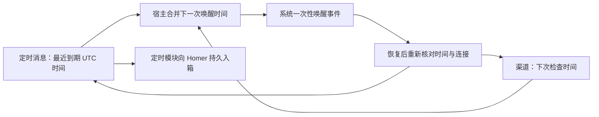

# Homer 桌面防休眠与系统唤醒

2026-11-12 · **已接入源码，尚未安装或发布。** 四项默认行为、桌面设置、执行保护、平台适配和打包接线已实现。离线、原生编译及隔离 Electron 保护检查与真实签名／休眠验收分别记录，不能相互替代。

本方案负责让本机宿主在需要时保持运行或请求系统唤醒。[定时消息模块](scheduled-tasks-architecture.md)负责到点向 Homer 的持久收件箱投递消息，入箱后结束职责；后续协调、审批、执行和交付继续由 Homer 处理。

## 1. 四项行为与范围

| 行为 | 默认值与用户控制 | 生效条件 |
| --- | --- | --- |
| 执行期间保持唤醒 | 自动提供，无开关。 | 主 Agent、Worker 或受管工具确实仍在执行时，防止系统因闲置自动休眠。 |
| Homer 运行期间始终保持唤醒 | 默认关闭，可手动开启。 | 桌面宿主仍在运行，空闲时也保持系统运行；允许正常熄屏。 |
| 定期唤醒检查渠道消息 | 默认开启，可关闭并选择间隔。 | 至少有一个启用且通过离线补收验收的渠道，平台支持系统唤醒且已取得所需授权。 |
| 为定时消息自动唤醒 | 默认开启，可关闭。 | 有未来到期的定时消息，平台支持系统唤醒且已取得所需授权。 |

执行期保护不是阻止用户主动休眠、合盖、关机或系统低电量／过热保护。普通后台工作使用不要求屏幕常亮的保护；需要屏幕的电脑操作按其真实执行窗口请求显示保护，但不自动解锁、不修改合盖行为，也不承诺锁屏后能操作桌面。[Electron 两类保护](https://www.electronjs.org/docs/latest/api/power-save-blocker) · [Apple 强制与闲置睡眠](https://developer.apple.com/library/archive/qa/qa1340/_index.html)

本次承诺范围为 macOS／Windows 桌面宿主。手机和 Web 入口不承担本机电源控制；终端独立宿主仍按[定时消息方案](scheduled-tasks-architecture.md)计算和补投，不因缺少桌面电源能力而禁用定时工具。Linux 系统唤醒、关机后自动开机、注销后自动登录和退出 Homer 后继续接单均不在本方案范围。

设置复用[现有桌面设置及交互规则](../../ui/DESIGN.md)的「电源与唤醒」。检查间隔为 5、15、30、60 分钟，默认 15 分钟；界面说明收件延迟和耗电。首版按原到期时刻请求唤醒，提前量为 0；调整提前量前须完成平台测量及预唤醒交接验收。间隔不是实时收件指标，真实平台与渠道专项仍是发布门槛。

## 2. 职责与唯一时间来源

| 负责方 | 输入与职责 | 不承担 |
| --- | --- | --- |
| 定时消息模块 | 保存消息与时间规则，计算最近到期时间，到点去重入箱；提供最近到期时间及其改变通知。 | 电源 API、平台授权、渠道收件、模型或 Worker 执行。 |
| 渠道模块 | 维护原连接、游标、可信绑定、入站持久化及去重；判断渠道是否符合补收条件，执行醒后重连／补收。 | 保存业务定时消息、注册系统唤醒事件。 |
| 执行宿主 | 从现有执行生命周期派生当前是否需要保护；将上述模块的事实交给桌面电源协调入口。 | 用事项是否未结案代替实际执行，另建一份任务状态。 |
| 桌面电源协调入口 | 合并用户偏好、执行事实、渠道检查时间和定时消息到期时间；持有／释放保护，更新系统下一次唤醒。 | 解释 cron、读取定时消息正文、替 Homer 启动业务或生成第二条定时消息。 |
| 系统组件与受限辅助程序 | 查询能力和授权，创建、查询及精确撤销本实例的唤醒事件。 | 执行模型提供的任意命令、修改全局电源计划或撤销其他应用事件。 |

定时方案已确定采用 Croner 加薄工具封装，规则及投递事实只在 Homer 原数据库维护。Croner 仅校验 cron／时区并计算日期，不注册独立业务回调；一次绝对时间和固定收件间隔直接计算。操作系统只维护最近一次有效唤醒请求及换代清理所需的自有事件身份，不逐规则复制业务周期和消息。[Croner 只计算日期的用法](https://croner.56k.guru/usage/examples/#find-dates)

电源侧只消费绝对时间与改变通知，不依赖具体工具名、存储格式或日期库，不保留另一份影子规则。电源方案的其余平台能力与验收状态保持本篇所列范围。

**与定时模块的最小衔接是“读取最近可投递安排的 UTC 到期时间，及其改变通知”。** 只考虑已启用、无永久规则错误且到期时间有效的安排，无候选则为空。创建、修改、取消、隔离、投递推进、启动恢复后，由宿主重读当前事实；通知不携带正文或执行权限，允许合并和重复。系统 `resume` 事件只促使现有模块复查，既不成为消息入箱成功的证明，也不单独制造定时业务消息。

源码接口为 `Homer.nextScheduledMessageAt()`、`onScheduleChanged(listener)` 和 `recheckScheduledMessages()`。执行事实由 `desktopPowerFacts()` 提供；桌面绑定 `bindDesktopPowerProtection()`，在真实执行及答复恢复前等待有界保护确认。进程间只传执行／显示布尔值、未来 UTC 时刻和渠道类型，沿现有私有宿主通道传递。

流式状态先比较轻量事实，不变时不重复计算日期；安排改变通知、既有 5 秒校准、恢复及执行前保护仍读取最新日期。发送或读取失败允许下次通知重试，不缓存业务规则。

电源功能不可用、用户拒绝授权或关闭自动唤醒，都不阻止创建安排、电脑清醒时到点投递或恢复后的补投。桌面存储就绪即幂等启动原检查器，未登录模型时仍可入箱，不启动模型消费。软件到期检查与系统唤醒有不同用途，二者从同一份规则派生；消息仍只有原定时模块一条投递路径。[Electron 电源通知](https://www.electronjs.org/docs/latest/api/power-monitor)

## 3. 保持唤醒与下一次唤醒

### 3.1 当前执行保护

- 沿用主 Agent、Worker 和受管工具的真实生命周期，在执行启动前申请保护，最后一项执行停止确认后释放；多个并发执行不能互相提前释放。
- 主 Agent 一次排队、未结案事项、普通渠道长轮询、心跳、未来定时规则本身不构成执行期保护。仅等待用户决定且无其他执行时，可以恢复系统闲置休眠。
- 仍有后台工具运行或停止尚未确认时，不能只因模型轮次结束就认为执行结束。由现有执行 owner 汇总事实，电源层不检查 Task／Run 表或解析消息正文。
- 始终保持唤醒和执行期保护独立：关闭前者不能解除后者。窗口隐藏不等于执行结束，页面刷新也不拥有保护生命周期。
- 保护申请失败只反馈能力状态，不使既有业务操作失败，也不静默把任务标为停止。停止与退出继续服从原确认流程。

### 3.2 共同的下一次时刻

1. 有合格渠道且周期检查开启时，维护一个下次检查时刻。无合格渠道时不注册空转唤醒，也不为一次空检查调用模型。
2. 按定时消息唤醒开启时，从定时模块读取最近未来到期时间；可为网络及宿主恢复预留准备时间。提前量由平台专项测量确定，预唤醒不能使消息在其原定时间前投递。
3. 从两类有效时间中取最近一次，合并同一检查窗口内的请求；两类开关分别生效，关闭周期收件不取消定时消息所需的唤醒。
4. 宿主串行更新系统事件：先按实例身份、时刻读回确认新事件，再精确撤销旧事件；计划或偏好在更新期间变化则复读重排。电源调用不能阻塞或回滚安排的持久变更。
5. 到期、系统唤醒、时间／时区变化、授权或渠道变化后，从当前事实重算。系统旧事件已过去时不立即反复重排过去时刻；平台失败采用有界重试，不轮询模型。

替换期间允许新旧自有事件短暂并存，消息仍只入箱一次。新注册失败时保留仍符合当前启用需求的有效旧事件，并显示新时刻未获保障；回执丢失先查询对账，不盲目重建。主动关闭或退出优先清理已取消需求，包括迟到创建的事件，迟到结果不能恢复已关闭偏好。

旧事件撤销失败占住两条原生记录时，保留一条有效备援、清理多余残留，再申请新事件。临时能力故障按有界间隔只读重查，不重复授权。Windows 先精确清理旧 session，仅复用当前 guardian 仍存活的事件；更替 guardian 须确认旧进程已退出。权限丢失后关闭功能，无法确认的旧事件保持「清理未确认」，能力恢复后再清理。

相同执行事实只更新保护，不重复查询原生计划；已确认目标保留 60 秒周期复核，原生调用失败按 30 秒退避，即使关闭最后一个需求仍重试清理。主动刷新、授权和恢复会立即对账。旧事件仅在其所属需求仍启用时可作备援；启动或迟到读回的事件若准确匹配当前目标，可直接认领，避免先删后建。

执行期或持续待命的防闲置保护不替代系统唤醒计划：有已启用的未来需求就保留并更新最近一次必要事件，只去重同一实例、同一时刻的重复注册。用户手动休眠可能绕过正常释放流程，不能因正在持锁而撤销未来事件；正常释放前仍复查计划。系统事件的迟到、重复或漏触发不推进投递游标，持久事实及补投仍以定时模块为准。

### 3.3 醒来后收件

系统唤醒后先恢复宿主及网络，渠道 owner 沿原协议重连，保持原绑定、游标和去重身份。准备阶段可以申请防闲置睡眠保护，但必须有有界等待；连接失败、空收件或永久长轮询不能无限持锁。已有消息进入原持久入口，有新执行则由执行期保护接续；纯渠道检查没有新执行时可释放，关联定时消息则按下一段覆盖到期检查。释放后由系统按原设置决定何时再睡眠，不主动强制电脑休眠。

关联定时消息的预唤醒保护须覆盖原定时刻，并至少完成当次到期检查，不能仅因网络提前恢复就释放。例如 08:55 预唤醒、08:56 联网、09:00 到期，应保持至 09:00 的检查结束，再按实际执行事实交接或释放；不提前入箱，也不等待 Homer 消费或 Worker 完成。准备提前量须有上界；检查失败不视为投递成功，按原有界退避处理，不以失败为由无限持锁。等待期间安排被取消或改期时，立即按当前需求重排，解除旧时刻不再需要的保护。

下一轮周期检查从本次检查结束后的选定间隔计算；网络失败也结束本次尝试并安排未来检查，不逐个补齐睡眠期间的空检查。电脑本来清醒时继续沿原渠道接收，不人为延迟到周期检查时刻。检查间隔说明应包含等待下一轮及重连准备时间，不显示为实时接收承诺。

清醒时的周期检查保留健康连接及群聊上下文；真实系统恢复才强制重建合格渠道连接。资格按账号判断，同渠道其他账号合格不能使需重新授权的账号参与重连。渠道 owner 有界等待重连状态，准备保护覆盖下一次系统事件的对账；检查进行中不为已过的轮询时刻空转。系统恢复与在途普通检查重叠时，合并补一次恢复检查。

## 4. 平台组件与授权

| 平台 | 推荐复用 | 仍需 Homer 完成的接线 |
| --- | --- | --- |
| macOS | Electron `powerSaveBlocker`；Apple `SMAppService` 管理受限辅助程序；IOKit／`pmset schedule` 创建和撤销具名一次性 wake。 | 用户授权、代码签名、可信 IPC、本实例事件身份、更新与清理。不能用只有 `launchd StartCalendarInterval` 的封装冒充机器唤醒。 |
| Windows | Electron `powerSaveBlocker`；系统 Task Scheduler，通过自带 `ScheduledTasks` 模块注册带 `WakeToRun` 的任务。 | 普通用户身份、固定任务动作及本实例任务名，查询／更新／删除与错误反馈；无需为此新增 Node 原生扩展或 SYSTEM 服务。 |

[Apple 授权与后台组件](https://developer.apple.com/documentation/servicemanagement/smappservice) · [Apple 唤醒与持久系统队列](https://developer.apple.com/documentation/iokit/1557076-iopmschedulepowerevent) · [精确撤销](https://developer.apple.com/documentation/iokit/1557116-iopmcancelscheduledpowerevent) · [Windows ScheduledTasks](https://learn.microsoft.com/en-us/powershell/module/scheduledtasks/new-scheduledtasksettingsset?view=windowsserver2025-ps)

macOS 创建／撤销系统电源事件需要 root。首次确有需要注册唤醒时引导系统授权；拒绝后不在每个周期重新弹授权，用户可在设置中主动重试。辅助程序仅支持查询、设置时间和撤销本实例事件，验证调用方签名及实例归属，使用固定系统 API 或参数数组调用，不接收任意 shell、消息正文、凭据或模型命令。运行控制不得附带全局 `disablesleep`、合盖禁睡或 `cancelall`。

可选唤醒适配器构造失败时，显示唤醒不可用，保留偏好、普通启动和执行保护，不放宽平台路径校验。Mac 更新仍须确认原生清理，不能因降级而跳过旧 helper 的处理。

Windows 优先采用当前已登录用户的 Interactive／Limited 身份，不保存用户密码、不默认申请 SYSTEM 或修改电源策略。任务动作只调用受信宿主的固定恢复检查入口，不能直接执行定时消息正文；该入口在日常宿主已退出时不能自行启动模型、复活旧工作或绕过单实例边界。任务成功与否不等于消息已持久入箱。[任务身份](https://learn.microsoft.com/en-us/windows/win32/taskschd/security-contexts-for-running-tasks)

Windows 的唤醒计时器可能被电源／企业策略禁用，电池条件也可能阻止运行。Modern Standby 下系统短暂活动不代表 Electron 桌面程序已经恢复执行，必须按支持机型验证。系统注册成功仅表示请求被接受，不能写为机器必定准时醒来。[唤醒策略](https://learn.microsoft.com/en-us/windows-hardware/customize/power-settings/sleep-settings-automatically-wake-for-tasks) · [Modern Standby](https://learn.microsoft.com/en-us/windows-hardware/design/device-experiences/integrating-apps-with-modern-standby)

### 复用取舍

| 候选 | 取舍 |
| --- | --- |
| [goguma](https://github.com/junnam586/goguma)、[LidAwake](https://github.com/Vladimir-Podgornyi/LidAwake) | MIT 开源，有真实唤醒、辅助程序和自有事件管理代码，可参考或裁剪。二者是独立应用，不能整体带入任务发现、其他 Agent hook、合盖禁睡或退出后继续服务等额外行为；也不代表 Homer 的签名、授权及包内生命周期已验收。 |
| [Microsoft 维护的 sudo-prompt](https://github.com/microsoft/vscode-sudo-prompt) | 能复用一次性提权交互，不能作为周期重排时反复询问密码的执行层，也不会替 Homer 管理持久 wake 事件。优先系统受限辅助程序。 |
| [DssW Power Manager](https://www.dssw.co.uk/powermanager/) | 有成熟独立调度器及命令行接口，但增加外部产品与分发授权依赖，尚未核实可作为 Homer 内嵌组件分发，不列默认依赖。 |

采用系统组件仍需平台接线，不自研 RTC 或替换操作系统调度。检索尚未找到维护充分、可直接包办 Electron 双平台授权、硬件唤醒和卸载清理的通用 npm 库；普通 cron、Wake-on-LAN 和防休眠库不能据名称认定支持本机未来唤醒。

## 5. 渠道补收证据与生效门槛

周期收件的前提是：渠道在无连接期间产生的新消息，可以在下一次连接时取回。自动重连、已投递未 ACK 重试、客户端历史同步及发送窗口均不能单独证明这个前提。能力判断由渠道 owner 维护，电源模块不复制协议状态。

| 渠道 | 2026-11-12 可得证据 | 本方案状态 |
| --- | --- | --- |
| Telegram Bot API | 官方明确未接收更新服务端最多保留 24 小时，`getUpdates` 可继续接收未确认更新；适配器先同步交给持久入口，再推进 offset。 | 已声明 24 小时协议补收能力，断连边界合成检查通过；真实自动唤醒收件待验。保留窗口包括连续漏唤醒与断网。 |
| 腾讯 ClawBot iLink 微信 | 开发者曾在约 2 分钟及 16 分钟未持续轮询后取回期间新消息；WXLink 作者说明应用关闭期间的消息可在下次连接取回，但无保留期限保证。历史另有已返回消息在崩溃后不能由旧 cursor 重放的报告。 | 优先专项验证的有限补收候选。不能仅凭 cursor 或短时个案承诺所有间隔、休眠边界均不漏。 |
| 钉钉 Stream 机器人 | 有断连和部分入站缺失的开发者报告；官方协议 FAQ 与当前 SDK 对未 ACK 重投的描述有差异，均未明确保证完全断线期间新消息的保留范围。 | 补收未证实，暂不列入可承诺的周期收件名单；保留正常在线接收。 |
| 手机 WebRTC | 当前为直连／中继通信，主端必须运行且联网，没有对应的云端离线消息箱。 | 不套用渠道补收资格，不因周期唤醒宣称休眠期间的手机请求已受理。 |

来源与局限：

- [Telegram 更新保留](https://core.telegram.org/bots/api#getting-updates)、[确认规则](https://core.telegram.org/bots/api#getupdates)；当前接线见 [Telegram 适配器](../../src/telegram-channel.ts)。
- [Tencent #320](https://github.com/Tencent/openclaw-weixin/issues/320)（2026-09-19，插件 2.4.8）及其 [2.4.9 补测](https://github.com/Tencent/openclaw-weixin/issues/320#issuecomment-6018920825)（2026-10-06）是延迟续拉的一手记录，进程存活，未替代完整睡眠实验。[WXLink FAQ](https://github.com/nextcaicai/WXLink/blob/8feac20d9dc04dc746cd441cfd34888d4524a158/README.md#faq)（0.2.5 文档，2026-11-07）是作者经验说明，不是腾讯保留承诺。
- [Tencent #164](https://github.com/Tencent/openclaw-weixin/issues/164)（2026-05-16）报告已取回消息在停机后无法由旧游标重放，未核实当前后端是否相同。当前 [微信适配器](../../src/wechat-channel.ts)也有在途长轮询，因此“返回后、落库前遇到睡眠可能丢失”是需要实测的推论。
- [钉钉官方 SDK #65](https://github.com/open-dingtalk/dingtalk-stream-sdk-python/issues/65)（2025-12-04）包含重连窗口丢失的推断，作者承认难稳定复现；[插件 #104](https://github.com/soimy/openclaw-channel-dingtalk/issues/104)（2026-02-12）及[维护者复现说明](https://github.com/soimy/dingtalk-stream-sdk-nodejs/blob/main/docs/inbound-msg-missing-repro.zh-CN.md)涉及部分入站缺失，均非受控的全离线补收验证。[官方协议 FAQ](https://open-dingtalk.github.io/developerpedia/docs/learn/stream/protocol/)与[当前 SDK SPEC](https://github.com/DingTalk-Real-AI/dingtalk-channel-sdk-python/blob/main/SPEC.zh-CN.md)的差异不能靠选择其中一份资料抹平。
- [多渠道设计](multi-channel-architecture.md)与[手机连接设计](mobile-device-pairing-architecture.md)继续拥有绑定、消息受理及恢复语义；电源功能不新增云端收件箱，也不修改其持久化协议。

源码仅将已启动渠道 owner 中已绑定、具备明确离线保留窗口且未要求重新登录的适配器列为协议候选，目前只有 Telegram；窗口须覆盖最大提供间隔与恢复准备时间。安装版发布前仍须完成对应版本、间隔及睡眠边界专项，合成检查不能替代实网保留承诺或真实唤醒证据。默认开启的偏好在无候选渠道时保持保存，界面说明“暂无支持定期补收的渠道”，不虚构已经收件，也不反复唤醒空机器。

## 6. 偏好、授权与生命周期

设置需要区分用户意愿与实际结果：已保存偏好，可能处于无安排、无合格渠道、待授权、平台受限、系统事件已确认或更新失败。状态从现有 owner 及系统读回结果派生；持久保存用户偏好和清理自有系统事件所必需的身份，不复制任务、消息或渠道游标。

- 首次需要授权时说明用途；拒绝不影响普通任务和电脑醒着时收件。撤销授权后立即标为不可用，不静默反复提权；残留事件不能确认清除时如实说明。
- 首次实际需求在受信主页面出现时提供一次授权引导；「稍后」记入原私有 profile，后续由设置主动重试。更新前清理已授权的 macOS 辅助程序，重启后重新核对授权，保留三个偏好；暂存更新后的“退出”同样须通过清理确认，异步完成后复核原窗口，失败保留窗口。原生注销只作用于自有事件，并拒绝影响其他活动实例。[Apple Service Management](https://developer.apple.com/documentation/servicemanagement/smappservice)
- 关闭某项先重算其他仍启用需求，再精确撤销或替换自有事件。正常退出先停止新增计划、撤销自有事件及确认保护释放；清理失败沿原退出流程明确报告残留，不把失败写成已停用。后端退出后，前端空壳不能继续替它待命。
- 意外退出时，由辅助程序在可信宿主连接断开／进程退出后撤销自有计划；辅助程序或系统也异常时可能遗留一次唤醒。下一次启动必须对账，不能据残留系统任务重发旧业务或复活模型轮。
- 用户资料／实例拥有独立、非敏感的系统任务身份，更新和卸载只处理自己创建的事件。撤销须先完成再卸载授权组件；不清理其他应用的计划，不把用户电源配置当作可恢复备份覆盖。
- 现有 macOS 点击窗口关闭按钮会隐藏窗口，Windows 点击该按钮会进入原退出确认流程，确认退出后停止待命；菜单“关闭窗口”也可直接隐藏窗口，见 [Electron 主入口](../../packaging/electron/main.mjs)。界面须说明“运行期间”以宿主存活为准，取消退出或隐藏窗口不停止待命。本方案不顺带增加托盘或改变关窗语义；若以后统一后台关窗体验，另行明确产品范围。

显示可包含选定检查间隔、有效渠道、当前保护原因和已确认的下次系统唤醒时间；电源诊断仅记阶段、错误码及非敏感时间，排除消息、账号、凭据、完整 URL、命令参数和系统任务 XML 正文。能力状态不以 `isStarted()` 或注册成功代替真实机器已唤醒、联网及消息已受理的证据。

## 7. 实施归属与验证

| 接线位置 | 未来改动范围 |
| --- | --- |
| [执行宿主](../../src/service.ts)、[开发宿主边界](../../src/dev-host.ts) | 从原生命周期输出最小执行事实及恢复检查通知；不暴露对话正文，不把全部 Worker 数量当作活动执行数。 |
| [桌面运行入口](../../scripts/desktop-runtime.mjs)、[Electron 主进程](../../packaging/electron/main.mjs) | 传递有限事实、保存偏好、调用系统组件、唯一电源 owner 和退出清理；沿原 IPC 授权边界。 |
| [preload](../../packaging/electron/preload.cjs)、[桌面 UI](../../ui/DESIGN.md) | 只提供必要设置／状态桥接和本机授权入口，不给渲染器任意系统命令能力。 |
| 定时消息模块与渠道 owner | 分别提供最近到期时间及合格渠道事实，恢复时沿原投递／收件路径检查；不引入第二消息队列。 |
| macOS／Windows 打包 | 纳入受信辅助程序、签名、更新及卸载步骤；默认不新增第三方守护应用或改变系统策略。 |

完成条件是四项默认值、模块职责和失败状态在源码、设置与平台运行中一致。先做不访问生产的定向协议检查，再按实际承诺的机型和渠道选择专项；普通 `npm test` 不自动获得真实电源、引擎或消息外发权限。

| 验证层级 | 需要覆盖的行为 |
| --- | --- |
| 离线保护契约 | 主 Agent／Worker／在途工具并发、等待用户、停止确认、始终保持开关组合、申请失败、页面刷新和后端退出；持锁期间仍保留必要未来唤醒，手动休眠不依赖正常释放回调。 |
| 离线计划契约 | 两类时间取最近、无需求不注册、迟到回执、改期／取消竞态、过去时刻不空转；新注册失败保留有效旧事件，注册回执丢失可查询对账，主动关闭清理自有事件，均不阻断业务规则。 |
| 最小衔接 | 最近到期时间变化可合并重读；重复 `resume` 不重复入箱；关闭唤醒不关闭软件投递；预唤醒后先联网仍保护至原到期检查结束，再交接或释放，不提前投递、不等待业务完成；取消／改期可解除旧准备保护。 |
| 授权与安装专项 | macOS 同意／拒绝／撤销／升级签名；Windows 普通用户身份及策略受限；伪造 IPC 拒绝，自有事件精确查询和清理。 |
| 真实电源专项 | macOS 实际支持架构及 Windows 实际支持的 S0／S3／S4 组合，接电与电池、手动睡眠、合盖和锁屏分别记录结果；系统醒来、宿主恢复和桌面可操作分别判定。 |
| 渠道补收专项 | 独立账号和 runtime，确认连接已断后于休眠早／中／晚发唯一标记消息，自动唤醒后各入原绑定一次；再覆盖在途长轮询恰逢休眠、断网、连续漏唤醒和重启，区分未送达与已受理未知。 |
| 退出与残留专项 | 正常关闭、崩溃、辅助程序异常及升级／卸载后，无越权清理或任务复活；不能清除的残留有明确证据与恢复路径。 |
| 界面专项 | 默认值、间隔选择、待授权／不可用／已确认状态一致，键盘与窄窗可用；不会将“已保存”显示成“已唤醒”。 |

## 8. 当前实施与验证

已实现：便携电源协调器、Main／Worker／CUA 真实执行保护及 1.5 秒前置确认、原私有 IPC、profile 原子偏好保存、桌面设置、macOS XPC／SMAppService／IOKit 组件、Windows 普通用户 Task Scheduler 与断连清理进程，以及打包和资源清单。正常收件与定时投递仍由原 owner 处理。

复审已修复原生空队列、恢复准备态消费、管理态定时检查、账号重连及适配器降级问题。提交前另补齐撤销失败退避、关闭来源及迟到事件清理、精确目标认领、Mac 暂存更新退出门禁和未启动渠道资格；保留有效备援、逐次认证和真实安全断言。性能回归确认相同状态不重算日期、不重复原生查询，必要刷新及完整性检查仍生效；未新增调度器或依赖。

2026-11-12 最终 103 文件隔离候选完整默认回归 **2352/2352 通过，零失败／取消／跳过，退出码 0**，父／子 Node 均为 22.22.0，985 个源码／测试输入在主目录和候选中前后指纹一致。两端类型检查、后台编译、联合定向 98 项、Windows 离线 10 项及归档 5 项通过。此前 Mac 原生／打包、隔离 Electron 保护申请与释放、39 项实际设置检查及 Vite 构建证据保留，本轮未重复可选专项。命令、指纹及测试夹具修复见[测试说明](../testing.md#桌面防休眠与系统唤醒)。

尚未验证：Developer ID 安装后的授权／拒绝／撤销／升级卸载、Intel 原生编译、Windows PowerShell 专项与签名包、真实 S0／S3／S4／macOS 睡眠、耗电及实网渠道补收。Windows 专项在此 Mac 不满足平台前置，未执行主体；本轮没有注册真实唤醒事件、改变系统权限或电源策略，也未操作日常 runtime、安装或发布。
