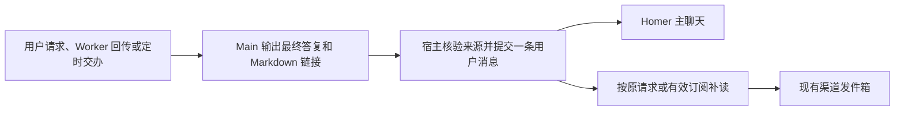

# 用 Codex 最终答复统一交付

2026-11-18 · 直办、Worker 回传和定时轮沿同一提交规则交付最终答复。获准的 Markdown 文件链接绑定已保存附件版本，供桌面和手机打开。已订阅渠道复用原补读和发件箱接收 Worker 和定时结果。现行契约见[主 Agent 与 Worker 会话架构](main-worker-chat-architecture.md#消息与附件统一交付)、[定时任务架构](scheduled-tasks-architecture.md#6-homer-如何收到消息)、[Hook 系统设计](hook-system-design.md)及[多渠道接入架构](multi-channel-architecture.md)。

## 主聊天怎样得到答复

build 304 中，宿主能从 Codex 提取后台 `final_answer`，Worker 回传的处理入口却忽略了这段返回值。Main 省略显式发送时，宿主就可能结束本轮并留下空的聊天记录。第一阶段在原收尾入口把有明确阶段证据的最终正文写进现有记录。成功的后台答复取得主聊天用户可见标记，供桌面预览验证该答复中的确切链接。 [处理入口](../../src/service.ts) · [Codex App Server 消息项目](https://learn.chatgpt.com/docs/app-server#items)

- Main 照常生成原生 `agentMessage`。宿主在确认本轮正常结束后，取该轮明确标记为 `final_answer` 的正文。用户直办沿原 `requestId` 和 `replyId`。后台普通 Worker 回传沿宿主确认的原回传、事项和版本，使用现有主聊天收尾位置。定时交办沿原定时消息身份及授权办理。
- 宿主在允许向用户报告的轮次里写入正文。对 Worker 回传核验同一实例的 Main、原回传和所绑定的原生轮次、当前事项版本与权限。源已失效时按已有状态处理。Worker 原文、工具输出和过程说明留在原记录。纯内部协调允许空答，审批、提问和归档复核沿各自已有入口。缺少明确阶段证据的后台聚合文本留在内部，直办兼容行为沿现有契约。
- 提交正文、选定文件关系和收尾证据在同一宿主事务内完成。直办复用原回复身份，后台使用与原输入绑定的稳定提交身份，并记录实际 Main 轮次。重复收尾或恢复读取原提交，一条答复在主聊天只出现一次。已发布的旧工具回执同样作为去重依据。文件部分失败时，保留可独立理解的文字，并说明缺失的文件。整条交付无法确认时，沿现有失败或待核实状态提示。

## 文件和补丁使用现有入口

模型侧只写最终答复和普通 Markdown 链接。Main 可以引用引发本轮答复的 Worker 回传中可核实的文件，也可以引用本轮自己生成的文件。宿主以授权的具体来源和版本为依据，从 Main 最终答复选中的链接解析文件。Worker 回传可能同时包含许多供核查的源码引用，只引用并展示本次需要的内容。 [Worker 回传结构](../../src/recursive-tasks.ts) · [现有附件暂存和消息提交](../../src/service.ts)

| 需要展示的内容 | 复用方式 |
| --- | --- |
| 网页或资料引用 | 沿用正文中的 Markdown 链接。 |
| 桌面、手机打开已交付文件 | 点击同一个 Markdown 链接，读取这条消息下的确切附件版本。未形成快照的旧本地链接沿桌面原有路径校验。 |
| 报告、媒体或 `.patch` 等需在手机或外部渠道交付的文件 | 由宿主核对本轮选中的确切文件及交付授权，复用 `assetId/revision` 快照和消息附件关系。已有快照直接引用，需传输的获准本地文件在提交前固定版本。渠道适配器读取同一版本，按现有能力发送文件，外送正文保留描述且不携带本地绝对路径。缺少可信文件或交付授权时，提供已确认正文及相应缺口提示。 |
| 解释实际发生的源码改动 | 沿[文件改动摘要卡方案](../2026-11-03-patch-preview-integration.md#最简接入方案与验收)，只展示归属明确的原生 `fileChange` 项，点击复用 DiffViewer。明确交付的 `.patch` 文件仍走上面的文件链接和预览。 |

保留现有 `conversation_attachments` 是为了准确版本、读取授权和文件传输。附件清单由宿主从已核实的消息引用得出，Main 无需为发送再填一份清单。补丁预览和网页链接沿已有实现，模型侧无需新增输出 JSON、成果编号或交付工具。

## 外部渠道为什么还要补读

外部渠道沿现有补读与发件箱办理，使用原恢复规则及重启门禁。补读在复核正文之前跳过已有发件项的消息。用持久待发项替代历史分页属于后续事项。 [渠道补读简化评估](channel-outbox-simplification-design.md)

**后台补读是渠道插件从 Homer 的持久消息记录里补查应该发送的消息。** 插件启动时会核对请求和有效订阅。消息提交后的 `message.committed` 会唤醒核对，状态变化与失败后的同步也可以触发检查。插件按请求或已获准事项分页读取已提交的消息，按 `messageId` 写入现有发件箱，再交给渠道适配器。 [现行补读与外送](multi-channel-architecture.md#补读与外送) · [渠道实现](../../src/channel-plugin.ts)

例如，用户从聊天应用交办，Homer 已保存结果，却在插件入队前退出。重启后的补读会查到那条原消息，再发回原入口。用户明确订阅长任务时，结果可以在发起请求之后很久才产生，插件也能把订阅生效之后提交的结果找出来。已经入队或已发送的消息由原发件项去重。如果远端可能已经收到、回执却没有落库，原发件项保留为待核实，避免重复发送。补读能找回已提交的消息。截图里的问题发生在提交之前，要由 Main 轮次收尾修正。

## 退役工具后，补读怎样继续工作

**合格的最终答复凭宿主确认回执进入同一受控读取。** 宿主复用现有消息和操作回执，绑定原输入、原生轮次、事项与版本及实际提交的 `messageId`。提交后发同一个 Hook，插件按原绑定或订阅和 `messageId` 去重并发送。外送正文里的本地文件链接换为标签，实际文件作为同条消息的固定版本附件发送。原直办输入终态和旧发送回执仍可补读。 [现行受控读取](../../src/service.ts) · [渠道授权和恢复](multi-channel-architecture.md#4-事务恢复与验收)

| 路由或恢复情形 | 迁移后的处理 |
| --- | --- |
| 外部渠道发起的即时请求 | 以原 `requestId` 回送原获准绑定。即使回复关联事项，也只走原请求返回。 |
| 后台 Worker 结果或定时结果 | 主聊天可见。Worker 结果绑定原事项和实际版本。定时安排在创建或更新时明确授权选择 `taskId`，宿主记录实际版本，并在外送前复核原交办、事项版本与有效订阅。缺少有效订阅的结果留在 Homer。 |
| 新订阅、换绑、撤销 | 保留现有提交顺序和订阅基线。订阅前已提交的消息排除，换绑前已入队的消息保留原归属。发送前重新校验原订阅、绑定、群或话题权限及文件可读性，撤销后停止对应投递。 |
| 提交后漏掉唤醒，或插件离线 | 后续补读找回同一个已提交 `messageId`。已有的发件项和回执继续有效。 |
| 文件或渠道发送失败 | 本机提交、附件可读和远端送达各有状态。明确失败与待核实分别呈现。分片发送沿原 `messageId` 和步骤回执核对，已经送达的部分保留，未知发送不自动重投。 |
| 旧消息与旧 Codex 会话 | 旧确认回执继续可读，消息及附件保留原 ID。新线程省去旧工具。固定版本 Codex 恢复旧线程时保留原声明，宿主拒绝该调用并提示使用最终答复，继续原线程。 |

### 保留旧发送工具兼容及其开销

保留兼容以便续用原 Codex 会话、读取旧聊天和附件，并沿原发送回执补漏和去重。恢复旧会话时，Homer 按原工具表续接。若旧会话调用 `send_user_message`，宿主拒绝执行并提示使用最终答复。新建 Main 会话只向模型声明当前工具表，其中已移除 `send_user_message`。正常交付直接保存 `final_answer`。[工具声明与旧表匹配](../../src/recursive-tools.ts) · [旧会话与附件回归](../../tests/main-chat-response-rules.test.ts)

在提交 `3eeacf1f` 上用隔离合成数据测量本地开销。Node 22.22.0、SQLite 3.50.4 下，三套旧工具表的序列化和哈希合计中位数约 **0.04 ms**。启动时，在原有附件暂存恢复查询中多检查旧发送记录。操作表有 1 万条和 10 万条合成记录时，配对测得的额外耗时中位数分别约 **0.06 ms** 和 **0.52 ms**。每次启动执行一次该查询。测量仅覆盖序列化、哈希和本地查询，范围不含整机启动或模型耗时。28 项定向测试通过。保留现有实现和历史数据。

## 实施顺序与退役验收

1. 普通 Worker 回传轮的最终正文和桌面 Markdown 链接已经接入原主聊天收尾。相关隔离回归核对首次显示、重启后恰好一条、失效授权、显式发送成功与失败，以及缺少阶段证据的内部输出。
2. 跨端文件和已绑定事项的定时外送已接入。隔离桌面与移动 WebRTC 可点同一 Markdown 链接，模拟渠道覆盖补读、换绑、授权撤销和重启去重。真实渠道验收另行记录。
3. Telegram 实网验收通过后，已移除 `send_user_message` 的发送实现及新线程声明，并同步 Main 和会员媒体交付指引。主动通知也在当前 Main 轮结束时提交。旧会话保持原线程身份，已确认的发送继续按原消息 ID 补读和去重。

### 2026-11-18 隔离验收

- 用独立数据目录、工作区与 `CODEX_HOME`，以安装包的原生 Codex `0.171.0-alpha.7` 跑 Main 交办、Worker 实际写文件并回传、Main 输出最终答复。受控回环模型响应固定为零次 `send_user_message`。build 304 能生成后台最终答复，主聊天显示 0 条。源码候选自动显示 1 条。用 Chromium 运行候选桌面界面，点击 Markdown 链接经正式预览接口返回 HTTP 200，界面显示 Worker 文件的标题和正文。关闭并重新启动隔离宿主后，答复仍是同一条，链接仍能打开，模型调用数保持不变。
- 模拟渠道在停用提交监听时生成结果，重启后按原订阅补发同一消息 ID，重复核对和再次重启均只发送一次。订阅生效之前的答复、内部过程及带本地文件链接的答复没有外送。
- 主流程、渠道、预览及提交 Hook 的定向离线回归 70/70 通过，服务源码类型检查通过。完整类型检查仍报原 `HEAD` 同样存在的 `web-history-maintenance-contract.test.ts` 夹具类型错误。
- 回环专项的桌面界面由隔离 Chromium 运行。配对手机与真实渠道待验。日常 Homer 的实例及数据未参与验收。

### 2026-11-18 真实模型补验

- 经明确授权，在独立 Homer 和 `CODEX_HOME` 中用原生 Codex `0.171.0-alpha.7` 接真实 ChatGPT `gpt-6.1-terra`。只派一个 Worker，三次业务轮正常完成。Worker 实际写出 Markdown，Main 的后台 `final_answer` 自动保存为一条主聊天消息，正文与原生最终答复一致。发送工具调用和操作回执均为零。
- 首次界面检查的选择器把测试请求里的示例链接也匹配进来。沿原试验保存的会话，改按最终答复的消息 ID 定位。点击链接经正式预览接口返回 HTTP 200，界面显示 Worker 文件标题和验收文字。重启后消息 ID 和正文一致，仍只显示一条，链接再次打开。补验没有新模型轮或 Worker 执行。
- 通过后继续迁移定时轮普通答复。110 项定向离线回归及服务源码类型检查通过，覆盖主聊天自动保存、原来源撤销、显式发送后去重、重启不重跑，以及定时答复保持独立于原请求的渠道路由。

### 2026-11-18 跨端文件与定时外送

- 隔离 Homer 和本地信令服务通过桌面 Chromium、手机 Web 界面和实际 WebRTC 配对。Worker 回传链接提交后覆盖原文件，桌面与手机仍打开交付时的同一版本。重启后两端仍能打开同一消息的链接。
- 模拟渠道验证已绑定事项的定时结果重启后补发一次，撤销原交办授权后停止外送。带文件的 Worker 结果通过现有发件箱发送正文和固定版本附件，外送正文保留链接标签。
- 源码和界面类型检查通过，154 项相关离线回归通过。补充附件缺失提示后，重新通过 62 项定向回归。
- 隔离 Homer 使用合成定时轮生成一条结论和一个测试补丁。暂停提交监听后保存结果，重启用现有补读和发件箱向已核实的真实 Telegram 测试私聊发送。Telegram 分别确认一条文字和一份补丁，下载补丁与交付快照字节一致。随后再重启并补读两次，外送请求增量为零。正式手机安装包以及其他真实渠道另行验收。
- 退役后的隔离测试覆盖历史消息和附件读取、提交回滚、授权撤销及重启去重。桌面 Electron 的定向预览确认最终答复只出现一个文件链接，点击后打开交付快照。无原生窗口截图权限，本次只核对渲染与交互。隔离开发版手动切换的交付检查也核对了原会话、正文和补丁快照，完整的多次切换专项另有超时。
