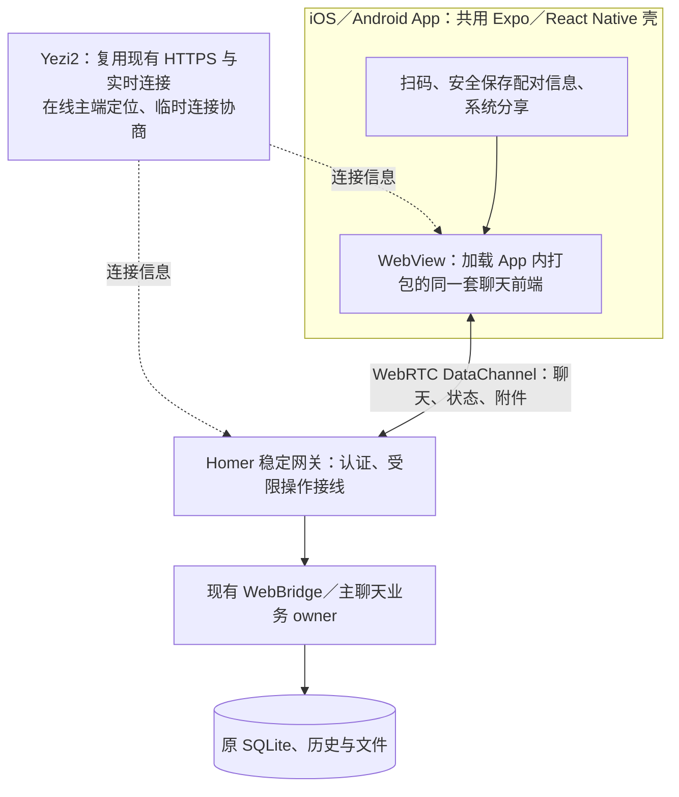

# iOS／Android App + WebView：设备配对与连接方案

更新日期：2026-11-10。

## 现行连接方案

手机扫码后由 Homer 主端确认绑定。主端与移动端通过 WebRTC 连接，优先直连，跨网络需要时可申请 TURN 中继。Yezi2 协助两端交换连接信息并按 Homer 账号资格签发中继凭据。配对后的聊天和附件沿同一主聊天交付，主端可停用或删除单台设备的绑定。

启用中继使用已保存的 Homer 账号。账号连接和应用重启与模型来源选择分开。具体接线及验证边界见[Homer 登录与 TURN](#chatgpt-等模型来源下的-homer-登录与-turn2026-11-05)。下方仅直连的 MVP 段落记录早期方案。

状态：用户已选择采用 WebRTC，服务器只帮助两端对接，手机与 Homer 主端直接通信。iPhone／Android 真机的公网扫码、真实模型聊天和原生附件核心闭环已通过；本次补验覆盖图片／HTML 预览、8 MiB 往返及双向停用隔离，具体边界见文末“扩展真机验收”。第 7 节仍有未逐项覆盖的异常用例；不以旧 HTTP／SSE 候选或浏览器测试替代真机验收。

## 1. 已确认的目标与取舍

用户安装 Homer App，在主端生成二维码，App 扫码后等待主端确认；主端显示默认名称“移动设备”，可修改后批准。手机无需登录，随后继续同一个主聊天。一个主端可绑定多个手机，并独立改名、停用、启用或删除。首版每个 App 只连接一个主端，主端必须运行且联网。

| 方案 | 取舍与本次结论 |
|---|---|
| 固定 HTTPS 隧道／frp TCP 转发 | HTTP 复用充分，但聊天流量经过服务器；撤出当前交付方向，既有部署申请不再作为执行依据 |
| frp XTCP | 穿透后可直传并保留 HTTP，但 App 必须内置 visitor，iOS／Android 原生封装成本尚未验证；暂不采用，也不并行维护 |
| WebRTC DataChannel | 优先利用 WebView 的成熟 Web API；需要调整启动、认证及通信适配；本次选择的方向 |

首版按“只直连，连不通就明确提示”设计：不配置 TURN、不自动切换 STCP／frp／其他聊天数据中转。STUN 只帮助地址探测，不转发聊天；其服务选择与目标网络可达性须验证。禁止中转意味着部分网络下可能无法使用，不承诺任意网络均可连接。WebRTC 的信令和地址协商见[官方连接说明](https://webrtc.org/getting-started/peer-connections)。

不新增手机账号、云端聊天库、第二个 Agent、离线发件箱、后台通知、跨主端管理、自动域名分配或通用通信框架。App 只提供手机访问能力，计费登录与模型接入沿原有方案独立处理。

## 2. 架构与页面从哪里加载

- App 壳继续使用现有 Expo、Camera、WebView、安全区和 FileSystem／Sharing；不原生重写聊天。
- 将现有聊天前端的移动构建产物随 App 打包，先打开本地页面，再协商直连。复用同一套组件与构建来源，不维护第二份聊天源码。已移除先访问远端 Homer HTTPS 页面的启动依赖，否则连接尚未建立就无法加载连接代码。
- 页面、脚本、样式和字体来自 App 包；聊天历史、任务状态和附件内容仍只从主端读取。HTML 成果所需的预览壳等静态资源也随同打包；不另建热更新或资源代理服务。
- 桌面与本机 Web 继续使用现有 HTTP／SSE；手机使用 DataChannel。复用业务合同与界面，不把 DataChannel 当成可直接使用的远程 HTTP 地址。
- Yezi2 不在聊天数据路径上，不转发或持久化消息正文、历史、附件及设备访问凭据。对接时服务器会接触必要的连接元数据；不能把“无聊天中转”写成“服务器不接触任何信息”。

首版 App 前端随安装包更新，接受与主端版本不一致时明确提示需要更新。不新增自动版本协商平台、兼容矩阵或从远端执行新脚本的机制；具体兼容检查复用现有协议／版本事实，需在接线时验证。

## 3. 现有代码：能复用什么，必须改什么

以下列出本次实施的复用与改动边界，当前验证结果和未验项见文末。

| 代码位置 | 可复用部分 | 必须改动或新增的最小接线 |
|---|---|---|
| [mobile/App.tsx](../../mobile/App.tsx)、[mobile/app.json](../../mobile/app.json) | Expo 壳、扫码、权限、安全区、前后台触发、错误提示、系统分享 | WebView 改为加载本地聊天产物；配对信息恢复和可信本地页面的最小凭据接线；不再把远端 origin 当作唯一入口 |
| [mobile/connection.mjs](../../mobile/connection.mjs) | 输入校验、外部链接控制、分享消息校验的边界思想 | 二维码与保存内容从“HTTPS 主端 origin”改为“对接服务、主端路由标识、一次性邀请”；调整本地页面来源校验，不能照搬原 URL 规则 |
| [ui/homer-app.tsx](../../ui/homer-app.tsx)、[ui/conversation-client.ts](../../ui/conversation-client.ts) 与原聊天组件 | 消息渲染、分页、草稿、队列、引用、requestId、回执及普通待答业务 | 将手机的连接建立／断开接入现有 connected 与错误状态；保留原未知结果处理，不把通信更换变成重新发送 |
| [ui/web-connection-client.ts](../../ui/web-connection-client.ts) | 现有调用方使用的请求与事件接口、本机 HTTP 实现 | 手机请求改走 DataChannel 请求／响应，状态订阅改走通道事件；取消手机对 HTTP Cookie、远程 fetch 与 SSE 字节流解析的依赖。只接聊天需要的操作，不做 HTTP-over-WebRTC 通用隧道 |
| [src/web-contract.ts](../../src/web-contract.ts)、[src/web-homer.ts](../../src/web-homer.ts)、原历史／输入／回执 owner | WebBridge、消息载荷、主线程身份、分页与回执语义、业务校验 | 增加受设备授权约束的 DataChannel 接线；共用原业务入口，不复制一套聊天处理器或数据库 |
| [src/mobile-devices.ts](../../src/mobile-devices.ts) | 原设备单表、凭据哈希、邀请码过期、单候选、审批、独立启停／删除 | 复用这些状态转换，将撤销回调接到对应 PeerConnection／DataChannel；不能以信令自报 deviceId 当作已认证设备 |
| [src/mobile-gateway.ts](../../src/mobile-gateway.ts)、[src/web-server.ts](../../src/web-server.ts) | 稳定网关的生命周期所有权、本机管理边界、已有业务校验 | 接入主端 WebRTC 连接与授权；旧 HTTP 配对页、Set-Cookie 和固定公网 listener 已撤出，本机 HTTP 入口保留 |
| [ui/mobile-devices.tsx](../../ui/mobile-devices.tsx)、[ui/desktop-permissions.tsx](../../ui/desktop-permissions.tsx) | 同一个设置面板、默认名称、审批、设备列表与启停操作 | 修改二维码内容和连接状态来源；不新增设备详情页、原生管理界面或新的审批 owner |
| [ui/homer-attachment-adapter.ts](../../ui/homer-attachment-adapter.ts)、[ui/canvas-panel.tsx](../../ui/canvas-panel.tsx)、[ui/homer-app.tsx](../../ui/homer-app.tsx)、[ui/file-download.ts](../../ui/file-download.ts) | 附件身份、上传确认、成果授权、Blob 预览与现有分享动作 | 上传／下载与媒体资源读取必须走直连通道；核对 img／iframe 等直接 URL 资源，改用本地静态壳或经授权取回的 Blob，不能只改 JSON 请求 helper |
| [scripts/dev.mjs](../../scripts/dev.mjs)、[scripts/dev-build.mjs](../../scripts/dev-build.mjs)、[scripts/desktop-runtime.mjs](../../scripts/desktop-runtime.mjs) 及前端／App 构建入口 | 原主端启动、受信构建、版本与退出流程，现有前端构建来源 | 接入稳定主端 WebRTC 生命周期、App 内前端产物及对应构建指纹；退出关闭连接。旧 mobile.json 的固定 publicOrigin／隧道端口不作为新配置合同 |
| 现有设备、HTTP、UI、App 与跨仓测试 | 可复用设备生命周期断言、业务 fixture、原 requestId／回执样本 | 增补 DataChannel 与新启动／凭据边界测试；原 HTTP proxy lab 不能代替 WebRTC 真实路径验证 |
| Yezi2 现有 Web 服务 | HTTPS、可用的实时连接及已有可信接入能力 | 只补最小信令接线：主端在线登记／定位、转交 SDP／ICE、断线与超时清理；不新增聊天 API、独立 broker 或设备数据库 |

主端 WebRTC 由稳定网关生命周期管理，不跟随聊天 React 组件挂载销毁。已选择并验证 `node-datachannel@0.33.6` 与浏览器原生 API 互通，只保留这一套主端实现，不引入隐藏窗口、额外守护进程或自研穿透。已接入稳定网关生命周期；设备审批与聊天接线已通过浏览器合成验证和两台真机核心闭环，具体覆盖范围见文末。

## 4. 配对与授权：保留单表，替换 Cookie 依赖

主端继续只保存 `mobile_devices(id, name, credentialHash, enabled)`。当前邀请、扫码候选、在线通道与待处理信令均为有期限的内存状态；不新增配对结果表、连接日志表或云端设备表。

1. 主端通过 Yezi2 保持必要的对接连接。本机保存一个 Ed25519 路由私钥，以公钥 SPKI DER 的 SHA-256 作为稳定路由标识，按信令连接的一次性 challenge 证明登记权；共用模型 Token 无法区分主端，因此不复用它。该密钥只用于主端登记，不新增账号、证书平台或设备 PKI；路由标识不提供聊天访问权限，也不要求每台主端分配域名。
2. 主端生成五分钟邀请，App 扫码后由本地页面通过 Yezi2 交换连接信息并尝试直连。二维码包含定位信息和短时邀请，不包含长期设备凭据；邀请只经直连通道提交，不进入信令载荷或访问日志。
3. 连通不等于获批。主端核验邀请，为当前候选分配随机凭据；App 从首次分配起安全保存同一凭据。等待期间只允许查询自身配对状态，不能读写聊天。
4. 主端可改默认名称后确认，将原凭据哈希写入设备表并消费邀请。批准回执不明时用同一凭据核对状态，不重新建绑定或更换凭据；重启清除未完成候选，已批准记录保留。
5. 后续启动按保存的路由信息重新对接，在直连通道内认证后读取聊天。停用／删除检查仍由主端持有，关闭该设备的在线通道并拒绝后续操作，其他设备继续使用；启用允许原凭据重连。

iOS 在用户开始或重新扫码时读取相机权限。首次请求直接显示系统授权弹窗，选择后才打开扫码页。已授权直接显示取景器。拒绝后可取消扫码或打开系统设置，跳转失败时提示手动打开。App 回到前台时重新读取权限。Android 保留原扫码入口。离线组件已验证请求时机、拒绝、取消、设置跳转失败和恢复。

真机验收使用 `789d8ed` 的移动页面和 Hermes、build 7 原生壳及两个独立的开发签名包。iPhone（iOS 26.6）通过首次允许、拒绝后取消和从设置恢复。该设备的设置链接打开了应用列表，用户选择对应 App 并开启相机后恢复取景。隔离的 Homer 主端收到扫码请求并确认绑定，用户确认手机进入主聊天。iPad 兼容模式待验。

同一提交已归档并导出 App Store `0.1.1 (8)`。本地核对正式签名、应用标识、版本、内嵌页面和相机用途说明。IPA SHA-256 为 `e4ef43a5e7bf0a7bd8ea8f2915b5988d3fa791d73589e3a6d511603d86808e7a`。2026-11-10 已上传归档并在原退审条目复提 build 8，App Store Connect 显示「等待审核」，版本设为手动发布。

DataChannel 不自动携带 HTTP Cookie。App 已采用 [Expo SecureStore](https://docs.expo.dev/versions/latest/sdk/securestore/) 保存配对信息，不把秘密放在 AsyncStorage、URL 或日志中。只有可信本地页面可获得本次认证所需值，成果 iframe 和外部网页不得取得它。旧 Cookie 不做自动迁移，测试安装重新扫码；新的凭据分配与原业务接线已通过浏览器合成验证，两台真机均已验证保存绑定与冷启动恢复。

信令登记和 PeerConnection 的身份绑定沿以下边界验证：不能因为知道路由标识、拿到 SDP 或通道已打开，就授予聊天能力。优先复用已有可信接入，手机不因此增加网站登录；不另建账号系统、设备 PKI 或权限分级。

拒绝、邀请过期和重新生成二维码取消待确认请求；关闭设置不取消邀请。重新绑定时，手机选择返回原连接会用本次候选凭据请求新主端取消；主端只取消匹配的待确认请求，重复请求可安全确认。取消未获回执时保留原连接，并在安全存储中临时保留待取消凭据，供重启后继续处理；确认取消后清除该临时记录。主端若已批准，手机提示先由用户在新主端删除这次绑定，不自动删除设备。断网、旧版主端或未取得候选凭据时不能声称已取消，手机提供重试或由用户先在电脑处理的路径。保留现有逐台绑定体验，不建候选队列、硬件识别或恢复向导。停用／删除不取消已受理业务，也不追回已交付内容。

待确认请求可附带手机提供的设备名称，名称只用于辅助辨认，不用于身份验证或替代设备凭据。名称不可用、旧版手机未提供或内容不安全时，电脑显示“未知设备”；用户仍须主动确认或拒绝，绑定后可重命名。平台可能仅返回通用名称，不能假定名称唯一。

## 5. 通信与附件的最小范围

DataChannel 使用成熟实现提供的可靠、有序传输，复用原业务数据。仅接入聊天用到的请求／响应、状态事件和二进制内容，不复制 HTTP 服务器，不设计插件协议、传输受理日志或第二个任务队列。[DataChannel 官方说明](https://webrtc.org/getting-started/data-channels)

- 状态变化仍来自原发布 owner。初连／重连读取当前状态和需要的历史，不建设通道回放缓存。手机不再接收 SSE 字节流，但状态数据含义与桌面保持一致。
- 消息发送沿原 requestId、载荷、幂等与回执；断线或主端升级时禁用发送并保留存活页面草稿。结果未知先核对原回执，不用新 ID 自动重发。业务暂不可用时拒绝新操作，不额外缓存待执行消息。
- App 后台不承诺连接存活，回前台恢复通道并读取状态。主端离线／穿透失败明确显示不可用；不进行无限并发重连，不承诺杀进程后恢复未发送草稿或离线历史。
- 附件沿原 assetId、revision、上传确认和成果授权。二进制按库／协商上限分块并处理背压、取消和断线，不能把整个附件当成无限大的单条 JSON／DataChannel 消息；优先使用库已有能力，不做断点续传或后台下载系统。
- 文件类型和大小校验沿原媒体策略；原生系统分享复用 FileSystem／Sharing。已有分享适配的单文件 8 MiB 上限继续明确保留，不能误称全部现有成果均可原生分享。成果内容只走直连，不交给缺少授权的系统浏览器下载。

主端模型、系统权限、IM、更新审批和任意路径读写不因通道接入开放；只接原移动聊天允许的业务能力。传输加密沿 WebRTC 标准实现，不另设计密码协议，也不能用加密代替配对审批。

## 6. Yezi2 边界与不再需要的部署项

Yezi2 只转交临时协商信息，清理离线登记和过期会话；主端身份与登记证明优先复用适用的既有接入。服务器重启可清空临时状态，两端重新登记即可，不建长期房间表、聊天同步日志、Redis／MQ 或额外在线状态数据库。已建立的直连无需服务器逐条转发；重新连接仍可能需要对接服务。

信令不携带正文、历史、附件或长期配对凭据；必要连接元数据也不写原文诊断。两仓已确定同一现有 Web 服务器内的 `/homer/rtc/host` 和 `/homer/rtc/mobile` WebSocket 接口，复用已有 `ws`，生产与本地 lab 使用同一个处理器。未采用 DDP，是因为其默认断线会话保留与消息重放不适合临时 SDP／ICE；不为此改变全站 DDP。WSS 与主端登记证明关联协商双方，通道加密沿标准 DTLS，不再增加通道自签名协议。跨仓合同见 Yezi2 的 `docs/homer/2026-10-29-mobile-connection-contract.md`。

原 `homer-mobile.super-tree.com`、frps TCP 转发容器、7000 端口放行、自签名隧道证书及 frpc 自启配置全部撤出当前方案，不因历史申请而部署。优先复用 `super-tree.com` 的既有 HTTPS 服务承载信令；具体公网变更需另行授权。现有网站、账号、计费与模型合同不作迁移。

## 7. MVP 验证与实施前必须核实的点

| 验证 | 通过条件 |
|---|---|
| 运行时与启动 | iOS／Android 真实 WebView 可从 App 内加载页面并建立 DataChannel；主端实现可纳入稳定生命周期，不要求新原生聊天壳或额外常驻产品 |
| 直连路径 | 同 Wi-Fi、手机蜂窝网到电脑宽带分别实测；检查实际选中 ICE 路径与配置，确认未使用 relay／TURN。失败明确提示，不能用中转冒充直连 |
| 配对与恢复 | 扫码、主端改名批准、批准回执丢失、App 冷启动、主端重启、邀请失效及清除凭据后重扫均符合约定；凭据不进入信令 |
| 原聊天语义 | 一次真实路径发送、持续状态事件、历史分页、回执、停止及普通待答；断线保留存活页面草稿且未知请求不重复执行 |
| 附件与资源 | 小二进制附件、原上传确认、图片／成果预览、HTML 本地预览壳、下载／分享、大小限制、取消与断线清理；不能仅以文字聊天验收 |
| 多设备撤销 | 两台 App 独立绑定；停用／删除关闭准确通道并拒绝新操作，另一台正常；启用原设备可重连 |
| 发布与边界 | App 内前端与主端版本不匹配有明确结果；桌面 HTTP／SSE 和业务回归保持；本机管理能力不可由手机通道调用 |

实施先验证 WebView 内建 API、已选主端库、最小请求／事件／附件接线和跨网络直连；只有确实无法满足时才评估原生 WebRTC 依赖，不同时维护网页与原生两套通道。不估算未经测量的成功率或工期。路由证明、信令、本地页面和原业务接线已通过定向验证；真机覆盖及未验项以文末记录为准。

## 8. 实施状态与历史记录

`mobile/` 已改为本地页面 + SecureStore 的 Expo 壳，已接入信令、DataChannel 和原聊天请求／事件。主端运行入口复用 `MobileDevices`、`createWebChat` 和 `StatePublication`；旧公网 HTTP listener、Cookie 配对页已撤出。桌面本机 HTTP／SSE 保留。操作说明见 [mobile/README.md](../../mobile/README.md)。

此前已观察到：设备生命周期与独立撤销、真实 HTTP 处理器经 Yezi2 本地代理的消息／SSE／上传／成果检查、网页配对与合成主队列同步、393 px 无横向溢出、App 定向测试／类型检查、iOS／Android JavaScript 导出及 Expo 原生工程生成。**这些仅为旧 HTTP 候选和可复用业务的证据，不证明 WebRTC 能工作。** 全仓回归存在旧测试／环境问题，曾因磁盘不足被停止，不能声称全绿。

已通过 Node／浏览器及本地真实信令的 WebRTC 前置验证；Android 调试 APK 与 iOS 签名 Release 已构建、安装并实际打开本地聊天页面，首个页面启动关口通过；Android 调试包仍依赖 Metro。Android 本地网络权限已授予；用户将 Homer 排除 VPN 后，重启 App 已取得 Wi-Fi 候选地址，SDP／ICE 均接受，早先仅主机候选的 ICE 失败，App 访问电脑 Wi-Fi 地址报主机不可达；加入已验证可用的 STUN 后，同 Wi-Fi 环境和手机蜂窝网均已传通文字与 16 KiB 二进制，实际选中 UDP `prflx ↔ srflx`，未使用 relay。USB 仅承载测试控制与信令，RTC 数据不走 USB；这些测试仍未接入 App 配对／聊天业务。iPhone 11 Pro（iOS 26.6）的已安装 Release WebView 也已通过文字与 16 KiB 二进制往返，实际选中 UDP `host ↔ srflx`，仅配置 STUN、无 TURN；连接信息由 USB 调试器临时交换，数据走 RTC，VPN 配置未改。该 iOS 测试未经过 Yezi2 信令或业务配对；该前置测试之后，iPhone 扫码与生命周期已通过；真实模型回复及真机完整附件链路仍待验收，见下文最新记录。已另行批准创建测试签名和安装到所接手机，以及 Yezi2 隔离提交和一次标准发布；本轮不涉及 App Store。既有候选在对应迁移通过后按引用清理，不同时维护两套公网移动入口。

## 9. Review 收口与实施顺序（2026-10-29）

- 主端优先验证 `node-datachannel`，直接接入现有 Node 稳定网关；只采用一个实现，不并行增加 simple-peer／PeerJS、隐藏 Electron 窗口或原生 WebRTC 通道。原生二进制与发行打包是否适用以实测为准。
- 配对继续复用 `MobileDevices.pair/status/approve/authorize/onRevoke` 及原单表。新增内容限于二维码定位、App 凭据保存和对应连接接线，不另建配对服务或授权状态机。
- Yezi2 先写定并验证最小信令合同，再让两仓消费：主端登记与身份校验、连接关联、SDP／ICE 转交、超时／断开清理。复用现有 Meteor 能力；HTTP lab 不代替信令。
- App 本地页面加载单独作为首个技术关口。复用原 Vite 构建与聊天源码，优先成熟打包能力；验证脚本、样式、字体、动态模块和预览静态资源，不假定复制目录即可工作，不为此添加本地 HTTP 服务器。

执行顺序与证据边界：

1. **本地页面启动**：生成 App 可打包加载的同一聊天前端，完成 iOS／Android 实际 WebView 加载验证。浏览器加载或 Hermes 导出只能作为前置检查，不能代替真机。
2. **消息与小文件直连**：成熟主端库与手机 WebView 经真实 Yezi2 信令处理器协商，传递消息及有界小二进制；同网检查后验证蜂窝网到宽带的实际非 relay 路径。
3. **原业务接线**：复用原配对、请求／回执、状态、附件与撤销能力，完成前文最小验收。第一条技术链路未通前不扩展所有业务接口。

缺少设备、SDK、签名或公网信令部署时，保留可复现源码与本地检查，明确阻塞项；不使用合成通过冒充真机／公网验收。部署和网络配置变更仍需单独授权。

## 10. 分阶段验证记录（历史待验项以文末最新结果为准）

以下命令从仓库根目录执行，使用 Node 22.22.0；仅操作隔离测试数据和本机测试端口。

| 检查 | 命令与已观察结果 |
|---|---|
| 原聊天打包与浏览器本地启动 | `node_modules/.bin/tsx --test tests/mobile-ui-build.test.mjs`，2 项通过（含 srcdoc 预览初始化）；393 px 页面无横向溢出，脚本／样式／字体无外部依赖 |
| 原生 WebRTC 库互通 | `node --test tests/mobile-webrtc-runtime.test.mjs`，1 项通过；Node 与 Chrome 的文字、16 KiB 二进制及非 relay 路径，仅同一电脑 |
| 跨仓真实信令 | `HOMER_YEZI2_ROOT=/path/to/yezi2 node_modules/.bin/tsx --test tests/mobile-signaling.integration.mjs`，1 项通过；实际 Yezi2 信令处理器与 Homer 信令客户端；该项为本地验证，公网状态见下文 |
| STUN 前置检查 | 在 VPN 保持开启时，已选主端库使用其 README 示例 `stun:stun.l.google.com:19302` 取得 1 个 srflx 候选；启用同一 STUN 的桌面跨仓信令测试通过。集成测试可选设置 `HOMER_MOBILE_STUN`，默认不访问外部 STUN，且不接受 TURN。后续 Android 真机已按下一行验证实际非 relay 路径；该项为部署前验证，当前公网状态见下文 |
| 受信打包 | `node --test tests/mobile-runtime-packaging.test.mjs tests/trusted-build.test.mjs`，4 项通过；真实依赖冻结和隔离运行时可加载平台二进制，修正了原复制逻辑遗漏可选依赖的问题 |
| 通道／路由／设备／原分享边界 | `node_modules/.bin/tsx --test tests/mobile-channel.test.ts tests/mobile-route.test.ts tests/mobile-devices.test.ts tests/mobile-client.test.mjs`，9 项通过 |
| App 输入、存储与权限 | `cd mobile && npm test`，5 项通过；长期保存不含一次性邀请；Android 37 本地网络权限使用平台 API，旧 Android／iOS 不走该请求 |
| 两端真机本地页面与 RTC | Android 调试 APK、iOS 签名 Release 均已安装启动原聊天页面，安全上下文和原生 RTC API 可用；Android 同 Wi-Fi／蜂窝与 iPhone 均已通过原生 WebView 文字和 16 KiB 二进制直连。仅为技术通道验证，未验收真机业务配对 |
| Android 真机直连 | 同一跨仓测试增加 `HOMER_MOBILE_CDP` 与 `HOMER_ANDROID_SERIAL`，连接已加载的 App WebView；USB 反向端口仅用于本地信令，RTC 数据不走 USB。权限已授予；仅主机候选失败后，启用 `HOMER_MOBILE_STUN=stun:stun.l.google.com:19302`。同 Wi-Fi 环境及蜂窝网分别通过文字和 16 KiB 二进制逐字节往返，选中 UDP `prflx ↔ srflx`，无 relay。蜂窝测试前确认 Wi-Fi IPv4 接口为 0、蜂窝 IPv4 接口为 1。测试未改 VPN 配置；这是业务接线前的技术验证，尚未完成真机产品配对与聊天验收 |
| iPhone 真机直连 | iPhone 11 Pro / iOS 26.6 / 业务接线后签名 Release：使用 Apple LLDB 在既有 WKWebView 临时执行合成 RTC 测试，Node 主端文字与 16 KiB 二进制回显逐字节一致，选中 UDP `host ↔ srflx`。只配置同一 STUN，无 TURN；USB 只交换连接信息。结束后断开调试器、删除临时连接信息并重启 App，未改 VPN 或持久数据。此项不覆盖 Yezi2 信令、扫码及业务配对 |
| 信令异步顺序 | `node_modules/.bin/tsx --test tests/mobile-signaling.test.ts`，3 项通过；另覆盖握手取消，先复现异步 SDP 回调与下一候选并发，再修正为按到达顺序处理事件，请求回执不排入该队列。该修正未使仅主机候选的 Android 测试通过，不将其认定为网络失败根因；后续启用 STUN 才传通 |

本轮信令模块及其测试的定向严格 TypeScript 检查通过。全仓 `npm run typecheck` 未通过，其他脚本／测试存在接口不匹配、缺失模块等错误，不能声称全仓类型检查通过。

完整验收仍以第 7／9 节为准。浏览器、前置模块和旧 HTTP 测试不代表 App 的聊天闭环已经完成。

### 原业务接线进度

- 桌面启动默认复用 `https://super-tree.com` 作为信令 origin；可选 `profile/mobile.json` 只接受 `{"signalOrigin":"https://..."}`，终端开发可设置 `HOMER_MOBILE_SIGNAL_ORIGIN`。不需要主端公网域名、转发端口或隧道。公网信令已随 Yezi2 6.1.35 部署并验收；信令离线不会阻止本机聊天启动。
- 手机仍调用原 `connectionFetch` / `ConnectionEvents`，适配为有限命名操作和状态事件；配对凭据只在 DataChannel 中传输，不放进信令。协议版本复用 `WEB_PROTOCOL`。断线不自动重放业务写入，保留原 requestId、回执与未知结果处理；读取取消沿用 AbortError。
- `tests/mobile-app-chat.integration.mjs` 使用真实 Homer / WebBridge、注入的合成引擎、原聊天构建和真实 Yezi2 本地信令处理器，已通过批准绑定、正文提交且只接受一次、合成主端回复、附件上传并由原业务读回、下载字节一致并进入 WebView 分享桥、刷新后同凭据恢复、停用断开。页面为真实回环 HTTP 测试页，宽 393 px；不修改 Chrome 的网络检查。它不代表 App 扫码、SecureStore 冷启动、原生系统分享或真实模型验收。
- `tests/mobile-request.test.mjs` 4 项、`tests/mobile-client.test.mjs` 2 项通过；原桌面 HTTP／队列等相关 24 项通过；`tests/mobile-rtc.integration.mjs` 1 项通过，覆盖真实通道审批、事件、信令会话结束后继续业务与撤销。服务源码、UI 和 App 类型检查分别通过。完整测试不能声称全绿，`web-upload-host.test.ts` 仍有既存 `memory_jobs` 表缺失的失败。
- 已安装的旧 Android／iOS 测试包只证明旧时点的本地页面／技术通道。业务接线后的 iOS Release 新包已重新构建、安装、启动，实际 WebView 的安全上下文、原生 RTC API 及文字／16 KiB 二进制直连已验证；测试通过 Apple 调试器临时注入合成测试，未新增产品调试入口，测试结束已断开。Android 的新 arm64 独立 Release 测试包已构建并验证签名及内置聊天／RTC 内容，尚未安装验收。后续 iPhone 扫码、SecureStore 冷启动、前后台恢复及经公网信令建立的手机业务连接已独立验证；原生分享和 Android 产品闭环仍待验收。Yezi2 于 2026-10-30 使用原标准 Meteor 完整构建退出 0，Capacitor 同步完成；针对这次新产物的独立空数据库／合成配置运行验证通过：Web／Cordova 的 Svelte runtime 唯一、桌面与移动页面正常渲染、真实监听器的 8 项信令检查通过。统一发布已包含当前已提交的账号／支付改动和本次信令。Yezi2 6.1.35 / 6135 于 2026-10-30 20:01 发布成功，线上源码与候选 `e305f3ddd2a1f36c610556f5d4cee8753e4f177c` 一致，配置核对通过；Linux native 检查、非强制任务排空、网站浏览器／免费 MCP 两轮及公网 WSS 8 项检查均通过。此次完整产物另通过合成配置／独立空数据库的桌面与移动页面验证；统计传输和存储 ACL 使用合成替代，不作为真实交付证明。Homer 主端已实际连接公网信令，iPhone 已连接并启动 App，iPhone 手机扫码／业务与生命周期验证已通过，原生附件与 Android 产品验收仍待完成。

本轮整体代码 review 发现一项重要问题：两个合法 8 MiB 附件响应并发会触发原 16 MiB 总排队预算并关闭连接。已用失败回归复现，改为最多八个包排队、逐包 UTF-8 编码发送，单包 16 MiB 上限保留；两个完整附件和后续聊天状态均通过。原网页折叠的“原请求”附件缺少显示元数据也在实际业务验收中复现，现由原 `WebBridge` 同时补齐，手机／桌面共用，已验证下载入口与字节一致。

定向 39 项测试通过；扩展原业务／投影回归为 24/28，其中四项在移除本次唯一 WebBridge 修改后同样失败（引用来源、旧 pending card、generation ownership、失败代数），已恢复修正，不改这些旧测试以求全绿。

2026-10-30 补充验证：同一 `tests/mobile-app-chat.integration.mjs` 还通过实际主端设置界面生成二维码、批准两台设备、改名、停用、同凭据恢复和删除；停用／删除一台时另一台仍能通过原业务各接受一次消息。该文件共 2 个浏览器用例通过，无页面异常；这项验证仍使用合成引擎，不能替代原生扫码。

桌面升级另补了一处兼容边界：新增 `mobile_devices` 改变 schema 指纹后，原检查会拒绝 build 123 或保留 build 66 标识的资料。现只放行这两个已知标识到本次精确指纹，保持原资料标识不变；`tests/mobile-desktop-profile.test.mjs` 验证旧资料可进入、未知指纹／反向升级仍被拒绝，且重复创建设备表不改变已有表与数据。仅使用合成资料，未打开或修改用户资料。

### iPhone 公网业务与启动修复（2026-10-30）

用户在已安装 App 实际扫码后，设备以同一绑定经线上 Yezi2 信令建立直连。隔离 Homer 主端使用合成引擎，不调用账号或模型。两次用户手动发送（第二次在切后台返回后）各执行一次，手机均显示合成回复；连续三次终止后冷启动恢复同一设备、历史和输入框，无需重扫。VPN 配置未改。

曾复现冷启动无法连接：WKWebView load-end 已触发，网页 ES 模块尚未注册连接监听器，原生注入事件因此丢失。修复仅在网页监听器就绪后发送 ready，由 App 复用现有连接入口补发；本地页来源检查保留，不增加服务器协议、连接状态或定时器。两项启动回归先失败后通过；`node --test tests/mobile-client.test.mjs tests/mobile-request.test.mjs` 8/8、App 测试 5/5、App 与 UI 类型检查通过。

此次修复只改变 JavaScript：标准 Expo Hermes 导出，未重新编译原生代码，沿用已有测试签名配置重新签名；签名严格验证通过后安装，修复包不含临时诊断。真实文件已经既有上传／消息／RTC 路径到达手机，点击下载后原生分享曾因 Expo 异步文件写入未 await 而失败；补上等待后，已通过 iPhone 镜像实际点击打开系统分享页并取消返回。当时待验的手机上传与真实模型回复已在下述补验完成；Android 最新产品包仍待验收。

2026-10-30 原生分享补验：Expo 58 `File.write()` 返回 Promise；原先未等待写完就调用 Sharing，实际 iPhone 返回 `ERR_FILE_PERMISSION`。已在写入和临时文件删除处补上 await，回归测试先失败再通过，启动／分享／请求定向测试现为 9/9，App 类型检查通过。不含诊断的修复包已安装；通过 iPhone 镜像真实点击，48 字节合成文本文件打开系统分享面板并取消返回，未发给任何人。另通过镜像输入并提交合成消息，主端只接受一次，手机显示合成回复。镜像需要手机锁屏；当前工具中文输入尚未成功，英文输入与点击已验证。

2026-10-30 重试补验：在同一台 iPhone、同一合成设备停用条件下，旧 `WebView.reload()` 实际复现 `NSURLErrorDomain -1004`。改为用 React key 重新挂载同一本地 HTML，保留原生绑定；修复包在停用条件下重试仍正常加载本地聊天页，重新启用后再点重试恢复同一绑定、历史和输入框。该对照由 iPhone 镜像实际点击完成；未重发聊天消息。此处采用真实原生对照验证，不以浏览器模拟 WKWebView 的加载行为。

### iPhone 文件上传与真实模型补验（2026-10-31）

使用同一已安装 Release，通过 iPhone 镜像操作真实原生界面，未修改产品代码、VPN 或信令部署：

- 文件上传：将已知合成文本通过系统分享保存到“我的 iPhone”，在聊天附件菜单使用 iOS Files 选择器选中并发送。主端只接受一次、附件只有一份；原媒体接口读回 48 字节，与原文逐字节一致，SHA-256 为 `0e971bc41ddcdb6ba2db7ebe1b09ffababf67917c85dda2bf3b57cbb3e72d56d`。首次使用合成引擎核对上传与回执。
- 真实聊天：独立测试资料运行实际 Homer / CodexEngine，使用已有 Homer 账号、桌面随包 Codex 0.163.0 与现行 native home 启动分支；未注入合成引擎。手机发送算式及随机标记，`gpt-6.1-sol` 返回正确结果和标记，手机与桌面同时显示同一对话。
- 组合流程：手机再次通过 Files 选择器上传同一文本，真实模型准确返回文件全文及另一随机标记。两次真实请求各接受一次，原生 turn 均 completed、均观察到用量事件，无错误事件；第二次附件读回仍与原文一致。手机保留原设备绑定，无需重新扫码。

测试准备曾错误选择 Homebrew 旧二进制及 legacy 受限启动分支；切换到随包二进制后仍复现，精确错误为读取 local 环境的 AGENTS.md 被拒绝。改用桌面现行 native home 分支后两次请求通过；这是测试配置修正，未放宽或修改产品权限规则。

本轮证据保存在 `.codex/scratch/mobile-webrtc/` 的 `iphone-upload-acceptance.json`、`iphone-real-model-acceptance.json`、`iphone-real-file-acceptance.json` 与 `iphone-real-file-pass.jpg`；独立账号／运行资料留在 Git 忽略的 private 目录。此处仅证明小文本文件及这两次真实模型流程；Android 最新独立包、两台真实 App 同时撤销隔离、图片／HTML 成果和第 7 节其余异常用例不据此宣称通过。未新增提交或发布。

### Android 真实聊天与附件补验（2026-10-31）

使用 Pixel 8 Pro / Android 17，通过无线 ADB 操作实际原生界面。最新 arm64 独立 Release 于 08:54 安装，大小 41,269,295 字节，SHA-256 为 `bce557a15b63b6ea2d9583779077b64ec38cc4112755d0cd3c2e4dcec9ec3fb8`；标准 Gradle Release 构建、签名和内置 Hermes 包检查通过，无需 Metro，沿用测试签名，不作为正式分发包。用户完成实际扫码后，App 使用线上 Yezi2 信令、WebView WebRTC 与原业务接口；没有 TURN 或 USB 业务转发。本轮同 Wi-Fi 产品验收不替代此前蜂窝网的技术通道证据。

- 真实聊天：复用 iPhone 补验的隔离 Homer / 实际 CodexEngine、已有账号与 `gpt-6.1-sol`，未注入合成引擎。手机实际提交算式和随机标记，结果正确且与电脑显示一致。
- 文件上传／模型读取：通过 Android 系统 Files 选择器上传已知 38 字节测试文本，原媒体接口读回逐字节一致，SHA-256 为 `e279ad58c5f8718261dbfcf8366e943bf4995d466e48a48f78b25ddfe85ff349`。手机提交后，真实模型准确返回文件全文与另一随机标记；消息和附件各一份。
- 原生下载／分享：手机点击该附件下载，Android 系统分享面板显示对应文件名；取消后回到聊天，无文件打开错误，未向其他应用发送。
- 冷启动／续聊：强制停止 App 后重新启动，进程已更换，同一设备绑定、历史和输入恢复，无需重扫；再提交一次请求，模型正确返回此前文件中的标记。三次实际请求均只接受一次，原生 turn／完成／用量事件各 3，无模型错误事件；两台已批准设备均保留启用。

观察到的限制：在 Files 选择器停留数分钟后，首次上传报 `mobile_not_connected`。连接自动恢复后，点击已有“重试上传”成功，草稿和选中文件保留；不据此宣称长时间后台上传连续可用。本轮仅覆盖小文本文件；两台真实 App 同时撤销隔离、图片／HTML 成果、8 MiB 边界及取消等其余第 7 节用例尚未验收。

可复核记录位于 `.codex/scratch/mobile-webrtc/`：`android-real-chat-acceptance-20261031.json`、`android-real-file-acceptance-20261031.json`、`android-share-acceptance-20261031.json`、`android-cold-real-acceptance-20261031.json` 与 `android-cold-real-chat-pass-20261031.png`。冻结 APK 留在 Git 忽略的 private 目录。本轮只更新验收记录，未修改产品源码、权限规则或 VPN，未新增提交或发布。此前“Android 待验收”均为历史时点，当前核心闭环以本节为准。

### 扩展真机验收（2026-10-31）

继续使用同一隔离 Homer 资料、既有账号与实际 CodexEngine／`gpt-6.1-sol`，经线上 Yezi2 信令连接；无 TURN、USB 业务转发或合成引擎。操作来自实际 iPhone 镜像和 Android 无线 ADB，未改生产业务数据、权限或 VPN。

| 本次实测 | 结果与边界 |
|---|---|
| 图片／HTML | iPhone 的正式 PNG 成果与静态本地 HTML 均可预览。Android 的 HTML 可预览；系统 Files 上传 1,872 字节 PNG，内联／放大显示正确，真实模型回复正确三色及测试标记，消息与附件各一份 |
| 恰好 8 MiB | Android 系统选件上传、发送，媒体读回为 8,388,608 字节；两台原生下载均打开系统分享。iPhone 另保存至“我的 iPhone”，经 Files 重新上传并移除草稿；两端上传 SHA-256 均为 `117fa0e68615c0e7efd3bf1748721de917ae091318d7d029ba3a2a42577cffbb` |
| 上传下限／超限 | Android 系统选取 0 字节和 8,388,609 字节均显示本地大小限制，主端无对应上传；1 字节正常上传并可移除。共用适配器回归另覆盖 0／1／8,388,608／8,388,609 字节，不冒充 iOS 各项原生操作 |
| 草稿／取消 | Android 返回 Files 时断线，所选文件在本地保留，重连后显式重试成功；不自动上传或发送。两台移除已上传草稿附件后主端对应资产撤销；两台取消 Files 后保持空草稿且无新上传 |
| 双机停用 | 停用 iPhone 后 Android 仍上传 8 MiB 并收到真实回复；停用 Android 后 iPhone 仍收到真实回复。被停用 App 输入／发送不可用；重新启用后沿用原设备与凭据恢复。最终两台均启用 |

实测发现并修复两处问题：

1. `ui/homer-app.tsx` 原先在断线时直接拒绝选择器回调，丢失选件；现在只在移动端将其交给现有附件暂停／重试路径。`ui/homer-attachment-adapter.ts` 在禁止网络上传前先接收该本地暂停草稿，仍执行尺寸、数量和名称校验。未增加离线发送队列或自动重试。
2. `src/mobile-rtc.ts` 将 `sendMessageBinary()` 返回 `false` 误判为发送失败；底层在已排队时也返回该值。现在复用原有 bufferedAmount 背压和异常／关闭处理，不主动断线、不重发已排队帧。依据为已安装 node-datachannel 的绑定和[底层 SCTP 发送实现](https://github.com/paullouisageneau/libdatachannel/blob/master/src/impl/sctptransport.cpp)。实际 RTC 的 8 MiB 回归先复现断线，再修复通过；随后双真机下载通过。

验证：附件适配器／手机请求／原生壳定向 21/21；实际本地 RTC、通道与设备撤销 6/6；App 自身测试 5/5；生产源码 `tsc -p tsconfig.json --noEmit`、UI 与 App 类型检查通过。仓库级 `npm run typecheck` 仍存在旧探针／测试的已移除接口和模块、NodeNext 导入等错误，未作为通过项。未重跑或宣称完整测试套件通过。

当前安装产物：Android 独立 arm64 Release APK 为 41,269,423 字节，SHA-256 `f84bd8411434436222af2815ef905d3c95eb3ec7258545c7e8bb8de3b553059e`；保留默认 lint／R8。增量构建曾复用旧 JS，已通过 `:app:createBundleReleaseJsAndAssets --rerun-tasks` 后标准 assembleRelease 修正，并核对 APK 内实际修复内容。iOS 使用现有签名壳、标准 Expo Hermes 导出，bundle 13,134,662 字节，SHA-256 `47e2c760f536ac0f2cb7ca74906269237a8f502f8af1287c7a9c55486f925a0d`，重新签名验证并安装；无新增签名配置。两者均非正式分发包。

可复核记录：`.codex/scratch/mobile-webrtc/extended-native-acceptance-20261031.json`、`published-preview-fixtures-20261031.json`、`android-picker-artifact-v2-20261031.json`、`ios-picker-artifact-20261031.json`，以及同目录 HTML／图片、双机隔离和上传截图。原始 UI 与安装包留在 Git 忽略的 private 目录，未记录凭据或个人文件内容。保持原有 8 MiB 上限；真机删除绑定／重新扫码、8 MiB + 1 字节下载及第 7 节其余异常矩阵未在本轮验证，超限分享桥拒绝有本地测试。此处记录提交前的真机验收时点；验收期间未部署，修正在本地工作树及测试安装包中。

### 提交前复核（2026-10-31）

当前实现继续共用原聊天页面、业务校验、附件身份和回执；新增范围限于 App 壳、设备单表及信令／直连接线。未增加聊天中转、云端聊天库、第二个 Agent 或离线发送队列。复核删除了没有调用方的聊天处理器注入选项，修正移动端模块的 NodeNext 导入及原生桥类型声明归属，并恢复锁文件中无关的既有平台元数据。

本次重新执行的定向验证共 91 项通过：共享 HTTP／设备／附件／桌面资料与受信构建等 78 项，真实本地 RTC／Yezi2 信令／运行时打包及浏览器业务与预览 8 项，App 自身 5 项。导入及简化修正后，相关请求／原生壳 9 项、HTTP／共享业务 12 项、浏览器业务及内联构建 4 项再次通过。服务源码、UI、App 类型检查通过；全仓 `npm run typecheck` 仍有既存探针／测试和旧 UI 模块错误，当前移动端模块没有新增类型错误。这里的真实信令处理器使用本地隔离 lab，业务引擎使用合成 fixture；本次复核未重新安装或重跑真机操作，真机证据和未验项保持上文边界。

### 主工作树合并（2026-10-31）

移动端提交 `1b23b77` 合入 `cd7b1a0` 所在 main，其他 worktree 祖先已包含。保留 main 的现有 UI、账号及发布行为；图片草稿预览接入共享聊天操作 `media.preview`，沿用原主端作用域校验；App 构建复用原预览脚本生成器，不依赖先前生成产物。桌面配置兼容仅增加已审查指纹，保留原配置标记；服务停止期间的错误响应关闭 HTTP 保活，避免待初始化 SSE 阻碍退出。未增加产品实体、依赖或传输方案。

仅含待提交内容的隔离副本通过服务端／UI 构建、类型检查及 92/92 项定向协议／浏览器验证；当前主工作树全仓类型检查、App 类型检查及原生壳单元检查通过。其他未提交工作未混入合并提交。本轮未重新进行真机安装、真实模型或生产部署验收。具体范围见 [App 合并验证记录](../../mobile/README.md#主工作树合并验证2026-10-31)。

## ChatGPT 等模型来源下的 Homer 登录与 TURN（2026-11-05）

本节为当前实现约定与验证记录。源码实现、签名安装、真机配对及中继路径分别记录，不能互相替代。

### 目标与授权边界

用户继续使用已经选定的模型来源，只为移动连接登录 Homer 账号。ChatGPT／Codex 登录不能兑换 Homer 身份；TURN 沿用现有 Homer Token 的资格校验。无需购买荷马会员或模型积分才能提出中继签发请求，实际可用性以现有服务端资格检查与签发结果为准，不新增收费承诺。

复用现有浏览器登录、私有回调、凭据文件、Electron 私有管道、TURN owner、刷新及手机重连。无须手机登录、设备手填密钥、新服务、新账号表或新接口；不修改 Yezi2、安全组、VPN、AMH 与 coturn 配置。本轮完成本地 UI、定向验证和 review；之后按既有正式签名流程构建安装并进行短真机验收，不发布、部署或提交审核。

### 已核实的现状与缺口

- 正式桌面 build 269 的运行入口已经将 Homer 账号用于 TURN；只有模型来源为 website 时才把网站模型配置交给引擎。模型来源为 codex 时，不应向 Codex 注入网站模型 Token、环境变量或模型配置。后续来源扩展也按这个职责边界处理。
- `src/mobile-gateway.ts` 当前在没有账号时不创建 TURN owner，且 `turnStatus:()=>turn?.status` 返回 undefined。`ui/mobile-devices.tsx` 因此不提醒首次未登录；现有 `account_required` 只覆盖签发 401，不能代表所有未登录情况。
- `ui/desktop-permissions.tsx` 已有账号读取、变更订阅和操作串行化 Hook；登录 `connect` 只保存 Homer 账号，不负责切换模型。`applyWebsite`／`applyCodex` 才负责显式切换来源；`restart` 只重启应用已保存配置。当前 UI 将这些操作放在账号／模型选择页面，容易让用户误选切换来源。
- 本次正式桌面首次启动后选择了 ChatGPT 登录，未保存 Homer 连接；iOS build 6 扫码后持续“正在连接电脑”，主端没有待确认设备。缺少 TURN 是已知条件，尚未证明是此次失败的唯一原因。

### 移动设备页的最小交互

保留现有下载区、绑定列表、二维码与批准流程。在下载区下、设备操作区上方放一个紧凑的连接授权提示，复用页面已有提示样式及 Button；不新增弹窗、设置分类或独立登录页。二维码和添加设备仍可用于直连，不以购买或 Homer 登录阻断原直连路径。

| 实际状态 | 页面提示和动作 |
|---|---|
| 未连接 Homer 账号 | “跨网络连接可能需要中继。连接 Homer 账号可启用中继，当前模型来源保持不变。”按钮“连接 Homer 账号” |
| 登录进行中 | “请在浏览器完成 Homer 登录。”沿现有操作显示“重新打开登录页面”“取消”；禁止重复发起 |
| 登录已保存、尚未应用 | “账号已连接，重启 Homer 后启用中继。当前模型来源保持不变。”按钮“重启并启用中继” |
| 已应用 Homer 账号 | 不再展示登录引导。仅在真实签发异常时展示原异常提示；不能凭登录成功就写“中继已连通” |
| 账号失效／401 | “Homer 登录已失效，请重新登录以恢复中继。”提供同一登录入口，登录后仍需原重启流程 |
| 网络受限／服务配置异常 | 沿现有 network_restricted／configuration_required 提示，不引导购买或反复登录；保留直连尝试 |
| 无桌面账号桥接的本地 Web | 提示“请在 Homer 桌面版连接账号以启用中继”；不展示无法执行的登录按钮，不通过 HTTP 暴露账号操作 |

只展示当前已知状态。状态读取失败时显示“暂时无法确认中继授权”，不误报未登录或成功；短时签发网络错误、429 和 503 继续使用原刷新与退避控制，不增加页面定时取证或第二套重试器。

### 最小代码接线与权限边界

1. **首次未登录由前端判断**：直接使用既有桌面账号桥状态；不修改 `src/mobile-gateway.ts` 的状态出口、不新增后端枚举或字段。已有 `turnStatus` 继续表达 owner 的签发错误，不等于已选中中继。
2. **复用账号 Hook**：账号类型、桥声明、错误文案和 `useDesktopAccount` 移入 `ui/desktop-account-state.ts`，避免设置页与移动页循环依赖。原账号页与额度提醒保持默认行为；移动页显式 `withWallet:false`，不查询积分，也不创建积分到期计时。授权事件与原等待补读继续复用，卸载取消订阅并丢弃过时响应；无第二份缓存、账号 store 或轮询器。
3. **直接登录**：移动设备页按钮调用现有受信任桥 `connect`；等待、取消和重新打开复用 `cancel`／`reopen`。不跳转到模型来源选择页、不调用 `applyWebsite`／`applyCodex`，也不修改 modelSource。账号设置页同步显示同一份连接事实。
4. **应用账号**：登录成功后不自动重启。由“重启并启用中继”调用现有 `restart`，走已有停止工作、取消／确认和正常退出流程；确认后按原入口启动并读取已保存账号。重启会短暂中断本机工作和连接，应明确提示；取消时旧模型和旧 owner 继续使用，不能提前启用新账号。
5. **引擎隔离**：核对 `packaging/electron/main.mjs`、`scripts/desktop-runtime.mjs` 和现有私有 FD 接线。账号身份只交给受信任的主端网关；是否向模型引擎提供网站配置，仅由既有模型来源判断决定。若当前代码已满足，不再重写。连接／更换 Homer 账号不能调用来源写入函数；退出也保留原显式确认，不能偷偷切换为其他模型。
6. **通道生命周期保持**：账号换入仅在重启后创建新 owner；退出／关闭沿原路径清理 owner、在途请求和连接。保持一份内存 TURN 缓存、一个在途请求及原刷新／退避。刷新只影响后续连接，不拆健康连接；断线继续原手机重连，不增加 ICE restart、业务重放或新恢复协议。

本节只规定来源无关的 Homer 连接。ChatGPT 是本次实际覆盖的非 website 来源；将来增加其他来源时须继续满足同一不变量，不能将尚未存在的来源写为已支持。

### 本地实施与验证顺序

1. 在最新 main 上仅修改共用账号 Hook、移动设备 UI 与对应测试，保护其他对话 dirty 文件。按 `ui/DESIGN.md` 保持既有布局、焦点、键盘操作和窄窗表现；UI 文案使用“连接授权／Homer 账号”，不暗示必须购买会员。
2. 定向验证无账号状态、已保存待重启、真实 401、网络／配置错误以及无桥 Web 分支；保留已有添加／批准／停用／删除和读取失败保护。
3. 账号／壳／运行入口测试必须证明：从移动设备页登录成功、失败、取消、重复点击、重启取消均不写 modelSource；确认重启后 Codex 来源不变，同时 TURN owner 收到账号；网站来源保持原模型行为；无账号仍可启动并尝试直连。不同账号换入、退出、关闭沿原 owner 清理逻辑，过时回调不污染新账号。
4. Codex 隔离断言检查实际生成的引擎配置、环境变量和输入管道：无网站模型 Token 或网站模型配置；仅主端网关收到签发所需的 Homer 凭据。测试用合成 Token，输出和截图不记录凭据。
5. 验证桌面及窄窗实际渲染：在移动设备页完成登录等待、取消、失败恢复、待重启提示；确认焦点可达，无额外弹层、横向溢出或积分购买推广。只运行相关离线测试和类型检查，不以全仓历史失败拖入无关修复。
6. review 后按本轮已授权的正式签名流程构建安装；签名输入必须是准确审查过的提交，不把其他对话的 dirty 工作区打入正式包。用户已明确授权仅提交本轮 7 个文件后继续构建安装；不 push，不发布或部署，不绕过构建输入校验。

### 当前正式版的真实验证安排

使用本轮正式签名 build 272（源码 `bc6e9b5a36e17174a04c3faa50f17c61d5764e22`），从“移动设备 → 连接 Homer 账号”连接已有账号。账号保存后点击“重启并启用中继”，沿普通重启流程应用连接并保留原 codex 来源；不点击账号页的模型来源切换，不注入私有 IPC，不改包内文件或本机来源标记。安装前保留旧包和现有资料，不清理用户数据。

重启前后核对模型来源仍为 ChatGPT；再生成一次新二维码，由 iOS build 6 扫描，在主端确认。以真实待确认请求、批准后加载主端和连接状态为证据。配对通过不等于 TURN 通过：必须从现有可用诊断中核实选中的 relay 候选／实际中继流量；如正式包不暴露该证据，单列“配对通过、中继路径待证”，不为此修改正式包或伪称直连为中继。

仅做短通道检查及一次原机制重连；无须重复长测或真实模型调用。若仍卡住，先采集信令连接、取证结果、ICE／DataChannel 阶段的安全枚举／计数，定位具体断点后修复；不通过反复扫码、清数据、变更 VPN／安全组或绕过设备批准掩盖问题。没有可靠阶段证据时保留未定位状态。

完成条件分别记录：方案定稿、最小 UI／接线实现及离线验证、ChatGPT 来源保持、iPhone 实际配对、实际 TURN 路径与重连。任一未做均明确列出；不自动发布或提交审核。

### 本轮源码实施记录（2026-11-05）

- 移动设备页在下载区下显示连接授权提示，直接使用原 `connect/cancel/reopen/restart`。无桌面桥只显示桌面版提示；读取异常显示未知和重查。登录待应用时明确重启影响；已应用账号收起引导，不宣称中继已连通。
- 共用 Hook 保留原事件、等待补读及动作串行化；移动页关闭积分查询和积分到期计时。普通重启不调用任何模型来源切换动作，取消后保存账号仍待应用。配置、签发、RTC、缓存与重连实现未改。
- 先失败后通过的新增 UI 回归覆盖连接／取消／重新打开、保存与取消重启、读取异常、重复点击、卸载迟到、等待补读以及无桥路径。现有设备审批、停用、启用、删除及二维码回归继续运行。
- 桌面壳、TURN 账号隔离、TURN 生命周期与设备 owner 定向离线回归 **341/341 通过**；包含两种模型来源下的普通重启确认／取消、私有账号管道，以及 Codex 环境与配置无网站模型凭据。账号与设备 UI **104/104 通过**，合计 **445/445**；前端类型检查通过。
- 真实浏览器已核对 1280px 桌面及 320px 窄窗：未登录、浏览器登录等待、取消登录、保存待重启、键盘操作、仍可用的添加设备入口均符合约定，页面无横向溢出。重启为合成动作；浏览器无相关 warning/error，不代表真机配对或实际登录通过。
- 本轮 7 个文件已提交为 `bc6e9b5a36e17174a04c3faa50f17c61d5764e22`。该准确提交的干净副本再次通过上述 **445/445** 检查，并生成 **0.1.1 / build 272**；其他对话的未提交输入未纳入。Developer ID 签名、Apple 公证及 stapling 均通过，最终 ZIP 为 **340,455,292 字节**，SHA-256 `3fdbbf14ecd8352ab64e45836d6ef2fb30e8c2fbd7e0c6101a768f183e85caff`。本地制品与回执保留于 `.codex/private/releases/homer-macos/mobile-account-0.1.1-build272/`，未上传。
- build 272 已安装到 `/Applications/Homer.app` 并正常启动；安装后的签名和 stapling 再验通过，包内版本与源码 SHA 一致，2,192 个资源摘要匹配。旧 build 269 保留在忽略目录，现有用户资料未清理，安装前后模型来源均为 `codex`，资料结构标记与新包一致。
- 当前界面工具连续将 `/Applications/Homer.app` 误认成未运行的旧候选，按路径、标识及重置工具均未恢复。用户已实际点击新的移动设备登录入口，但网页授权因参数问题未成功；用户反馈相关修复已完成、正在安排部署，本轮不重复修改或部署该网页。待其上线后继续登录及普通重启；本轮尚未取得真实账号保存成功的证据。
- 实际登录和重启前后的来源保持、iPhone build 6 配对、实际 relay 路径及一次重连仍待验收。网页授权参数失败不等于此前配对失败的唯一原因，不能据此宣称已恢复。无真实模型调用、服务端或官网改动。

隔离检查日志位于 `.codex/scratch/mobile-account-20261105/`；该目录只作本地证据，不作为发行输入。

### 源码 review 与 worktree 收尾（2026-11-05）

- 本次复核范围为登录引导 `bc6e9b5`、私有 RTC 诊断 `9a4165b`、手机候选字段序列化 `818a6ca`；三项均已在 main，相关实现与原提交一致，无须重复 cherry-pick 或合并。未修改其他对话的代码或待提交内容。
- 复核确认：移动页复用账号 Hook，关闭积分查询及到期计时；连接与普通重启不调用模型切换；候选显式发送既有协议四字段，缺失值为 null，不依赖 WebKit toJSON；RTC 诊断仅记录固定阶段、候选类型和状态，不记录 SDP、地址或凭据，日志受权限和大小约束，I/O 失败不改变连接生命周期。未增加连接缓存、刷新器、重连机制或依赖。
- 从 main `818a6ca` 的准确源码副本运行：桌面壳、移动设备 UI、手机连接及 TURN 生命周期 **339/339** 通过；主端与 UI TypeScript 检查均通过。补充 TURN 凭据、构建边界及资料隔离检查 **36/37** 通过。
- 单列既有失败：`mobile-desktop-profile.test.mjs` 的结构指纹断言期望 `ee1189f5…`，实际为 `ec2c9edc…`；本次登录改动之前 `bc6e9b5^` 与 main 的全部 schemaHash 输入产生同一实际指纹，本次三项提交未改变这些输入。不放宽兼容检查或修复其他对话正在修改的资料结构逻辑；不能称为完整回归通过。
- 两个 detached worktree `mobile-account-20261105/source`、`mobile-rtc-diagnostics-20261105/source` 已在确认无独有改动、无进程占用且提交已进入 main 后移除。其忽略的构建中间资料移到各自父目录 `retained-build-intermediates/` 保留；原私有签名制品与回执未删除。
- 2026-11-06 清理：build 273 中间目录的 `official-node`、`official-codex` 和 `official-codex-cli` 与 build 272 缓存对应目录逐文件 SHA-256、权限和符号链接目标一致，确认无进程打开后删除了 build 273 的重复解包；build 272 对应依赖副本、两份私有签名 ZIP、Forge App 和回执保留。另将 build 272 构建目录中的发行 ZIP 与私有发行 ZIP 逐字节比对并确认无进程打开后删除重复副本；build 273 两个 ZIP 路径是同一硬链接，均保留。
- 同日继续清理：build 273 的 `payload/runtime` 与 build 272 缓存逐项校验内容、权限和符号链接一致，确认无进程打开后删除重复副本（文件合计 340,807,156 字节）；build 272 副本保留。两份 `payload/node` 内容不同，均保留。
- 同日复核编译产物：`signed-build-272/compiled-product` 与 `signed-build-272-cached/compiled-product`、`signed-build-273/compiled-product` 与 `signed-build-273-verified/compiled-product` 分别逐项校验内容、权限和符号链接一致，确认无进程打开后删除前者，保留后者及签名包和验收材料。
- 后续复核两份保留的 `compiled-product/assets`，均与各自的 `payload/homer/assets` 在内容、权限、符号链接和扩展属性上完全一致，已删除编译暂存区中的重复资源；需要重建编译产物时，先用 `ditto` 从对应的 `payload/homer/assets` 恢复。两份 payload、签名 App 和发行包保留，恢复已在隔离目录验证。
- 同日复核 build 272：`signed-build-272-cached/official-codex` 和 `official-codex-cli` 与同目录下 `payload/runtime/codex` 和 `payload/runtime/codex-cli` 逐项校验内容、权限和符号链接一致，确认无进程打开后删除前者；可从保留的 `payload/runtime` 副本重建这些内容、权限和符号链接，系统扩展属性未验证一致。
- 后续复核 build 272 的 `payload/runtime/codex/vendor`：其内容、权限、符号链接和扩展属性与同次保留的 `forge/Homer-darwin-arm64/Homer.app/Contents/Resources/runtime/codex/vendor` 一致，已删除暂存副本。恢复上述 build 272 或 build 273 的运行时时，先用 `ditto` 将 App 内的 `vendor` 复制回 build 272 的 `payload/runtime/codex/vendor`；已用隔离目录验证可完整恢复，签名 App 和发行包保留。
- 后续复核 build 272 的 `official-node`：保留的 `signed-build-272/node-v22.22.0-darwin-arm64.tar.gz` 校验和与构建时的官方清单一致，隔离解包出的二进制、许可证、权限和扩展属性与暂存副本一致，已删除该解包副本。重建 build 272 或此前删除的 build 273 `official-node` 时，按 `signed-build-272-cached/rebuildable-official-node-cleanup-20261106.json` 中的命令从压缩包恢复；两份 `payload/node` 和签名 App 保留。
- 后续复核两份 `payload/node`：两版本的内容仍各不相同，但分别与各自保留的签名 `Homer.app/Contents/MacOS/node` 的内容、权限和扩展属性一致，已删除暂存文件。需要重建时用 `ditto` 从同一 build 的签名 App 复制；各自的 `duplicate-payload-node-cleanup-20261106.json` 记录了原修改时间及创建时间，恢复演练验证了修改时间，创建时间不还原。
- 2026-11-09 复核：以上 build 272、273 的签名 App 和私有发行 ZIP 均已不在原记录路径，原先针对两份 `payload/node` 及 build 272 `payload/runtime/codex/vendor` 的 App 内复制恢复命令现已失效。两份 Node 暂未找到哈希相同的副本；保留的 Node 官方压缩包完整且符合当时保存的校验和，但不能据此认定其解包二进制与旧签名文件相同。保留的 `codex-0.163.0-darwin-arm64.tgz` 未通过 gzip 完整性检查；私有引擎中存在同版本、同文件数及总大小的 vendor，但尚无逐文件哈希证据证明与旧副本相同。重新验证来源前，不应按旧记录认定这些路径可以精确恢复。
- 同日复核 Android 0.1.1-5：历史 `android-formal-20261105` 副本的依赖和构建输出已不在原路径，相关清理记录中的 109 项恢复来源失效；其中 25 项可在保留的正式 APK 中找到同哈希内容，原文件元数据尚未验证。正式 APK 哈希未变；根据此前记录的哈希，从旧 `android-latest` 副本将完全相同的混淆映射另存到私有发行目录。原 `native-debug-symbols.zip` 已不在原路径，本次核对的四份同名归档均与记录的哈希不同，不能作为等价符号归档。详情见 `.codex/scratch/android-formal-20261105/recovery-recheck-20261109.json`。
- 同日清理两次构建的 `native-build/module-cache` 和 `build-tmp/node-compile-cache`；它们分别是 Swift 模块缓存与 Node 编译缓存，实际构建物和签名包保留。build 273 的图标输出与 build 272 逐项校验内容、权限和符号链接一致，删除 build 273 的重复输出并保留 build 272 副本；系统扩展属性未验证一致。
- 同日清理早期 `signed-build-272` 和 `signed-build-273` 中的 `build-tmp/node-compile-cache`；两次构建的其他材料和保留的发行制品不变。
- 当前检查日志在 `.codex/scratch/mobile-closeout-20261105/`。本轮未构建、安装、发布、部署或操作日常账号，未重复真机及长连接验收。源码收尾不代表公开桌面/Android 制品已更新，也不补足 iPhone 实际 relay 路径证据。
