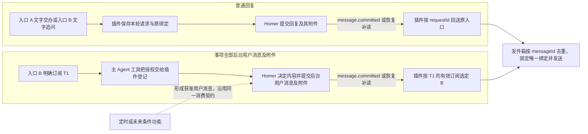
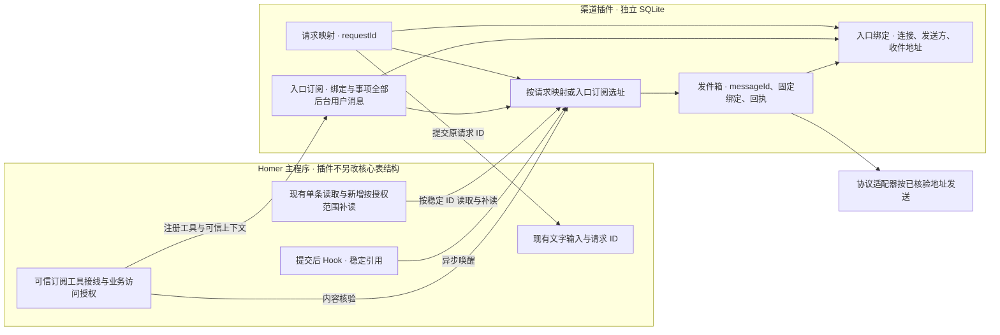

# Homer 多渠道接入架构

2026-11-07 · 首版已用模拟入口验收。渠道以一个独立存储的可选插件接入，各协议作为适配器由插件管理。插件负责入口授权、订阅、路由、发件箱和远端回执，消费核心已提交的用户消息及其附件。[主架构的核心范围](main-worker-chat-architecture.md#核心边界)沿用任务、消息和附件，插件启用不增加核心表结构。具体渠道适配单独实施。

**订阅一个事项，就接收该事项在订阅生效后所有明确发给用户的后台消息及其附件。** 内容、发送时机和附件选择由 Homer 决定，插件按授权范围处理每条已提交消息。进度说明、结果说明或其他后台用户消息使用同一规则。普通回复仍回原请求入口，即使该事项已被另一个入口订阅。

| 负责方 | 职责 |
| --- | --- |
| Homer 与核心 | 决定面向用户的内容和附件，保存消息、准确附件及其业务归属，执行现有授权与读取校验。Worker 经原会话向 Homer 回报。 |
| 渠道插件 | 核验入口，维护请求映射和入口订阅，读取获准消息，固定唯一绑定并记录发送与恢复。 |
| 协议适配器 | 管理连接与凭据，核验外部身份，转换协议格式，按已选地址发送并返回实际回执。 |

## 1. 首版范围与消息路由

首版支持**文字收件、已提交消息及其附件外送、聊天内登记事项订阅**。待答、审批卡和外部附件入站单独接入和验收。

| 后续能力 | 接入边界 |
| --- | --- |
| 待答 | 沿已有交互记录和 `interactionId` 核验原请求与当前待答状态。 |
| 审批卡 | 复用核心已有的授权、决定提交和回执。普通消息 Hook 只用于已提交的用户消息。 |
| 外部附件入站 | 接入现有媒体导入校验，核验可信入口、原请求和附件版本。 |



| 场景 | 从输入到发件 |
| --- | --- |
| 普通回复 | A 用文字交办 T1，插件先登记 `R1 → A`，再用普通 `ConversationInput` 提交 R1。Homer 的答复保留 `requestId=R1`，插件将答复及所附附件回送 A。B 的文字追问形成 `R2 → B`，B 收到 R2 的答复及所附附件。 |
| 事项后台消息 | 用户从 B 明确订阅 T1 的后台消息及附件。主 Agent 判断意图和事项，调用插件提供的 `set_notification_destination(taskId)`。宿主把当前真实用户轮的可信 `requestId` 注入工具上下文，插件据此定位 B、核验并保存订阅。Homer 此后通过 `send_user_message` 提交的 T1 后台用户消息及全部所附附件，都按有效订阅送 B。每条消息的实际事项版本和附件归属沿核心接口核验。 |
| 定时或条件通知 | [定时任务方案](scheduled-tasks-architecture.md)已接入到点向 Homer 投递消息，后续处理及是否通知由 Homer 决定；已提交的用户消息继续沿原 Hook、读取、事项订阅和发件箱契约外送。定时模块不选择渠道或等待交付；条件触发另行设计。 |

**一条回复或后台消息只选一个外部绑定。** 同一 Homer 内，一个事项最多有一个有效订阅。明确改订阅时，插件在同一事务中撤销旧订阅并登记新订阅。新订阅以核验授权时确定的发布基线划分接收范围，仅匹配可证明在授权生效后提交的后台用户消息。已有消息和发件项保持原归属，撤销后尚未发送的旧发件项停止发送。默认交办与追问只建立本轮回送关系，后台外送需要显式订阅。没有有效订阅时，后台用户消息及附件仍可在 Homer 内查看。

两条路径消费同一种 `message.committed({messageId})`。消息带实际 `requestId` 时只按原请求回送，即使同时带 `taskId` 也沿这一分支处理。`requestId` 为空且有事项归属时，才匹配后台订阅。订阅覆盖该事项生效范围内的全部后台用户消息，读取时按每条消息的实际 `taskVersion` 核验现有业务权限。读取与发件项统一使用 `messageId`，附件选择为 `{assetId, revision}`。同一事项版本可追加多条消息，每条都发送并独立去重。本节的发布基线指已提交后台用户消息的 ID 集合。

## 2. 插件独立存储

每个 Homer 运行范围有自己的插件库，建议放在该实例的 `<runtime>/channels.sqlite`。用户明确授权入口接入指定 Homer，A 和 B 通过同一实例共享业务上下文。各入口的外部账号由适配器独立验证，无需跨入口推断用户身份。首版一个外部连接获准接入一个私聊，适配器在自己的安全存储管理凭据及协议状态。



| 插件数据 | 最少保存的内容与约束 |
| --- | --- |
| `channel_bindings` | `binding_id`、适配器类型、该类型下的外部连接标识、核验过的发送方、授权会话地址、创建与撤销时间。每个 ID 只代表一次授权。相同外部连接重新绑定时发新 ID，旧请求和旧订阅继续引用原 ID。 |
| `channel_requests` | `request_id`、原 `binding_id`、适配器作用域内的事件去重键、可选的加密原消息回复引用、接收与恢复所需的状态。重试沿用同一个请求 ID 和同一输入，确认主程序接收后可清理临时入站内容。 |
| `channel_subscriptions` | `subscription_id`、`binding_id`、事项 `taskId`、真实用户授权依据、授权生效时的发布基线、撤销状态。一个事项最多有一个有效订阅，接收该事项全部获准的后台用户消息及所附附件。入口的收件地址沿绑定解析。 |
| `channel_outbox` | 核心 `messageId`、固定的 `binding_id`、匹配的订阅 ID 或原请求 ID、发送状态、尝试 ID、重试信息与回执。分步发送时才记录对应附件的准确引用和子步骤回执。实例内按 `messageId` 唯一，入队后固定绑定。 |

主库以核心方案的事项、消息、附件及 `operations` 为准，删除 `results / deliveries`，不为渠道保留旧表。消息的实际 `requestId`、宿主绑定的事项及版本表示业务归属，插件按请求映射或订阅选择地址。两个库通过 `messageId` 与准确附件引用对接，不增加 publicationId。插件自行升级其 schema，启用或移除插件均不再改变已收敛的核心表结构。

## 3. 主程序的最小接口

首版采用受信的进程内插件，主程序沿用现有表结构。插件用 `submitMessage` 幂等提交文字，以 `message.committed` 唤醒处理，复用 `readCommittedMessage` 核验单条消息的提交状态、归属和撤销状态。消息和外送授权核验后，附件用 `readAttachment` 读取准确版本并校验字节。本地提交和远端发送各自留证。[Hook 系统设计](hook-system-design.md)

| 首版渠道收发接口 | 接口职责 |
| --- | --- |
| 按授权范围补读 | 分页列出已获准请求或事项下可外送的已提交消息，复用现有单条读取校验。覆盖同一请求的后续消息和同一事项的多条后台消息，也用于建立订阅生效基线。 |
| 可信订阅工具接线 | 沿主 Agent 专用 MCP 入口接入 `set_notification_destination(taskId)`。宿主核验实际调用属于当前真实用户轮，并注入可信 `requestId`。插件据此核验事项和原绑定，将订阅与回执写入插件库。[主 Agent 插件工具注册](main-agent-tool-registration.md) |

旧渠道桥接已随核心重构退役。新插件从现有消息与附件接口接入，渠道能力独立验收。

### 消息来源

各渠道共用以下来源契约。宿主按现有 `requestId` 查找该消息的原始绑定，单轮读取一个请求，历史分页按页批量读取。新渠道适配器负责提供渠道标识和绑定账号的展示值，宿主和前端统一组装模型输入和界面标签。

| 字段 | 取值与用途 |
| --- | --- |
| `requestId` | 已领取的原请求 ID。沿用 `submitMessage` 和渠道请求映射，用于定位原绑定并传给模型。 |
| `source` | 原绑定的适配器标识，如 `telegram`、`wechat`、`dingtalk`。用于模型输入。前端用它查公开渠道名，如 `Telegram`、`微信`。 |
| `entryLabel` | 原绑定账号的可展示名称或稳定标识。仅供前端显示，字段值省略前缀 `@`。 |

`entryLabel` 优先采用由渠道核实、可展示且能区分同渠道账号的名称。缺少名称或名称重复时，使用可展示的稳定账号标识，或由原绑定派生的稳定本地标识。历史消息继续按原绑定取值，解绑后可以用原绑定的稳定标识。正文、私聊地址和凭据各自沿原有通路处理。

- **Telegram** 复用已有 `getMe` 对同一 Bot 的身份校验，从响应取公开用户名，取不到时用原绑定记录中的 Bot ID。[Telegram 适配器](../../src/telegram-channel.ts) · [Telegram Bot API](https://core.telegram.org/bots/api#user)
- **微信** 使用腾讯确认扫码后由 Homer 生成的本地绑定标识 `wx-…`，与 CLI 一致。绑定标识在重新授权时保留，解绑后再扫码生成新的标识。历史标签仍按原绑定显示。Demo 使用模拟账号。

- **钉钉** 使用通过私聊配对后生成的本地绑定标识 `dt-…`。同机器人换密钥时保留该标识，解除后重新绑定生成新标识。历史仍按原绑定显示。

前端在用户消息正文上方统一显示 `渠道名@账号名或标识`，例如 `Telegram@homer_work_bot` 或 `微信@wx-demo-01`。复制、引用和搜索继续使用用户原文。

模型输入使用 [Homer Leaf Directive 规范](leaf-directive-spec.md#message-source)的 `message-source` 指令。宿主在来源已核实的外部消息前加一行指令，空一行后接用户原文，整体作为一个 `InputText`。Homer 页面消息和来源无法核实的消息沿用普通气泡和原输入流程。渠道库暂时不可读时仅省略来源，后续读取恢复后可再次显示标签。

```text
::message-source{source=telegram}

这个事项后续的消息和附件都发到这里。
```

主 Agent 只把该指令用于理解当前消息的「这里」。订阅工具继续使用宿主绑定的本轮 `requestId`，由渠道插件解析入口并核验授权。

消息来源已接入 Telegram。离线回归覆盖双 Bot、用户名缺失或重复、解绑后的历史标签和本地正文中的同形指令。固定 Codex 0.163.0 在同一会话经回环模型替身验证了两个渠道请求的完整 `InputText`、页面原文和伪造指令无法取得订阅授权。实际 Homer Web 界面用模拟账号验收了双 Bot 标签、历史分页和复制到剪贴板接口的原文。真实模型判断订阅意图单独验收。[Telegram 回归](../../tests/telegram-channel.test.ts) · [固定引擎专项](../../tests/channel-native.engine.test.ts)

[消息来源 Demo](../../examples/message-source.html)可独立打开，包含两个 Telegram Bot、两个模拟微信账号和 Homer 页面。

## 4. 事务、恢复与验收

### 订阅生效与消息提交的先后

首版沿用 Homer 的实例独占锁，消息提交与订阅生效都经同一个宿主进程。订阅生效点是插件库成功提交，消息生效点是主库提交终态正文及附件关系。两个动作的数据库临界段均同步执行，所有生效、换绑和消息提交入口遵守同一规则。实例锁的现有入口见 [service.ts](../../src/service.ts) 和 [processes.ts](../../src/processes.ts)。

1. 宿主完成可异步的准备，进入同步段后重新核验真实用户轮、事项与绑定，确认实例仍持有写入权。读取该事项所有已提交后台用户消息的 `messageId`，作为新订阅的排除基线。读取须覆盖全部 ID。内部轨迹、请求回复、占位及未提交内容不进入订阅范围。
2. 宿主在同一同步段内，调用受信插件的同步 SQLite 事务，把基线、新订阅、旧订阅撤销和授权操作回执一次提交。两步之间禁止 `await`、外部 I/O 和回调重入消息提交。提交前任何失败保留旧订阅。插件仅在提交成功后向调用方确认。相同绑定的重复确认沿用当前订阅和原基线。针对同一原用户请求及事项的工具重试，先按稳定授权操作键查回执，参数冲突则拒绝；重试不得重新截取基线或覆盖此后的换绑。
3. 消费时只考虑当前已提交且仍获准的后台用户消息。ID 在该订阅基线内则排除，ID 不在基线内才有资格继续匹配。先提交消息后订阅时该 ID 已可读，必在基线内。先订阅后提交消息时该 ID 尚未提交，必在基线外。已入队的发件项固定原订阅和绑定，发送前再核验撤销和内容；未知发送不能换一个消息 ID 自动再发。

| 退出点 | 重启后的依据与结果 |
| --- | --- |
| 已读基线，插件库事务未提交 | 沿原订阅处理。新授权与基线都未生效。 |
| 插件库已提交，工具尚未返回 | 新订阅及基线一同保留。通过原操作回执确认授权，注册后补读消息。 |
| 消息事务尚未提交 | 本次提交尚无可外送的消息。稍后按消息与订阅的实际提交顺序匹配。 |
| 消息已提交，通知尚未派发 | 补读按持久基线匹配。消息在新授权前时排除，在授权后时可入队并去重。 |

这套顺序依赖单实例单写者及进程崩溃后的 SQLite 事务恢复。两个库各提交自己的事实，无需跨库原子提交、时钟或主库新表。以后若允许独立进程写消息或订阅，须先定义跨进程排序机制。基线读取失败或缺少可信的历史提交证明时，暂停相应的订阅变更或外送。

### 补读与外送

插件启动先注册监听，再按原请求和已获准事项补读。提交 Hook 唤醒补读，宿主已有的状态通知只标记待核对，多个唤醒共用一个补读任务。定时器只在状态变化或处理失败时补读。即使提交 Hook 漏掉，状态通知仍可触发下一次核对。空闲时不查询历史。监听器的积压上限见 [Hook 系统设计](hook-system-design.md#监听接口)。

请求回复按已登记且获准的 `requestId` 分页补读该请求下**全部符合条件的已提交用户消息**，包括复用原 `replyId` 的第一条和后续显式发送的独立消息。第一条已入队或已送达时，后续核对仍须能发现新消息。每条按 `messageId` 去重并回送原绑定。后台消息按已获准事项完整枚举。分页扫描期间有提交时，后续扫描须能找回。回复占位可能早于终态创建，创建顺序、时间戳及通知到达顺序均不能作为完成顺序游标。

受控读取核对实例、请求或事项授权、实际版本、用户输出归属、提交和撤销状态。附件按 `messageId + assetId + revision` 核对归属，再校验字节与摘要。发送前复核当前授权，路径、内部 Worker 消息及可读事项本身均不足以授权外送。

已确认并提交用户终态的失败或中断，读取只返回原 `messageId`、`requestId` 和对应状态。渠道只按原请求回送简短状态，按消息 ID 去重。部分正文、内部错误详情和附件均不外送。执行结果未确认、启动恢复仅标记为中断的占位和辅助提示均不入队。状态通知也不会改变已提交消息或远端发件回执。

- **接收。** 插件先持久化入站去重键、固定的 `requestId`、原绑定及接续所需的输入。主程序接收成功但插件尚未记录回执时，插件用原请求重试，主程序返回原接收结果。
- **消息提交与入队。** 主程序提交用户消息、准确附件关系及操作回执。插件依据请求映射或订阅生效基线筛出获准消息，按 `messageId` 唯一入队。消息仍可补读期间，保留原发件项的去重键和结果。正文和完整附件清单由核心消息提供，附件留存沿用核心消息引用。
- **发送。** 先复核原绑定、原订阅和内容仍获授权，按 `messageId` 读取获准正文和准确附件。调用适配器前持久化尝试 ID、发送步骤和该步骤的附件版本。确定收到记 `sent`，明确失败记 `failed`，效果无法证明记 `unknown`，确认未发而撤销记 `revoked`。回执未落库时，重启将正在发送的步骤记为 `unknown`，保留其尝试和此前的步骤回执。首版不自动重发未知项；后续按具体适配器的对账与幂等保证处理。
- **切换。** 先用独立实例和抽象模拟入口验收，再按授权接入真实渠道。与核心新 schema 配套，不提供旧成果或渠道数据迁移，不自动切换日常连接。每条连接由一个收发实现负责；新版本中的未知发送仍须按原回执核对，不能通过换库或重新绑定重发。

| 必测场景 | 通过条件 |
| --- | --- |
| 新核心启用或移除插件 | 插件启停前后核心表结构相同。产品内置入口可继续提交和读回复，任务、消息与附件可读。 |
| 首版收发范围 | 通过外部入口提交文字，可收到已提交的回复及附件，可在聊天内订阅。待答、审批卡和外部附件入站分别验收。 |
| A 交办、B 追问、B 订阅 T1 | 普通回复分别回 A、B，即使带 T1 归属也只按原请求回送。B 订阅后，Homer 提交的进度说明、结果说明及各消息所附的全部准确附件只发 B，内部 Worker 回报保留原协作路径。 |
| 同一事项多次后台发送 | 同一版本连续提交多条后台用户消息，插件逐条发送。重复 Hook 或补读不会重发同一 `messageId`，附有多个文件的消息保留全部附件及各子步骤回执。 |
| 订阅改绑 | 改订阅后旧发件项保留原绑定，生效后的新消息可发新入口。改订阅前已提交、尚未补读的消息排除在新订阅外。 |
| 提交后、通知前退出，或运行中漏掉最后一次通知 | 重启或定期核对能找回回复和后台消息。重复唤醒与补读重叠时，每条消息只有一个发件项，Homer 和 Worker 不重跑。 |
| 同一请求的第二条消息漏通知 | 第一条已送达后，提交同一 `requestId` 的第二条消息并故意丢掉通知。定期核对按请求找回第二条并回送原绑定，第一条不重发。 |
| 已确认失败或中断 | 只向原请求绑定回送一次简短状态。补读结果无正文残片、错误详情或附件。未确认执行、恢复标记的占位和辅助提示均不入队。 |
| 积压覆盖通知 | 阻塞一个监听器并提交超过待调度上限的消息。宿主及其他监听器仍能推进，渠道随后通过补读找回所有获准的消息，逐条去重。 |
| 订阅与消息提交竞争 | 覆盖两种提交顺序及基线读取后、插件库提交后回执前、消息提交后通知前退出。恢复沿原授权回执和基线处理，重试不覆盖后续换绑。 |
| 分页与乱序完成 | 提前创建但晚完成的回复、扫描期间提交的后台消息都能补读。 |
| 通过插件工具登记订阅 | 用宿主核验过的真实用户请求定位原绑定，拒绝无权订阅的事项或已撤销的绑定。 |
| 已入队时解绑重绑，或发布范围撤销 | 新绑定不接管旧发件项。未发项核验失败停止发送。跨实例主体和越权文件的读取被拒绝。 |
| 渠道已接收、回执丢失后重启 | 没有对账或幂等证明时原项为 `unknown`，累计发送调用仍为一次。本地消息仍可独立核对。 |

### 首版实现与验证

[渠道插件](../../src/channel-plugin.ts)随 Homer 默认可用，用户只管理账号绑定。装载受信适配器后，宿主只连接仍获授权的账号，重启时按同一规则恢复。没有适配器时不创建插件库。解绑立即撤销收件权限并取消连接。同一账号最多一个连接，重绑时新连接等旧连接结束。宿主关闭时取消渠道操作，等启动、收件连接和在途发件结束后释放运行锁。适配器负责协议重连，收件和发件都须响应取消并在停稳后返回。发送结果未知时保留原发件项及已完成步骤，由具体适配器处理远端对账。

[宿主接口测试](../../tests/channel-host.test.ts)验证受控补读、分页、撤销、轮次匹配和迟到调用拒绝。[模拟入口验收](../../tests/channel-plugin.test.ts)覆盖漏通知补读、原入口回送、订阅生效与改绑，以及适配器已接收但回执落库失败的恢复。[真实引擎专项](../../tests/channel-native.engine.test.ts)用固定 Codex 0.163.0 恢复旧主会话，经实际 stdio MCP 登记订阅，并验证原入口回送、后台附件外送、换绑边界、未知发送不重发及主库表和索引不变。专项使用回环模型替身和模拟入口；真实渠道另行验收。

故障回归验证同一请求的首条回复已送达、第二条漏掉 Hook 时只补发第二条。另一用例在订阅写入后、宿主返回工具回执前终止 MCP 桥，再重启宿主。重投原事件不会重跑用户轮。直接复验插件的授权处理函数，确认重试保留原订阅和生效基线，旧授权也不会覆盖后来改绑的入口。

Telegram 首版使用 [Bot API 长轮询](https://core.telegram.org/bots/api#getupdates)，每个 Bot 绑定一个普通私聊。CLI 和桌面宿主启动时读取该实例的 `<runtime>/telegram.json`。文件是 JSON 数组，每项含 `token`、数字 `userId` 和数字 `chatId`。文件由运行用户持有，macOS 和 Linux 上使用 `0600` 权限，Windows 沿用宿主的私有 ACL 校验。每次变更配置后重启 Homer。移除某项会撤销对应绑定，写入 `[]` 或删除文件会撤销全部 Telegram 绑定。配置未变时沿用原绑定。全新实例没有文件时不创建渠道库。凭据留在本机文件，业务授权和发件记录沿用插件库。[Telegram 适配器](../../src/telegram-channel.ts)

普通文字以纯文本发送，超出单条文字限制时以一个文本文件发送。附件使用 [sendDocument](https://core.telegram.org/bots/api#senddocument)。协议替身已验证双 Bot 路由、订阅、附件字节和解除绑定后的重启恢复。

2026-11-07，隔离 Homer 使用脚本引擎和两个真实 Telegram 测试 Bot 完成实网验收。先用 A 验证私聊文字收件、原入口回复、事项订阅、后台通知和附件发送回执。加入 B 并重启后，两个 Bot 分别回复各自的私聊。移除 A 再重启，只恢复 B，A 的测试消息未进入 Homer。主库表和索引定义一致。CLI 源码入口另用固定 Codex 验证无配置和空绑定时的启动与退出。真实模型的订阅意图及桌面安装包运行另行验收。

#### Telegram 团队入口

在 Homer 保存 Bot 的私聊配对并等渠道就绪后，用同一 Telegram 账号把 Bot 加入群。Homer 从 [`my_chat_member`](https://core.telegram.org/bots/api#update) 核对是谁加入了 Bot，并按 Bot 的当前绑定记录群授权。普通群和超级群均可使用。Bot 被移除即撤销该群，超过 Telegram 更新保留期的连接中断也会清除旧授权，需要由绑定者重新加群。

授权群里的成员可以发送含准确 `@Bot` 的文字，或直接回复这只 Bot 的消息。请求进入同一 Homer 主 Agent，沿用已有会话、事项、项目、工具和审批机制。渠道库持久化每个请求的原群、话题、原消息和授权代次。主 Agent 的回复及附件沿发件箱回原群并引用原消息，事项订阅的后续通知回订阅所在的话题。重启时先补读 Telegram 群成员状态，再领取该群的待执行请求。已撤销或暂时无法核实的群请求不会启动主 Agent，撤权后停止向该群投递。

在实例的 `<runtime>/telegram-mtproto.json` 写入 `{"api_id":123456,"api_hash":"32 位十六进制字符串"}` 后重启，启用群聊背景。文件沿用 `telegram.json` 的私有权限。一组应用凭据用于这个实例，各 Bot 沿用各自绑定时的 Token。[Bot 的 MTProto 登录](https://core.telegram.org/method/auth.importBotAuthorization)

启用后，适配器为每只 Bot 的每个授权群和话题在内存保留 Bot API 送达的最近 10 条消息。普通发言不触发回复。触发时用该条消息之前的窗口，从直接回复目标开始沿同群链条逐条查找。窗口外按已知消息 ID 走 MTProto，超级群从推送获得本会话的群访问凭据。最多走 16 层，上游读取总预算 6 秒。遇到不可读的节点，保留已知背景和可用的直接引用。限流时按 Telegram 返回的等待时间暂停补读，冷却结束后的请求再按需尝试。按消息 ID 去重后按原顺序把文字和附文附入本轮。背景不构成用户指令或授权。群授权变更时清理对应窗口。[按 ID 取超级群消息](https://core.telegram.org/method/channels.getMessages) · [按 ID 取普通群消息](https://core.telegram.org/method/messages.getMessages)

Homer 不建群聊历史库，渠道队列和 Homer 对话库只保存触发文本。重启后窗口重新积累。选入本轮的背景作为模型输入进入主 Agent 的原生会话记录。缺少有效的应用凭据时，群入口继续使用 Bot API 提供的直接引用。真实群启用背景前，需按 Telegram 条款核对群成员对具体内容和使用范围的同意。[Telegram 内容使用条款](https://telegram.org/tos/content-licensing)

群路由写入 `channels.sqlite` 后，如需回退到不认识群路由的宿主，应恢复启用群入口前的运行目录快照。旧宿主复用新渠道库时会按原私聊绑定解释待发群消息。

Bot 作为普通成员使用 `@Bot` 时，在 BotFather 关闭群隐私模式，再把 Bot 移出并由绑定者重新加群。2026-11-10 的实测中，隐私模式开启时两条定向命令均送达，普通 `@` 未送达。关闭并重新加群后，定向命令、普通 `@` 和未提及 Bot 的消息均送达。源码用协议替身验证群触发、主 Agent 交办、原消息和话题回送、撤销及重启去重。真实群里的 Homer 回复待验收。[Telegram 隐私模式](https://core.telegram.org/bots/features#privacy-mode) · [渠道回归](../../tests/telegram-channel.test.ts) · [固定引擎专项](../../tests/channel-native.engine.test.ts)

桌面「设置 → 连接聊天应用」在 Telegram 分组标题下、绑定列表上方提示群聊用法，空列表也显示。小叹号内提供 BotFather 小程序入口，指引用户选中 Bot 后在设置里关闭群隐私模式。提示保留 `/setprivacy` 命令备选和重新加群的步骤。已在隔离浏览器核对列表文案、浮层及小程序链接。[BotFather 小程序](https://t.me/BotFather?startapp)

群背景的离线验收验证窗口外的两个上游、重叠去重、跨群和跨话题窗口隔离，以及直接回复 Bot 时的引用降级。实网超级群收到了本轮 11 条合成测试消息。隔离实例未收到重新加群事件，MTProto 登录探针也遇到 Telegram 限流。实际回填、主 Agent 收件和群内回复仍待闭环。[背景合并回归](../../tests/telegram-context.test.ts)

### 个人微信

个人微信通过[腾讯 ClawBot iLink](https://github.com/Tencent/openclaw-weixin/blob/874637a0dbc24050f72d1385add4fc6170a2d726/docs/protocol_zh_CN.md)接入同一插件。停止 Homer 后，使用 `homer wechat bind [--config 路径]` 扫码，可重复添加不同账号。`homer wechat status` 列出本地绑定标识及失败、结果未知的发件数。`homer wechat unbind <标识>` 移除指定入口，下次启动时撤销原绑定。启动后先在自己的 ClawBot 私聊发一条文字，建立该入口的投递上下文。

`<runtime>/wechat.json` 是微信适配器的私有文件，保存每个账号的扫码凭据、轮询游标和同一私聊的最新会话令牌。只接受扫码者发给对应 Bot 的私聊文字。入站事件按无损微信消息 ID 去重，宿主接收后才推进游标。原入口回复、事项订阅和发件箱沿用通用规则。附件走微信普通文件通道，超过 3500 UTF-8 字节的长回复作为文本文件发送。拒收或结果未知的消息仍可在 Homer 查阅，发件箱保留对应状态。

两个测试账号已通过扫码和手机收件的协议探测。独立探针从磁盘恢复 B 的会话后，在无新入站 30 分钟时得到文字和文件的腾讯 API 回执，手机确认收件。产品代码已接入 CLI 和桌面宿主，定向离线回归通过。实际 Homer 使用脚本引擎完成 A、B 原入口回复，B 的事项订阅已落库，手机确认两条回复。解绑 A 并重启后只剩 B 有效，主库和渠道库表及索引定义一致。B 无新入站 30 分钟后，实际 Homer 的后台文字和文件均获腾讯 API 回执，两部分只发给 B，手机已打开文件并核对内容。解绑对照补测中，宿主仅接受 B 的请求，B 手机收到回复，A 无回复。隔日探测仍待完成。腾讯未公开承诺会话有效期，实测窗口仅代表本次环境。[微信定向回归](../../tests/wechat-channel.test.ts)

真实 ChatGPT 通过固定 Codex 和两个模拟入口完成订阅意图验收。B 普通追问无订阅工具调用，回复到 B，订阅仍在 A。B 明确要求发到这里时调用一次 `set_notification_destination`，订阅从 A 改到 B。A 随后只说「有结果通知我」，回复到 A，订阅仍在 B。后续后台文字和附件只投到 B。渠道收发与模型语义分别验收。

macOS ARM64 本地候选包已通过签名校验和同线程重启回归。包内宿主使用隔离资料和脚本引擎，微信 A、Telegram 测试 Bot B 在正常关闭并重启前后各完成一次实网收发。四条请求各有独立 ID，均按原绑定外送，手机确认每个入口两次均收到回复。此证据覆盖候选包内的宿主，不代表分发安装或其他平台验收。

### 钉钉专用机器人

组织先批准内部机器人，启用 Stream、企业内机器人发送消息及媒体上传，限定到获准成员。在桌面「连接聊天应用 → 钉钉」输入该应用的 AppKey 和 AppSecret，然后在机器人私聊发送五分钟内有效的一次性指令。荷马核对机器人、组织、员工和私聊，再由用户确认。每个机器人只绑定一个私聊，并应由一个荷马实例独占收件。换密钥保留原绑定，解绑后重绑使用新标识。

`<runtime>/dingtalk.json` 保存本地绑定标识、应用凭据、组织 ID、员工 ID 和私聊 ID，沿用现有配置文件权限与重启写入流程。Stream 仅接收绑定生效后的授权私聊文字，使用业务消息 ID 去重，先持久化再确认。CLI 和桌面宿主均装载适配器，取得运行锁后读取并核对最新配置。

原入口回复和后台文字复用主动单聊发送，每次只传已核验的一名员工。附件先上传，再把原始媒体 ID 交给文件模板。单文件上限 20 MB，超过 2,048 UTF-8 字节的文字改为一份 TXT。发件箱的 `sent` 表示钉钉已受理，回执保存 `processQueryKey`。明确失败或结果未知时，原消息仍留在荷马，未知项重启后不重发或改投。[适配器](../../src/dingtalk-channel.ts) · [钉钉协议](https://github.com/DingTalk-Real-AI/dingtalk-channel-sdk-python/blob/main/SPEC.zh-CN.md)

- **协议试点。** 钉钉客户端确认收到原会话 Webhook 回复，以及 Stream 断开约 35 秒后主动发送的文字和 TXT。
- **离线。** 本地回归核对私有凭据文件权限和短员工 ID 脱敏。Stream 替身覆盖同组织私聊配对、拒绝其他组织和私聊、超时和取消、提交失败不确认、断线恢复、双机器人出站隔离、附件字节及回执分类。共享插件回归验证去重、未知结果不重发、撤销旧绑定和两库结构。另有回归验证配置在取得运行锁后读取，防止并发解绑时恢复旧地址。[离线协议替身回归](../../tests/dingtalk-channel.test.ts)
- **macOS ARM64 候选包实网（2026-11-09）。** 桌面设置完成一次性私聊配对及应用重启。两条私聊请求经主动单聊获得两条受理回执，历史显示 `钉钉@dt-…`。通过固定脚本引擎订阅事项，正常退出后恢复同一会话，从荷马页面触发交付，钉钉侧无需新入站。后台文字和文件各获一次回执，客户端打开文件核对正文。设置解绑并重启后，钉钉入口无新增请求或发件，荷马页面仍正常收发，历史来源仍可见。两库表和索引定义一致。真实模型、Windows 和另一外部渠道同时在线留待专项验收。

### 桌面连接管理

桌面设置提供「连接聊天应用」。微信、Telegram 和钉钉各自显示多个绑定及其发送情况。微信沿用扫码生成的 `wx-…`，Telegram 优先使用经 Bot API 核验的公开用户名。主窗口通过专用 Electron 桥读取宿主的逐绑定状态。凭据保存在各适配器的私有配置文件。

微信沿现有扫码确认与验证码流程。新增 Telegram Bot 需在私聊发送一次性配对指令，并在荷马确认发起者。重新授权须匹配原身份并保留原绑定。增删和重新授权在桌面主进程中暂存，可撤销。确认宿主正常停止且进程以 0 退出后，使用现有运行锁写入各渠道配置。每个文件独立原子更新，部分失败时保留未保存项。启动时沿现有绑定核对流程撤销旧授权，重新绑定建立新的授权边界。

桌面接线验收记录（2026-11-07）

- Node 22.22.0 类型检查通过。渠道、桌面壳、设置和消息标签定向回归 414 项通过，4 项旧运行目录收养测试因 `desktop_schema_incompatible` 失败，同样结果在未改动的主检出复现。新回归验证配对确认、取消扫码、运行锁、晚到的停止确认、部分写入重试、微信重新授权及两库结构。合入前修复了微信授权失效与轮询异常的竞态，新增回归确认迟到的轮询错误无法恢复发送。
- 浏览器使用实际设置组件和模拟协议验证分组、空列表、两种授权、重启提示和解绑撤销，核对 731 和 390 像素宽度下的界面。
- 隔离 macOS ARM64 候选包通过签名校验。专用账号从桌面完成微信扫码和 Telegram 私聊配对，应用变更后重开，同一配置正常恢复。用户确认首轮和再次重启后两边均只收到各自的回复，聊天中显示两个来源标签。解绑微信并重开后只有 Telegram 回复。发件箱最终有微信 2 条、Telegram 3 条成功记录，两库表和索引定义一致。验收使用脚本引擎。原生重启流程的重开由验收脚本完成，桌面壳回归核对了实际调用重启的条件。Windows 桌面和微信真实验证码场景待验收。

## 5. 行业经验与采用范围

### OpenClaw、Hermes Agent 与 Cindy 的取舍

对照采用 OpenClaw 与 Hermes Agent 的公开文档和源码，以及 Cindy 已记录的历史静态核查。对照结论用于选定接入边界和验收用例。真实渠道收发与恢复另行验收。

| 产品 | 对照事实 | Homer 的取舍 |
| --- | --- | --- |
| OpenClaw | 会话归属与投递路由分别处理。同一会话可有多个来源，部分后台通知可沿用最近的投递上下文。 | 同一用户的多个绑定可以接入同一主会话。即时答复跟当前请求，后台用户消息按入口订阅匹配。插件选址，发件箱固定原绑定。 [路由源码](https://github.com/openclaw/openclaw/blob/main/src/routing/resolve-route.ts) · [后台投递上下文](https://docs.openclaw.ai/concepts/session-tool) |
| Hermes Agent | Gateway 用统一来源和适配器处理不同平台。官方文档描述了持久投递账本，以及发送中断后带「可能重复」提示重发的策略。 | 适配器只做可信收件和按地址发送。Homer 与 Worker 使用页面同一套消息和工具。发送效果未知时先核对原发件项，只有满足本文的安全重试条件才续送。 [投递源码](https://github.com/NousResearch/hermes-agent/blob/main/gateway/delivery.py) · [投递可靠性](https://hermes-agent.nousresearch.com/docs/user-guide/messaging#delivery-reliability) |
| Cindy | 0.1.109 的历史静态核查记录了每轮固定回复目标，以及按绑定代次校验异步结果的做法。 | 插件保存每条外部请求的原绑定。重绑生成新的授权身份，旧投递沿原记录核对。 [历史静态核查](../08-telegram-integration-plan.md#12-cindy-本机设计对照) |

### 收件与可靠投递参考

| 实践 | Homer 采用的规则 |
| --- | --- |
| Microsoft Teams 用入站活动的会话标识或引用定位后台消息。 | 每轮回复保存可信的原请求引用，主动通知使用订阅所指向的已核验绑定。[Teams 主动消息](https://learn.microsoft.com/en-us/microsoftteams/platform/bots/how-to/conversations/send-proactive-messages) |
| Slack Events API 区分应用、安装授权、事件 ID 与发件人，并可能重投。 | 将账号授权和事件去重分开，先持久接收，再确认渠道收件。[Slack 事件结构与重投](https://docs.slack.dev/apis/events-api/#callback-field-overview) |
| AWS 的 transactional outbox 在一个数据库事务里提交业务事实和待发记录。 | 主程序提交用户消息。插件补读后在自己的 SQLite 中按 `messageId` 唯一入队，事务外发送。[AWS Transactional Outbox](https://docs.aws.amazon.com/prescriptive-guidance/latest/cloud-design-patterns/transactional-outbox.html) |
| Stripe 的安全重试依赖服务端对相同幂等键、参数和有效期的承诺。 | 本地稳定 ID 用于认领和去重。渠道效果未知时以原回执为准，只有具备相应服务端保证时才安全重试。[Stripe 幂等请求](https://docs.stripe.com/api/idempotent_requests) |
