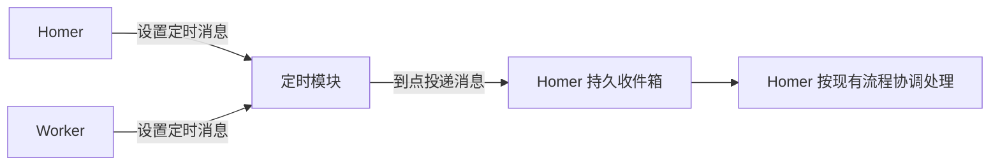

# Homer 定时任务架构：定时向 Homer 发消息

2026-11-12 · **最终方案已实现，按隔离环境验收。** 使用 Croner 和四个薄工具，范围仅为设置消息与时间、到点可靠投递给 Homer。源码、依赖、队列接线和测试已落地；未安装到日常实例或创建真实业务安排。具体证据见第 8 节。

**整个流程只有一条：Homer／Worker 通过工具设置消息和时间 → 定时模块到点把消息投递给 Homer → 后续由 Homer 处理。**

定时模块的职责终点是消息进入 Homer 的持久收件箱。它不启动 Worker，不判断业务是否完成，也不等待 Homer 的执行结果。

## 1. 模块边界



| 负责方 | 职责 |
| --- | --- |
| Homer／Worker | 提供到时要交给 Homer 的消息、一次时间或周期；按需要查询、修改和取消安排。 |
| 定时模块 | 保存安排、计算到期时间、可靠投递消息、推进下次时间。 |
| 宿主工具适配 | 核验调用者与委托范围，绑定真实来源，把工具接到两个角色，并提供向 Homer 入箱的接口。 |
| Homer 收件与协调 | 接收消息后判断怎么处理，沿已有事项、会话、审批与交付流程办理。 |

定时模块不依赖 `RecursiveTasks`、TaskVersion、Run、Worker 生命周期或渠道发件箱。它不维护每次业务工作的实体、结果、完成回执、业务互斥或续办状态。业务任务的取消、结案与重试也不自动改动时间规则；需要调整安排时，由 Homer 根据用户意图调用定时工具。

## 2. 已确定的实现

**采用 Croner + 最薄的宿主工具适配 + 已有 SQLite + 单个宿主到期检查器。** 工具负责管理消息与时间，模块到点向 Homer 持久入箱，后续工作全部交给 Homer。这是已确定的实现方向。

### Croner 只负责日期计算

[Croner](https://github.com/Hexagon/croner)复用 cron 校验、IANA 时区和 `nextRun / previousRuns` 日期计算，不自研日历算法。**不向 Croner 注册任务回调，不启动它的独立计时循环。** 规则及下次时间以 SQLite 为唯一事实源，只有宿主到期检查器负责检查和投递。[只计算日期的官方示例](https://croner.56k.guru/usage/examples/#find-dates)

一次绝对时间以及渠道补收的固定间隔直接计算，不必调用 Croner。运行依赖精确锁定 `croner@11.0.0`（MIT），隔离测试覆盖其日期、时区和 DST 语义。

### 工具只做薄适配

Croner 提供 JavaScript／TypeScript API，没有官方 AI／MCP 工具定义。Homer 按现有 MCP 工具格式定义创建、查询、修改和取消四个工具，直接调用定时模块；不暴露任意 Croner 配置、shell 命令或回调，也不另建调度服务。

两种角色共用同一模块和规则存储。宿主沿现有机制核验调用身份、委托范围及操作回执，定时模块不解释业务目标或执行状态。模块对外只需数据库能力和一个由宿主提供的入箱接口：`enqueueHomerMessage` 接收稳定 `deliveryId`、原定时刻、正文及不透明的 `sourceRef`，返回已持久保存的 `messageId`。

入箱接口在调用方的同库事务中同步追加现有消息与回执，不自行开启嵌套事务、不调用模型、不等待回复；失败或容量拒绝均使投递与时间推进一起回滚。成功提交后，宿主沿现有主队列唤醒处理。模块只访问自己的规则记录，收件箱结构、容量受理和消费方式由宿主适配器负责。

桌面存储就绪即启动原到期检查器，不依赖模型登录。Main 尚未初始化或群来源仍在 `preparing` 时，已入箱消息保留原 `pending`，就绪后重新检查并领取；真正撤权仍拒绝。已领取或未知结果的消息不因此重置重放。

### 与电源模块的最小衔接

操作系统仅承担可选的机器唤醒，不保存消息正文，也不逐条复制业务周期。定时模块提供两个事实：**读取最近一个可正常计算的启用安排的未来绝对 UTC 到期时间，无候选则为空；该值可能变化时通知宿主重读。** 创建、修改、停用、规则隔离、投递推进及启动恢复成功后均需通知；通知在提交后发出，可合并或重复，不携带正文、权限或业务状态。

宿主通过 `nextScheduledMessageAt(): number | null`、`onScheduleChanged(listener): () => void` 和 `recheckScheduledMessages(): void` 衔接[桌面电源模块](desktop-power-management.md)。时间为 UTC 毫秒；电源方与合格渠道的下次补收时间合并，只管理本实例最近一次系统唤醒。过去的投递游标由原检查器处理，不反复注册过去时间，也不遮住其他未来候选。

流式状态通知先比较执行、渠道等轻量事实，未变时直接返回。初始化、事实变化、规则改变、现有 5 秒校准、恢复检查与执行前保护均重读最新到期时间；读取或发布失败后允许后续通知重试。

系统唤醒、恢复或电源状态变化只促使宿主复查到期；消息仍沿唯一入箱路径投递。可提前唤醒机器准备网络，但不能提前投递消息。关闭自动唤醒、授权被拒或电源能力不可用，不影响设置安排、电脑醒着时投递及恢复补投，也不使规则创建失败。定时模块没有 OS 依赖，不读取电源设置或自行申请权限。

## 3. Homer 与 Worker 共用的工具

Homer 与 Worker 使用同一组四个工具，不要求 Worker 先请求 Homer 代设。工具名称与参数是 Homer 的薄适配契约，不是 Croner 官方工具；定义格式复用现有 MCP 的 `name / description / inputSchema`，不设计新协议。[MCP 工具规范](https://modelcontextprotocol.io/specification/2025-11-25/server/tools)

| 工具 | 输入与行为 | 返回 |
| --- | --- | --- |
| `schedule_create` | `text / trigger`；创建一次或周期消息。 | `scheduleId / revision`、规范化规则、时区、下次时间及原操作回执。 |
| `schedule_list` | 默认按可选 `scheduleId / enabled` 和 `offset / limit` 查询安排；`receipts: true` 改为分页查询获准范围内的原操作回执，无需先知道安排或操作 ID。 | `items / nextOffset`；项为安排详情，或原调用关联、原操作回执及其 `scheduleId`。 |
| `schedule_update` | `scheduleId / expectedRevision`，以及要改的 `text / trigger / enabled`；拒绝空修改。 | 更新后的安排及回执；从生效时间重排未来投递。 |
| `schedule_cancel` | `scheduleId / expectedRevision`；停用后续投递并保留记录。 | 停用状态及原回执。 |

`trigger` 只有两种形式：

```ts
{ at: "2026-11-13T09:00:00+08:00" }
{ cron: "0 9 * * *", timeZone: "Asia/Shanghai" }
```

消息正文就是未来要发给 Homer 的任务说明，可以包含必要上下文或原记录的引用。不强制先建事项，不要求 `taskId`，不复制或锁定任务版本。正文沿用现有文本入口的 16,000 字符上限，首版不增加定时附件存储。

### 调用者与委托

- Homer 可在当前真实交办或既有授权范围内使用工具，Worker 可在自身有效委托范围内使用；设置重复安排仍需有对应的持续工作授权。
- 宿主校验当前引擎、会话、轮次及 Worker 执行身份，拒绝伪造、越权或停止后的调用。Worker 的查询和修改限于获准安排，不能借工具浏览或改动其他委托的记录。修改正文也须处于原授权内；超出时拒绝，或由宿主绑定确有相应授权的新来源，不能仅凭可修改安排就继承旧权限。
- 来源、接收方和操作身份由宿主注入，模型不能自行填入可信用户来源、任意 Homer 实例或幂等身份。来源仅证明消息从哪里来，不自动扩大执行授权。
- 工具返回原操作回执；响应丢失时通过 `schedule_list({ receipts: true })` 恢复，不用新调用重复创建。

现有 [主 Agent 插件注册](main-agent-tool-registration.md)中的 `registerMainPluginTool / pluginUserTurn` 专用于真实用户轮，不能直接拿来限制这组双角色工具。四个薄工具分别加入 Main／Worker 的 `homer_interactions`，共用逐次调用认证，分别核验当前用户交办或有效委托，再调用同一个定时模块。既有渠道订阅等用户专用工具保持原限制；不新增独立 MCP 服务或调度进程。目录增加后复验旧原生会话发现，不变更原动态工具目录及 `MAIN_TOOLS_HASH`。

### 每次调用都由宿主认证

四个工具的 MCP 桥及 Main／Worker 分派均传递原生 `_meta.callId` 和 `_meta["x-codex-turn-metadata"].turn_id`。宿主将其与**同一活动引擎**观察到的 `homer_interactions` 工具开始事件匹配，核对线程、轮次、调用 ID、工具名及规范化参数。两路消息到达顺序可不同，沿现有机制短暂、有界等待；缺失或冲突则拒绝。模型参数不能自证调用身份，也不能用 Worker 引擎此刻的 `turnId` 替代原调用证据。

复用现有原生证据校验，补齐 Worker 的桥接、引擎事件和分派接线；`pluginUserTurn` 等真实用户轮门禁保持原样。轮外直调、错引擎／错轮次、参数不符、停止及过期后的请求均拒绝。证据最多授权一次写入；已经提交的同一原调用只可按下述规则重取回执。认证和授权归宿主，定时模块仍只接收可信的操作上下文、消息和时间。

### 创建响应完全丢失时怎样恢复

宿主为三个写工具在认证后复用 [现有 `toolOperationId`](../../src/recursive-tools.ts)，从真实 `threadId / turnId / callId` 生成稳定操作身份，并按本实例、调用 Agent 和获准委托范围隔离。规则变更与原回执同事务写入现有 `operations`；复用 `payloadHash / responseJson / detailsJson` 保存工具与参数指纹、原结果、原生调用关联及原委托来源，不增加回执表。查询时重验当前权限，操作键本身不授予查询或写入权限。**这与到期投递的 `deliveryId` 是两种用途：前者去重工具变更，后者去重消息入箱。**

即使整个创建响应丢失、调用者不知道任何内部 ID，也可发起一次新的、正常认证的 `schedule_list({ receipts: true })`。宿主从这次调用的可信身份和当前获准范围出发，分页列出该范围内创建、修改、取消的已提交回执；每项返回原工具名、原 `threadId / turnId / callId` 关联、`operationKey` 和原结果（含 `scheduleId / revision`）。调用者从列表取得原关联及安排 ID，再按需查询安排详情。`receipts` 查询与安排过滤互斥，不接受模型填报任意 Agent、委托或原生调用身份来扩大范围；Main 和 Worker 使用相同入口，不放开 Main 专属的全局操作查询。

同一原调用、相同参数的传输重试，先核验当前调用和访问权限，再按稳定操作身份返回已提交的原结果，不重新写规则，也不重新执行修订校验；同身份但内容冲突则拒绝。原轮次失效、引擎替换、停止或授权撤销后，旧写请求仍拒绝，回执恢复改由当前获准的 `schedule_list` 只读完成。两个独立新调用即使正文和时间相同，也分别创建，不按内容猜测幂等。查询未发现回执不等于已经确认原调用失败，不能据此自动换新调用重建。

## 4. 时间与投递规则

### 一次与周期

一次时间使用带偏移的 ISO 时间并转换为 UTC 保存；周期使用明确 IANA 时区的五段 cron，按分钟触发。自然语言到时间规则的解释由 Homer／Worker 完成，模块只校验规范化输入。相对时间以原交办接收时间和明确时区解释，回执显示实际日期与时区。

创建时拒绝已过期的一次时间、非法时区、无效表达式或没有下一次时间的规则。创建后不跟随电脑时区自动漂移。日历边界、日与星期组合及夏令时按锁定版本的 Croner 验收，不自研解析器；工具的 `timeZone` 直接映射到 Croner 的 `timezone` 选项。[Croner 时间语义](https://croner.56k.guru/usage/pattern/)

### 首版固定行为

| 情况 | 定时模块的行为 |
| --- | --- |
| 正常到点 | 把消息投递进 Homer 收件箱。Homer 正在忙也可以入箱，等待原队列处理。 |
| 一次消息入箱成功 | 停用该安排；这只表示消息已投递，不表示工作成功。 |
| 周期消息入箱成功 | 计算并等待下次时间，不等待本次业务结束。 |
| 上一次业务仍在办理 | 照常投递下一条周期消息，由 Homer 判断继续、合并、等待或忽略。 |
| 宿主重启后发现漏期 | 一次消息补投一次；周期只补最近一个到期时刻，再计算未来时间，不展开全部漏期历史。 |
| 修改或重新启用安排 | 从操作生效时间计算未来投递，不补停用期间的消息；已过期的一次安排需先改为未来时间。 |
| 取消安排 | 停止后续投递；此前已进入 Homer 收件箱的消息不由定时模块撤回或停止。 |
| 本地入箱失败 | 回滚本次投递和时间推进，保留原到期安排供后续重查。 |

首版不增加漏跑策略选项、业务执行重试、业务排他锁、任意经过时长间隔或工作日历。需要精确的经过时长周期时，应另行扩展时间规则，不能用不等价的 cron 悄悄替换。

电脑睡眠时，普通进程计时器不能自行执行；可选系统唤醒按电源方案尽力恢复主端，但不替代漏期补投。电脑关机、宿主退出、唤醒失败或资源不可用时不保证准时投递；恢复后按上述固定规则补投。关机执行仍需常在线宿主。分钟级安排不承诺实时 SLA，消息入箱与 Homer 实际开始处理是两个时间点。

## 5. 最小持久化与可靠入箱

### 规则记录

在现有主库增加一张 `schedules` 表，规则和消息入箱使用同一数据库事务。不新增执行队列、独立调度存储或每次业务工作的表。schema 6 增量升级为 7，建表与版本标记同事务提交；保留旧会话、事项和不确定操作。未审查的旧版仍在写入前拒绝，旧程序不能把新消息来源当成原有格式读取。

| 数据 | 含义 |
| --- | --- |
| `id / text` | 安排编号，以及未来实际发送给 Homer 的消息正文。 |
| `trigger / timeZone` | 一次时刻或周期表达式及明确时区。 |
| `enabled / nextFireAt` | 是否继续投递，以及下个尚未处理的到期时间；无后续时刻或规则被隔离时为空。 |
| `errorCode` | 可空的永久规则错误码；有值时隔离该条规则，保留原正文、规则和启用意图，供查询与修正。 |
| `revision` | 创建、修改、停用、规则隔离及投递推进的并发校验版本。 |
| `sourceRef` | 宿主绑定的真实来源引用；只供接收端按原机制追溯。 |
| `createdAt / updatedAt` | 记录时间。 |

`nextFireAt` 随规则创建、修改、重新启用和成功投递同步更新；停用时清空。库、Node 或时区数据升级时复验未来时间；不能在计算失败时把安排标为已投递。

持久规则损坏或升级后无法计算等单条永久错误，按条记录错误码、清空其不可用的 `nextFireAt` 并更新修订，排除出到期检查和系统唤醒候选；正常安排继续处理。修改或重新启用时重新验证，通过后清除错误并从当前时间重排。共享数据库暂时不可用不属于坏规则，保留游标并有限退避，不能因此隔离或停用全部安排。不增加错误历史表或专用控制台。

### 同一事务完成一次投递

1. 读取已到期且无规则错误的启用安排；停机跨过多个时刻时，计算最近一次与下一未来时刻。
2. 在现有主库事务中重读并校验 `revision`，生成稳定 `deliveryId`，例如由安排 ID、当前修订号和原定 UTC 时刻组成。
3. 通过宿主的 `enqueueHomerMessage` 追加消息及现有幂等操作回执；同一 `deliveryId` 只入箱一次。
4. 同事务推进 `nextFireAt / revision`；一次安排改为停用。
5. 提交成功后唤醒 Homer 的原队列。**到这里，本次定时投递已经完成。**

投递事实复用原消息和 `operations`，不另外保存消息正文副本、业务执行状态、结果或完成意向。投递失败回滚，两边不出现只推进时间却丢失消息的状态；提交后、唤醒前崩溃，则由原收件箱恢复同一条消息。

这里保证的是本地消息去重受理。Homer 消费后产生的业务重试、未知效果及外部副作用仍沿原有机制处理，不由定时模块重做整个任务。

### 运行与恢复

定时模块跟随现有宿主生命周期启动和关闭，沿现有实例锁运行。有可投递的启用安排时维护一个到期检查器，等待最近时间且单次不超过一分钟；醒来重读实际时间。有界处理批次，合并重复唤醒，无可投递安排时不轮询。关闭时取消计时器并等待已开始的本地事务结束。

消息入箱只要求存储可用，不要求模型空闲、Worker 退出或模型已连接。数据库不可写时保留时间游标并按有限间隔重查；不能因到期时间在过去而零延迟空转。时钟回拨不重置已提交的投递事实，时钟前跳沿漏期规则处理。

有界批次只限制单轮工作量，不能限制收件箱长期积压。宿主收件入口对定时消息受理采用 512 条／4 MiB 上限，普通用户入口保留至 1,024 条／8 MiB 的总容量；统计未结清输入，去重先于容量检查。不把容量拒绝加到必须保全的 Worker 终态回传上，也不设定时专用队列或配置。隔离负载验证覆盖满容量后的分页、查询及用户受理。

容量拒绝时回滚本条投递、不推进游标，按有限间隔重查，并让本轮其他可受理安排继续；不能让同一条拒绝反复占住批次。已受理消息逐条保留，不按业务是否完成合并或丢弃；恢复重查仍沿既定漏期规则。读取、修改、取消及用户交互不能依赖积压先被消费。定时消息正文不可在队列内编辑，移动继续遵循原队列规则，不增加定时专用锁。

普通重启后，从未领取的定时消息继续沿原 `pending` 输入处理；已被领取但消费结果未知的消息保留原回执，不重新入箱。宿主收件端对桌面 `pauseOldDesktopWork` 精确识别“同一实例、已提交、从未领取”的定时消息；接管或归属改变仍走原来源确认路径。该边界由持久元数据恢复，同源再次重启不自动解除；旧安排后来生成新的队列序号，也不能绕过旧来源的暂停边界。沿用宿主成功用户轮之后恢复内部消息消费的机制，消费和后续动作仍核验原授权，不产生新的用户授权。定时模块不读取桌面资料、模型来源或 Worker 状态来决定业务恢复。

## 6. Homer 如何收到消息

现有 [主输入队列](../../src/recursive-main-inputs.ts)已接入独立的 `scheduled` 来源，由宿主适配到持久收件箱及主轮消费；不能把它伪装成用户新输入或 Worker 回报。消息携带稳定投递 ID、原定时刻、正文和真实来源引用，接收方固定为本实例 Homer。现有队列和处理过程显示“定时消息”，不增加专用管理页。

接收端沿原交办来源核验允许处理的范围。到点消息只是一次延迟投递的指令或提醒，不自动变成新的用户授权；原事项是否仍有效、上次工作是否结束、是否需要新事项或用户决定，都由 Homer 按当前事实处理。宿主对这类可信输入补足现有授权入口的来源识别，定时模块不感知后续采用哪一种业务路径。

Worker 正常结束不撤销已经获准的持续委托，接收端沿原持久来源核验，不要求原 Worker 仍在运行。原授权来源撤销后不得继续沿用旧权限；投递也不能恢复已撤销的授权。渠道来源由渠道 owner 的只读入口核对独立 `channels.sqlite` 中的原绑定及群组代次，不能只按当前账号地址推断，也不依赖原 Worker 存活。定时工具和当前定时消费的后续动作均复查该来源，覆盖消费期间撤销的情况。既有事项的续办和渠道投递仍分别沿原授权与路由契约处理。这些检查复用宿主授权机制，不另建调度权限系统。

Homer 也可以按处理结果调用工具调整或取消周期。需要停止某事项的相关安排时，由 Homer 同时办理定时工具调用，并按各自回执说明结果；无需在定时模块里订阅事项取消、结案或版本变化。

结果及附件继续沿现有 `send_user_message` 和渠道订阅交付。定时模块不选择收件渠道、不订阅消息 Hook、不等待交付成功，也不将创建安排时的 requestId 当作未来普通回复的路由。源自外部渠道的安排保留原来源边界，不因本机计时器投递而获得本机专属能力。

## 7. 实施范围与验收

### 影响位置

| 位置 | 必要变化 |
| --- | --- |
| `src/schedules.ts` | 使用 Croner 计算日期，保存时间规则、检查到期，并通过注入接口向 Homer 投递。 |
| 宿主工具目录及 Main／Worker 分发 | 注册四个薄工具；共用定时模块，`schedule_list` 同时支持受限回执查询。 |
| `src/worker-interaction-mcp.ts / src/engine.ts / src/service.ts` 的工具接线 | 两角色四工具转交并核对原生调用证据；补 Worker 工具开始事件及分派元数据，保留用户专用门禁。宿主复用 `toolOperationId` 和现有 `operations` 完成变更幂等及回执恢复。 |
| `src/host-tool-calls.ts / src/schedule-tools.ts` | 宿主适配复用原生证据、持久来源和操作回执；两角色共用，不把业务状态放入日期模块。 |
| `src/service.ts` 与主输入、主处理来源投影 | 提供持久入箱接口、定时消息消费及来源追溯；复用正常业务流程。 |
| `src/store.ts` 及版本兼容入口 | 增加规则表，按现有兼容流程处理新结构及消息类型；不改 TaskVersion 或 Run 结构。 |
| `package.json / package-lock.json` 及打包清单 | 锁定 Croner，纳入运行依赖与许可核验，不增加第二调度器。 |
| 工具说明、主提示词与架构索引 | 告知两角色怎样设置和处理定时消息；不新增专用管理页面。 |
| 与桌面电源协调入口的衔接 | 提供最近到期时间及其改变通知，接受宿主恢复后的重新检查；不在定时模块注册系统任务。 |

实现边界是：定时模块只认识消息、时间、数据库和入箱接口。任务、执行、审批、渠道及其状态不能成为它的依赖；主收件端为新增来源做必要适配，但不建立定时专用的业务执行分支。

### 最小验收

| 范围 | 通过条件 |
| --- | --- |
| 两角色工具 | Homer 和 Worker 均可在有效委托下设置、查询、修改和取消；无效身份及越权操作被宿主拒绝。 |
| 逐次调用认证 | 两角色四工具的真实原生调用均通过；开始事件和 MCP 请求先后到达均可关联。缺证据、轮外直调、错引擎／错轮次、参数冲突、停止及过期迟到写请求均拒绝；用户专用工具原限制保持。 |
| 回执恢复与幂等 | 两角色创建提交后完整响应丢失，不知任何内部 ID 仍可用 `schedule_list({ receipts: true })` 找回原结果；重启后由当前获准调用恢复，旧写请求不能复活。同原调用并发重试仅一条安排、同身份冲突拒绝；两个内容相同的新调用分别保留。分页和越权查询不泄露其他范围回执。 |
| 时间 | 一次、每天、每周、明确时区、日历及 DST 边界正确；非法时间和表达式清楚报错。 |
| 持久化 | 重启后规则不丢；一次漏期只补一次，周期漏期只补最近一次；停用期间不补。 |
| 坏规则隔离 | 损坏或升级后不可计算的单条规则可查询、可修正，不冒充已投递、不占用后续检查及系统唤醒；其他安排继续。共享数据库暂时失败保留所有规则，恢复可继续。 |
| 原子入箱 | COMMIT 前后故障、真正的提交失败及重复检查均无丢消息或重复入箱。 |
| 独立投递 | Homer 忙、上次业务未完成或 Worker 仍运行时，新的到点消息仍可入箱；模块不查询其状态。 |
| 积压与背压 | 持续清醒且 Homer／模型长期不消费时，用分钟规则验证 pending 增长及容量拒绝；队列读取、修改取消和用户交互仍可用。拒绝不推进游标、不忙循环、不阻塞其他可受理安排，已入箱消息不合并，恢复后按既定漏期规则继续。 |
| 修改取消 | 修改与投递竞态由 revision 和事务决定；取消只影响未来，已入箱消息保持原身份。 |
| 来源消费 | 不生成假用户或 Worker 消息；原来源可追溯；新旧来源混合队列、分页及重启不回放已领取消息。 |
| 延迟授权 | Worker 创建后正常结束，仍可沿原持久委托处理；原来源撤销后不能沿用旧权限；越出原授权的正文修改被拒绝或绑定确有相应授权的新来源。 |
| 职责终点 | 入箱后无需完成／续办工具或执行结果回调；Homer 的正常处理失败不会改回“未投递”。 |
| 电源衔接 | 到期时间改变可合并重读；重复恢复检查不重复入箱；预唤醒不提前投递；关闭、拒绝或不支持系统唤醒不阻断普通设置与软件投递。 |
| 宿主 | 无安排时无空转，关闭无遗留计时器；存储不可用无忙循环，恢复可继续。 |

离线检查使用可控时钟、独立 SQLite 和合成入箱适配器；双角色工具发现和旧会话恢复使用显式固定引擎专项。实际打包及休眠恢复按所承诺平台专项验收，命令见[测试说明](../testing.md#定时消息)。测试不迁移日常资料，不访问外部模型或创建真实业务安排。

## 8. 当前状态

**设计状态：最终定稿。** 采用 Croner 做日期计算，Main／Worker 共用四个薄工具，规则存于现有 SQLite，由单个宿主到期检查器可靠投递给 Homer。逐次调用认证及原操作回执恢复由宿主适配承担，查询复用 `schedule_list`。消息进入持久收件箱即完成定时模块的职责；后续协调和交付由 Homer 处理。电源模块只消费最近 UTC 到期时间及改变通知，不拥有消息或第二套业务周期。

**实现状态：源码已实现。** 已锁定 Croner 11.0.0、接通四个工具和独立来源、补齐 schema 6→7 升级及队列容量受理。没有部署或替换日常实例；系统唤醒由电源方案独立实施。

**验证状态（2026-11-12）：** 日期与故障恢复、调用认证、宿主与入箱 46 项及最终联合定向 98/98 通过。最终提交候选在独立检出中通过默认核心 2352/2352，零失败／取消／跳过、退出码 0，父／子 Node 均为 22.22.0，985 个输入前后指纹一致。前后端类型检查、后端编译、候选归档 5 项及 VM 子套件实际非空执行核验均通过。深目录 socket 夹具已按平台修正，保留伪造、超限和缺失端点的拒绝断言。此前固定 Codex 0.163.0 的回环专项已验证 Main／Worker 旧线程、四工具、原生调用证据及回执隔离，两条安排、六条操作正确持久化；本次未重复该专项。真实业务、签名安装及实机睡眠唤醒未验。
