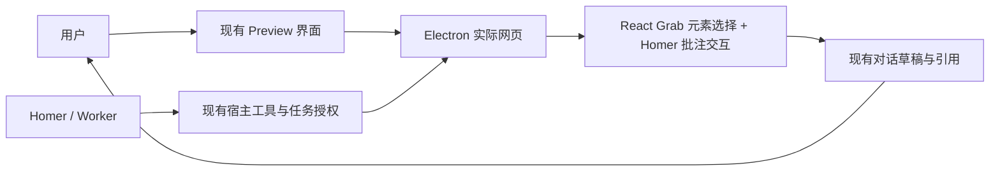

# 内嵌网页与内容操作调研

日期：2026-11-17。状态：用户授权后已接入桌面产品源码并通过隔离合成验收；真实 LLM、安装版和跨平台验收未完成。当前实施见第 16 节，前述 Demo 保留为历史实证。

**当前方案见[第 13 节](#13-当前收敛方案react-grab优先)：React Grab＋Homer 现有批注交互，保留 WebContentsView、多 Worker 各后台页面及用户接手。用户随后授权 Demo，实际结果见第 13.9 节及[运行说明](../scripts/browser-content-demo/README.md)。第 1—12、14 节是历史依据，其中 Agentation 优先及继续选型的建议已被替代，不再进行许可调研。**

研究与 Demo 阶段之后，用户已明确授权正式产品实施。当前代码与确定契约纳入现有 Preview、service、MCP、Electron 和架构正文，不增加浏览器服务或批注数据库；未提交、部署或使用日常账号。文档和合成产物可公开，不包含用户账号、浏览记录或凭据。

## 1. 需求与结论

重点是网页内部的阅读、选择、批注、提取、表单输入和交互，以及用户与 Homer/Worker 在同一页面接力。标签、地址栏、历史和下载是配套，不应主导选型。后台操作是要求；用户明确认为产品原型尚早，本阶段继续研究。

当前最简候选：**Electron 已有的 WebContentsView + webContents 内容能力 + 现有批注/草稿/引用 + 按需使用成熟自动化库**。暂不引入另一个浏览器内核、完整浏览器壳或独立 Agent 循环。这个组合是研究建议，不是已验证实现。

关键发现：

- Electron 已提供页面脚本、隔离执行环境、CSS 注入与移除、输入、截图、查找、选择文本和 CDP 入口，无须为这些基础能力另找一个全栈框架。
- 存在可安装的 React WebView 包装库，但它们封装的是 Electron/Chromium 的 `<webview>`，不是系统 WKWebView/WebView2。前者与后者不能混称。
- Wry、webview 是系统 WebView 库；没有在本轮检查的候选中找到兼具当前 Electron/React 直接接入、macOS/Windows 一致内容自动化及明确维护证据的即插即用系统 WebView 组件。这是检索结论，不是“不可能实现”。
- 现有 HTML DOM 批注可以复用大部分 UI 和数据流程；网页 URL 路径目前没有接通。适配重点是内容执行环境、通信、导航和样式，而非再建批注系统。
- `puppeteer-in-electron` 确实解决“控制现有 Electron 页面”，但源码老、映射页面的方法有副作用，不宜未经核验直接采用。

## 2. 三种 WebView 与直接可用库

### 2.1 Electron 自带能力

| 路径 | 是什么 | 内容操作与接入判断 |
| --- | --- | --- |
| iframe | 浏览器 DOM 子框架 | 可展示允许嵌入的网页；父页面不能随意读跨域 DOM，受网站 CSP/X-Frame-Options 和 sandbox 影响 |
| Electron `<webview>` | Chromium guest view，异步 IPC | 比 iframe 有更多宿主控制方法，可封装成 React 组件；Electron 官方不建议新项目依赖这一标签，包装库不能消除底层限制 |
| WebContentsView | 主进程创建的原生 View，承载 webContents | 适合真正的远程网页；可操作实际内容，不依赖网站允许 iframe。与 React DOM 的布局/覆盖层需协调 |
| 系统 WebView | macOS WKWebView、Windows WebView2 等 | 是另一套原生控件和浏览器后端；不是将 Electron 的 webviewTag 打开即可得到 |

一手依据：[Electron Web Embeds](https://www.electronjs.org/docs/latest/tutorial/web-embeds)、[WebContentsView](https://www.electronjs.org/docs/latest/api/web-contents-view)。同一 webContents 只能同时呈现在一个 WebContentsView；不要规划两个视图各显示一份“同一实时页面”。

### 2.2 实际库检查

版本是本次读取的源码清单或明确发布标签；仓库推送时间不是最近功能修复时间，也不是兼容性证明。

| 候选 | 许可、版本与维护快照 | 真正能复用什么 | 对 Homer 的判断 |
| --- | --- | --- | --- |
| [react-electron-web-view](https://github.com/MarshallOfSound/react-electron-web-view) | LICENSE 为 MIT；源码 2.0.1；仓库推送 2023-10-05；peer React 15，开发 Electron 1.4 | React 属性、事件和方法代理到 `<webview>` | 能直接安装，但不是系统 WebView；代际较旧，不作为当前基础 |
| [@luxbit/react-electron-webview](https://github.com/Luxbit/react-electron-webview) | 源码 2.0.6；推送 2025-05-09；peer 到 React 18，开发 Electron 26；LICENSE/README 写 MIT，package.json 写 ISC | 同一路线的 React 包装 | 许可标注存在不一致；没有当前 Electron 45/项目 React 组合的实测证据；不因“较新 fork”直接采用 |
| [Wry](https://github.com/tauri-apps/wry) | Apache-2.0 或 MIT；发布 wry-v0.57.2，2026-11-10 | Rust 跨平台系统 WebView、脚本/IPC、子视图与窗口句柄集成 | 是库，但不是 Electron 插件；需要原生桥、事件循环、焦点/缩放/销毁/打包适配，Mac/Windows 内容驱动也不同 |
| [webview/webview](https://github.com/webview/webview) | LICENSE 为 MIT；README 示例固定 0.12.0，不将示例版本当作最新发布版 | C/C++ 系统 WebView 与双向 JS 绑定 | 需 C/C++ 接入及各平台依赖；没有解决现有 Electron 中的嵌入生命周期或统一 Agent 驱动 |
| [EdgeSharp](https://github.com/webview2/EdgeSharp) | 本轮只用于核对框架类别，不纳入许可/版本推荐 | .NET Win32/WinForms/WPF WebView2 框架 | 是替代应用框架，不是供现有 Electron 直接加载的跨平台内容组件 |

Wry 明确需要运行中的事件循环与窗口句柄，支持 child webview；macOS 使用 WebKit、Windows 使用 WebView2、Linux 使用 WebKitGTK。[官方 README](https://github.com/tauri-apps/wry/blob/dev/README.md)、[版本和许可](https://github.com/tauri-apps/wry/blob/dev/Cargo.toml)、[发布](https://github.com/tauri-apps/wry/releases/tag/wry-v0.57.2)。webview 的平台与编译依赖见[README](https://github.com/webview/webview/blob/master/README.md)，许可见[LICENSE](https://github.com/webview/webview/blob/master/LICENSE)。

Windows WebView2 可按官方方案开放 CDP 后接 Playwright；这只证明 Windows 这一条链路，不证明 WKWebView 可用相同协议，也不证明跨平台无头能力。[Playwright WebView2 文档](https://playwright.dev/docs/webview2)。

对现有 Electron 再接系统 WebView，本轮没有测量到体积、内存或 CPU 收益。已有 Chromium 仍在运行，增加原生后端未必节省总体成本。只有出现明确的 Chromium 无法满足的需求，才值得重新比较。

## 3. 把研究重心放在网页内容

| 内容任务 | 已有组件/能力 | 使用边界与尚缺证据 |
| --- | --- | --- |
| 读取选区、引用正文、提取列表 | webContents 的上下文菜单 selectedText、页面/隔离世界脚本；复杂定位交给自动化库 | DOM 提取不等于可见内容；需区分隐藏节点、虚拟列表和实际页面状态 |
| 网页内元素批注 | 现有 Agentation runtime 与引用格式 | 注入、样式、导航及草稿桥需适配；不是从 URL 加载后自动具备 |
| 表单、按钮、下拉框、上传 | Playwright/Puppeteer 的定位、等待和输入能力 | DOM 赋值或 `.click()` 不一定触发框架预期的事件/真实交互；业务成功仍需读取验证 |
| 批量读取或重复流程 | 受授权约束的页面脚本/成熟自动化代码 | 重用用户已有 Homer/Worker 推理；不必每次动作调用一个新 Agent 模型；未知结果的写操作不能盲目循环重试 |
| 页面视觉调整、临时高亮 | insertCSS/removeInsertedCSS、页面内批注 UI | 修改当前渲染，不修改远程源文件；需可移除，避免全局样式污染 |
| Canvas、复杂画布、视频 | 网页截图、原有图像区域批注、坐标输入兜底 | 无可定位 DOM 时不能声称获得元素语义；截图坐标随缩放/滚动失效 |
| 后台读取与操作 | 保留同一 webContents 或独立 Chromium headless | 隐藏页面、offscreen、真正 headless、退出应用后持续运行是四个不同承诺 |

对 Homer 当前 Electron 45.0.0 标签的官方 API 文档做了源码核对，确认 `executeJavaScriptInIsolatedWorld`、`insertCSS`、`removeInsertedCSS`、`sendInputEvent`、`capturePage` 均存在；只是 API 存在性证据，未调用运行。[固定版本文档](https://github.com/electron/electron/blob/v45.0.0/docs/api/web-contents.md)。

隔离世界隔离的是 JS 全局环境，不隔离共享 DOM 或全部 CSS；不能将“在隔离世界运行”理解为“网站脚本绝不会影响批注器”。文档也没有证明现有 React/Agentation bundle 能原封不动在该环境正确运行。

### 3.1 现成 Electron 内容自动化库

[puppeteer-in-electron](https://github.com/TrevorSundberg/puppeteer-in-electron) 是直接相关的现成适配库：`initialize(app)`、`connect(app, puppeteer)`、`getPage(browser, window)`，接到已存在的 Electron 页面，而不是再启动一个外部 Chrome。

已核源码 3.0.5、[MIT LICENSE](https://github.com/TrevorSundberg/puppeteer-in-electron/blob/master/LICENSE.md)，仓库推送时间 2023-03-04；开发依赖 Electron 13/Puppeteer 10。[清单](https://github.com/TrevorSundberg/puppeteer-in-electron/blob/master/package.json)。它不是当前 Electron 45 已验收的适配。

深入读 [index.ts](https://github.com/TrevorSundberg/puppeteer-in-electron/blob/master/index.ts) 后发现：

- 初始化必须在 app ready 前执行；开启应用级 localhost 远程调试端口，不是仅给一个获准网页开放接口。
- getPage 类型接受 BrowserWindow/BrowserView，未明确列 WebContentsView。共同有 webContents 不等于当前 API/类型兼容已验证。
- 页面匹配会在主世界写 `window.puppeteer`，枚举所有 Puppeteer 页面读标记，再删除；存在网站同名属性覆盖、页面变化竞争和多页面权限范围问题。
- 内部有连接读取重试，但并没有解决业务动作结果未知、用户与 Worker 争写或页面归属。

因此它是“已有方法可借鉴”的实证，不是当前直接引入结论。更小的候选是 Electron 自带按 webContents 的 debugger/CDP 入口；更完整的候选是现成 Playwright/Puppeteer 连接层。按页面 debugger 的 CDP transport 不等于 Playwright connectOverCDP 所需的 browser endpoint，不应承诺随手替换即可。Playwright 的 Electron 支持仍标实验性，CDP 连接也低于其原生协议完整度。[Electron Debugger](https://www.electronjs.org/docs/latest/api/debugger)、[Playwright Electron](https://playwright.dev/docs/api/class-electron)、[CDP](https://playwright.dev/docs/api/class-browsertype#browser-type-connect-over-cdp)。

## 4. Homer 现有批注的实际复用范围

本轮源码快照的 HEAD 为 `bf5261acd1decce8d2dac7165fbf6707b5929c86`，相关结论读取的是当时共享工作区，含未提交改动，不等同于 HEAD 或已安装 App。行号可能随并行修改移动，以文件和函数名定位。

### 4.1 已存在的流程

1. [scripts/build-preview-annotation.mjs](../scripts/build-preview-annotation.mjs)把 React 与本地修改的 Agentation 3.1.2 打成自包含 IIFE。
2. [src/html-preview.ts](../src/html-preview.ts)把 HTML 与 runtime 组合进 `srcdoc` iframe，允许 scripts/forms，不赋同源和顶层导航能力。
3. [ui/annotation-frame.tsx](../ui/annotation-frame.tsx)在内容 document 中挂载实际 Agentation，通过 parent.postMessage 发送候选批注。
4. [ui/canvas-panel.tsx](../ui/canvas-panel.tsx)检查消息来源、token、sourceKey、revision/epoch，更新唯一草稿并回传确认；超时/失败保留输入。
5. [ui/annotation-draft.ts](../ui/annotation-draft.ts)与 [src/preview-reference.ts](../src/preview-reference.ts)保存并发送批注来源、元素描述、路径、位置和备注。可继续使用现有发送、删除、恢复与回看流程。

网页 URL 路径目前只有 iframe 与 connect 消息：`receive` 和 `enableWebAnnotation` 都显式排除 webSource。普通网站也没有该 runtime，因此当前页面提示不能作为“网页批注已接通”的证据。主 Electron 窗口还限制非 owned frame 导航，不能只解除 UI 分支就当成可用。

源码注释有旧的“network-disabled”描述，但当前 HTML_PREVIEW_POLICY 明确允许 HTTP(S) 资源和网络连接；本研究以策略代码为准，不能称当前预览全面断网。

### 4.2 DOM、坐标与引用的边界

- PreviewAnnotation 保存 id、element、elementPath、comment、x/y 和可选 boundingBox；网页 source 已有 URL、title、messageId/sourceId，不需重建来源系统。
- 当前库的 x 为视口宽度百分比，y/矩形涉及页面滚动与 fixed/sticky 状态；图片批注 region 则为原图像素。两类坐标不能混用，恢复时需核对视口、缩放与滚动。
- vendor getElementPath 默认深度 4，可能使用 id/class/属性，并不是永久唯一锚点。当前 focus 回看通过枚举 body 元素比较路径，只有唯一匹配才滚动；不能推断它能恢复任意 Shadow DOM/iframe 内节点。
- 库有可访问 iframe 和 open shadowRoot 的命中/投影逻辑；frameDocument 读取 contentDocument 失败返回空。跨域 iframe、closed shadowRoot 与 Canvas 不能据此宣称完整支持。
- 父端只保留有限 native metadata（isFixed、selectedText、多选矩形等）；库能产生 frame 信息不等于当前引用已保存完整 frame 身份和可恢复路径。
- 网页 DOM 会变化。当前引用输出已经注明位置是批注时的信息，不是服务器复现。回看失败时保留原内容与备注，比猜一个新元素更准确。
- 图片引用目前仅接受附件来源；网页截图应进入已有附件流程，附网页出处，不能直接给图片引用塞一个不被解析器接受的 web source。

### 4.3 哪些可复用，哪些需要适配

| 直接沿用的已有责任 | 必须研究的薄适配 |
| --- | --- |
| 备注 UI、元素选择/标记、草稿控制器 | 内容世界安装与移除；页面样式/脚本干扰；CSP 下实际运行 |
| revision/epoch/changeId 确认语义 | 顶层 WebContentsView 的 parent 是自身，改用窄的宿主通信，不能原样复用 iframe 通信 |
| 来源、引用校验、消息发送、批注列表 | 校验真实 webContents/frame/导航归属，旧页面迟到回执不能进入新页面 |
| 图片区域批注与附件 | 当前网页截图、DIP/像素和来源绑定；不要增加第二套图片编辑器 |

宿主通信只暴露此页面需要的批注消息，不向第三方网页注入 Homer 主窗口的 preload、账号令牌、任意 IPC 或文件/命令入口。token 可以用于关联，不能代替宿主对发送页面的身份校验。页面可见内容仍作为来源数据，不构成给 Agent 的新授权。

## 5. 页面脚本、样式与导航需要继续研究什么

| 情形 | 已有源码能说明什么 | 不能提前承诺什么 |
| --- | --- | --- |
| 样式隔离 | 工具栏使用 Shadow DOM，部分 portal 在内容 document 中；已有 overlay/事件处理 | JS 隔离不隔离共享 DOM；站点可移除节点或影响 host 布局；top layer/dialog/fullscreen 的覆盖需验证 |
| localStorage | 当前 runtime 在访问失败时定义内存替身，且调用 saveAnnotations(location.pathname, notes) | 不能把替身逻辑原样注入网站主世界；新场景不应顺手写站点 localStorage 或影响页面已有键 |
| 页面错误 | runtime 监听全局 error 并报告批注 runtime error | 第三方站点自身脚本异常不一定代表批注失败，不能把所有站点 error 等价处理 |
| 普通导航/刷新 | pagehide 会取消待确认状态，顶层 DOM-ready 可作为新 document 安装时机 | 未确认输入跨导航保存尚无证据；导航后不能继续使用旧节点或旧坐标 |
| SPA 路由/动态列表 | 同一 document 的 URL 与 DOM 可以变化，不一定触发新 DOM-ready | 不能只靠刷新注入；当前 runtime 按 pathname 存状态也不等于完整路由隔离 |
| 子框架/弹窗 | Electron 可观测 frame 导航及 window.open；主 frame 与子 frame 不同 | 跨域框架需要各 frame 的获准通道及坐标映射；不能靠父页面绕过同源策略 |

候选做法保持简单：同一文档仅安装一次、切换启用状态；离开文档取消旧操作并失效旧回执；保留已有草稿，重新连接后按实际来源与唯一定位恢复。不要自动重放未确认的批注提交或业务写动作。当前 runtime 的卸载、页面事件与 SPA 路由行为仍需独立研究，尚未实现。

WebContentsView 是原生视图，不是 React 元素。Homer 根页面 CSS z-index 无法把自己的 DOM 当成网页 DOM 覆盖。优先把元素高亮与就地备注放在实际内容 document，批注列表保留在 Homer；宿主弹窗出现时需协调视图区域/可见性。这个方案比再做一个透明原生覆盖窗口更小，但还没有实际渲染证据。

## 6. 用户、Homer 与 Worker 共用内容

不为研究先增加数据库实体或完整服务框架。后续可在现有宿主持有的页面引用上标记当前操作者与导航代次，继续使用既有任务授权和执行回执。

- 用户交给 Agent 的是明确页面/会话；不默认把所有个人标签页开放给 Worker。
- 同一页面一次一个写操作者。用户开始编辑或批注时，Agent 停止争写；交还后重新读取 DOM/选区，作废旧截图坐标和节点引用。
- 批注模式可能拦截点击，Agent 读取也可能读到自己的标记 UI；操作时应明确模式并排除注入的批注节点，不能一边用户选元素、一边 Worker 点击同一页。
- 不同 Worker 可在不同页面操作；若共用 session，登录退出、Cookie 和同源存储仍互相影响。多窗口不等于账号隔离，不让多个进程同时写同一持久 profile。
- 浏览器 session 与页面状态不同：共享登录不代表共享当前表单、JS 变量或长连接。用户系统 Chrome 的登录也不会自动出现在 Homer 的独立 session。
- 隐藏但保留页面最有希望支持“随时接手同一页”。后台 throttling、visibility、焦点和截图行为会影响站点；禁用 throttling 也可能增加整窗口绘制成本。[官方 webPreferences](https://www.electronjs.org/docs/latest/api/structures/web-preferences)。
- 独立 headless Chromium 可用于不需要实时交接的任务；将结果交回附件/引用。headless 到 headed 的重启或 Cookie 迁移不等于实时页面无损迁移。

## 7. 自动化工具与壳的定位

本轮不再以“选一个浏览器壳”作为主要决策。此前资料保留为辅助：

| 复用对象 | 适用范围与证据 |
| --- | --- |
| Playwright/Puppeteer | 内容定位、等待、输入、提取；连接现有内置页面的兼容与权限范围待确认，不把 Electron 测试启动接口直接暴露给 Agent 控制整个主进程 |
| [agent-browser](https://github.com/vercel-labs/agent-browser) | 2026-11-17 已核发布 0.43.0、Apache-2.0；适合独立后台 Chromium、CLI/MCP 和诊断；画面流不提供 Homer DOM 批注能力，不能因有 streaming 就直接选为主显示层 |
| [browser-use](https://github.com/browser-use/browser-use) | 同日已核 1.0.6、MIT；当前为代码执行/REPL/CDP 路线；完整 Agent 循环及 Python 分发可能重复 Homer 现有责任；本地与云服务不同 |
| [OpenCode Browse](https://opencode.ai/product/browse) / [源码](https://github.com/anomalyco/browse) | 已读正文与源码；MIT；接管用户已有 Chromium、复用登录、人机交接有参考价值；不是供 Homer 内嵌的渲染组件，也不是独立无头引擎 |
| [samuelmaddock/electron-browser-shell](https://github.com/samuelmaddock/electron-browser-shell) | MIT；此前已核 shell 源码 2.2.0、WebContentsView；可借标签生命周期、弹窗等少量代码，不需为内容能力引入其扩展商店/整个 UI |
| [Min](https://github.com/minbrowser/min) | Apache-2.0；已核发布 1.35.8；完整应用，可按缺口参考下载、权限与视图处理；不是 React 即插即用组件 |
| [electron-tabs](https://github.com/brrd/electron-tabs) | MIT、已归档且声明停更；依赖 webviewTag，排除为新基础 |
| [Wexond](https://github.com/wexond/browser-base) | 当前归档仓库 README 禁止使用代码和素材，不纳入可复用代码候选 |

用户提供的[《浏览器操控的苦涩教训》](https://www.liaocaoxuezhe.com/article/the-bitter-lesson-of-browser-use/)此前已取得全文；代码优先、持续状态、成熟接口值得参考。但内部成功率、领先性和训练推断是作者主张，不是 Homer 的实测结论；无需因此放弃结构定位或视觉兜底，也无需自建 Agent 循环。

## 8. 权限、失败分类与许可

不新增“隐私网页禁止操作”过滤。用户明确交给 Homer 的页面按现有授权处理；隔离第三方页面与宿主能力是技术边界，不是根据网页主题另加拒绝规则。

| 失败 | 应核对的证据 | 不混淆为 |
| --- | --- | --- |
| iframe 被拒 | 响应头、frame 导航、Electron 自身导航限制 | 模型拒绝操作 |
| 连接/驱动失败 | 工具是否已装载、端点/进程、协议、target 是否仍存在 | 网站“隐私” |
| 登录/权限不足 | 当前 session、Cookie、账号、站点授权 | 浏览器控制接口缺失 |
| 沙箱拒绝 | 实际调用路径和权限回执 | 所有 Worker 统一断网 |
| 服务/模型拒绝 | 原始工具回执、模型响应、配置 | 本地 Chromium 无法打开 |
| CAPTCHA/风控/平台认证 | 站点挑战及原生能力，允许用户接手 | 改成顶层页面就必然解决 |

Homer 当前 [desktop-cua.ts](../src/desktop-cua.ts) 是外部 Chrome/原生窗口链路，含 owner 串行与隔离 origin 限制；不是这里所建议的网页内容接口。当前 [engine.ts](../src/engine.ts) 的禁网络 controlPermissions 用于 controlOnly，不能泛化到 Worker。没有历史具体失败回执，本研究不声称解释了所有 Codex 连接问题。内置浏览器可减少外部链路依赖，不能承诺消除网站政策、账号风控或模型供应商约束。

现有 [Agentation LICENSE](../ui/vendor/agentation-3.1.2/LICENSE) 是 PolyForm Shield，包含竞争性用途限制；[本地集成说明](../ui/vendor/agentation-3.1.2/MODIFIED-SOURCE.md)也明确不是 MIT，已有本地集成不构成商业/公开分发许可确认。技术复用与扩大分发范围分别核对；本轮未扩大运行或分发范围，也未作法律适用结论。

## 9. 本轮证据、未验证项与下一步研究

已完成：官方 API/固定 Electron 45 文档核对；候选 README、源码清单、许可证和维护元数据读取；puppeteer-in-electron 实际端口及页面匹配路径检查；Homer 内容批注到引用/草稿的代码追踪。结论来自具体分支和源码，不以搜索摘要代替能力核验。

现有 [HTML 生命周期检查](../tests/html-annotation-lifecycle.browser.mjs)、[批注同步检查](../tests/annotation-composer-sync.browser.mjs)、[边界检查](../tests/preview-annotation-edge-cases.browser.mjs)可供后续复用；本轮仅阅读入口，未运行，也不将历史合成 iframe 检查视为 WebContentsView/真实网站验收。

本轮未做：启动 Electron/Chrome、安装依赖、构建 bundle、连接日常账号/profile、真实网站写入、付费模型调用、产品原型或性能测试。文档检查只覆盖本新增文件的格式、链接目标与差异。

后续先补下列证据，不提前进入产品实现：

1. 对固定 Electron 45 的隔离世界、preload、frame 生命周期及自动化 target 绑定继续查源码/上游测试，确认选定连接方式不会开放整个 Homer 主窗口或枚举其他任务页。
2. 对现有批注 bundle 的 storage、样式注入、事件监听、全局 error 与卸载责任做定向审阅，列出迁移所需最小改动；同时核对实际用途的许可条件。
3. 用户若继续授权隔离技术验证，仅用合成离线页面检查严格 CSP、站点全局样式、SPA 重渲染、跨域 frame、Shadow DOM、导航未确认批注、缩放/输入法及用户/Agent 交接。无需接入产品入口、真实账号或真实模型；通过也只算局部技术证据，不算产品交付。
4. 收到这些证据后再决定是否需要产品原型。没有明确缺口就不追加浏览器壳、另一套存储或新的 Agent 框架。

研究材料保留为本文件。没有克隆仓库、下载包、临时 profile、测试副本或运行进程需要回收。

## 10. 独立复审：真实采用者遇到的限制

复审日期：2026-11-17。针对第 1 节组合重新检查，而非为原建议寻找背书。目标仍为工作区 Electron **45.0.0**、playwright-core **1.59.1**，主要平台 macOS ARM64、Windows x64。上游 main、其他版本或 Linux 报告只作为线索；没有本机复现就不写成 Homer 已发生的问题。本节保留原文，修正和收窄其适用范围。

### 10.1 复审结论与必须收窄的承诺

组合仍有可行性，适合普通网页阅读、提取、常规表单与显式批注；**不能据此承诺任意网站完整登录、无焦点后台输入、通用浮层覆盖、任意内容稳定锚定或整套批注 runtime 原样迁移**。这些限制分别来自网站政策、原生视图模型、浏览器协议和现有库行为，不是“隐私页面过滤”可以解释的。

优先处理四个决策：

1. 网页与宿主 React 弹层怎样共存。已有成熟项目采用“临时隐藏实时视图、显示截图占位”，确实可行，但占位期间无法直接操作实时网页；透明原生浮层的任意区域点击穿透仍非通用现成功能。
2. 后台操作选哪条输入链路。Electron 原生输入 API 有焦点条件；若 CDP/成熟库不能在目标组合中满足要求，就应明确退回用户接手，不能默默抢窗口或把 DOM 改值算成交互成功。
3. 现有批注只复用所需功能。暂停动画、定时器、storage、全局错误和卸载均需审阅，不能直接把整个开发反馈工具当作任意业务网页的无侵入批注层。
4. 对网站认证保留独立能力边界。一般表单可用不等于 Google OAuth、任意站点 passkey、支付确认或 CAPTCHA 均可用；应按站点与操作留证。

### 10.2 实际 issue 状态与版本判断

下表状态通过 GitHub issue API 和评论核对；`closed/completed` **不等于已经定位到修复提交或已进入 Electron 45**。报告正文是报告者证据，不自动等同维护者确认。

| 证据 | 状态与适用范围 | 对 Homer 的具体影响、绕行与代价 |
| --- | --- | --- |
| [Electron #42339](https://github.com/electron/electron/issues/42339)、[PR #49425](https://github.com/electron/electron/pull/49425)：新增原生内容页打断输入焦点 | issue 已关闭；PR 已合并。维护者明确 navigation commit 是触发点，40+ 有 focusOnNavigation；45.0.0 固定文档已核该属性 | 可以设置 focusOnNavigation:false，再在用户明确切页时主动 focus；代价是自行管理焦点和键盘导航，不应“失焦后再抢回来”造成丢字。这不是当前不可解决问题 |
| [Electron #54321](https://github.com/electron/electron/issues/54321)：隐藏内容视图导航仍取焦点 | 报告 44.4.5/45 alpha、Linux，已关闭，无修复说明；正文自己确认上述选项可规避 | 隐藏不等于无焦点行为，默认值需审视；不能将该 Linux 报告当作 macOS/Windows 正式 45 复现 |
| [Electron #54328](https://github.com/electron/electron/issues/54328)：未挂窗口视图在 macOS 错报焦点 | 44.3 macOS 报告；已关闭、无评论/修复链接。45.0.0 的 IsFocused 源码仍在 NSWindow 非空时才检查 key window，与报告所指结构一致，但未运行复现 | 不用 getFocusedWebContents 选 Worker 目标；沿明确持有的内容页引用路由。系统焦点仅用于交互校验，不作为页面授权或归属依据 |
| [Electron #49039](https://github.com/electron/electron/issues/49039)：WebContentsView 局部点击穿透 | **开放的功能需求**；多个应用报告透明顶层视图阻断底层鼠标事件，转发和多窗口方案有边界 | 首选内容内批注，宿主菜单可缩小/隐藏网页视图。透明浮层加 pointer-events:none 的 DOM 思路不能直接跨原生视图；多透明窗口会增加焦点、IME、可访问性和平台维护成本 |
| [Electron #43293](https://github.com/electron/electron/issues/43293)：空/加载中的内容视图层级异常 | 历史 31/32 报告、已关闭；报告者确认 **31.4.0+ 加载情形恢复**，Mac/Windows 均有结果 | 不把旧视频当成 45 必现故障；原生视图不受宿主 DOM z-index 控制这一结构边界仍成立，二者分开 |
| [Min #2709](https://github.com/minbrowser/min/issues/2709)、[PR #2710](https://github.com/minbrowser/min/pull/2710)：中文 IME 首字母残留/重复 | Windows/macOS，Min 1.35.5 及此前报告；PR 2026-06-21 已合并，修正为 composition 完成后显示搜索结果 | 是“原生输入与动态宿主 UI 的组合会出问题”的真实案例，不证明网页内容输入在 Electron 45 必坏。批注 Popup、快捷键和用户/Worker交接必须尊重 composition，不能仅靠英文 type/fill 验证 |
| [Electron #54323](https://github.com/electron/electron/issues/54323)：debugger 附着时没有 unresponsive | 报告 44.4.5/45 alpha、Linux，已关闭无修复说明；45.0.0 源码仍受 ShouldIgnoreUnresponsiveRenderer 和 visible 条件控制 | 无响应监控不能只等这个事件，后台页尤其如此。可用有界调用超时/存活探测与原回执；超时不说明写操作未发生，不能因此自动重试提交 |
| [Electron #53819](https://github.com/electron/electron/issues/53819)：附过 CDP 的 webview 反复销毁导致主进程崩溃 | 43.1.1/macOS 的 **webview tag** 报告；已关闭，评论仅见调查，没有核到 45 修复版本 | 不外推为 WebContentsView 必崩，也不声称 detach 后必安全；更支持避免 React 重挂内容页、协调导航/命令/销毁顺序。它是剩余风险线索，不是当前方案否决证据 |
| [Electron #54025](https://github.com/electron/electron/issues/54025)：隐藏 Windows 窗口＋titleBarOverlay 不发 ready-to-show | 44.4.x 回归报告；关闭记录包含模板机器人，不构成修复证明；未核到正式 45 复现 | 后台准备不能无限只等首帧；DOM-ready/连接/首次可用状态分别观察。回退显示整个窗口会抢前台，不宜把报告者 workaround 直接搬入 Homer |

固定源码依据：[45.0.0 webPreferences](https://github.com/electron/electron/blob/v45.0.0/docs/api/structures/web-preferences.md)、[RendererUnresponsive](https://github.com/electron/electron/blob/v45.0.0/shell/browser/api/electron_api_web_contents.cc)、[macOS IsFocused](https://github.com/electron/electron/blob/v45.0.0/shell/browser/api/electron_api_web_contents_mac.mm)。这些是源码结构核对，不是运行验收。

### 10.3 已采用类似架构的项目怎样处理

**Min 的同类原生视图并未消除宿主浮层问题。** 当前 [js/webviews.js](https://github.com/minbrowser/min/blob/master/js/webviews.js) 的 requestPlaceholder/hidePlaceholder 会捕获或使用页面预览图、请求 hideCurrentView，等宿主操作结束后恢复实际 view；多个占位理由共同控制恢复。它证明“截图占位＋临时隐藏”的路径已有真实采用者，也明确其代价：画面不是实时内容，隐藏/恢复与焦点有额外协调，不能在截图占位上继续让用户当成原网页点击。

**Playwright 使用者已经遇到内容页与应用级 tracing 范围不一致。** [#33530](https://github.com/microsoft/playwright/issues/33530) 的作者明确使用 Electron＋WebContentsView＋connectOverCDP，只希望记录一个内容页，context tracing 却覆盖同 context 其他页；维护者认为该非测试用途超出范围，建议 CDP 等工具，issue 已关闭。Homer 不能把选定 page 等同自动获得“仅该页面可见/可记录”的保证；应限制宿主实际返回和记录范围，不启用默认全 context 追踪，代价是放弃部分现成全量诊断便利。

**“浏览器可能不安全”确实可能由网站认证侧产生。** Min 的 [#868](https://github.com/minbrowser/min/issues/868)、[#2306](https://github.com/minbrowser/min/issues/2306)仍开放。旧建议中有改 UA 的尝试，但不构成长期或当前成功保证。Google [OAuth 官方政策](https://developers.google.com/identity/protocols/oauth2/policies#secure-browsers)明确禁止把开发者控制的嵌入 user-agent 用于 Google OAuth 授权请求，所述能力包括注入任意脚本、改请求路由和读 session cookies。这与本方案可控制的能力重叠，不能把失败都归因于 Codex，也不能承诺修改 UA 解决。该政策针对 OAuth 授权，不应扩大成所有 Google 页面都无法阅读或用户操作。

可行替代是站点支持的系统浏览器/OAuth 回调或用户在受支持环境完成授权；对第三方网页，Homer 未必拥有其 OAuth client/callback，完成外部登录也不自动把 cookie 转移到内置 session。这里存在无法仅靠本地工程彻底消除的产品边界。

### 10.4 CDP、多个调试者与后台输入

- 固定 [45.0.0 Debugger 文档](https://github.com/electron/electron/blob/v45.0.0/docs/api/debugger.md)仍声明打开附着页面的 DevTools 会导致 detach。应处理 detach、目标关闭与未完成调用，用户打开开发者工具时可能需要暂停 Agent。
- 不把“CDP 只能有一个客户端”写成结论。[45.0.0 实现](https://github.com/electron/electron/blob/v45.0.0/shell/browser/api/electron_api_debugger.cc)检查的是本 Debugger 对象是否已有 agent_host，然后 AttachClient；这不能证明 DevTools、Playwright 和多个 Worker 的所有命令可安全同时使用。多个客户端即使成功连接，也可能争抢输入、导航、网络拦截、emulation 和截图模式。
- 对同一内容页由一个宿主控制通道协调写操作；Worker 不直接获整个 Electron browser endpoint。这样复用任务执行/回执即可，不必先增加多 Agent 浏览器服务框架。只读命令也要考虑 context 级 tracing、页面脚本和监测的副作用。
- **重要收窄：**[45.0.0 sendInputEvent 文档](https://github.com/electron/electron/blob/v45.0.0/docs/api/web-contents.md#contentssendinputeventinputevent)要求所属 BrowserWindow 获得焦点。第 3 节列有该 API，不等于它可实现完全不抢前台的后台输入。后台 DOM 读取通常不需要用户键盘焦点，真实输入还要确认 CDP/Playwright/Puppeteer 路线；DOM setter/脚本 click 不能替代所有受控组件、手势和安全确认。
- backgroundThrottling:false 会影响页面可见性和整窗口绘制，不能解决所有后台站点行为。应用退出、系统睡眠、网站依赖 visibility、原生凭据/文件选择弹窗都不是“隐藏一个 View”即可消除。

### 10.5 批注 runtime 不是无侵入组件：新增离线证据

本轮对实际 [vendor ESM](../ui/vendor/agentation-3.1.2/index.mjs) 的 freeze/unfreeze 函数做了**一次 Node VM 合成检查**：只读取并执行对应函数，用内存对象替代 window/document/timer，没有加载 Electron、React 页面、网络站点或真实模型，也没有生成脚本文件。退出码 0，结果为：

```json
{"frozen":false,"remainingStyleCount":0,"timeoutRestored":false,"intervalRestored":false,"rafRestored":false}
```

其含义严格限于：启用该库的“暂停”功能后，恢复会移除冻结样式，但保留对该执行世界 setTimeout/setInterval/requestAnimationFrame 的包装。源码还会暂停 document.getAnimations 和 video，并在恢复时回放部分队列。**默认 isFrozen 为 false，不是打开批注就自动冻结网站。**

这在任意业务页中具有重要差别：主世界会改变站点调度；隔离世界的 timer 包装不能冻结站点主世界定时器，但共享 DOM 的动画/视频仍会被影响。因此不能既宣称“暂停了整个站点”，又宣称“完全无侵入”。候选是对真实网页先不提供这一附加功能，仅复用选择、备注与草稿确认；具体裁剪和卸载工作尚未实施。

其他已确认的迁移风险：

- [annotation-frame.tsx](../ui/annotation-frame.tsx)绑定全局 error，网站自身异常可能被当作批注失败；pagehide 清理 pending 但没有一条完整的可反复卸载/重挂 React root 路径，不能在 SPA 上反复注入当作可靠恢复。
- runtime 对 localStorage 的兼容替身，以及 saveAnnotations(location.pathname, notes)，均需与站点业务 storage 分开看待。新桥不能因同源页面就信任任意 postMessage。
- 同一页第三方 JS 与批注共享 DOM。Shadow DOM 降低样式冲突，不防站点移除 host、重置 body、改变布局或捕获事件；宿主顶层 React portal 也不能跨 document 直接变成内容页批注。
- Chromium [content scripts 文档](https://developer.chrome.com/docs/extensions/develop/concepts/content-scripts#content_security_policy)区分 isolated world 的 CSP 与 MAIN world 的页面 CSP；不能由“Chrome 扩展注入成功”直接推出 Electron 自定义 world＋现有 bundle＋所有严格 CSP 均可用。保留执行、style 插入和站点行为的定向证据缺口，不采用全局关 webSecurity/移除站点 CSP 作为默认方案。
- Playwright [定位文档](https://playwright.dev/docs/locators#locate-in-shadow-dom)明确不支持 closed-mode shadow roots，XPath 不穿透 shadow。跨域 frame 可以通过获准的各 frame 自动化接入，但现有批注仅保存有限 frame metadata，不会因此自动获得可靠的跨 frame 锚定。Canvas/DRM 画面等也可能只能截图或由用户接手；视觉兜底不等于可恢复的 DOM 语义。

### 10.6 登录、弹窗、支付与平台认证不能统称“支持”

正常 popup 能创建，并不代表站点完整登录成功。保留 opener、POST body、session、跨站重定向和站点隔离策略等语义，需要沿实际弹窗生命周期处理；简单地把每个 popup URL 在新标签再 loadURL 可能丢失这些上下文。系统认证、文件选择、支付 sheet 和 CAPTCHA 可能超出网页 DOM，需要用户接手；未知付款结果继续沿原回执核对，不自动重放。

**修正过宽的 passkey 判断：Electron 45 并非一概不支持 macOS passkeys。** 固定 [app.configureWebAuthn 文档](https://github.com/electron/electron/blob/v45.0.0/docs/api/app.md#appconfigurewebauthnoptions-macos)已有两条不同路线：

- Touch ID/Secure Enclave：需匹配签名 keychain access group；按 session 持有 metadata secret。开放的 [#52302](https://github.com/electron/electron/issues/52302)报告非持久 session 创建凭据后，重启丢 secret 导致孤立凭据，要求 per-session 开关。报告尚未在 Homer 复现，不将其直接称为目标版确定缺陷；也不认为“临时浏览器＝凭据全部临时”。
- platformPasskeys：文档要求签名、provisioning profile、Associated Domains 与依赖方域名 AASA 关联。Homer 无法单方面为任意第三方域名提供这种关联；该路线也不服务跨 origin iframe 请求，并有 prf/largeBlob 扩展限制。

本轮 Homer 源码搜索没有发现 configureWebAuthn 调用，不把上述 API 存在当作产品已启用；也不打开真实 keychain/profile 验证。此前其他浏览器 README 的平台认证限制不能替代固定版本官方文档。

### 10.7 缩放、截图、生命周期与许可

- 固定 [45.0.0 缩放 API](https://github.com/electron/electron/blob/v45.0.0/docs/api/web-contents.md#contentssetzoomlevellevel)说明默认按 origin 共享缩放，可用 setZoomMode('isolated')；不同 Worker 的同源页面不一定天然各自独立缩放。CSS px、DIP、截图像素、页面缩放和显示器缩放需明确转换，不能沿用旧截图坐标。
- [capturePage](https://github.com/electron/electron/blob/v45.0.0/docs/api/web-contents.md#contentscapturepagerect-opts)有 stayHidden/stayAwake，并说明捕获计数影响可见状态；一次截图也可能影响后台行为。它捕获网页可见区域，不等于操作系统弹窗、完整窗口或所有未滚动内容。
- [#55180](https://github.com/electron/electron/issues/55180)是当前开放的 Windows WGC 桌面捕获 GPU 泄漏报告，正文包括正式 45.0.0。**只适用于所报 desktopCapturer/getUserMedia 桌面捕获路径，不证明 webContents.capturePage 泄漏**；若为原生认证弹窗退回系统捕获，需要单独核验。报告者的 GPU 数据不是 Homer 测量值。
- [BaseWindow 资源管理](https://github.com/electron/electron/blob/v45.0.0/docs/api/base-window.md#resource-management)明确关窗口不会自动销毁其 WebContentsView 的 webContents。隐藏、移除和销毁要分开，停用时取消实际调用/监听；不能为了“随时接力”无限保留已无用途的后台页，也不能删除仍有未提交内容的页面。
- Agentation 的 PolyForm Shield 适用与分发范围仍未确认；将其用于通用网页批注不能自动沿用“现有 HTML 本地集成”的许可结论。UI/草稿/引用可复用，不代表所有 upstream 功能和分发方式均已获许可。复审没有修改许可证或推断已获商业许可。

### 10.8 研究验收与下一步

本次完成的是固定版本源码/文档交叉检查、真实采用者 issue 状态/评论/修复记录核对及一项有限 VM 证据；没有启动 Electron/Chrome、连接用户账号、运行真实模型或产品原型。Node VM 检查不证明隔离世界、CSP、IME 或站点行为已通过。

建议后续研究按证据缺口排序：先确定宿主层级/后台输入和同页控制边界，再审阅批注可保留功能与许可，最后才讨论是否授权合成技术实验。已修复历史问题只保留回归场景；关闭但无修复链接的报告保留目标版未知；固有边界用明确降级表达；开放问题不夸大成所有平台不可用。

若这些边界不能接受，应先调整承诺：允许部分认证跳到受支持浏览器、允许特定页面只做截图批注或用户接手、允许宿主菜单期间暂用占位图。不能为了让方案看起来完整而默认新增透明窗口体系、改 Chromium、关闭网页安全策略或接付费 CAPTCHA 服务。

## 11. 多 Worker、批注替代件与行业认证处理

补查日期：2026-11-17。本节仍为只读研究；没有安装库、登录账号、调用模型或运行浏览器原型。下列版本为读取的源码清单，不冒充最新正式发布；维护时间为仓库推送快照，不证明每项功能近期修复。

### 11.1 多个 Worker 各操作一个 Preview 标签，不要求全部展示在前台

例如 A 读取商品列表、B 填一份普通表单、C 提取报告，同时用户只看 C。可按明确页面引用，把 DOM/CDP 命令发到 A/B/C 各自的页面；任务并行不要求轮流把三个页面切到系统前台。agent-browser 官方已有多个命名隔离 session 的用法；OpenCode Browse 明确让 Agent 创建后台标签，且不允许 Agent 主动把窗口拉到前台。[agent-browser sessions](https://agent-browser.dev/sessions)、[Browse 使用说明](https://github.com/anomalyco/browse#usage)。这证明相应产品的设计路径存在，不等于 Homer 的 WebContentsView＋目标自动化组合已运行验收。

需要分开四个限制：

- **页面级与系统级焦点不同。** DOM/CDP 可以指定目标页面及其元素，不必依赖操作系统当前活动窗口；Electron sendInputEvent 的窗口焦点条件、桌面快捷键、原生文件/凭据窗口仍可能要求前台。CDP 也不保证所有站点都忽略 document.visibilityState、用户手势或页面内焦点。
- **一页一个写操作者，不是一台电脑只能一个 Worker。** 不同页可并行；同页用户与 Agent 的点击/编辑要接力，避免输入交叉。连接数量多不代表共用同一页面的导航、emulation、网络拦截和 tracing 可以任意并发。
- **标签隔离不等于账号隔离。** 同 Electron session 的同源页共享 Cookie/localStorage 等状态；A 退出登录，B 可能随即失效。即使浏览器存储隔离，同一个网站账号仍可能共用服务器端购物车、草稿或登录名额。需要隔离时用独立 session/partition 与账号，不让多个进程写同一持久 profile。
- **隐藏页面仍消耗资源。** DOM、脚本、网络、renderer 和 GPU 有成本；节流可能影响时序，关闭节流可能增加 CPU。允许多少并发应测量后决定，不按“开多少 tab 就支持多少 Worker”承诺，也不预设每个标签必有一个独立进程。

浏览器库中的“元素必须 visible”通常指元素在该页面布局中可交互，并非要求该 tab 一定在用户桌面前台；具体隐藏原生 View 的渲染、布局及截图仍属 Homer 目标组合的待验证项。

### 11.2 WebContentsView 不要求重做整套批注

现有分工可以保留：内容页负责选元素/选区和标记，Homer 负责草稿确认、引用、批注列表及消息发送。WebContentsView 改变的是运行和通信位置，不改变备注属于当前对话草稿的责任。

- **可沿用：** annotation-draft、现有来源与引用、revision/epoch/changeId 语义、批注列表和发送流程；可复用 [AnnotationCommentForm](../ui/annotation-comment-form.tsx) 的备注输入/保存/删除交互，以及已有图片区域批注。
- **需适配：** 注入真实 document、隔离世界/窄宿主桥、视图导航、事件和样式清理；iframe parent.postMessage 不能原样用于顶层 WebContentsView。现有 DOM 选择/标记代码可能继续用，也可以换库，二者不绑定。
- **需审阅而非照搬：** 暂停/冻结、storage、全局 error、重挂/卸载和 frame 锚点。现有文本引用的 source 限制为附件；新文本批注引擎不能把自己的 range/quote 锚点直接丢进当前 web elementPath 字段，需保留其语义并决定最小适配。不能以“复用格式”为由丢弃恢复所需信息。

因此不是重写批注产品；但也不是只把 iframe 换成 WebContentsView 就完成。技术复用与 Agentation 许可范围继续分别评估。

### 11.3 实际开源替代库：能力不能混称等价

| 候选与一手来源 | 许可、源码版本/维护 | 已有能力 | 替代 Agentation 的缺口 |
| --- | --- | --- | --- |
| [React Grab](https://github.com/aidenybai/react-grab)、[primitives 源码](https://github.com/aidenybai/react-grab/blob/main/packages/react-grab/src/primitives.ts)、[LICENSE](https://github.com/aidenybai/react-grab/blob/main/LICENSE) | MIT；源码 react-grab 0.2.0；推送 2026-08-22 | DOM 命中、矩形、选择器、上下文；primitives 明确可构建自定义界面，支持 open shadow 与同源 iframe 的命中/坐标 | 最接近任意元素选择部分；不是完整持久批注产品，无 Homer 备注/标记/确认协议。源码定位偏开发环境，第三方生产页未必有 React source stack；其冻结/复制/编辑器功能仍需排除或审阅，不能整包注入替换 |
| [Recogito Text Annotator](https://github.com/recogito/text-annotator-js)、[React wrapper](https://github.com/recogito/text-annotator-js/tree/main/packages/text-annotator-react)、[LICENSE](https://github.com/recogito/text-annotator-js/blob/main/LICENSE) | BSD-3-Clause；@recogito/text-annotator 源码 4.3.7；推送 2026-10-12 | 文本范围选择/高亮、创建/更新事件、加载/删除、destroy、scrollIntoView；React 有可定制 selection popup | 很适合文章/文本；不等于选择按钮、图片、卡片任意 DOM 元素。备注 UI 可用 Homer 现有组件，锚点与确认需适配；React 示例包裹自有内容，不证明可直接包裹另一 WebContents 的 document |
| [Hypothesis client](https://github.com/hypothesis/client)、[LICENSE](https://github.com/hypothesis/client/blob/main/LICENSE)、[嵌入说明](https://github.com/hypothesis/client/blob/main/docs/publishers/embedding.rst) | 主体 BSD-2-Clause，含单独许可子组件；推送 2026-11-12；package 版本为 dummy，不据此报发布版本 | 成熟网页文本高亮、批注及侧栏；可作为扩展或页面嵌入，有文本锚定相关实现 | 更完整但客户端围绕 Hypothesis 服务，不能直接把 embed.js 当成本地 Homer 草稿替代。换后端/认证/侧栏或抽取锚定模块有整合成本；内嵌 iframe 支持也有明确同源/层级限制，不等于任意页面全元素批注 |
| [web-highlighter](https://github.com/alienzhou/web-highlighter)、[LICENSE](https://github.com/alienzhou/web-highlighter/blob/master/LICENSE) | MIT；源码 0.8.0；推送 2026-10-29 | 依赖少的文本选择高亮、序列化、恢复和事件回调 | 不含任意元素选择和完整备注编辑器；会包装文本 DOM，框架重渲染/结构和分词变化会影响恢复，README 已说明。可配现有备注表单，但需评估对第三方 DOM 的影响 |
| [Annotorious](https://github.com/annotorious/annotorious)、[LICENSE](https://github.com/annotorious/annotorious/blob/main/LICENSE) | BSD-3-Clause；源码 3.9.5；推送 2026-10-20 | 图像区域标注、事件/加载与 React 集成 | 适合网页截图或图片区域；不是通用 HTML 元素批注引擎。Homer 已有图像批注能力，优先复用，不为本研究重建 |
| [旧 RecogitoJS](https://github.com/recogito/recogito-js) | BSD-3-Clause；已归档，README 明确 deprecated | 旧文本批注实现 | 不按旧教程推荐；官方已指向上表 Text Annotator |

这些库可以构成功能等价的组合，但没有在本轮核查中确认一个当前维护、宽松许可、能直接替换“任意 DOM 元素选择＋持久标记＋备注＋Homer 引用”的完整组件。

研究优先级：若保持任意元素批注，先审 React Grab 的选择/矩形/selector primitives，配现有备注表单和草稿，仅补标记及页面桥；这是一条待验证组合，不是零开发替换。若主要批注文章文字，优先评估 Recogito Text Annotator；若要完整协作批注服务，才考虑 Hypothesis。截图继续沿已有图片流程。没有必要为所有范围同时引入多个引擎。

### 11.4 其他 Agent 浏览器怎样解决认证与接手

| 实际方案 | 登录态、认证与接手方式 | 能证明与不能证明的内容 |
| --- | --- | --- |
| [OpenCode Browse](https://github.com/anomalyco/browse) | 扩展操作现有 Chromium，使用其中已有登录；用户借出标签、随时收回，登录/2FA/支付时 handoff，完成后点 Continue；Agent 自己后台标签与用户标签分开 | 通过复用受支持浏览器及真实会话减少重新登录，不是重新实现 OAuth。网站仍可风控；内部 chrome 页面等也有限制。不意味着 Electron 新 session 自动得到这些登录 |
| [agent-browser](https://github.com/vercel-labs/agent-browser)、[CDP 模式](https://agent-browser.dev/cdp-mode)、[session](https://agent-browser.dev/sessions) | 可连接已有 CDP 浏览器，或为命名 session 启动独立浏览器并配置 profile/state；也有 streaming 供用户交互 | “连接已登录页面”与“新建持久 profile 首次登录”不同。独立 session 各有存储/认证；改变 headed 等启动选项可能重启，Cookie 恢复不保留实时 DOM。工具存在不等于所有验证码/passkey都完成 |
| [Browser Use 本地与 Cloud](https://github.com/browser-use/browser-use#faq) | 本地可操作现有 Chrome/指定持久目录，云端用 cloud_profile_id；Cloud live view 可供用户操作。README 声明云端有 CAPTCHA solver，可关闭，并明确无配置保证所有挑战可解 | 云浏览器/solver 是服务能力，不随 MIT 本地库自动具备；README 默认浏览器是云端，不能未经选择把它当本地。profile 保留登录不保证 cookie 不过期、不触发风控；云 profile 也不是本机 Touch ID/iCloud 凭据 |
| [Browserbase Contexts](https://docs.browserbase.com/features/contexts)＋[Live View](https://docs.browserbase.com/features/session-live-view) | 持久 Context 保存 Cookie/localStorage/IndexedDB，Live View 可让人看、点击、输入并交还 Agent | 官方明确建议避免同一 Context 同时用于多个登录会话，网站仍可强制登出；持久 Context 不等于永久有效认证。Live View 是云会话接手，不是把本地系统认证器带到云端 |
| Homer 内置 Electron | 可持有自己的浏览 session，普通网页登录后由用户交给 Worker；系统认证按 Electron/平台 API 接入 | 这是候选设计，未实现。不会自动继承外部 Chrome cookies；OAuth 嵌入式限制和 Electron passkey 条件仍按第 10 节处理，没有“换成内置就普遍绕过”的依据 |

可理解的同类工作流是：用户先在真正运行任务的浏览器会话中完成一次登录/2FA，Agent 沿同一会话继续；下一次任务尽量复用该会话，遇到过期或新认证再交回。OAuth popup 必须保持其实际 opener/session/跳转上下文；不把登录页 URL 另开一遍就当成等价。CAPTCHA 可能人工处理或由另选服务处理，都不能保证普遍成功；passkey 还受真实设备/平台/域名关联约束。

本轮核实的是这些产品的公开文档和源码能力，没有在它们或 Homer 中登录任何站点。Homer 应复用的成熟经验是明确页面、保留合适的会话、显式交接和重新观察；不为“看起来全自动”默认复制用户 profile、启用云端或加入付费解验证码服务。

## 12. 历史比较：React Grab 的采用指标与两条批注路线的成本

查询日期：2026-11-17。本节记录改选 React Grab 之前的比较与初步推荐；当前决策以第 13 节为准，后述许可调查不再是待办。不改变“暂不做产品原型”的边界，也不以下载量推算人数。

### 12.1 公开指标能说明多少

| 指标 | 本次实际查询值 | 解释 |
| --- | --- | --- |
| GitHub stars / forks | **7,722 / 342** | [仓库 API](https://api.github.com/repos/aidenybai/react-grab)。关注和派生规模，不等于活跃安装或真实用户 |
| 最近一周 npm 下载 | **2,968,625**，窗口 2026-11-10 至 2026-11-16 | [npm 下载 API](https://api.npmjs.org/downloads/point/last-week/react-grab)。包下载次数，含自动化、重复安装/依赖等，非去重用户 |
| 最近一月 npm 下载 | **10,753,646**，窗口 2026-10-18 至 2026-11-16 | [npm 下载 API](https://api.npmjs.org/downloads/point/last-month/react-grab)。不据此推导生产项目数或 Electron 采用人数 |
| 正式包 | npm latest **0.2.0**；npm 元数据发布时间 2026-08-16T09:37:09.209Z；GitHub 对应 release 为同日 | [npm 元数据](https://registry.npmjs.org/react-grab)、[release](https://github.com/aidenybai/react-grab/releases/tag/react-grab%400.2.0) |
| 维护活动 | 仓库 pushed_at 2026-08-22；最近 30 条默认分支 commit 覆盖 2026-07-18 至 2026-08-22，涉及 **2 个不同 author 标识** | [提交样本](https://api.github.com/repos/aidenybai/react-grab/commits?per_page=30)。author 标识可能含机器人；只是这段样本，不是贡献者总数。距查询已近三个月，不称为持续高频更新 |
| 全部贡献者/真实使用人数 | **未取得可验证总数** | GitHub 连接器不支持 contributors endpoint，匿名 API 又限流；不猜总人数。下载和 star 无法回答有多少用户将它用于任意第三方网页/Electron |

可得结论：有可观的公开关注与包下载记录，值得研究；没有证据证明它在 Homer 这种“第三方网页＋多条持久批注＋WebContentsView”场景已足够成熟。

### 12.2 检查了已发布包，避免只看 main 文档

本轮还只读获取 npm 0.2.0 tarball 并在内存中检查文件/类型声明，没有落盘安装或执行包代码：它确实导出 `react-grab/primitives`，包含 getElementAtPoint、getElementsAtPoint、getElementBounds、getElementSelector 等，不是只存在于未发布源码中的建议 API。[发布包](https://registry.npmjs.org/react-grab/-/react-grab-0.2.0.tgz)。

但“只用几个函数”不等于引入一个完全独立、零运行依赖的 DOM 库：已发布 package 仍依赖 bippy 与 @react-grab/cli；primitives 引用共享 chunk、冻结、上下文、样式提取等模块。没有构建测量，不推算 tree-shaking 后大小或性能。主分支与已发布包的 bippy 版本也有差异，后续必须固定实际依赖而非跟 main 自动升级。

getElementContext 会额外获取 React/context/source 与样式；对任意第三方生产页，不应依赖一定能拿到组件源文件。只做元素批注时，先研究最小命中/矩形/selector 函数，而非默认启用源码提取、剪贴板、openFile 或 freeze。

### 12.3 “选择 DOM＋现有弹窗”能实现目标，但不是完整现成产品

这足以搭出“选元素→写备注→保存”的主路径，完整目标还要承担下列接缝。现有 [AnnotationCommentForm](../ui/annotation-comment-form.tsx)明确只是表单内容，定位、草稿、校验和保存事务属于调用方；它已经处理 IME 和忙碌/失败交互，可复用但不包含元素批注控制器。

| 责任 | React Grab primitives＋现有表单 | 迁移现有 Agentation 集成 |
| --- | --- | --- |
| 指针选择、矩形与元素描述 | 有命中/矩形/selector 原语；还要写批注模式监听与状态，避免选中链接时真的导航/提交 | 已有选择模式与交互、原生 Popup，可继续沿用；仍需审阅站点事件冲突 |
| 标记与多条批注 | 需把保存的多条记录渲染成标记，处理编号、点击编辑、删除、选中、重复目标与滚动/resize | 已有标记/多批注/多选和更新删除流程，Homer 已接入 |
| 备注输入、失败与确认 | 表单已有；需把选中/编辑/保存候选与现有 revision/epoch/changeId 接起来，不能另存一份权威状态 | 已有 onDraftController、replaceAnnotations/cancelPending、失败保留输入等本地扩展 |
| 引用和持久化 | Homer 的来源/草稿/引用可复用；需适配 selector 格式及恢复，不等于库自带持久批注 | 已有引用和 native metadata 适配，但 frame/动态页面定位仍不完整 |
| 跨页恢复与锚定 | selector 是当前 DOM 的定位结果；nth-child 会随重排变化，不能保证跨版本永久恢复。`>>>`、`>>iframe>>` 是该库边界标记，不能直接 document.querySelector | elementPath 默认深度有限，也非永久唯一锚点；现有唯一匹配/失败提示可复用，不能因此声称恢复问题已解决 |
| 样式与 Popup | 自定义标记、表单 CSS/依赖需带到实际内容环境或选择宿主侧栏；Shadow DOM/CSP/层级仍需适配 | 现有内部样式/Shadow DOM/Popup 更多现成，但隔离不完整，站点 DOM 重建和严格 CSP仍待验 |
| frame 与 shadow | 原语注明 open shadow、同源 iframe 支持；跨 origin iframe/closed shadow 不因换库自动获得；需各 frame 接入或截图降级 | 同样有相应边界；现有持久 metadata 不涵盖全部 frame 语义 |
| WebContentsView 通信与生命周期 | 需要窄桥、导航代次、安装/卸载、SPA 重入、用户/Worker 接力 | 同样需要，iframe postMessage 不能直接搬过去；两路线共有这部分成本 |
| 附加行为与许可 | MIT 更便于定制复用，但仍需审阅冻结等行为和依赖；MIT 不等于无需集成/安全检查 | PolyForm Shield 实际用途及分发范围未确认；暂停、storage、全局 error 和清理需审阅 |

React Grab 本身含防误操作/冻结的整套体验，但“只用命中原语”不会自动带来这些控制。批注模式应避免业务点击漏下去，并在用户/Worker写入交接时停止选择模式；只调用 preventDefault 也未必压住站点已注册的所有事件处理。应检查具体事件策略，不先增加透明窗口或拦截整个页面。

### 12.4 初步推荐：技术增量与长期取舍分别判断

**就现有代码的技术增量，优先评估迁移 Agentation。** 两者都要适配 WebContentsView 桥、导航、样式及 frame；Agentation 已完成标记、编辑、多批注、草稿确认等责任，React Grab 路线要重新补齐其中的控制与显示。没有实测工期，不据此报天数或成本倍数；旧 runtime 隔离/卸载的实际难度也可能改变比较结果。

**若 Agentation 许可不适用，或希望长期只保留可控的元素批注功能，React Grab 原语是值得保留的替代候选。** 它的 MIT 许可、可独立调用的选择原语是优点；完整功能却不能用“接一个备注弹窗”概括。优先复用已有表单、草稿和引用，只补确实缺失的选择控制/标记层，不自建第二套批注系统。

这收窄第 11 节“先审 React Grab”的含义：适合作为替代引擎研究，并非已经证明比迁移现有集成便宜或更适合上线。先查许可和两路线的具体共用/新增责任，再决定是否需要隔离技术验证；持续保留用户认可的“多 Worker 各后台页、持久会话＋必要用户接手”方向。

## 13. 当前收敛方案：React Grab优先

复审日期：2026-11-17。用户已将网页批注改为优先使用 React Grab：用其元素选择原语，复用 Homer 现有备注、标记交互模式、草稿与引用。此前 Agentation 优先的决定已被替代；现有 HTML 批注代码不因本次文档决定立即迁移或移除。继续采用持久浏览会话＋必要用户接手、多 Worker 各自后台标签的方向，不再开展许可调研或扩展替代库清单。13.1—13.8 保留 Demo 前的方案及验收范围，授权后实际实施结果以 13.9 为准；仍未进行产品接入。

### 13.1 目标与最小组成

用户从对话链接或 HTML 成果打开 Preview，可以正常阅读、选择、批注和交互；Homer/Worker 按明确目标读取和操作同一个真实页面。不同 Worker 可分别在后台标签工作，用户只展示需要看的一个。登录在实际任务会话中维持，出现新认证或用户要编辑时交还用户。

只组合四部分：

1. **Electron WebContentsView 承载页面。** 每个活动网页保留自己的 webContents；Preview 的显示/隐藏切换不自动重载或销毁页面。沿现有 Preview 界面扩展标签展示，不引入完整浏览器壳或第二浏览器内核。
2. **React Grab 负责命中元素，Homer 负责批注交互。** 优先使用已发布的 react-grab/primitives 中必要的命中、矩形与 selector 函数；复用现有备注表单、Popover、编号标记及编辑删除模式。补一层元素选择状态、标记投影与通信适配，不引入完整 React Grab 工具条，不默认冻结网页或启用源码定位/剪贴板。
3. **现有草稿、来源与附件负责保存和交付。** 复用 annotation-draft、preview-reference、消息发送和图片批注；网页标记是草稿的呈现，不另设第二份权威批注存储。
4. **成熟自动化库负责内容操作。** 优先评估项目已有 playwright-core，沿其定位/等待/表单/截图接口；用必要的页内 JS 做读取或批量处理。Electron 自带 API 负责页面生命周期、注入与视图。连接到目标 webContents 的兼容性尚未验证，不在本阶段同时加入 Puppeteer、agent-browser 和 browser-use 作为备用栈。



图中不表示新增服务、数据表或独立 Agent。页面管理只需宿主内存中持有页面引用及必要关联，不先建页面数据库、任务调度器、通用插件系统或新权限体系。

完整用户路径是：从消息链接/HTML 来源打开页面 → 浏览或启用批注 → 选择目标、备注并保存到原对话草稿 → 用户发送后，备注、摘录和来源成为 Homer/Worker 的任务上下文。保存批注不等于发送消息或自动执行网页动作。Worker 打开/取得页面后走第 13.4 节的读取与操作闭环，遇到用户接手则暂停；页面内脚本不能替用户发送任务。

### 13.2 页面、后台标签与会话

- 创建页面时沿用现有任务/来源信息，关联实际 webContents、session、当前文档代次及当前写操作者。使用这些现有概念作校验，不靠当前前台窗口或 URL 猜测 Worker 目标。
- 用户切换标签只改变展示；Worker 已持有的目标页不随之改变。不同页可以并行，同一页的输入/导航/批注写操作由当前操作者执行。用户接手时先暂停后续 Agent 写动作，已经发出的未知动作先观察或核对，不直接重放。
- 普通展示页面不等于接管。用户开始编辑/批注或点击接手时，宿主停止派发该页后续 Agent 写动作，当前已派发动作结算或标明未知后再交接；用户明确继续任务后，Worker 重新读取再操作。任务停止撤销其后续调用，页面可继续供用户阅读；主动关闭/崩溃后返回不可用，不自动重建并重放动作。
- 用户展示某页可接着其当前 DOM、表单和滚动状态操作；未展示的页面仍保留状态。后台并发能力以 DOM/CDP 路径为主，不能把 sendInputEvent 当作无焦点输入保证。
- 账号使用 Homer 内实际浏览会话。需要保留登录时用浏览器专用持久 session，不与 Homer 管理 UI 的 session/preload 混用；临时任务按需要使用临时 session。不同标签共享账号时明确 Cookie/同源存储和站点账号状态会互相影响，必要时分 session，而非每个 Worker 必须独立浏览器进程。
- 用户接手登录、2FA、支付确认等步骤后，在同一会话继续；不默认导入系统 Chrome profile、复制 cookies 或切换云服务。站点要求受支持外部浏览器时沿相应流程交接，不保证登录态自动返回内置页。
- 初步后台目标是 Homer 运行时的隐藏活动页。真正无显示环境、应用退出后持续工作和独立 headless 引擎不与它混为同一交付；只有实际任务需要时再单独讨论。

### 13.3 批注适配：选择原语＋现有交互

**普通浏览不加载批注编辑器。** 用户启用批注时才向实际内容文档安装自包含 runtime；同一文档安装一次，后续切换活动状态，避免重复监听和 React root。文档销毁时清理 root、监听、计时器及待确认候选。SPA 路由/DOM 重建另行观察，不能以每次 URL 变化就重注入来代替生命周期管理。

流程沿现有草稿协议：选中元素并填写备注 → 发出增删改候选 → 宿主校验页面与来源 → 唯一对话草稿更新 → 按 revision/epoch/changeId 回传确认 → 更新页面标记；失败保留输入。批注列表继续使用现有引用 UI；用户发送时交给 Homer/Worker 的仍是来源、元素/位置与备注，而非新增一套反馈系统。

复用范围要分清：AnnotationCommentForm 可复用为表单内容；PreviewSelectionToolbar 的多标记、编辑删除、Popover 和位置观察模式，以及 ImageAnnotation 的模式切换/取消候选模式，可迁移所需片段。前者依赖 Homer 文本容器与 Range，后者依赖图像几何，不能整组件原样搬进第三方网页。React Grab 不提供持久标记集合；薄适配负责当前选中/编辑状态、元素引用与草稿标记的投影，草稿仍是唯一权威记录。

最少的迁移工作：

- 为 React Grab 原语＋Homer 交互组织最小内容 runtime，复用现有构建方式和草稿协议，将页面交互与 transport 分开；增加适用于真实内容页的窄通信入口。既有 Agentation runtime 不与它在同一文档同时运行。第三方网页不使用主窗口已有账号/设置等 preload，不暴露任意 IPC。
- 优先使用隔离执行环境，桥只承载批注所需消息；宿主同时校验真实发送页、文档代次、来源和草稿版本。token 仅作关联，不代替页面身份校验。执行环境能否承载现有 bundle 与 CSP 行为需验证。
- 多条标记按草稿 ID 投影，沿现有编号、编辑/删除和失败反馈交互；位置更新参考现有 requestAnimationFrame 合并与 observer 清理，只跟踪当前有效目标，避免每帧全页扫描。先使用已有 Base UI Popover，不另加一套定位引擎。
- 只调用所需原语不等于默认界面的事件控制也已复用。选择模式需处理点击/键盘，避免选链接或按钮时触发业务动作，并验证退出后的焦点和正常交互。依赖导入、样式隔离、CSP、事件顺序及卸载行为尚无实际内容页运行证据。
- 批注选择模式与 Agent 写操作互斥；退出选择后网页恢复正常交互。用户只读查看已有标记时，也要确保标记不挡住必要业务控件。Canvas/无法稳定定位处可沿现有截图区域批注，不自动升级为新的 DOM 引擎。
- 元素高亮和备注 Popup 在内容 document 内；列表放在 Homer。宿主菜单/对话框覆盖网页时优先协调视图区域/可见性，必要时沿截图占位；不先增加透明原生覆盖窗口及点击转发体系。

### 13.4 LLM 使用流程与进程通信

工具沿现有 Homer/Worker 工具目录、任务权限及回执接入，初步只涵盖打开/指定目标、读取、常规交互、截图和关闭等必要操作；少量宿主转发调用成熟库方法，不实现自己的元素定位器、自动等待框架或另一套浏览器动作语言。

**LLM 的闭环固定为：取得 pageId → 读取当前页 → 操作明确目标 → 读取结果；遇到接手则等待用户继续。** pageId 是宿主映射到 webContents 的不透明引用，不是 URL 或前台标签序号，权限仍由调用任务决定。仅需下面三组接口责任；工具正式名称和 schema 在 Demo 中固定，不为此另建编排引擎。

| 责任 | 最少输入/返回及使用规则 |
| --- | --- |
| 打开、展示/接手、关闭 | 打开返回 pageId、实际 URL/title 和当前文档代次；可把用户已有 Preview 明确交给当前任务。展示沿用同一页；接手/继续是明确状态，不靠 LLM 猜焦点。关闭仅作用于指定页面 |
| 读取与截图 | pageId 必填；返回实际 URL/title、文档代次及所需正文/语义控件信息，长内容可按范围读取，截断必须标明；截图沿附件返回。不能只给“成功”或整页 HTML 淹没上下文 |
| 常规内容动作 | pageId＋观察到的文档代次＋成熟库支持的定位/动作参数；优先 role/name/label 等语义定位，保留 Playwright strictness 与等待。定位不唯一就重新读取，不默认 first/nth/force 绕过；自有 Demo fixture 可用 testId。React Grab selector 只用于批注目标描述，不直接充当自动化定位器 |

动作回执需区分：已执行及观察到的变化、未执行（过期页/用户接手/目标不匹配）、结果未知（已发出后断连/超时）。工具执行成功只证明动作完成，订单提交等业务成功还需页面证据。文档代次只能排除跨文档旧请求，不能保证同文档动态 DOM 的语义未变；仍用成熟定位和结果读取。页面文字/脚本是任务数据，不能变成新的用户授权，也不能要求工具扩大页面或本机权限；沿既有 Agent 授权机制处理，不新增内容审查器或敏感网页名单。

本轮源码核对：[desktop-cua.ts](../src/desktop-cua.ts) 的 browser_open/read/click 操作外部 Chrome，且有全局 owner；[worker-interaction-mcp.ts](../src/worker-interaction-mcp.ts) 当前仅按 cua 开关给 Worker 附加这些工具。内置页须以明确的 Preview 工具前缀/描述接入主 Agent 和 Worker 对应目录，不复用这些名字或全局串行假设，也不把旧工具存在当作新工具已可调用。Demo 可脚本验证 schema/路由；实际 LLM 能否选对工具、读完再操作，仍需后续显式模型验收，不能用合成调用代替。

Homer 与 Worker 共用这条有页面范围的路径；若由 Homer 直接调用，同样校验当前用户来源和页面归属。未授予整个 Electron browser/context 枚举与管理能力；即使使用成熟库，宿主仍只返回本目标页面的内容，避免 context tracing 顺带记录主界面或其他任务页。

源码上 Electron 主进程持有视图，服务/Worker 运行在另一进程。这不是把 Playwright import 到某个 UI 文件就能解决：需要在已有桌面 runtime/宿主进程连接上补最小请求与回执分支，再由服务按任务路由到目标页面。保留既有通信方式，不增加 localhost 通用控制服务或独立浏览器 daemon。

现有 scripts/desktop-runtime.mjs 的 stdin 控制行有 4096 字符上限，原有账号分支也只支持固定动作。不能将更长的批注/脚本/图像直接塞入该分支；后续选定通信边界时需对实际消息设置适当上限，图像沿现有附件通道，且不顺手放宽所有管理消息。请求超时、页面关闭、导航换文档都要区分结果已知与未知，未知业务写入不自动重试。

自动化连接仍是本方案需要验证的核心技术接缝：优先核对已有 Playwright 版本对目标内容页的发现、导航重绑定和隔离范围。Electron debugger 可以补充按页底层操作，但不是直接替换 browser CDP endpoint 的适配器。若目标组合不满足，再依据具体缺口比较其他成熟连接层；现在不承诺已连通或自行实现完整 CDP 中间层。

本轮重读官方资料：[WebContentsView](https://www.electronjs.org/docs/latest/api/web-contents-view) 具备独立 webContents；[connectOverCDP](https://playwright.dev/docs/api/class-browsertype#browser-type-connect-over-cdp) 明示连接保真度低于 Playwright 自有协议，因此“有 Chromium”不能证明现有组合全部兼容；[locator strictness](https://playwright.dev/docs/locators#strictness) 提供目标歧义检查。这些支持上述职责划分，不替代 Electron 45.0.0＋playwright-core 1.59.1（当前 package.json 声明）的实测，也不证明已安装或打包版本一致。

### 13.5 来源与导航：本轮新核实的接缝

[service.ts](../src/service.ts) 的网页引用校验会按来源消息/sourceId 找原链接，严格比较 URL 和 title。页面从原链接导航到另一 URL 后，不能将当前 URL 冒充原消息 URL，也不能原封不动继续把新页面批注标成旧页面内容。

方案保留“原消息/附件来源”，按需补充最少的“批注时页面 URL/title/文档关联”信息，并由宿主校验与实际页面绑定；具体字段在后续设计中确定，不新增来源数据库或关闭校验。附件 HTML 同样保留 assetId/revision/hash，不因变成真实页面而扩大任意本地文件读取。需要相对资源时只映射已获准附件/工作目录的必要资源，不把整个文件系统暴露给页面。

还需覆盖 Worker 直接打开、原消息中没有对应链接的页面：以已有任务/请求来源和宿主实际打开结果为依据，补充引用来源表达，不能伪造 sourceId 或跳过 service 校验。这与导航后的当前页信息一起作为 Demo 中的最小格式适配。pageId 是运行期句柄，发送后的引用保留 URL/title、元素描述/必要摘录和用户备注，不以仍然打开该页为阅读前提，也不把批注时坐标当作当前可点击目标。精确文字 Range 与跨导航永久锚定不因 React Grab 元素命中而自动获得；首轮先验证元素批注，既有文本/图片批注路径保持原功能。

恢复标记只针对匹配的来源/文档和可唯一定位的元素；定位失败保留原备注与摘录，不猜一个新元素。React Grab selector 中的 `>>>`、`>>iframe>>` 不能直接交给 document.querySelector；当前元素唯一不等于动态重排或跨导航后语义仍相同。open shadow/同源 iframe 的原语支持也不等于整条批注与 Popup 链路已验证；跨域 frame、closed shadow 的完整标记恢复不列为已实现能力，按实际缺口使用可访问 frame 或现有截图区域批注。

### 13.6 必要代码位置

下表只用于定位未来最小改动，不表示本轮会修改这些文件。

| 位置 | 拟承担的适配责任 |
| --- | --- |
| [packaging/electron/main.mjs](../packaging/electron/main.mjs) | 页面创建/视图区域、session、展示/隐藏、用户接手和销毁；与既有主窗口边界分开 |
| [packaging/electron/preload.cjs](../packaging/electron/preload.cjs) | 可信 Homer UI 的最小 Preview 调用接口；远程内容页使用独立窄 preload，不能复用整份主窗口桥 |
| [scripts/desktop-runtime.mjs](../scripts/desktop-runtime.mjs) | Electron 与服务现有连接的必要请求/回执适配、大小及退出处理，不复用账号 action 冒充浏览器动作 |
| [ui/canvas-panel.tsx](../ui/canvas-panel.tsx) | 复用 Preview 入口、来源、标签与批注控制，协调原生页面区域；不重建第二个浏览器应用 |
| [ui/annotation-comment-form.tsx](../ui/annotation-comment-form.tsx)、[ui/preview-selection-toolbar.tsx](../ui/preview-selection-toolbar.tsx)、[ui/image-annotation.tsx](../ui/image-annotation.tsx) | 复用备注表单，迁移必要的多标记/编辑删除、Popover、位置观察与模式切换片段；新增最小元素 owner/renderer，不把文本 Range 或图像坐标当任意 DOM 锚点 |
| [ui/annotation-frame.tsx](../ui/annotation-frame.tsx)、[build-preview-annotation.mjs](../scripts/build-preview-annotation.mjs) | 参考已有 runtime 构建、安装与草稿通信方式，为 React Grab 组合提供必要入口及清理；既有 HTML Agentation 路径继续可用，不在本阶段强制统一 |
| [ui/annotation-draft.ts](../ui/annotation-draft.ts)、[ui/preview-reference.tsx](../ui/preview-reference.tsx) | 继续作为唯一草稿与展示，尽量不改；仅补导航来源所需适配 |
| [src/preview-reference.ts](../src/preview-reference.ts)、[src/service.ts](../src/service.ts) | 最少的当前页来源信息与校验；复用任务身份、附件、停止与工具回执 |
| [src/worker-interaction-mcp.ts](../src/worker-interaction-mcp.ts) | 沿既有目录向 Homer/Worker提供必要页面工具；不复用外部桌面 CUA 的全局串行 owner 假设 |

页面管理/自动化薄适配是否需要一个小模块、内容页是否需一份独立 preload，按实现时实际内聚性决定；不预先扩展目录体系或创建大量抽象。

### 13.7 复审结论与最小 Demo

**Demo 前复审结论：可以进入最小技术 Demo。** 未发现需要先推翻架构的证据；剩余核心问题是目标连接、页内 runtime 和草稿/来源闭环的运行兼容性，继续扩大库清单不能替代验证。下表保留当时提出的范围，不以“先研究完所有网站”作为前置条件；实际已做/未做以 13.9 和运行说明为准。

| 阶段 | 范围 | 通过后能确认什么 |
| --- | --- | --- |
| 1：先通页面 | 当前版本 Electron 独立测试宿主＋两个 WebContentsView；只用隔离 profile 和自有 HTML/本地 HTTP fixture。验证成熟连接层能准确绑定两页，两个模拟 Worker 调用者各自后台读取/输入，切换展示后用户可直接接续；读取返回页身份与实际结果 | 最关键的连接可行性和后台目标隔离；若不能绑定就停止后续集成，报告具体缺口，不先重写 CDP |
| 2：一条批注闭环 | 同一宿主内组合 React Grab 必要原语、现有表单/Popover、多标记交互片段、真实 annotation-draft 与引用解析/校验函数；本地 HTML 与 HTTP 页各验证选择三处、编辑/删除、滚动/缩放、中文 IME 和退出模式。内容与宿主通过拟用窄桥传输，跨进程回执须包含超过 4096 字符的合法批注；复用来源校验，覆盖导航后页面及 Worker 直接打开页的引用 | 选择→备注→草稿确认→页内标记→发送引用的结果；不能用假保存回调或仅截图代替，不能靠放宽全部控制消息上限通过 |
| 3：同页接力与收尾 | 用户接手后拒绝后续自动写入，继续后重新读取；验证一次导航/迟到回执、DOM 重建、严格 CSP 的 fixture，以及关闭/崩溃一次。测试 profile 中用本地 cookie 验证 session 保留；销毁页面后关闭 webContents、卸载监听，退出无残留 | 必要的接力、错误与生命周期行为；导航恢复失败应保留旧备注并标记失联，不自动猜目标。合成 session 不证明真实 OAuth/passkey |

首轮先做当前开发平台，记录实际依赖版本、工具请求/回执与界面效果；通过后才扩大到 Windows/其他目标平台和真实产品入口。跨域 iframe/closed shadow、真实 OAuth/CAPTCHA、付费模型和全量浏览器功能不进入这个 Demo。普通导航和一个自有 popup 可用于核对 session/新页目标，不把 popup 静默转到外部浏览器当作内置流程通过。

真正阻碍扩大实施的是：连接层无法绑定/重绑定目标 WCV；React Grab＋Homer 表单无法在保持隔离与正常网页交互的前提下运行；导航来源或草稿回执只能靠绕过现有校验才通。这三类若发生，先修订对应接缝；目前它们是待验证风险，不是已经复现的失败。Demo 通过后再决定产品接入与真实 LLM 专项验收，不能据此承诺任意网站、所有平台、性能或并发数量。

### 13.8 只保留必要的边界

| 必须保留 | 最小实现位置与原因 |
| --- | --- |
| 远程网页与 Homer 权限分开 | sandbox/contextIsolation 开启、nodeIntegration 关闭、独立 session 和窄 preload；主进程检查实际 sender/frame，只接受批注候选而非任意 IPC/本机调用。任意网页不能因此获取管理 UI 能力 |
| 页面和操作者明确 | 宿主校验任务→pageId、文档代次与当前写操作者；每页顺序派发写动作，不引入全局锁或通用分布式租约 |
| 草稿与来源不分叉 | 复用 revision/epoch/changeId 和现有来源校验；由宿主确认原来源＋当前页信息，页面声明不能自证身份；不另建批注数据库或审计事件系统 |
| 失败与资源有交代 | 有限超时，未知写入不自动重试；关闭/退出时清理内容 runtime 与 webContents，持久 session 按用户选择保留；不自动重启页面并重放任务 |

这些是直接承载不可信网页和同页接力所需的边界，不增加每次点击审批、隐私网页禁用、自动风险评分、通用策略引擎、容灾重放或多套自动化备用栈。普通 HTTP(S) 导航在内容页内进行；外部协议、popup、文件/设备权限沿具体行为处理，不能直接照搬 Homer 主窗口“所有链接转系统浏览器/权限全拒绝”的策略，也不向网页开放任意 shell。Demo 不需要的能力保持未接入并明确返回，不伪装为支持。

依据：[Electron 安全指南](https://www.electronjs.org/docs/latest/tutorial/security#17-validate-the-sender-of-all-ipc-messages) 要求校验 IPC 发送者及远程内容隔离；[BaseWindow 资源管理](https://www.electronjs.org/docs/latest/api/base-window#resource-management) 明确子 WebContentsView 的 webContents 需要主动关闭。这是必要生命周期责任，不等于需要新建一套恢复框架。上述为研究阶段约束，之后已按用户授权实施下节独立 Demo。

### 13.9 授权后的 Demo 实证

2026-11-17 用户授权后实施了[独立 Demo](../scripts/browser-content-demo/README.md)，最终执行 `node scripts/browser-content-demo/run.mjs` **退出码 0，15 组断言通过**，报告为[report.json](../outputs/browser-content-demo-2026-11-17/report.json)。实测 Electron 45.0.0 / Chromium 156.0.8078.48；使用 Playwright 1.59.1 的实验性 `_electron.launch`，不是独立 CDP 连接既有 Homer 实例。

| 已取得实证 | 不能据此推出 |
| --- | --- |
| 两个隐藏 WCV 被 Playwright 发现、两个模拟 task 分别输入，不切换展示目标；错误 task 被拒绝 | 真实 Worker/LLM 已接工具、OS 焦点完全不变、任意网站后台行为一致 |
| React Grab 命中三处元素；现有表单＋Base UI Popover、多标记编辑删除、真实 annotation-draft 与引用解析/格式化闭环；4500 字备注往返、失败保留输入 | Homer service/stdin/MCP 已接入；当前 URL 已通过真实消息 sourceId 校验；附件文件映射已通 |
| 严格 CSP fixture 中隔离世界与 Shadow DOM 样式可运行，网页主世界没有 preload 桥或 require；模式防误触且 timer 继续 | 所有网页事件、CSP、跨域 frame、closed shadow 都兼容；生产安全已经全面验收 |
| 用户接手后拒绝后续写入，继续后恢复；DOM 重建及滚动/缩放后标记跟随；导航重注入、旧文档拒绝、关闭页不可再调用 | 持久会话重启/真实登录、OS 输入法、崩溃恢复、Windows 或安装版已验证 |

已目视核对实际[备注弹窗](../outputs/browser-content-demo-2026-11-17/page-editor.png)、[网页标记](../outputs/browser-content-demo-2026-11-17/page-annotations.png)与[宿主草稿引用](../outputs/browser-content-demo-2026-11-17/host-draft-reference.png)。它们分别是内容/宿主 renderer 截图，不冒充包含原生视图的完整窗口截图。

Demo 暴露并修复了两个具体集成接缝：Electron 目标发现需等实际 page 事件就绪；独立依赖会导致 React 多实例，构建必须统一解析到项目 React。原语并未强迫引入完整 React Grab 工具条，现有表单与草稿可组合，普通单文档内容操作方向已获得实证。导航使用合成来源记录，真实服务的“原来源＋当前页”契约仍是产品接入前的必要工作，不能删校验绕过。下一阶段宜做这些现有接口的最小接入及真实工具验收，不需要重选浏览器内核或先扩建完整浏览器壳。

本轮未修改产品或日常配置，未登录、部署、提交或调用付费模型；Demo profile/构建在退出时清理，源码、依赖锁及合成截图/报告保留供复跑。

## 14. 历史补查：现成标记、定位与去工具条

补查日期：2026-11-17。本节记录改选 React Grab 之前对精简实现的比较，供复用代码时参考；当前方案以第 13 节为准。不重启许可调查，不实现原型。

### 14.1 修正成本表达：缺的责任不等于全从零写

此前 React Grab 路线需补齐的“多标记、编辑删除、位置更新、模式切换”，在普通单文档场景是常规交互，已有成熟代码可以复用。Homer 自己也已实现其中相当部分，不能把这些责任全算作一套新系统。

| 能力 | 相对难度与已有可借鉴代码 | 真正需要额外处理的部分 |
| --- | --- | --- |
| 多条标记、编号、点击编辑/删除 | 普通 DOM 场景较直接：沿现有草稿记录 map 渲染标记，ID 对应编辑/删除。Homer 文本批注已有完整流程 | 元素标记的目标映射、标记重叠、不同模式可点击范围、键盘焦点；不能从文本 Range 直接当作任意元素框 |
| 备注 Popup | 现有 AnnotationCommentForm＋Base UI Popover 已有 IME、保存/删除、忙碌与失败交互 | 在实际网页 document 挂载样式和 popup，避让边界、焦点恢复及宿主通信；不是再写编辑器 |
| 滚动、resize 和一般布局变化 | 成熟定位库和现有观察器能处理，是中等整合工作 | 必须监听实际滚动祖先、元素变化并清理订阅；仅存截图 x/y 不能跟随元素；全页面每帧扫描所有节点没有必要 |
| 批注/浏览模式切换 | 单一开关和活动态本身直接；Homer 图片批注已有取消待编辑、切换 drawingEnabled 的例子 | 选中链接/按钮时避免业务动作漏下去，处理 Escape/IME，与用户/Worker 同页写操作协调 |
| 动态 DOM 后重定位、跨导航恢复 | 两路线共同的主要复杂度，不能因换组件消除 | React 重渲染会销毁原节点；selector 可能指向新商品。先确认唯一匹配/页面来源，不能把“坐标更新”当作“语义恢复” |
| 多选 | 多个元素 ID/矩形的集合与增删不难，有库和已有 UI | 元素脱离 DOM、框选命中规则、跨 frame 坐标、编辑集合时同步与失败保留，需要明确范围 |

### 14.2 Homer 已有的直接复用点

- [ui/preview-selection-toolbar.tsx](../ui/preview-selection-toolbar.tsx)：多条文本批注、编号标记、点击 edit、保存后更新、删除、失败保留输入；使用 Base UI Popover 的 anchor/碰撞避让。useLayoutEffect 中已有 ResizeObserver、MutationObserver、scroll/resize/fonts.loadingdone 监听，requestAnimationFrame 合并绘制和完整清理；高亮使用 CSS.highlights，标记重叠时保留独立键盘目标。
- [ui/annotation-comment-form.tsx](../ui/annotation-comment-form.tsx)：纯备注内容组件，可作为统一表单；定位、草稿和事务属于 owner。不是包含全流程的独立批注器。
- [ui/image-annotation.tsx](../ui/image-annotation.tsx)：Annotorious 管几何/选区，Homer 负责备注表单、模式开关、编号、权威 notes 投影、候选取消与删除，正是“现成选择引擎＋现有 UI/草稿”的实际组合例子。
- [ui/annotation-draft.ts](../ui/annotation-draft.ts)、[src/preview-reference.ts](../src/preview-reference.ts)：继续保存唯一草稿与来源/引用，不需新建持久批注服务。文本锚定只适用于既有规范化文本流，不能直接声明适合任意第三方 HTML。

这些是本轮读取的实际源码，不是新增实现或对第三方网页的效果验收。React Grab 路线可以迁移相同交互模式与所需片段；完整 PreviewSelectionToolbar 依赖自有正文容器/文本表示，不能原封不动搬到另一个 WebContents。

### 14.3 成熟项目可直接借鉴哪些零件

| 项目/源码 | 现成 API 与组织方式 | 用于 Homer 的边界 |
| --- | --- | --- |
| [React Grab primitives](https://github.com/aidenybai/react-grab/blob/main/packages/react-grab/src/primitives.ts) | getElementAtPoint/getElementsAtPoint、getElementBounds、getElementSelector；已有发布包入口，见第 12 节 | 提供元素命中/矩形/selector，不提供持久编号标记集合。只用这些函数时，选择模式/编辑状态由 Homer 管；不默认调用 freeze、复制或源码定位 |
| [Floating UI autoUpdate](https://github.com/floating-ui/floating-ui/blob/master/website/pages/docs/autoUpdate.mdx) | computePosition/useFloating 配 autoUpdate；覆盖祖先滚动/resize、元素 resize、layout shift，可选 animationFrame，返回 cleanup | 可用于当前 Popup 或可见标记的定位，不含备注/持久锚定。官方要求仅在浮层挂载时订阅并清理，多浮层长期订阅可能严重拖慢；不据文档示例估算 Homer 性能 |
| [Recogito TextAnnotationPopup 实现](https://github.com/recogito/text-annotator-js/blob/main/packages/text-annotator-react/src/text-annotation-popup/text-annotation-popup.tsx) | 用 useSelection 获多选数据，以虚拟 reference 的 getBoundingClientRect/getClientRects 接 Floating UI；配 inline/offset/flip/shift/autoUpdate 和自定义 popup | 是“标注状态＋成熟定位＋自有备注内容”的真实源码示范。其 range/store 依赖 Recogito 文本引擎，不适合仅为任意元素标记引入整套文本栈 |
| [Annotorious React](https://github.com/annotorious/annotorious/tree/main/packages/annotorious-react) | selection hooks、可定制 ImageAnnotationPopup，矩形多边形标记由图像引擎处理 | Homer 已在图片流程使用，沿用其 UI 分工与同步模式；不能将图像坐标直接映射成网页语义锚点 |

本轮重新读取了上述主分支文档/源码；Floating UI DOM 清单版本为 1.8.0，React Grab/Recogito/Annotorious 的版本与维护快照见第 11—12 节。Homer 已有 Base UI Popover，先确认现有 Positioner 足够，再决定是否需要直接使用 Floating UI；不为一个 Popup 同时安装多套定位引擎。没有发现一个独立、现成的“任意网页 DOM 多标记＋完整备注控制器”可直接插入替代所有 owner 责任，但所缺责任有现成模式可组合。

### 14.4 Agentation 能否拆取或去掉悬浮条

对**本地实际 3.1.2** 的类型和 ESM 核对结果：

- 已公开导出 AnnotationPopupCSS，以及 identifyElement/getElementPath 等工具函数。可直接复用 popup 组件或描述函数，但 popup 不负责页面目标解析、标记集合和 Homer 草稿确认；已有 Homer 表单也可用，没必要为了弹窗单独抽一份。
- AnnotationMarker、AnnotationCard、marker 集合/位置投影和编辑状态在大组件内部，未作为公共 headless API 导出。Marker 接收 pending、编号、退出/删除动画、hover、编辑、renumber 等多项控制；“拿出一个 marker”不等于拿到了完整定位与编辑流程。
- 当前 props 有 enableKeyboardShortcuts、copyToClipboard、onSubmit、portalContainer，以及 Homer 加的 defaultActive/onActiveChange/onDraftController；**没有只隐藏工具条却保留选择和标记的公开参数，也没有现成受控 active setter**。defaultActive 仅初始值，不能用它控制后续模式切换。
- 内部 hideToolbarTemporarily 会 setIsActive(false)，保存隐藏状态；随后 isToolbarHidden 分支直接 return null。它隐藏的是整套呈现，不能作为“由 Homer 按钮取代悬浮条”的配置。
- 用 CSS 只藏工具条还会留下快捷键、隐藏状态、焦点恢复/launcher 和模式控制，无法证明冗余逻辑已停用。关闭全局快捷键已有配置可用；去掉工具条并由宿主控制选择态则需最小源码/接口修改及回归。

可研究的较小修改是把“渲染工具条”与“是否选择/显示标记”解开，沿现有控制器接受宿主活动态，保留原 marker、popup 和草稿投影；同时明确标记在浏览模式是否只读显示。尚未证明这个修改只涉及一个条件，也不实施。若选择抽取内部 marker/anchor，则需要携带其样式、辅助函数及必要控制，工作接近维护一个精简 renderer，不应称为纯 API 拼接；直接改生成 ESM 仍须遵循项目已有精确 patch 维护方式。

### 14.5 更新后的取舍

**React Grab 路线的新增工作比“全部重写”小，两条路线的成本差距应收窄。** 多标记、Popup、编辑删除和模式切换都可参考现有 Homer 代码；普通单文档场景属于可控整合。此前列出的缺口是需承担的责任，不是只能从零实现的清单。

**Agentation 也不是只搬运行环境即可。** 若用户不需要工具悬浮条、布局/冻结等功能，需支持精简模式；已有内部隐藏入口不满足要求。但先解开渲染/活动态、复用现成 marker/编辑状态，通常比把内部零件全部拆出更能保留已有成果，这是结构性判断而非工期结论。

当时曾优先考虑精简 Agentation；用户随后已改选 React Grab，当前执行方向见第 13 节。“继续拆解 Agentation 精简模式/patch”的建议不再是待办；保留本节源码比较，不将路线选择当作效果或成本已验收。

两者共同未解的难点始终是实际 WebContentsView 环境、页面事件误操作、动态 DOM 语义重绑定、导航与迟到回执，以及跨 origin frame/closed shadow 的边界。成熟定位库只能跟随当前有效目标，不能保证任意网页永久可恢复。此轮仅更新研究文档，没有改 vendor、产品、配置或用户网页。


## 16. 正式产品源码接入与验收（2026-11-17）

当前方案已从独立 Demo 接到 Homer 产品：消息 HTTP(S) 链接、HTML 附件在原 Preview 标签中打开；多个 Worker 各自拥有后台 WebContentsView，用户展示/接手的是同一个页面。批注只使用 React Grab 命中、边界和 selector 原语，复用 AnnotationCommentForm、Base UI Popover、annotation-draft、Composer 与来源校验。现有 Agentation 保留给无原生桥的旧 HTML/Web 回退，不成为内置网页依赖。不建第二套标签栏、任务、草稿或持久批注记录。

### 16.1 最小实际链路

1. 用户点消息链接或 HTML → 既有 HTTP 接口校验当前会话、原消息/请求/附件 → Electron 创建或复用页面。HTTP(S) 正常导航，HTML 通过每页独立的 `homer-preview` 来源读取附件快照和同目录资源。原来源不随导航改写，引用另外记录当时实际 URL/title/pageId。
2. Main/Worker 用 `preview_open/read/act/navigate/screenshot/show/close`。真实原生工具 callId/turn、参数与当前任务校验沿 HostToolCalls；Electron 再限定会话及页 owner。每页忙碌状态独立，不存在全局前台锁。读回 ARIA 快照、用 `aria-ref` 或精确 selector 操作，再读验证；未确认写入不重放。
3. 用户点“用户接手”或“批注” → 等已发操作收束后暂停后续写入，页面 DOM 不迁移。选择元素 → 同一备注表单 → 页面提交候选 → 当前 Preview owner 合并既有草稿 → 回执后显示标记。编辑、删除、滚动跟随、chip 定位复用这条链；网页不直接写数据库或 Composer。新请求带已提交的该页引用时，`preview_open(pageId)` 可接续同页并替换操作者，原 Worker 随后不能再操作。
4. 导航使文档代次失效；批注 runtime 按需重注入。关闭销毁对应 webContents；退出释放全部子页。持久会话使用独立 `persist:homer-preview`，页面映射只在进程内，不承诺重启恢复所有标签。真实登录及重启后登录态仍待验。

### 16.2 自动化连接的必要调整

独立 Demo 的 `_electron.launch` 是测试入口，不能当成产品连接方案。补查实证表明浏览器级公开 CDP 同时可见管理窗口；单个 `webContents.debugger` 不能提升为 Browser-level target，见 [连接探针](../outputs/browser-content-demo-2026-11-17/connection-probe.json)。产品因此不开放全局调试端口：构建时从**固定 playwright-core 1.59.1**复制其生成的 InjectedScript 引擎，隔离世界负责成熟 ARIA/selector/可操作性检查，单页 debugger 仅在内部发输入命令。[后台输入探针](../outputs/browser-content-demo-2026-11-17/native-engine-probe.json)和正式专项分别验证。

这复用了 Playwright 的内部引擎，**不是稳定公开 API**。升级 Playwright 须重新构建并运行专项；当前只公开 click/fill/select、读取、导航及截图，不声称完整 Playwright Page、自动等待或任意网页适配。未引入第二套浏览器进程/daemon、Puppeteer 或全局 CDP 备用路线。

### 16.3 代码与必要边界

- `packaging/electron/preview-pages.mjs`、`preview-automation.mjs`、`preview-content-preload.cjs`：子视图、独立会话、隔离内容通信、原生输入与生命周期；主窗口只暴露固定方法，不给远程页管理 preload。
- `ui/browser-preview.tsx`、`browser-annotation.tsx`：原 Preview 的视口、接手和候选投影，React Grab＋已有表单/草稿；普通浏览不注入批注编辑器。Shadow DOM 隔离样式，不是向网站隐藏备注的安全边界。
- `src/browser-preview-tools.ts`、`service.ts`、既有 MCP/desktop IPC：窄工具与原宿主授权；`preview-reference.ts` 扩展原来源和当前页面快照。新类型文件仅描述这条现有链，不增加持久实体。
- 页面/帧身份、文档代次、候选 revision/epoch/changeId、有限等待和未知结果不自动重试保留；未加入逐点击审批、隐私网页屏蔽、风险分类或通用恢复系统。
- 可执行 HTML 的相对资源只允许原附件目录及子目录内 CSS、JS、HTML、图片和字体，继续校验真实路径、符号链接和管理目录；目录外的 `../` 资源不加载。上传附件无原文件路径时不猜测。Markdown 相对图片原规则不变。

### 16.4 本次实证与未验边界

正式专项 [browser-preview.electron.test.mjs](../tests/browser-preview.electron.test.mjs) 使用真实 UI、service、SQLite、公开消息/附件、Composer、MCP endpoint 与原生内容模块，仅 EngineLike 为合成替身。已通过消息链接打开、React Grab 多标记新增/编辑/删除与 chip 定位、真实草稿发送/来源校验、双 Worker MCP 后台填入与点击、ARIA ref/select、用户接手恢复、导航旧代次拒绝、关闭不可再读、新 Main 接续原页、HTML 相对 CSS/JS 与批注发送。报告为 [product-report.json](../outputs/browser-product-2026-11-17/product-report.json)。已目视检查[真正的原生完整窗口](../outputs/browser-product-2026-11-17/product-native-window.png)；[备注弹窗](../outputs/browser-product-2026-11-17/product-page-editor.png)与[HTML 附件](../outputs/browser-product-2026-11-17/product-html-attachment.png)为对应内容 renderer 截图。

专项通过 Electron 45.0.0 / Chromium 156.0.8078.48；测试 harness 通过 Electron inspector 转发浏览器 transport，产品没有启用该入口。生产 stdout/stdin 的 shell、runtime reader、业务 host 另以合成 IPC 合约验证大于 4096 字节的浏览器结果、匹配回执与错误边界；不能把这些分段验证称为安装版全链路通过。命令与当前检查结果维护在 [testing.md](testing.md#内置浏览器正式源码2026-11-17)。

**仍未验收：**真实 Codex/LLM 是否按新工具完成业务、真实 OAuth/CAPTCHA/passkey/登录态重启、原生 IME、popup 认证完整流程、Windows/手机、安装包与日常应用接入。跨域 iframe/closed shadow、任意动态 DOM 的语义重定位、无限后台并发和 OS 原生对话框不在当前已承诺操作集合；返回实际失败而非换坐标乱点。源码通过不等同任意网站、安装版或真实模型验收。


### 正式源码提交前复审（2026-11-17）

在独立 HEAD 候选中只纳入本事项代码，未借用并行渠道、图片或历史滚动改动。修复两处问题：同一请求只能首次凭引用认领页面，后续重复 open 不解除用户接手；SPA 同文档导航也递增文档代次，拒绝旧操作且复用原批注 runtime。接手等待已发操作时保留其失败信息，但仍完成用户接手。

固定 Node22 的精确候选类型检查、UI/runtime 构建与原生专项通过；合成回归617项（首次1项因候选误带并行preload变化失败，排除后404项shell复验通过；最终合并复验记录见outputs）。原生专项8组完整通过，新增重复open与SPA断言，未扩展模型/账号/安装版验收。性能方面仍按需注入、rAF合并位置更新、每页独立串行，不做全页逐帧扫描；未据此承诺任意网站或无上限并发性能。Playwright内部引擎升级与真实模型、Windows、登录/IME、安装包仍需专项。

BrowserPreviewContext 的MainComposer与reader提取夹具绑定已补齐，候选包含相关复验。前轮默认12项失败的独立HEAD对照保持原证据，未删除断言或追认默认全绿。[复审原生报告](../outputs/browser-product-2026-11-17/review/product-report.json)与[窗口截图](../outputs/browser-product-2026-11-17/review/product-native-window.png)保留供审核。


最新 main `08d10164` 之上重新整合候选：保留已提交 Preview 改动，617/617 关联检查、两端类型、独立构建通过；最终固定 Node22 原生专项8组通过。未重跑全量，前述12项基线失败仍保留。
