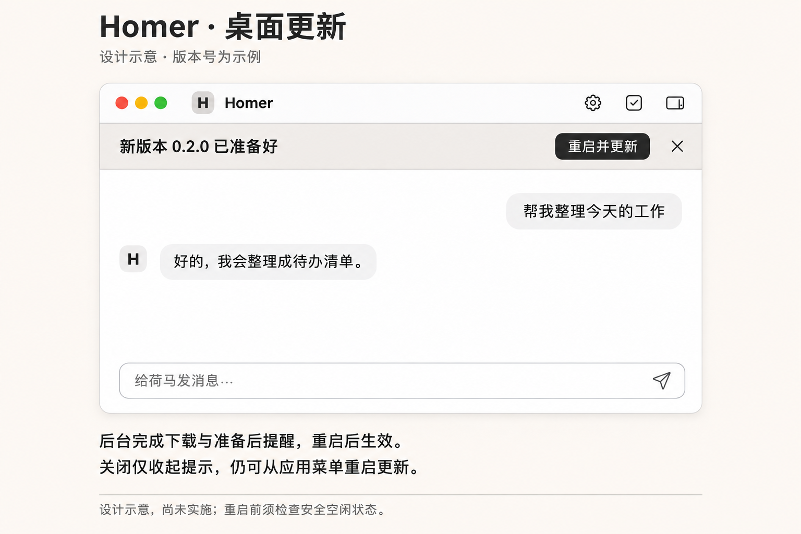

# 桌面 App 自动更新实施方案

整理日期：2026-11-04（Asia/Shanghai）。状态：Mac 与 Windows 的源码接点已完成；Windows 已接入 electron-updater＋NSIS 及最小相关离线验证。三目标真实原生升级、签名与最终 URL 验收均未验证。本轮仅源码、依赖锁、合成验证和文档，不构建、安装、提交或发布。

> 第 8、9 节区分源码与离线检查、原生验收及发行。源码通过不代表正式包可用；构建、安装和公开发行继续分别等待授权。

**目标：** 后台检查、下载并准备正式安装包，准备好后在操作栏下方显示“新版本 {version} 已准备好　重启并更新　×”。

**架构：** Yezi2 托管固定路径的更新库原生清单；Homer 主进程持有唯一状态、安全停止及重启入口。Mac 继续使用 Electron 内置 autoUpdater＋Forge ZIP；Windows 使用 electron-updater 的 NsisUpdater，Forge 准备包目录，electron-builder 仅以 --prepackaged 生成 NSIS 安装器与清单。包存放 GitHub 固定标签附件；不新增更新服务器、数据库、下载器或通用更新管理器。

**依赖基础：** Electron 45.0.0、Forge 8.0.1 保持。已精确锁定 electron-updater 6.8.11、electron-builder 26.18.0、js-yaml 4.1.1 和 Sharp 0.35.5 及传递依赖；根工程均为构建依赖，生成的 Windows 壳声明 updater／YAML 运行依赖，Windows Homer payload 声明 Sharp 运行依赖，Mac 运行依赖保持原集合；不采用 alpha 或自动升级。库的默认验签不能作为完整保证，须按第 7 节严格调用 Windows 验签。Mac 不引入 Windows 更新器；不再加入 maker-squirrel、electron-squirrel-startup 或 MSIX maker。

**上位要求：** [正式产品自动更新要求](20-product-update-requirements.md)。版本／数据兼容、原身份恢复和故障恢复继续按该文档约束；本方案不将其九项能力标为完成。

## 1. 约束与平台范围

| 必须覆盖的客户端 | 原生更新路径 | 正式产物 |
| --- | --- | --- |
| Apple Silicon Mac，darwin-arm64 | Squirrel.Mac，静态 JSON | 签名并公证的完整 .app ZIP |
| Intel Mac，darwin-x64 | 同上，独立架构清单 | 对应 x64 .app ZIP |
| Windows，win32-x64（Intel／AMD 64 位） | electron-updater／NSIS | 首装与更新均使用同一完整签名安装器 .exe；清单 latest.yml |

Windows ARM64、32 位、Linux 不纳入本次三目标验收。三目标均须完成，不能以 Apple Silicon 成功代替其余平台；平台不可用时只影响自己的清单，不误发其他架构的包。

不增加更新内容入口、摘要、弹窗、Markdown 渲染或相关状态；原生附带的说明直接忽略。手机合同、手机关闭记录及下载入口不变。

主进程启动最多自动检查一次，提供原生菜单手动检查，不轮询、不定时重试、不在空闲时自动重启。只对正式 stable 身份启用；开发、QA、测试 profile、preparation、localWorkingTree、缺失或未知渠道全部禁用。

首批只发布所有已启用来源版本都已验证兼容的目标；本次 MVP 不新增通用迁移框架。需要数据迁移、新权限或改变最低系统要求的目标不进入此次发行，先满足上位要求；静态清单不承担来源兼容路由。

## 2. 接口归属与对齐

公开接口、清单格式及官网发布／缓存规则唯一维护在 Yezi2 的 [桌面发行数据合同](../../yezi2/docs/homer/desktop-release-data-contract.md)。本文维护 Homer 实施接点与验收，不复制完整字段表或示例 JSON。跨仓链接按 Homer 与 Yezi2 同级检出解析。

Mac 合同保持；Yezi2 已将 Windows 合同改为 latest.yml，Homer 已逐项核对并回传一致性确认，结果见第 9 节。以下固定路径是已接入客户端的约定，不表示官网已经部署：

| 平台 | 官网静态清单 | 主进程更新器配置 |
| --- | --- | --- |
| darwin-arm64 | https://super-tree.com/homer/updates/stable/darwin-arm64/RELEASES.json | url 为完整 JSON 地址，serverType: 'json' |
| darwin-x64 | https://super-tree.com/homer/updates/stable/darwin-x64/RELEASES.json | 同上 |
| win32-x64 | https://super-tree.com/homer/updates/stable/win32-x64/latest.yml | NsisUpdater：provider 为 generic，url 为该目录，channel 为 latest |

- **Yezi2：** 托管原始静态清单、核对 HTTP 和缓存行为；官网人工下载入口引用同一已验收发行。只维护自己的公开合同。
- **Homer：** 三平台真实包、版本／身份／签名、生成清单、包地址校验、主进程检查、安全重启和客户端验收。
- **发行流程：** 冻结同一次候选产物及其原生清单，先在隔离环境完成真实签名升级和数据保留验收；获准后上传不可变固定标签安装包，核对匿名下载、摘要和清单匹配。上传后、公开切换前，复用同一隔离夹具及临时 feed，以待发布的最终清单原文和已上传的最终固定标签 URL，由三目标各自实际版本的原生更新器完成解析、拉取和校验，尤其验证 Windows latest.yml 中最终安装器 .exe 的绝对 URL；普通 HTTP 下载和摘要核对不能替代此项。候选包及清单未变时不重复全部业务验收，变化时重做受影响验收。上述检查通过且获准公开更新后，才切换对应 stable 清单；切换后只做线上响应和缓存复核，不把真实升级验收留给正式用户。失败保留或恢复上一份已验收清单；撤回不能撤销已暂存更新。现阶段不执行这些操作。
- 不使用 update.electronjs.org、GitHub Latest 解析或第二份自定义 desktop-releases.json；不把手机 schema 交给桌面更新器。

Mac 使用 Forge 的 currentRelease／releases／updateTo 原生结构；name 固定为纯公开版本供提示显示，生成时将目标 ZIP 的 url 指向已验收 GitHub 固定标签。Windows 使用 electron-builder 生成的原生 latest.yml，完整字段只在 Yezi2 合同维护；Homer 的产物处理将 files[].url 及存在的兼容 path 指向同一固定标签安装器，保留其 SHA-512 与长度并核对一致性，不手写占位清单。业务渠道仍只有 stable；latest 是库的清单文件名，不是 GitHub Latest。不继续提供旧 RELEASES／.nupkg 接口，不增加双格式兼容。MVP 禁用差分和 web installer，无需官网托管 blockmap 或额外包体。该处理只操作发布产物，不重复实现版本协议、下载或解包。Mac 源码的 postMake 仅保留 Forge 生成的本次版本记录，校验其版本和架构、将 name 改为纯版本、指向 --release-tag 下实际 ZIP 附件并删除 notes；不读取或修改官网 stable 清单。

原生清单是版本和下载位置的同一来源；GitHub Release 标题不再承担客户端版本接口。两平台公开版本与 app.getVersion()、包内版本一致，Mac 原生 build 单调增加；正式版本不得以覆盖旧附件的方式修订。

清单匿名 HTTPS，缺失／撤回必须返回真实 404，不能返回 SPA HTML、登录页或手机占位 JSON。清单禁缓存目标、响应类型、CDN 清理和撤回顺序以 Yezi2 合同为准。Yezi2 已核对：现有普通静态文件 maxAge 为 0，但不是 no-store；缺失路径会回退应用 HTML，Windows latest.yml 的 application/yaml 尚未验证。后续先评估现有配置，必要时仅在该更新前缀修正静态 HTTP 边界；本轮不改服务端代码。native 请求不能靠浏览器 cache 选项或 Expo fetch 请求头实现全平台禁缓存。撤回阻止后续发现，不承诺撤销已暂存包。

## 3. 当前基础、必改文件与平台缺口

| 文件／模块 | 原有基础 | 本轮源码及剩余范围 |
| --- | --- | --- |
| packaging/electron/main.mjs | 已接 Mac 更新状态与安全门 | 已增加 Windows NsisUpdater 初始化、事件参数适配及严格验签函数；复用原状态、菜单与停止证明，不新增桥接 |
| packaging/electron/preload.cjs | 已有无参数方法和可取消订阅 | 已沿同样模式暴露 state／dismiss／restart 和可取消通知 |
| ui/homer-app.tsx、ui/homer-styles.css | 原顶栏、手机更新条、阅读锚点 | 已在原 UI 文件增加轻提示和所属类型，复用现有条样式、阅读锚点与焦点引用，无新增 CSS／组件 |
| scripts/dev.mjs、scripts/desktop-runtime.mjs、src/dev-host.ts | 已有 probe／prepare、更新停止结果与外层 owner 回执；Mac 资源区分架构 | 已补 Windows 资源路径、进程及环境接点；安全停止协议保持，不另造停止证明 |
| scripts/build-desktop.mjs、scripts/prepare-desktop-dependencies.mjs、scripts/desktop-source.mjs | Mac 两架构的资源、产物及冻结 guard 已接入 | 原入口增加 Windows x64 分支、匹配归档及包目录→NSIS 接点，所有新增构建配置纳入原冻结 guard；不复制构建脚本 |
| packaging/electron/forge.config.mjs | Mac ZIP、签名、公证和最终资源清单已接入 | Mac 保持；Windows 使用 Forge package 及签名后的最终资源清单，再交 electron-builder 的 prepackaged NSIS；小型 Windows 构建配置随原脚本维护 |
| packaging/macos/dependencies-lock.json、package.json、package-lock.json | 已锁定 Mac 两架构元数据 | 已补 Windows Node／Codex 官方元数据和精确依赖，沿同一读取点维护；生成壳声明并复制运行依赖，实际 ASAR 入包仍待构建验收 |
| scripts/desktop-profile.mjs、src/processes.ts、src/homer-account.ts、既有媒体／登录 owner | 存在 /bin/ps、负 PID 信号、getuid 及 POSIX 权限／路径假设 | 已补 Windows 进程身份／树停止证明、锁、私有文件 ACL、路径和图片 helper；原校验保留，身份未知拒绝证明，原生有效性未验证 |
| tests/electron-shell.test.mjs、tests/electron-package.test.mjs、tests/desktop-profile.test.mjs | 离线 shell、打包合同和数据路径 fixture | 沿原 fixture 补 Windows 验签、Promise、取消／退出重开、包清单与资源断言；本地通过不宣称原生支持 |
| scripts/test.mjs、docs/testing.md | 真实桌面专项目前校验 .app 路径 | 本轮只扩展既有测试，分类保持；浏览器边界专项只按显式源码路径离线执行，真实升级专项仍待登记，不削弱既有 .app 门槛 |

### 三目标完整包前提

1. Node、Codex、native helper 必须为目标架构与平台；不把 ARM64 资源塞入 Intel 包，也不把 .app 路径搬到 Windows。沿现有固定版本与官方发行来源核对摘要，构建发生在对应获准环境。
2. Mac ImageDecoder 的 Swift 编译目标、现有 helper 签名及资源清单覆盖两架构；Windows 图片／权限／登录等调用沿现有跨平台 owner，未适配的 Mac API 必须完成对应平台实现或准确说明不支持，不能以 App 能启动代替功能可用。优先复用平台库，不另起并行服务。
3. 源码将正式 Mac 身份固定为 app.homer.desktop；本地候选仍为 app.homer.desktop.candidate，不能直接作为正式自动更新基线。Developer ID、安装位置及一次正式基线安装仍待原生验收。构建沿原生 Mac 主机架构执行：ARM64 保留原 27.0 声明；Intel 必须显式传入经后续验收核定的 --minimum-macos，不默认照抄 27.0。该值同时用于 plist 和 Swift target，仅是构建声明，不是“已测试系统”。Windows 最低系统同样待实际依赖和验收。
4. Windows 冻结正式 appId 为 app.homer.desktop、exe 名称为 Homer.exe、NSIS 安装身份和发布者证书完整 Subject；只支持 x64、按用户安装，不请求提升权限。NSIS 显式设置 oneClick=true、perMachine=false、packElevateHelper=false；资源封存前及最终 NSIS payload 均须确认没有 resources/elevate.exe，防止打包阶段追加提权 helper。只接受同用户的正式安装基线，拒绝声明 isAdminRightsRequired=true 的目标，不增加该远端字段。QA 继续隔离身份。NsisUpdater 及其运行依赖、app-update.yml 必须打入生成的壳工程／ASAR 与 resources，不能只加入仓库根 package.json；不接 Squirrel 安装参数或 MSIX 身份。
5. 数据保存在安装目录之外。Mac 原 profile 路径保持；Windows 以原平台数据路径为准，无旧基线时使用 join(app.getPath('appData'),'Homer Desktop')，其 host-home/electron 仍归原 profile。更新不得创建替代主对话、迁移到包内数据目录或清凭据。
6. Windows NSIS 完整包必须在原生 Windows 环境验收，系统下限由 Electron／Node／Codex 共同支持范围确定，不以 maker 默认值代替。没有已验证资源／系统组合时，该目标维持未就绪，不生成可下载占位包。

Windows 图片沿原媒体入口使用 10 行 Sharp helper，覆盖现有 WebP 等格式、首帧、方向校正、像素／输入预算及 320px 缩略模式，不维护第二套原生解码器。Sharp 只进入 Windows payload，其原生 addon 必须存在且参与既有依赖和资源封存；原生编解码仍未验证。新增 scripts/windows-security.mjs 仅集中固定 PowerShell 命令与私有 ACL，profile／账号／进程复用；固定 UTF-8 防止中文用户路径或 Subject 乱码。

## 4. 主进程状态与最小桥接

### 初始化与检查

仅对应的三项目标正式包、releaseChannel: stable、核定平台身份和有效版本启用。渠道写入已有 desktop-manifest.json 并由原完整性路径保护；publishable 不能代替正式签名。源码仅 --distribution、有效签名输入、显式 --release-tag 和正整数 --build-number 才写入 stable 及正式 appId；构建号由发行时核对现有版本后指定，不能依赖公开仓库的提交数量。候选仍按 Git 提交数量生成构建号，不生成更新清单。原脚本及依赖锁纳入既有 source freeze guard。

先注册原生事件，再在既有服务 ready 后后台检查一次，不阻塞业务启动。Windows 验证当前 exe 与业务启动并行，由原服务 ready 分支等待局部初始化 Promise 后检查；两个到达顺序都只检查一次。Windows 只在正式 NSIS 安装的普通业务进程启用；不处理旧 Squirrel 首启锁或增加延迟重试定时器。菜单可手动发起；checking／downloading 去重，ready 后不再发起第二次更新。

Mac 内置 autoUpdater、Windows NsisUpdater 各负责版本判断、下载及准备；不写手机数字比较器、不使用手机 5 秒／32 KiB 限制、不新增 Homer 安装包缓存。Windows 配置 autoDownload=true、autoInstallOnAppQuit=false、allowPrerelease=false、allowDowngrade=false、disableDifferentialDownload=true、disableWebInstaller=true；只使用完整稳定版安装器。库缓存归库管理，命中缓存也须通过第 7 节验证；Homer 不持久保存发行结果。菜单继续仅显示“正在后台下载…”，不增加进度 UI。

Windows 的检查调用须同时消费 checkForUpdates() 及返回结果中的 downloadPromise；null 结果直接结束。error 事件统一更新状态和安全错误码，Promise 的终结 catch 只消费拒绝，不再更新状态、弹窗或重试；不能照搬 Mac 的同步 try/catch，也不调用 checkForUpdatesAndNotify()。一次启动一次指 Homer 发起一次检查；不另加库外重试调度。

### 状态与事件

主进程持有一份快照：禁用时为 null；启用时仅包含 status（idle／checking／downloading／ready／error）、必要的 version、noticeHidden 和安全错误码。不持久保存发行响应、已准备版本或关闭记录。

| 事件／动作 | 状态及行为 |
| --- | --- |
| checking-for-update | checking，菜单显示检查中；自动检查不打扰 |
| update-available | downloading，不显示“已准备好” |
| update-not-available | idle；仅手动检查给“已是最新版本”反馈 |
| update-downloaded | Mac 保存 releaseName；Windows 先验证事件携带的本地候选，再保存 UpdateDownloadedEvent.version 并进入 ready；验证失败不显示轻提示 |
| 检查或下载 error | 未进入停止流程时进入 error，旧版继续可用，可手动重查；Windows 停止中报错后等待本次停止证明，已安全停止则按第 6 节退出恢复，不重查 |
| × | 仍为 ready，noticeHidden=true，菜单保留重启入口 |
| 重启请求／失败 | 安全准备期间拒绝重复动作；busy／取消等准备失败保留 ready；Mac 安装失败保持原恢复路径，Windows 安装失败或服务停止后的验签失败进入 error，按第 6 节退出重开 |
| 安全停止并确认退出 | 校验通过后，每次用户确认只调用一次安装 API；失败后按第 6、7 节显式恢复 |

Mac 的 releaseName 来自清单 name；Windows 使用 NsisUpdater 事件对象的 version、downloadedFile，不套用 Mac 的位置参数。候选文件路径仅由主进程保留供缓存验证和安装前复核，不进入 renderer 快照、IPC、日志或持久记录。只接受合法稳定版本号用于显示，忽略发行说明；原生已暂存后发现元数据异常只能停止主动重启并提示核对，不能宣称撤销了暂存安装。检查／下载期间清单切换导致的目标版本一致性须纳入专项，不能仅凭第一个响应推定实际准备版本。

自动失败安静结束，不自动重试；错误诊断只保留阶段及安全错误码，不输出原始更新响应、发行正文、完整查询 URL、账号或聊天。包安装失败和新版启动失败按第 7 节处理，不因错误清理业务数据。

Windows 创建 NsisUpdater 后、任何检查及验签前显式设置 logger=null，禁用库默认 console 日志；不接原始错误的第二个 message 参数，不向业务日志转存异常或响应。Homer 原有阶段／安全错误码诊断保留，不新增 logger 或脱敏包装层。

### 桥接签名与信任边界

在原 preload 增加 window.homerDesktopUpdate：
- state()、dismiss()、restart()：无参数，返回 Promise<DesktopUpdateState>，类型与上面唯一快照一致。手动检查仅由原生菜单调用 main 内部动作，不为没有页面入口的检查另增桥接方法。
- onChange(callback)：仅通知读取快照，返回取消订阅函数；页面先订阅再读取，清理沿原生命周期，不缓存第二份判断状态。

main 沿 permissionCaller 的主窗口、主 frame、origin、精确页面及异步后重新核对规则；不增加 nonce／新来源协议。未授权网页、子 frame、过期页面和额外参数均拒绝；下载 URL、目标版本、签名和本地路径不从 renderer 传入。

网页只展示原生状态并发用户意图，没有桥接或无有效 ready 状态不显示；普通网页、手机和旧壳保持原行为。

## 5. 仅重启更新的轻提示



操作栏下、conversation-workspace 前直接渲染在聊天 Panel 内，不跨右侧成果区。正常文案为“新版本 {version} 已准备好”，操作只有“重启并更新”“×”；无更新内容、摘要、弹窗、完整说明链接或倒计时。

沿原暖灰 tokens 和阅读锚点；不重挂聊天／Reader，不清草稿、不抢焦点。正常单行，窄窗／大字体允许换行，动作至少 44px，有“关闭更新提示”读屏名称和可见焦点，温和播报一次。关闭时仅在焦点原本落在被移除条内时回原输入区；原未保存表单离开确认继续有效。

× 只在本进程收起当前提示，不删除包、不取消升级；页面重载保持收起，原生菜单仍有“重启并更新…”。不复用手机最高关闭版本键，不新增桌面持久键。安装失败后仍运行旧版时，下次再次提示属于恢复提醒。

“已准备好”指原生下载、准备已完成，重启后才运行新版。Mac 正常退出后也可能应用已暂存更新；Windows autoInstallOnAppQuit=false，普通退出不由库自动启动安装器，只有通过第 6 节的显式动作才能安装。关闭条不会删除已下载包或撤销更新。Mac 关闭窗口仍按原行为隐藏；Windows 保留系统标准窗口行为，所有真正结束进程的入口均受第 6 节保护。

图中 0.2.0 为示例版本，系统按钮展示 Mac 参考外壳；Windows 使用其原生窗口控件。正式 Logo 复用现有资产；沿 [ui/DESIGN.md](../ui/DESIGN.md) 实现，不根据示意图另造跨平台标题栏。

## 6. 安全停止后才重启

现有“确认后停止当前工作”的普通 quit 不能当作安全空闲证明。沿原桌面 runtime 通道新增内部 update-stop 意图，复用原 runDev／dev-host 的 probe 和 prepare：

1. 沿原离开规则确认草稿及未提交编辑；不可证明保存成功时不声称重启后保留。
2. 检查原队列、journal、在飞变更和 owner；先 probe，再冻结入口并做 prepare 最终判定，继续使用 app.upgradeStatus().safe、微信／Telegram canUpgrade。
3. 忙碌、待答交互、未知执行或检查失败返回 update-busy，保留原 owner／服务，提示“当前工作尚未结束，请稍后重试。”不停止 Worker、不排队自动重启、不增加观察器或轮询。
4. 成功沿原交接身份正常结束业务 child 和 runtime、释放锁；此分支结束进程，不执行开发版 launch(next)。完成外层 owner 释放后才发送 update-stopped，再以 0 退出。
5. main 同时核对本次 update-stopped 和 runtime exit0，无信号退出；普通 stopped、startup_refused、仅 ACK、仅退出或端口断开不放行。复用既有停止超时作为失败边界，不强杀／清锁；若已经停止，明确服务已停而非假装仍在线。
6. 安全停止成功后，Windows 对同一本地候选再次执行第 7 节验证，成功才调用 NsisUpdater.quitAndInstall(true,true)，由 NSIS 完成安装及重启；Mac 保持现有 quitAndInstall()。这两条路径都不再 app.relaunch()。验证失败不启动安装器；安装器拉起不代表安装成功，需原生验收后继进程在旧进程结束后接管。

Windows 的原 terminateLease owner 在 EOF 前后各取一次 CIM 进程快照，包含 PID、父 PID 和创建时间；保留根身份复核、必要的原 taskkill /T 及原后代存活检查。只有前后快照身份未变且创建时间严格早于原 owner 的进程，才可作为外部锚点；其余进程沿原创建时间有效的父链推导，能追溯到该锚点才排除出本次停止范围。首次快照中已有的孤儿也不能仅因身份未变而放行；创建时间与 owner 相同或更晚、且无法追溯到外部锚点的进程均拒绝确认。无法确认外部归属的 PID 复用、缺失时间或快照失败同样不确认安全停止；不为未知孤儿另行杀进程，也不增加常驻监控或 owner。与本任务无关但归属不明的孤儿也可能因此阻止更新，真实 Windows 的 CIM 可用性和保守拒绝频率仍未验证。

恢复共用原离开检查和原生弹窗：页面存活时仍执行离开检查；窗口已销毁且已有安全停止证明时使用无父窗口弹窗，不读取已销毁页面、不重建服务页面。弹窗返回后核对窗口身份和导航，期间出现新窗口或页面变化则不采用旧确认。显式退出不再调用安装 API、不 relaunch，也不应用待提交的账号／来源动作。缺少回执、非零退出、信号退出等未知停止状态不得放行；不新增持久状态、恢复管理器或强制退出。

**Mac 保持原恢复路径。** 安装 API 同步抛错或异步报错后，保留本进程已有的 update-stopped＋无信号 exit0 证明和 ready 状态，不自动重试。用户再次选择重启更新或普通退出时，弹窗仍提供“取消”“重试更新”“退出荷马”；重试复用停止证明进入原 finishQuit，每次确认只调用一次安装 API，不向已退出 runtime 再发停止请求。取消保留状态及关闭记录，菜单入口仍可用；退出本身仍可能应用原生已暂存更新，不删除候选。

### Windows 安装失败后的重试路径

Windows 采用“退出荷马 → 用户手动重新打开 → 重新检查与验证 → 再确认更新”。6.8.11 的安装调用会设置内部 quitAndInstallCalled，并可能已排入一次退出；异步启动失败不保证重置该标记，因此本次不提供同进程“重试更新”，不修改库内部字段、不打补丁、不重建更新器实例。

1. 壳仍存活且观察到安装 API 同步／异步失败时，立即撤销 allowQuit、清理原退出等待及待提交配置动作，进入 error，保留 noticeHidden 和本进程的安全停止证明。安装前验签失败且服务已停时也走此分支；服务已停的事实不能被 error 状态抹掉。若更新器在停止途中先报错，先保持 error 及本次停止等待，冻结迟到的更新事件；本次 update-stopped 与无信号 exit0 均齐备后，才清理退出等待并进入同一恢复流程。回执与退出任一先到均可，缺失回执仍由原超时拒绝，不复用普通 stopped 或下次进程的证明。进入恢复时清除原候选引用，使尚在等待的安装前验签即使成功返回也不能继续安装。
2. 沿上述共用保护显示“服务已安全停止，更新未完成。请退出后重新打开荷马再试。”，操作只有“取消”“退出荷马”。取消不恢复服务、不安装、不退出；菜单明确提示需退出重开，本进程禁用检查和安装。不会把该错误当作普通下载失败重新请求。
3. 库随后触发的退出在原 before-quit owner 中只拦截，不自动退出或重复弹窗。用户的退出菜单／关窗由原退出入口进入同一确认；只有用户确认“退出荷马”且 updateConfirmed() 仍成立，才设置 allowQuit 并正常退出。取消后仍可再次主动退出，无父窗口同样可用；不再发 update-stop，不清数据，autoInstallOnAppQuit=false 保持。复用原错误状态、quitPending 和 allowQuit，不增加第二份退出状态。
4. 用户手动重新打开后使用新进程的正常检查路径；库内部安装标记自然重置。目标以当次最新清单为准，库按清单核对缓存完整性，Homer 复核签名及安装范围；缓存不匹配则正常下载，撤回／无效清单不安装。不延续上次 ready、关闭标记或安全停止证明；再次安装须重新确认并取得本次停止证明。不自动 relaunch 或直接执行旧缓存。

若 NSIS 已接管或壳已退出，不能保证捕获后续安装器失败；用户重新打开后按当前版本与清单判断，不将“已调用安装器”记为安装成功。此边界保留到原生验收，不增加安装监控器。

所有发起退出的入口共享此门：ready 时的菜单退出、Windows 窗口关闭、账号退出／来源重启等；取消和 busy 不保存待应用配置，也不偷偷退回普通“停止全部工作”。未准备更新时原有退出语义保持。安全门与配置动作的顺序只在原 finishQuit／before-quit owner 内处理，不新增第二个退出管理器。普通退出确认期间若刚准备好更新，则转入同一安全门；普通 stop 已发出后才收到 ready 时，因缺少 update-stop 证明，阻止自动退出安装并提示服务已停，不能把普通 stopped 当更新停止成功。

before-quit-for-update／before-quit 不能承接全部异步安全准备；显式调用安装 API 前就必须完成检查。系统强退、断电、崩溃不可保证拦截，须以原数据和身份恢复验收约束。

## 7. 真实性、兼容与恢复门槛

- 三目标分别需要正式基线；没有 updater 的旧包只能通过一次获准的正式安装进入，不能远程补齐。Mac 核对同一 bundle ID／designated requirement、Developer ID、公证、可写安装位置；Windows 核对正式签名 NSIS 安装器、发布者、固定 appId、按用户安装位置与可写缓存目录，便携 ZIP 不冒充更新基线。
- 完整包包含所有平台资源；不增加 Node／Codex 独立更新器。Windows 的 .exe／原生模块、路径和凭据必须在目标系统真实验收，不以 Mac fixture 通过替代。
- 原 Squirrel.Windows 可行性路线已撤销：SHA-1／长度不是发布者证明，且其应用更新早于 update-downloaded。MSIX 的 OS 验签也不能直接证明目标属于 Homer，不作为本次替代。Windows 按下述 NSIS 严格验证路线推进源码，原生签名拒绝仍是正式发行前置条件；Mac 签名验证独立验收。
- 静态清单不新增业务兼容字段。发布前按 [HMR-UPDATE-PRODUCT-001～009](20-product-update-requirements.md)核对全部支持来源、系统下限、协议、运行时和权限；需要迁移时先用原固定迁移／一致性备份与副本预演路径，未知来源或新 schema 继续拒绝。
- 区分包替换、服务 ready、原会话恢复及新输入被采用；安装成功不是业务验收通过。新版产生业务事实前的恢复、产生事实后的前向修复分别沿长期要求，不把旧快照覆盖新数据，不自动降级已迁移 profile。
- 撤回清单不撤销已下载包；不得用 CDN 刷新承诺完整回退。一个目标失败保留该目标旧的已验收版本，其余目标的验收状态独立。

### Windows 严格验签：源码已接，原生未验证

只在 packaging/electron/main.mjs 增加一个可复用的 verifyWindowsUpdate(publisherNames, path): Promise<string|null> 函数，作为 NsisUpdater 公开 verifyUpdateCodeSignature 钩子；null 仅表示成功，其余返回固定安全错误码。它调用 Windows Authenticode，不实现签名算法，不新增原生模块、服务或验签管理器。

- 信任根是正式壳随包携带的 app-update.yml.publisherName（证书完整 Subject），不接受清单或网页提供发布者。配置缺失、空值、仅 CN 或验证被关闭均禁用本次 Windows 更新，不依赖库的跳过行为。正式构建同时要求有效签名输入，拒绝默默产出 unsigned 包。
- 用系统绝对路径的 Windows PowerShell、固定命令和 LiteralPath 验证指定候选；文件路径按数据传递，不拼接 shell 命令。要求有效的嵌入 Authenticode 签名、完整发布者身份匹配、返回路径与候选一致。进程超过 20 秒／不可用、空或畸形输出、非零退出、证书或路径不匹配均失败；不打印原始验签输出。
- 新下载由钩子验证；update-downloaded 处理在发布 ready 前复用同一函数，覆盖库复用缓存而跳过下载钩子的路径；安全停止后、每次启动安装器前再复核同一候选。验证失败进入 error，不得保留可安装的 ready 或执行安装；若原业务已停则准确提示，保留停止证明，并在原退出分支允许正常退出。此时原生弹窗只提供“取消”“退出荷马”，不盲重试无效候选，也不伪装服务在线。
- SHA-512／长度由库校验，不能替代发布者验证。锁定稳定库版本的源码已确认存在 PowerShell 不可用时跳过验证的分支，不能只设置 verifyUpdateCodeSignature=true 就标为完成。签名回调、缓存和安装前复核必须分别有负向测试。
- 原生验收仍需确认有效签名与时间戳、错误发布者、未签名、篡改包、验证环境不可用、缓存替换、只读／空间不足及重启时序。签名证书、私钥及账号只由获准环境提供，不进入 docs 或仓库。

## 8. 实施任务与检查状态

勾选仅表示本轮相应源码和离线检查完成，不代表原生／生产验收。未勾选项及 D 节继续等待其前置关卡或授权；不以模拟结果代替真实包。

三平台完整包与运行基础、更新功能分别验收；基础包通过不代表自动更新通过。以下勾选覆盖已有的 Mac／共享源码和本次提交的 Windows 源码；均不能推定三目标真实包已通过。Windows NSIS 源码与离线验证已完成，构建／安装／原生验收仍另行授权；不再等待旧 Squirrel 路线的实验。

### A. 接口和三目标配置

- [x] Mac 两架构固定官网 feed、未知目标／渠道／身份／测试 profile 禁用、正式包 Developer ID requirement 接点；扩展原 shell 和打包 fixture，先红后绿。
- [x] 原构建、依赖准备及 runtime 选择匹配的 Mac 资源；Forge 原生清单按实际 ZIP 和固定标签处理；未知架构、缺少 Intel 系统声明、无签名输入／固定标签直接拒绝。
- [x] x64 Node 摘要与 Codex SRI 来自固定版本官方元数据；合成归档断言两架构路由与篡改拒绝。真实二进制内容、架构和系统下限未验证。
- [x] 按下面 A.W 接入 Windows 源码、依赖锁、包配置及离线断言；未构建或安装任何产物，Windows 发行就绪状态不变。

### A.W Windows 最小实施顺序

步骤 1～5 的源码已接入并沿原 fixture 定向验证，步骤 6 及 D 节仍未执行；实际结果见第 9 节和测试说明。不提前运行构建或原生安装。不新增更新后端接口、并行状态或仅为 Windows 复制一套 UI。

1. **固定依赖与包接点。** package.json／package-lock.json 锁定上述版本；scripts/build-desktop.mjs、scripts/desktop-source.mjs、packaging/electron/forge.config.mjs 原文件增加 Windows 分支。Forge package 生成同一 payload 的 win32-x64 目录，按第 3 节固定按用户安装并禁用提权 helper，最终签名／资源清单完成后使用 electron-builder --prepackaged 的 NSIS 目标，显式 --publish never；打包工具不再编译或重打业务源码。生成壳的 package.json 必须声明并携带 electron-updater 运行依赖；resources/app-update.yml 写入 generic 目录、latest 和正式 publisherName。prepackaged 不假定会自动补此文件或签名。tests/electron-package.test.mjs／tests/desktop-update-runtime.test.mjs 合成断言正式／QA 隔离、依赖入包、配置完整、签名后再封资源清单及两个 Mac 分支保持。
2. **补齐平台运行基础。** scripts/prepare-desktop-dependencies.mjs 与原锁文件选择 Windows Node／Codex x64 归档和摘要；scripts/desktop-runtime.mjs、packaging/electron/main.mjs 选择 node.exe、Codex .exe、resources 路径、Windows PATH／SystemRoot／TEMP，保留最小环境。src/processes.ts 在原 owner 内补 Windows 创建时间／身份与进程结束证明；scripts/desktop-profile.mjs、src/homer-account.ts 的 POSIX 私有文件校验改用 Windows 等价的用户／ACL 与路径校验，不能删除安全检查。现有媒体／登录调用按真实 Windows 资源适配，不用空 helper 或“能启动”替代。tests/desktop-profile.test.mjs／tests/desktop-update-runtime.test.mjs 先验证路径、PID 复用、未知 owner、凭据越权及不清数据；新增真正可复用的底层适配才抽函数。
3. **接更新器与验签。** packaging/electron/main.mjs 仅在合法 Windows 正式身份下加载 NsisUpdater；配置第 4 节开关、Promise 终结处理及 logger=null，复用第 7 节唯一验签函数，适配 UpdateDownloadedEvent.version／downloadedFile。tests/electron-shell.test.mjs 原 VM 注入合成库及验签输出，先覆盖一次检查、自动失败不重试、渠道隔离、签名／安装范围／配置失败及缓存命中后仍拒绝未验证候选。测试不得调用真实 PowerShell 或网络。
4. **复用安全重启及恢复。** main 的 finishQuit／before-quit 保持原停止证明，Windows 安装前复核、只调用一次 quitAndInstall(true,true)；标准关窗若结束进程也进入同一门。Windows 可观察到的安装失败及服务停止后的验签失败均按第 6 节退出重开，不套用 Mac 的同进程重试；Mac 原流程不变。沿 tests/electron-shell.test.mjs、tests/desktop-update-stop.test.mjs 原夹具验证停止证明及下表断言，不新增恢复框架。
5. **生成 Windows 清单并做离线检查。** build-desktop 与原打包 fixture 验证实际产物元数据：latest.yml 的版本、SHA-512、长度及所有安装器地址一致，发布目标为固定标签绝对 URL，不修改公开清单；差分／web installer 关闭且不展示说明。沿第 8.C 所引命令运行受影响的 shell／package／runtime／profile／stop／UI 和类型检查；新增共享平台适配的测试只运行该接点相关案例，并保持 scripts/test.mjs 分类。此阶段不执行包含产品构建的 development 专项。
6. **另获准后执行 D 节。** 先冻结按用户安装的正式 Windows 基线及升级目标，在隔离环境完成严格签名拒绝、安全停止、覆盖升级和数据保留；再按第 2 节上传及最终 URL 验证，全部通过才具备请求公开切换的条件。无 updater 的旧包须先手动安装正式基线；不增加 Squirrel→NSIS 自动迁移或通用恢复框架。

下表四组断言已沿原 fixture 实现并离线通过；仅模拟库、文件、签名和退出次序，不替代真实 PowerShell／缓存／安装器。具体断言唯一维护在此，不新增专项文件：

| 问题／案例 | 原测试接点及最小断言 |
| --- | --- |
| Windows 安装失败后退出重开 | tests/electron-shell.test.mjs：合成库保留 quitAndInstallCalled 并排入延后退出，分别模拟同步失败、异步失败及先关窗后报错；停止中报错覆盖 ACK／exit0 两种顺序及两者之间报错、窗口存活／销毁。确认只调用一次安装 API；错误后延后退出被拦截，取消后无安装／退出／重复弹窗，迟到的更新事件不恢复 ready，菜单及关窗仍能主动确认退出；缺 ACK、非零退出、信号或超时后的迟到 ACK 仍拒绝。新建第二个 shell fixture 模拟用户重开，检查一次并重验缓存；缓存篡改、清单撤回不得 ready，旧 ACK 不放行新进程安装。tests/desktop-update-stop.test.mjs 原证明断言保留，Mac 重试／退出／取消回归不改语义。 |
| 检查与下载的异步拒绝 | tests/electron-shell.test.mjs：覆盖 checkForUpdates() 拒绝、检查成功后 downloadPromise 拒绝和 null 结果；原错误事件仅产生一次状态／提示，无 unhandledRejection、不自动重查；服务与输入保持可用。 |
| 按用户安装及禁用提权 helper | tests/electron-package.test.mjs／tests/desktop-update-runtime.test.mjs 合成配置和归档断言第 3 节三个 NSIS 值、封存前后均无 elevate.exe、NSIS 打包不额外改变已封存 payload；错误配置或夹具注入 helper 时拒绝。shell 拒绝 isAdminRightsRequired=true 目标；对 EACCES／UNKNOWN 模拟库回退到缺失 helper 后失败，走安全退出恢复，不另找提权程序。真实 payload 和无 UAC 仍待 D 节验收。 |
| 禁用库原始日志 | tests/electron-shell.test.mjs：检查前 logger 已为 null；注入含合成正文、查询 URL 和用户路径哨兵的解析／下载／验签错误，确认 console、业务诊断、IPC 和原生弹窗均无原始哨兵，只保留安全错误码。与 Promise 拒绝用例共用替身，不新建 logger。 |

### B. 更新状态和安全切换

- [x] 一次启动一次自动检查、原生菜单手动重试／去重、下载完成才 ready、错误脱敏、重复准备事件不重开已关闭提示；不保存响应或关闭记录。
- [x] 原 runtime 通道接入 update-stop，复用原 probe／prepare 和最终冻结；原线程交接、host 停止证明及 exit0 后才结束 runDev，外层 owner 释放后才发 update-stopped。
- [x] 合成断言覆盖忙碌 owner、未知 journal、新输入竞态、在飞请求、账号写入、prepare 冻结、缺失线程／停止证明、ACK／退出码／信号／超时、安装 API 失败；普通退出竞态不绕过安全门，重复回执不重复安装、不 relaunch。
- [x] Mac 安装失败后复用停止证明的显式重试／正常退出／取消；覆盖同步及异步失败、隐藏提示、取消后菜单重试、重复回执、恢复期间的未保存编辑／页面切换保护及先关窗后报错的无父窗口恢复。未知停止状态即使窗口已销毁也拒绝恢复放行。
- [x] Windows 安装失败或停止中报错均沿第 6 节等待本次证明，之后只允许取消／退出后手动重开，库延后 quit 不绕过确认；EOF 前后快照拒绝新增后代及无法确认外部归属的新进程，已知外部进程及其合法新增后代不阻止停止。复用原停止协议，无新增 owner。
- [ ] 真实 host／Worker／微信／Telegram 的在跑和待答状态、进程交接及持久数据保留仍需原生专项；本轮只复用其既有安全判定，无新 owner 或停止框架。

### C. 桥接和产品 UI

- [x] 原 preload 暴露无参数方法、去掉 IPC 事件参数并可取消订阅；主进程拒绝恶意／旧 frame／额外参数。未新增检查桥接、URL 或版本入参。
- [x] 原 HomerApp 操作栏下直接渲染，复用条样式、阅读锚点和输入框焦点；订阅先于读取，旧结果不覆盖新状态，卸载清理。关闭仅本进程有效，重载仍收起，原生菜单继续可用。
- [x] tests/desktop-update-ui.test.mjs 用真实产品 hooks／JSX 的内存转译和 React DOM 合成环境验证文案、关闭、重试、焦点、锚点调用和无桥接／手机隐藏；不打包 UI，不启动产品服务。
- [ ] 获准 UI 构建后，以独立 scratch 和合成快照核对真实桌面、320／390px、大字体、键盘、读屏、预览双栏、长历史阅读位置及草稿。DOM fixture 不证明真实布局、滚动距离或 Electron 的原生行为。

最小相关离线命令及结果见 [docs/testing.md](testing.md) 的“桌面自动更新：源码离线检查”；不运行含 build 的 npm run check，不扩大到无关全量或付费模型。

### D. 原生、安装与发行：每阶段另行批准

- [ ] 原生构建前在 scripts/test.mjs 登记 tests/desktop-update-acceptance.test.mjs 等真实专项，按目标校验受测包和引擎路径；docs/testing.md 写精确平台命令和环境，不让 Windows 绕过原 Mac 包校验。
- [ ] 在隔离验收夹具中使用临时 feed，三目标各验证冻结的“正式签名旧基线→正式签名新目标”：Mac json 与 Windows 原生格式、版本/build、签名或篡改拒绝、截断、空间不足、只读安装位置、断网／恢复、清单在下载间切换。复用现有夹具，不新增公共渠道或常驻服务；普通 QA／测试 profile 仍禁用正式检查，不能为验收改写公开 stable 清单。
- [ ] 覆盖 Windows 按用户 NSIS 首装／升级／卸载、最终 payload 与封存清单一致且无提权 helper、无 UAC、库缓存、签名拒绝、主窗口关闭、失败后取消／退出及手动重开再试的进程次序；Mac 两架构原生 helper、公证和安装位置；两平台普通退出及显式重启。原生重开测试不得延续上次停止证明，也不以模拟安装错误代替外部安装器失败证据。
- [ ] 验证原账号、thread、历史、已保存草稿、未知请求和渠道单 owner；包替换／启动／会话恢复失败均按第 7 节记录恢复边界，不能以版本号改变代替。
- [ ] Yezi2 托管边界在公开清单切换前完成隔离验收，覆盖 HTTPS、Content-Type、404、无 HTML、无持久缓存及撤回传播；固定标签包上传后核对下载地址、摘要和清单一致性，再按第 2 节复用原隔离夹具，完成最终清单及 URL 的三目标原生解析、拉取和校验。全部前置验收通过且另行获准后才切换 stable 清单，随后复核线上响应与 CDN；失败按合同保留／恢复旧清单或撤回，并记录已暂存更新无法撤销的边界。全程保留实际版本、目标平台、时间、退出码和证据，通过验收不自动发布。

### 审查重点

五类最容易遗漏的输入已分别归入任务断言：错误架构／错误身份及验证环境失效（A.W、7）、缓存命中或安装前绕过验签（A.W、D）、HTML／缓存旧清单和清单切换（A、D）、busy／未知 owner 被误当停止成功（B）、有新业务事实后盲目回退或草稿丢失（C、D）。不新增付费模型或无关全量检查。

## 9. 对齐及验证记录

2026-11-04 提交前复核：基于当前 main 的干净候选，仅纳入本任务的 Windows 实现、停止证明及恢复修复。十文件定向回归 455/455、浏览器权限边界 2/2、正式签名配置静态断言 1/1 通过，均无跳过；后端／UI noEmit 和差异检查通过。数量不包含共享工作区其他任务的未提交用例；下列历史记录保留其原验证范围。未新增轮询、重试调度或持久状态；Mac、关闭规则与 Yezi2 合同不变。未构建、安装或发布，真实原生功能和性能均未验证；既有共享脏树 schema 指纹失败仍保留原证据边界，不更改兼容门槛。

2026-11-04 首次快照归属补齐：外部锚点仅增加“创建时间严格早于原 owner”的条件，父链推导与停止／恢复协议不变。原 fixture 新增首次采样孤儿、同时创建的未知孤儿及合法外部父链三个案例；前两个修改前失败，修改后 19 项进程相关检查及六文件 389/389 回归通过、0 跳过，后端 noEmit 与差异检查通过。Mac、关闭规则和 Yezi2 接口未改；真实原生验收仍未验证，未构建、安装、提交或发布。

2026-11-04 停止证明与恢复修复：仅修改原 Windows terminateLease 和 shell 停止／恢复分支。前后快照补齐 EOF 期间新增后代和孤儿的拒绝；停止中报错后保持本次证明等待，齐备后复用取消／退出恢复，覆盖先退出再回执的交错顺序、窗口销毁及迟到的安装前验签。新增或扩展 22 个合成案例，关键失败用例先红后绿；六份最小相关离线测试 386/386 通过、0 跳过，后端 noEmit、shell 语法和差异检查通过。未新增依赖、状态实体、接口或恢复框架；Mac、第 5 节关闭规则及 Yezi2 合同不变。真实 CIM／原生失败恢复仍未验证，保守拒绝边界见第 6 节；未构建、安装、提交或发布。

2026-11-04 Windows 源码实施：在隔离 worktree 接入固定版本 NSIS 更新器、三处严格验签、生成壳运行依赖和按用户 NSIS 配置、最终 latest.yml 校验、Windows Node／完整 Codex 资源路由、ACL／进程／媒体接点。没有新增 UI、下载器、持久状态或通用恢复框架。保持 Mac、进程内关闭规则与 Yezi2 合同不变；重新只读核对 Yezi2 聊天及合同，未修改对方仓库。复核已修复根进程退出误判、系统 PID 0、真实浏览器目录保护、PowerShell 中文编码、schema 快照键及启动验签阻塞；关键行为用例先验证失败再通过，独立只读审查未发现剩余源码阻断。最小定向 431/431、浏览器边界 2/2、静态签名配置 1/1 与两套 noEmit 类型检查通过。额外 mobile-desktop-profile 回归的固定 schema 指纹断言有一条既有失败；同一冻结输入用修改前逻辑复现，未修改 schema owner 或放宽白名单，发行前仍需所属变更解决。准确命令及结果见 docs/testing.md；旧记录中的“尚未实施”仅描述当时状态。未构建、安装、提交、上传或公开切换；所有 D 节关卡仍未验证。

2026-11-04 四项 review 补齐：本轮只完善本文及 docs/testing.md。Windows 安装失败改为取消／退出后用户手动重开再试，不改库内部安装标记，不在同进程重建更新器；补齐库延后退出的拦截、两个 Promise 的终结处理、按用户安装且无提权 helper、logger=null 及第 8.A.W 节四组待实施断言。Mac 原安装失败重试与关闭规则保持，Yezi2 latest.yml 合同及第 2 节发布顺序不变。本轮仅做文档对照、链接和差异检查；未实现或执行这些测试，未改源码／依赖，未构建、安装、提交或发布。三目标真实原生验收仍未验证。

2026-11-04 Windows 路线修订：用户同意 Windows 使用 electron-updater＋NSIS，Mac 保持内置 autoUpdater＋Forge。第 1～8 节及 latest.yml 为现行方案；下列早期记录中的 Windows RELEASES／Squirrel 仅保留为历史，不再指导实施。上一轮只读源码调查与三个合成验签检查确认：已发布 6.8.11 默认验证存在失败后跳过路径，因此采用库公开钩子严格调用 Windows 验签，缓存与安装前同样复核。这不代表 Windows 原生验证已完成。Yezi2 已更新其公开合同；三平台地址、Windows 原生字段与固定标签绝对 URL、HTTP 边界及上传后／stable 切换前的实际更新器验证顺序均已交叉核对，Homer 已回传一致性确认。相对链接与两仓相关文档的 diff 检查通过；未运行源码测试。本轮只修改本文及 docs/testing.md，由 Yezi2 维护其合同；不修改源码／依赖，不构建、安装、提交或发布。

2026-11-03：已读取 Yezi2 最新讨论及手机合同，并向其发送用户授权的桌面接口对齐请求。Yezi2 已落盘 docs/homer/desktop-release-data-contract.md；Homer 逐项核对三条固定清单 URL、Mac json／Windows RELEASES、固定标签包地址、说明省略、先包后清单、独立撤回以及缓存／404／MIME 前置条件一致，并已向该 chat 回传确认。公开合同只由 Yezi2 维护，本文链接引用，不改手机合同。

2026-11-03 核对结果：只读核对依赖、退出与 runtime、原 probe／prepare 和平台写死位置；修改仅限方案、文档索引及 Yezi2 维护的合同。两仓三条清单地址一致性、相对链接、索引唯一性、轻提示状态及差异检查已通过。未运行源码测试、真实 feed 下载、原生编译、签名、安装或生产操作；不能将文档对齐算作三平台可用证据。

2026-11-04 review 修订：明确先隔离验收再切换公开清单，Windows 签名拒绝能力前置；MVP 保留三平台、一次启动检查、原生准备及安全重启，不新增通用迁移框架。已通过 codex-app-tools 同步给 Yezi2，其已更新公开合同并确认；逐项核对两份文档的验收、包上传、授权切换及恢复／撤回顺序一致。再次 review 后补齐上传后、公开切换前的最终 URL 原生验证，复用同一隔离夹具，不重复未受影响的业务验收；Yezi2 已同步更新合同，原生验证时序、三平台地址及文档链接／格式核对通过。本轮仅文档和接口协调，未实施、构建、安装、提交或发布。

2026-11-04 源码实施：原生壳为唯一更新状态 owner；接入 Mac feed、菜单与只重启轻提示、安全停止、配置动作顺序和退出竞态保护，复用现有能力，无新增产品组件、配置层或运行时依赖。两种 Mac 的资源选择和清单产物处理已接入源码；Intel 系统下限、实际归档、签名和升级仍未验证。Windows 因原生签名拒绝关卡尚未执行而保持未就绪，未将 Mac 离线成功算作 Windows 完成。

本轮记录：最小相关离线测试 270/270 通过、0 跳过；另定向执行受影响的既有签名配置静态断言 1/1 通过，未执行其构建／产物案例。UI 类型检查与相关 JS 语法／diff 检查通过。原打包 fixture 缺少主可执行文件造成既有 ENOENT，本轮只补合成 Mach-O 头，保留原签名忽略断言。测试使用 VM、合成协议／归档和内存 JSX 转译；未运行旧 dev 升级专项（含实际构建）、完整默认回归、UI 产品构建、原生构建、安装、日常 App、真实 feed、最终 URL／CDN 或任何发布。第 2 节上传后、切换 stable 前的原生验证顺序及 Yezi2 合同未变。本轮不修改 Yezi2 仓库，不提交或推送。

2026-11-04 安装失败恢复修复：review 复现了安装器报错后，已安全停止的服务令后续重启和退出都被 closed 分支阻止。仅调整现有 before-quit 分支复用 updateConfirmed()，沿原弹窗提供上述恢复操作；未新增桥接、更新状态或依赖。六个核心回归修改前均失败、修改后通过，再补两项离开保护并扩展未知停止断言；shell／update-stop／runtime／UI 四份相关离线测试 261/261 通过、0 跳过。该结果来自 VM 与合成 DOM，不代表真实原生安装失败恢复已验收；未构建、安装、提交或发布。Yezi2 接口、关闭规则和最终 URL 的发行验收顺序不变。

2026-11-04 窗口销毁恢复修复：针对 Electron 45 先关闭所有窗口、再调用安装器的时序，现有分支仅在安全停止已确认时允许无页面的原生恢复弹窗；存活页面保留离开检查，弹窗期间窗口身份或导航变化则拒绝旧确认。未新增状态、桥接、依赖或自动重建。原 shell fixture 增加关闭事件、销毁状态及销毁后脚本拒绝；三个“先关窗、后报错”的重试／退出／取消案例先红后绿，补充取消后菜单重试、重复回执、弹窗期间新开窗口，以及未知停止状态下窗口销毁仍不放行。四份相关离线测试 265/265 通过、0 跳过，语法检查通过；真实原生关窗及安装失败恢复仍未验证。关闭规则、Yezi2 接口及发行顺序不变；未构建、安装、提交或发布。

官方依据（Mac 查阅于 2026-11-03；Windows 更新于 2026-11-04）：
- [Electron 45 autoUpdater API](https://github.com/electron/electron/blob/v45.0.0/docs/api/auto-updater.md)：原生事件、平台及安装时机。
- [Electron 45 Mac feed 实现](https://github.com/electron/electron/blob/v45.0.0/shell/browser/auto_updater_mac.mm)：json 模式使用实际应用公开版本。
- [Forge 8.0.1 ZIP maker](https://github.com/electron/forge/blob/v8.0.1/packages/maker/zip/src/MakerZIP.ts)：静态 Mac 清单生成。
- [electron-updater 6.8.11 NsisUpdater](https://github.com/electron-userland/electron-builder/blob/electron-updater@6.8.11/packages/electron-updater/src/NsisUpdater.ts)：验签钩子、下载后验证及安装入口。
- [同版 Windows 签名验证](https://github.com/electron-userland/electron-builder/blob/electron-updater@6.8.11/packages/electron-updater/src/windowsExecutableCodeSignatureVerifier.ts)：PowerShell 异常时的跳过边界，不能依赖默认值。
- [同版 BaseUpdater](https://github.com/electron-userland/electron-builder/blob/electron-updater@6.8.11/packages/electron-updater/src/BaseUpdater.ts)、[AppUpdater](https://github.com/electron-userland/electron-builder/blob/electron-updater@6.8.11/packages/electron-updater/src/AppUpdater.ts)：安装标记与延后退出、两个 Promise、关闭日志及缓存命中路径。
- [electron-builder v26 CLI](https://www.electron.build/v26/docs/cli/)：--prepackaged；[Windows 配置](https://www.electron.build/v26/docs/win/)：正式签名与公开验证接口。
- [electron-builder 26.18.0 NSIS 配置](https://github.com/electron-userland/electron-builder/blob/electron-builder@26.18.0/packages/app-builder-lib/src/targets/nsis/nsisOptions.ts)、[helper 入包路径](https://github.com/electron-userland/electron-builder/blob/electron-builder@26.18.0/packages/app-builder-lib/src/targets/nsis/nsisUtil.ts)：按用户安装及禁止追加 elevate.exe。
- [Electron 45 Windows updater](https://github.com/electron/electron/blob/v45.0.0/lib/browser/api/auto-updater/auto-updater-win.ts)、[Squirrel 2.0.1 下载校验](https://github.com/Squirrel/Squirrel.Windows/blob/2.0.1/src/Squirrel/UpdateManager.DownloadReleases.cs)：旧路线未满足的真实性边界，仅作取舍依据。

## 10. 设计稿来源

使用内置 imagegen 生成，类型 ui-mockup；未使用私人聊天截图或真实发行内容。生成稿仅用于审阅视觉方向，不能替代实际界面验收。原始提示词如下，便于后续修订：

<details>
<summary>生成提示词</summary>

```text
Edit the supplied Homer desktop update design board to implement this approved simplification: the app only reminds the user to restart and update; remove every release-notes/update-content entry, benefit summary and details dialog. This is a UI mockup, not implementation.
Preserve the warm ivory background, charcoal text, quiet warm-gray borders, system Chinese typography and macOS Homer chat visual style of the reference. Recompose the board as ONE large centered desktop window, landscape 1536x1024. No right-hand pane, no modal, no second state, no sidebar. All Chinese text must be clear and accurately rendered.
Top heading: "Homer · 桌面更新". Subtitle: "设计示意 · 版本号为示例".
The centered desktop window has the original macOS traffic lights at upper left, small Homer brand, and existing settings/task/preview icon controls at right. Immediately BELOW the toolbar, a compact single-row warm-gray inline strip, thin lower border, with exactly these controls: left text "新版本 0.2.0 已准备好"; right dark charcoal button "重启并更新"; then × close button. No subtitle or second benefit line inside this strip. All actions sufficiently spaced with generous hit areas.
Chat beneath remains calm, user bubble "帮我整理今天的工作", assistant response "好的，我会整理成待办清单。", bottom composer "给荷马发消息…" with send icon. Preserve white space, do not add products or settings.
Under window two short board annotations: "后台完成下载与准备后提醒，重启后生效。" and "关闭仅收起提示，仍可从应用菜单重启更新。"
Bottom small gray caveat: "设计示意，尚未实施；重启前须检查安全空闲状态。"
There must be NO "更新内容" entry, NO "完整说明" link, NO release-note bullet list, NO feature claims, NO notes dialog, NO progress percentage or countdown. Keep the bar modest and the visual minimal.
```

</details>
