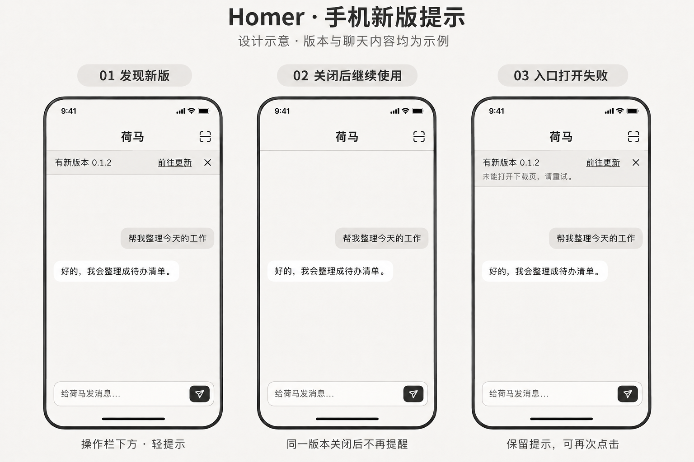

# Homer 手机 App 新版轻提示方案

当前源码（2026-11-12）：安卓 App 与官网安卓入口共用 GitHub 清单 `https://raw.githubusercontent.com/wolf3c/homer/main/mobile/android-releases.json`，维护文件为 [`mobile/android-releases.json`](../mobile/android-releases.json)。安卓更新按钮直接打开校验后的固定标签 APK；iOS 继续读取原官网 JSON、打开原官网更新入口。版本、系统、ABI、关闭规则和轻提示不变。当前 Android 0.1.1 / build 6 已采用该来源并公开分发，GitHub 清单已上线；已完成同签名覆盖安装与启动，真实更新查询和绑定／数据保留待验。官网读取代码尚未部署，iOS 不变。

确认日期：2026-11-03（Asia/Shanghai）。客户端更新提示已接入源码并提交（`a3b8059`，固定入口调整为 `0ff46e4`）。源码和离线验证不代表正式包已完成启动检查或覆盖安装验收。

发布状态核对（2026-11-04）：[官网移动下载区](https://super-tree.com/homer/app)已提供 Android 0.1.1 build 4；[线上发行数据](https://super-tree.com/homer/mobile-releases.json)与 [GitHub Release](https://github.com/wolf3c/homer/releases/tag/mobile-android-0.1.1-4)的附件地址及 SHA-256 一致，iOS 为 `coming_soon`。本轮未下载安装包或核验其内置更新提示；不能据此认定该包已包含、启用并通过本方案全部能力。

## 目标与职责

iOS、Android 正式 App 启动时检查本平台是否有实际可安装的新版本，以可关闭的轻提示引导用户前往官方安装入口。平台独立判断和发布；上传中、审核中或本地签名完成都不等于可安装。

| 责任方 | 范围 |
| --- | --- |
| Yezi2 | 官网移动下载区域读取 GitHub 安卓清单；iOS 数据和入口保持原路径。旧官网 JSON 的安卓记录保留供旧客户端过渡。 |
| Homer 手机端（本方案） | 安卓清单维护、安装包信息读取、版本和可安装条件判断、启动检查、关闭记录及轻提示；安卓打开 APK，iOS 继续打开官网。 |
| Homer 桌面入口任务 | 设置 → 移动设备的下载按钮及下载二维码；共用官网固定区域。 |
| 平台发行方 | 核实正式包身份、签名、版本、系统和架构，验收实际下载或商店地区可用性后提供发行数据。 |

官网及下载入口遵循[既有移动端发行约定](../.codex/skills/homer-github-build/references/releases.md#移动端)，不另建下载服务或重复维护桌面 Latest 规则。Android 使用既有仓库中独立移动标签下的正式 APK，不改变桌面 Latest。已撤下的 models.super-tree.com Homer 下载不恢复。

本项不包含强制更新、静默安装、OTA、后台常驻轮询、App 内下载安装器、新账户或数据库。桌面自动切换和数据迁移继续归属[正式产品自动更新要求](20-product-update-requirements.md)，不能套用到本项手机提示。

## 已通过的设计与交互

设计图为 AI 生成并经用户确认的概念图，版本号和聊天内容均为虚构示例，不是已发布版本或产品运行截图。周边界面仅供说明，实施保留实际产品组件，遵循 [UI 设计原则](../ui/DESIGN.md)。此前操作栏上方的大卡片方案已由本图替代。

- 提示在现有操作栏正下方、聊天内容上方，占正常布局空间；操作栏位置保持稳定，不悬浮遮挡聊天或输入框。
- 正常文案为「有新版本 {version}」，右侧提供「前往更新」和关闭按钮。采用暖灰背景、细分隔线、文字操作，不使用警告色、警告图标或大卡片。
- 正常字号下优先单行；窄屏或系统大字体允许换行，不能靠缩小字号或裁掉操作维持单行。按钮触摸区域至少 44px，并提供读屏名称「关闭更新提示」。
- 关闭后整条收起，继续使用原聊天；显示与关闭均不能重载 WebView、清除草稿、改变连接或抢走输入焦点。布局变化需保持消息阅读位置。
- 「前往更新」在安卓打开本次已校验记录中的固定标签 APK；iOS 仍打开既有固定官网下载区域。下载和安装由系统及用户完成。打开入口成功不等于下载、安装或更新成功，也不自动记为已关闭。
- 系统无法打开入口时，条内补充「未能打开下载页，请重试。」，保留更新和关闭操作；不弹出阻断对话框，不自动重试。
- 扫码、系统文件选择、绑定确认及相关关键操作期间暂缓展示，返回稳定页面后再显示；检查仍只执行一次。界面出现与关闭不改变既有扫码、附件或绑定状态机。

## 官网与手机端数据合同

公开字段合同唯一维护在 Yezi2 仓库的 [docs/homer/2026-11-03-mobile-release-data-contract.md](../../yezi2/docs/homer/2026-11-03-mobile-release-data-contract.md)，包括固定数据 URL、schema、初始 JSON、平台必填字段、官网链接约束及发布缓存规则。本文只维护手机端行为、实现接点和验收，不复制字段表或 JSON。跨仓链接按 Homer 与 Yezi2 同级检出解析；单仓阅读时按上述仓库及文件路径查找。

桌面下载按钮、静态下载二维码及 iOS 更新按钮继续使用 `https://super-tree.com/homer/app`；安卓新版更新按钮直接打开 APK。官网保留旧版锚点及原 JSON，兼容已安装客户端。查询源变更随后续正常 APK 更新采用，不为换地址单独打包，不让旧客户端自动获得新源码行为。

App 按合同读取本平台正式渠道记录；仅对有效的 `available` 记录判断更新。安卓使用 GitHub 清单，校验通过才把 downloadUrl 存入原生更新记录并用于打开 APK；网页快照仍只有版本和打开失败状态，网页消息不能指定下载地址。iOS 保持原官网查询与更新入口。QA App 禁用公开更新检查；未知渠道直接跳过。正式渠道身份来自明确的发行配置及安装包身份，不能仅凭展示版本或 debug 开关推断。旧官网静态 JSON 曾核对为 Android `available`、iOS `coming_soon`；此记录不代表 GitHub 新源已上线。2026-11-04 匿名 HTTPS GET 返回200和 JSON 正文，响应类型为 `application/json; charset=utf-8`，缓存头为 `public, max-age=0`；这只证明本次响应，尚未验收原生 HTTP 缓存、撤回传播或 WebView 跨域行为。

## 安卓来源迁移与发行

GitHub 清单沿用 schemaVersion 1，只维护 releases.stable.android；iOS 不复制进此文件。APK 继续位于独立移动标签，下载 URL 必须是无凭据、端口、查询及片段的官方固定标签地址，拒绝 latest。正式签名兼容性及实际 APK 的 SHA-256 继续由发行验收保证；当前壳只校验清单字段，不自行下载文件或计算 APK 摘要。

获准发布并验收 APK 后，再更新 GitHub 清单；不占用桌面 Latest、不覆盖旧标签或附件。首次采用新官网读取代码需单独部署一次，此后安卓常规发版只维护 GitHub 清单，无需逐版交接或部署官网。旧官网 JSON 的安卓项保留为旧客户端过渡快照，不再作为新版安卓的可变数据源；若需引导旧版升级，另按当轮授权更新旧快照。iOS 数据继续按原官网流程维护。

新 GitHub 地址未发布、离线或超限时，本次安卓检查静默结束，官网安卓显示原不可用状态，不回退到旧官网安卓记录。GitHub Raw 的缓存与跨域由 GitHub 提供，不能沿用官网缓存头或承诺固定撤回时限；发布后须核验匿名 JSON、CORS、缓存及实际 APK。

## 手机端检查与状态

1. App 进程启动时，异步读取本机平台、正式渠道身份、实际安装包版本、系统及架构信息，与原连接恢复并行。不能以源码 `app.json` 或随包网页版本代替安装包信息。
2. 每次进程启动最多请求一次本平台 JSON（安卓为上述 GitHub Raw 地址，iOS 为原 `https://super-tree.com/homer/mobile-releases.json`）；返回前台、重连、扫码、WebView 重挂不重新检查。超时 5 秒，响应上限 32 KiB；不持久缓存发行响应，通过 Expo 支持的 `Cache-Control: no-cache, no-store` 请求头要求重新验证且不存储响应，不使用其未传递到原生层的 `cache` 选项。不携带账号或绑定凭据，不上传聊天内容。
3. 读取失败、超时、离线、未知 schema、未知渠道、字段无效或本机必要信息未知时，本次静默结束，不阻断连接或显示错误提醒。
4. Android 检查远端 versionCode 严格更高、系统 API 及 ABI 满足要求。正式包 applicationId 与签名兼容性由发行验收保证；客户端版本数值比较不能证明签名兼容。
5. iOS 按数字段比较公开 marketing version，例如 `0.1.10 > 0.1.9`，缺失尾段按零处理，拒绝非数字版本；同一公开版本增加 build 不提醒。最低系统满足，且当前 StoreKit storefront 位于核验列表才可提醒。
6. 读取当前渠道和平台的已关闭版本。目标比本机及已关闭版本都高时，进入待展示状态；等稳定页面可展示后出现轻提示，不再次请求发行数据。
7. 关闭立即收起，并以渠道、平台组成的独立 SecureStore 键保存一个最高已关闭版本标识（Android versionCode、iOS 规范化公开版本），不按每个目标版本新增记录。该版本及更低版本不再提醒；更高版本仍可提醒。读取关闭记录失败时，本次跳过提示；写入失败仍立即收起，但跨启动去重不作成功保证。

检查和提醒不改变既有连接、重连、授权和消息路径。现有「App 与电脑版本不匹配」是协议兼容状态，不能作为有新发行版的依据；App 壳版本、内嵌页面和协议版本分别管理。

## 实施接点与必要平台能力

- [mobile/App.tsx](../mobile/App.tsx) 负责启动检查、版本及可安装条件判断、关闭记录和系统浏览器操作，是提示状态的唯一 owner。嵌入网页只负责渲染，不自行请求发行数据或持久化关闭记录。
- 聊天模式的操作栏属于 [ui/homer-app.tsx](../ui/homer-app.tsx) 的 `conversation-header`；轻提示放在该 header 之后、`conversation-workspace` 之前，仅移动 App 展示，沿用现有样式层，不创建或移动操作栏。连接页的轻提示由原生壳在其既有 toolbar 后呈现；扫码、确认绑定等关键流程继续暂缓。
- 复用现有本地 WebView 事件和消息桥：原生壳下发可见提示的版本、入口打开失败状态或清空状态；网页上报关闭或打开更新意图。沿现有来源与 nonce 校验，网页不能提供任意 URL 或写入目标版本。原生壳处理动作后同步当前状态；网页只保留渲染快照。WebView 重挂或 ready 后补发当前状态，nonce 更换时沿既有连接同步更新，不重复检查、不恢复已关闭的提示；网页先注册 `homer-mobile-update` 监听，再立即读取 `window.__homerMobileUpdate` 快照；即使 ready 和首次下发早于 React 挂载，也不会丢失展示状态。快照只在当前 WebView 内存中存在。文件选择通过带当前 nonce 的 `update-busy` 布尔意图暂缓展示，选择或取消后解除；网页仍不能决定候选版本或存储记录。
- 版本及数据校验放在小型可测试模块；不改配对协议或主端服务，不创建通用更新框架。SecureStore 使用独立键，不能覆盖绑定和取消操作记录。
- 已加入当前 SDK 声明兼容的 `expo-application ~58.1.2` 及锁文件，读取应用标识、公开版本和原生 build，未升级 Expo。正式 JS 打包必须显式设置 `EXPO_PUBLIC_HOMER_RELEASE_CHANNEL=stable`；缺失、未知渠道、开发模式或实际应用 ID 不是 `com.homer.mobile` 时禁用。iOS 同时要求 SDK 返回 `production`，sandbox、TestFlight、xcode 或未知环境均跳过。
- iOS 需小型 StoreKit 只读桥接获取当前 storefront；不能通过设备地区、语言或 IP 代替。返回 nil、失败或不在核验列表时本次跳过。只读模块已置于 `mobile/modules/homer-storefront`，仅有 Swift、模块声明和 podspec；元数据发现通过，原生编译、链接及实际 StoreKit 返回尚未验收，不能把合成测试或跳过策略称作 iOS 完整验收。环境与 storefront 读取设五秒上限，不注册长期事件或主动请求登录。
- 现有 Expo Device 与 React Native 平台能力用于系统和 ABI 读取，信息未知则跳过。`mobile/update.mjs` 集中校验和比较，不新增更新框架。进程级 Promise 只保留候选结果，WebView 重挂或前后台切换不重查；关闭后本进程结果清空。原生能力需要后续构建及定向真机验收授权，当前不执行。

## 发布数据更新与失败处理

发布顺序、旧入口保留、撤回及缓存目标统一见 Yezi2 合同的「发布、缓存与核验」，不在本文维护第二套流程。单次启动检查已展示的提示不会实时获知撤回，用户点击时官网需以当前数据为准。

正式覆盖更新须保留原绑定和用户数据。Android 签名不兼容时不引导自动卸载、清数据或绕过平台校验；QA 与正式安装的迁移需另行安排。旧 App 没有此功能，不能追溯收到提示，须先安装包含该功能的新包。

## 验收清单与当前证据

以下为完整完成标准；已执行范围见本节末的实际证据，未覆盖项继续待验：

- 合成数据：平台与渠道隔离、版本相同/更低/更高、Android API/ABI、iOS 数字段比较及 storefront、缺失/错误字段、未知 schema、超时和超限响应；错误记录不影响另一平台。
- 去重：同版本关闭后冷启动不再提示；更高版本再次提示；发行回退不出现旧提醒；关闭记录读写失败按约定处理。
- UI：实际产品操作栏下方位置、320/390px 窄屏、大字体、至少 44px 操作区、读屏、焦点、输入键盘及阅读位置；提示不遮挡聊天，不重挂 WebView、不丢草稿。
- 关键流程：扫码/确认绑定、系统文件选择与分享期间暂缓展示，返回后可见；断线重连不重复检查、不打断业务；入口打开失败可再次点击；ready 前后、WebView 重挂和 nonce 更新时正确同步提示，旧 nonce 或错误来源的动作被拒绝。
- 双方接入：HTTPS/JSON 响应、官网与 App 同源数据、缓存和撤回传播、官网锚点、实际 APK 下载摘要及准确 App Store 页面。
- 正式包：本机身份与实际版本读取、iOS StoreKit storefront、各自正式发行渠道可安装性、覆盖安装后绑定及数据保留。QA/合成测试不能代替这些证据。

按项目测试边界先执行最小相关离线检查，新增专项登记到 `scripts/test.mjs` 并维护 `docs/testing.md`；真机、安装、真实模型或发行验收按后续实际授权选择。不重复 TURN 长测，不运行无关全量或付费模型测试。

2026-11-03 源码及离线验证记录：

| 检查 | 实际结果 |
| --- | --- |
| `npm test --prefix mobile` | 32/32，无跳过；包含原扫码／绑定回归、版本和平台条件、最高关闭记录、正式／QA 隔离、存储失败、固定官网打开失败／重试、nonce／来源、分享及文件选择暂缓、ready／重挂／前台不重查、storefront 与请求超时、缺失／伪造长度头的流式提前取消、UTF-8 分块及恰好 32 KiB 边界。原生 API 均使用隔离合成夹具。 |
| `node --import tsx --test tests/mobile-client.test.mjs tests/mobile-request.test.mjs` | 17/17，无跳过；保留原连接、取消和文件分享协议回归。 |
| `node --import tsx --test tests/mobile-ui-build.test.mjs` | 2/2，无跳过；真实产品页面以合成壳快照验证首次快照、后续事件、提示位置、打开／重试／关闭意图、旧壳无快照、390／320px、大字号及 44px 操作区；无页面脚本错误或横向溢出。另保留隔离预览回归。 |
| 移动、网页类型检查 | `npm run typecheck --prefix mobile`、`npx tsc --noEmit -p ui/tsconfig.json` 通过。 |
| 独立 UI 打包 | 输出至 `.codex/scratch/mobile-update-implementation-20261103/ui`，通过无外部脚本／样式资源检查；移动打包仅过滤已有 Live 调试注入，不修改调试源页面。打包器仍有 CSP 提示；本次浏览器页面成功渲染，不据此推定 WKWebView 验收。 |
| 本地模块元数据 | Expo autolinking 的 search／resolve 均找到 `HomerStorefrontModule` 及 podspec；这不是编译或安装证据。 |
| 禁缓存修复复验（2026-11-03） | `node --test mobile/update.test.mjs` 8/8，无跳过；新增请求头及移除无效 `cache` 选项的断言，先在旧实现上失败，修复后通过。保留匿名请求、离线失败、五秒超时、32 KiB 和 UTF-8 边界回归；此结果不代表原生 HTTP 缓存验收。 |
| 提交前隔离复核（2026-11-03） | 仅导出本聊天所属的源码及文档到独立 worktree；更新、连接及本地权限纯 Node 测试 14/14，无跳过，移动和网页 `tsc --noEmit`、相关脚本语法及差异检查通过。本轮未重新运行需编译夹具或打包的 React／浏览器专项，未构建、安装或发布；前述历史结果不代表隔离候选已获原生验收。 |
| 文档整理复核（2026-11-04） | `npm test --prefix mobile` 32/32，无跳过；核对官网移动下载区、匿名发行 JSON 及 GitHub Release 附件元数据一致。未重新运行浏览器专项、类型检查、UI 打包或原生验收；本轮只改文档。 |
| 安卓 GitHub 来源（2026-11-12） | 隔离 Node 22.22.0：移动端 38/38、桥接／请求 21/21、官网离线 19/19、官网浏览器 1/1，均 0 失败／跳过；移动类型检查通过。来源和 APK 直达断言先红后绿，nonce 与关闭规则继续通过回归；中英文桌面／390px 验证安卓与 iOS 来源隔离及故障状态。原官网 JSON 未改，新 GitHub 地址及原生网络／安装、生产缓存未验收。 |

截图、命令日志和开始修改前的文件副本保留在 `.codex/scratch/mobile-update-implementation-20261103/`。本次没有新建根目录专项文件；现有 `mobile-ui-build.test.mjs` 已登记在 development 专项，纯移动测试由 `mobile/package.json` 的 test 入口收集。

尚未验证：真实键盘、读屏、大字体系统设置与有消息时的阅读锚点／草稿／焦点连续性；iOS 模块编译链接、真实 storefront 和正式／TestFlight 环境；正式包覆盖安装后绑定与数据保留；Yezi2 原生 HTTP 缓存、撤回传播及实际安装包下载。网页代码已复用现有阅读锚点，鼠标操作避免转移输入焦点，不能以代码检查替代上述交互验收。额外内置浏览器 `file://` 复核被工具安全策略拒绝，未绕过，也未算作通过；此前显式运行的浏览器测试证据保留。本轮仅核对已公开页面、发行数据及 Release 元数据，未执行部署或发行操作；后续构建、安装及发布仍须单独授权。

## 设计来源与参考

归档图 `images/mobile-app-update-notice-approved.png` 是本聊天第二版设计图的原始 PNG，未重绘或修改像素；1536×1024，1,575,720 字节。SHA-256：`9bf8c44ef23b6ee58ded63ec29b91069fbee56f925389de582c44c7c52b8d06e`。图中虚构内容仅说明 UI，不能用于商店可用性或运行验收。

- [Expo 原生 fetch：流式读取与内置编码 API](https://docs.expo.dev/versions/latest/sdk/expo/#expofetch-api)
- [Expo Application：实际安装包身份及版本](https://docs.expo.dev/versions/latest/sdk/application/)
- [Apple Storefront.countryCode：三字母地区码](https://developer.apple.com/documentation/storekit/storefront/countrycode)
- [移动端使用与连接说明](../mobile/README.md)

## 2026-11-05 Android 本地正式签名构建与覆盖安装

- 0.1.1 / build 5，基于 main `7b79a341994651ad1fdf8536de29467ba301de13` 冻结源码，仅候选的 `mobile/app.json` 将 Android versionCode 从 4 递增为 5；未纳入共享工作区其他未提交改动，未改变 iOS build、标识或签名。当前蓝底移动图标已包含，尚未实施后续讨论的深藏蓝统一。
- stable Release ARM64 APK；32 项移动测试及类型检查通过，重新生成内嵌页面并执行 Expo prebuild、Gradle assembleRelease。APK 签名与旧正式包、已安装包一致；包内 Hermes bundle 和构建输出一致，source map 中 App、更新模块和内嵌页面与候选源码一致。无源码 map、密钥和环境文件打入 APK。
- 制品：`.codex/private/releases/homer-android/0.1.1-5/Homer-0.1.1-5-android-arm64.apk`，42,784,844 字节，SHA-256 `859e293c451b43b2c24242152b115fa6388ecf1e4ccef771cb2774fa201e50d5`，最低 API 24、target 37。原密钥签名，无换签。
- 已通过 ADB 对 Pixel 8 Pro 的 user 0 覆盖安装，回读版本和安装后 APK 摘要一致；未卸载、清数据、操作 VPN 或 QA App。解锁后实际启动可见，原绑定进入自动重试，当前提示暂时无法连接电脑；没有据此宣称配对或 TURN 验收通过，也未操作桌面主端。
- 本次仅本地打包和安装，未上传 GitHub、更新官网发行 JSON、部署或变更 iOS 审核。私有核验在同版本 verification.json；旧正式制品保留。

## 2026-11-12 Android v0.1.1 / build 6 隔离构建

桌面发行聊天 `01a1ce49-48c0-7482-b65e-c8e2974e3465` 本轮完成后启动，范围仅限安卓隔离构建与包核验；未安装、上传、公开或部署，不修改 GitHub 清单及官网数据。

- 源码基线：`edbf4c6a16bf3f566ba973b066bd547aab8e3757`。只在独立候选将 `mobile/app.json` 的 Android versionCode 从 4 改为 6，完整覆盖差异记录在私有 verification.json；未纳入共享工作区未提交改动。移动版本保持 0.1.1，iOS 配置不变。不是纯提交无覆盖构建。
- 复用 Node 22.22.0、已安装 JDK 21／Android SDK 37 和原正式密钥，候选中重新生成原生工程与内嵌聊天页面。已安装移动依赖的 479 个版本与锁文件一致；38 项离线移动测试及类型检查通过。Gradle `assembleRelease` 使用 ARM64、两 worker、非 daemon，保留 Release lintVital、启用 R8 与资源收缩；353 个任务执行，14 分 35 秒成功。构建日志含既有第三方弃用提示。
- 产物：`.codex/private/releases/homer-android/0.1.1-6/Homer-0.1.1-6-android-arm64.apk`，41,766,177 字节；SHA-256 `ae441df98bfee1a44e5132c680421d3977c0d8600e3bfd47c753c0f95d64d8f5`。
- APK 实读：`com.homer.mobile`、versionName 0.1.1／versionCode 6、最低 API 24、target 37、仅 arm64-v8a、不可调试。apksigner 校验通过，证书 SHA-256 与正式基线及重新下载、核对摘要后的公开 build 5 一致：`a99360f0b7b12f5fab09dd41f3a7a18ec53c954253e2caca7399b14a9af28382`。
- 包内 Hermes bundle 与本次构建输出逐字一致；最终及中间 source map 均确认 App.tsx、update.mjs、重新生成的 chat.mjs 与候选原文一致。已确认新 GitHub 查询地址、stable 编译替换及内嵌许可；未发现 keystore、source map、环境文件或签名密码进入 APK。保留最终 source map、R8 mapping、摘要与脱敏 verification.json，供本包后续崩溃定位和验收；不公开调试映射。

构建阶段只完成制品核验，后续安装和公开分发结果见下文；不能据此宣称更新提示、绑定／数据保留通过。构建阶段尚未上线 GitHub 新清单，后续公开下载和清单跨域／缓存核验见下文；官网下载入口上线与原生更新查询仍待验。该构建阶段未修改共享版本、签名材料、iOS、Release、Latest 或远端，未提交记录。

### 2026-11-12 build 6 ADB 覆盖安装

用户另行授权安装后，唯一已连接 Pixel 8 Pro（当前 Android user 0、API 37、arm64-v8a）上原正式 build 5 的证书与本次 build 6 一致。使用 `adb install -r --user 0` 成功覆盖安装，未执行卸载、数据清除或降级。安装后回读 versionName 0.1.1／versionCode 6，拉取已安装 base.apk 的 SHA-256 与本次交付包一致；启动 MainActivity 成功，Homer Activity 已在前台恢复。

这里只确认安装及 Activity 启动；未读取聊天或应用私有数据，未验收绑定／数据完整保留、配对、真实模型及 GitHub 更新查询。核验 JSON 已更新，无设备序列号进入维护记录。安装阶段未上传、公开或部署，后续分发见下文。

### 2026-11-12 build 6 GitHub 公开分发

按用户本轮授权，将已经安装且核验过的原包发布为 [mobile-android-0.1.1-6](https://github.com/wolf3c/homer/releases/tag/mobile-android-0.1.1-6)，Release ID 442637345。标签指向原构建基线 edbf4c6，versionCode-only 候选覆盖仍按上文记录，不把它称为纯标签源码构建。先创建草稿，仅上传 APK 与 SHA256SUMS；对照 GitHub 附件大小、digest 后公开同一 Release，附件身份未变，make_latest=false。

匿名完整回下载 APK 为 41,766,177 字节，SHA-256 与交付及手机回读包一致（ae441df98bfee1a44e5132c680421d3977c0d8600e3bfd47c753c0f95d64d8f5）；公开 SHA256SUMS 与本地原文逐字一致。完成上述核验后，安卓发行清单由 build 5 更新到 6，URL 使用同一不可变移动标签 APK，保持 API 24、arm64-v8a 及原 schema。固定读取地址为 `https://raw.githubusercontent.com/wolf3c/homer/main/mobile/android-releases.json`。清单提交 `f394d95` 已推送 main；匿名回读 HTTP 200，JSON 原文与交付清单一致（SHA-256 `75aeca3f6a595341868357c11b16b7e32c86d4317c87930236ec784aebf1fd35`），Content-Type 为 `text/plain; charset=utf-8`，Cache-Control 为 `max-age=300`，Access-Control-Allow-Origin 为 `*`。这仅证明当前公开响应，不承诺固定缓存撤回时限；实际更新模块校验确认 build 5 可识别 build 6，build 6 不重复提醒。

本次只更新安卓 GitHub 清单；iOS 和 Yezi2 原 JSON 不改，不部署官网。公开后回读桌面 Latest 仍为 v0.1.8；不将此移动版设为 Latest。手机真实查询、完整绑定／数据保持及业务流程仍待验收；公开包不包含私有 verification、R8 mapping 或 source map。
