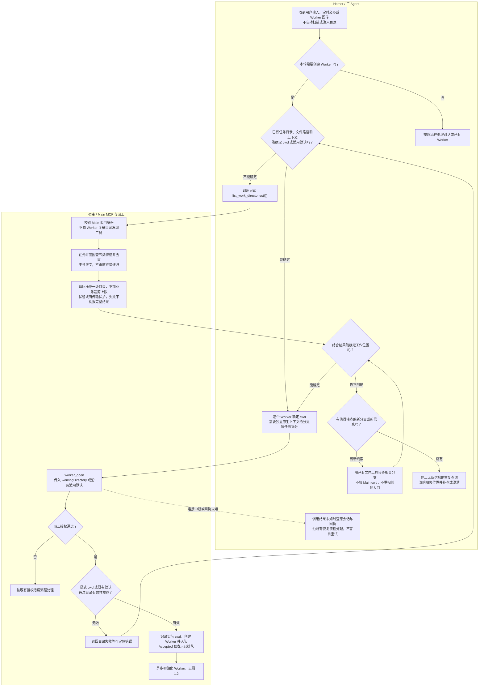
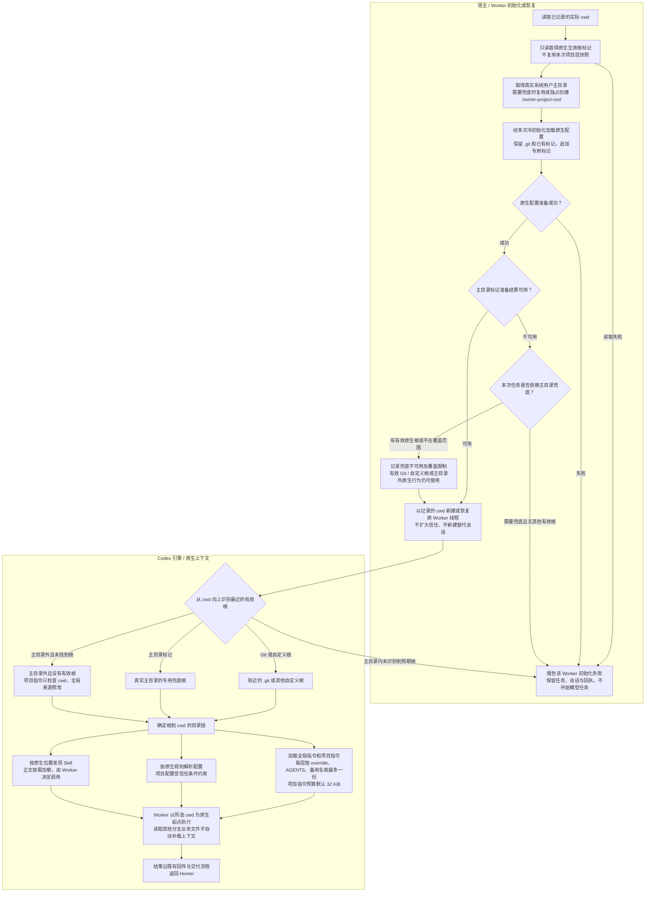

# Worker 工作目录与项目根：简化方案

状态：v0.8，核心已实施，macOS 离线定向及原生隔离验收完成；完整离线有既有失败，Windows／LLM 效果待验。日期：2026-11-14。

本稿替代 v0.1–v0.7。目录不明确时，Homer 按需调用 Main 专用的 `list_work_directories({})`，先看压缩一级目录，再用已有文件工具定向查看相关分支。新工具复用现有宿主 MCP 通道，`work_directory` 保持原样；Worker 继续通过 `worker_open.workingDirectory` 获得 cwd，Codex 保留 `.git` 和真实用户主目录兜底根。授权覆盖源码、复审、离线检查、隔离原生验收及本次本地提交；不影响日常 Homer 数据，不推送、部署或调用付费 LLM。实施记录见[计划](../plans/2026-11-14-worker-directory-context.md)和[测试说明](../../testing.md#worker-目录上下文-v08)。

## 1. 职责与最小流程

Homer 准备创建目录相关的 Worker 时，先结合任务目标、工作文件路径、已有任务目录和对话信息选择 cwd。能够确定就直接填写；目录仍不明确时才查询候选位置。默认目录适用的通用任务、普通对话及继续已有 Worker，不为这个字段强制查询。

| 接口 | 职责 | 目录副作用 |
| --- | --- | --- |
| `list_work_directories({})` | Main 专用，只读发现候选工作位置 | 不选择 cwd，不创建目录或 Worker |
| `work_directory`，保持现状 | 读取当前 runner 的已选目录，或选择其下一原生轮的目录 | 指定 `path` 或 `taskId` 会选择目录 |
| `worker_open.workingDirectory`，保持现状 | 为本次 Worker 指定实际工作目录 | 沿既有授权、校验和入队流程处理 |

`list_work_directories` 返回的是约定搜索范围内的候选位置，不是所有合法 cwd，也不是已运行 Worker 的目录清单。Homer 可以选择没有 Codex 标记的已核实目录；选好后直接传给 `worker_open`，不需要先切换 Main cwd。

程序负责位置发现、校验和兜底标记准备，LLM 负责语义选择。目录资料仅进入显式查询的工具结果，不逐条注入用户消息，不写入永久提示词、动态工具声明或 Worker 的派工正文。不新增文件路径解析器、共同祖先决策、任务分类器、项目数据库或 Skill 配置接口。

### 1.1 Homer 按需查询与派工

以下是 v0.8 的运行流程。授权错误、目录错误和回执未知分别处理，避免通过查目录绕过授权或重复创建 Worker。



查询失败或没有匹配，不代表工作目录不存在。宿主不在模型选定后另算共同祖先覆盖 cwd，目录发现也不构成读写或执行授权。`worker_open` 结果未知的分支只表示调用端未确认结果，不能据此重新创建任务或 Worker。

### 1.2 Worker 初始化、根识别与原生加载

先尝试准备主目录标记，再进行本次最终原生配置加载；不可复用标记准备前已经解析的项目层快照。原生配置失败是该 Worker 的初始化失败，主目录标记不可用则按是否依赖兜底分别处理，不将兜底文件变成所有 Git 任务的启动前置。



依赖兜底，指 cwd 位于真实用户主目录内，且不能核实其他有效原生根、需要主目录作为本方案的继承起点。核实依据来自生效的原生配置与目录事实，不自行拼接规则或模拟 Skill 加载。若实际根发现与准备状态不一致，应报告初始化问题，不能仅凭标记存在宣称加载成功。三条加载分支表示不同职责，不要求按图并行。

## 2. 候选发现的对象与范围

只有 Main 显式调用 `list_work_directories` 才启动候选发现。下列特征映射为其所在业务目录，并按实际路径去重：

| 定位特征 | 候选位置 |
| --- | --- |
| `AGENTS.md`、`AGENTS.override.md` | 文件所在目录 |
| `TEAM_GUIDE.md` | 文件所在目录，仅作为额外位置线索 |
| `.codex/`、`.agents/` | 目录的父目录 |

`TEAM_GUIDE.md` 不是 Codex 默认指令名，只有生效配置将其列入 `project_doc_fallback_filenames` 时才可能按备用名加载；本方案不自动修改这项配置。见[原生备用文件名说明](https://learn.chatgpt.com/docs/agent-configuration/agents-md#customize-fallback-filenames)。这五类是定位特征，不加入 `project_root_markers`；`.git` 和主目录专用标记只用于根识别，不扩展成通用项目清单。

默认在真实用户目录下可访问的非隐藏工作入口，以及系统文档、桌面、下载位置中查询；Main 已选目录、已有任务／Worker 的目录、用户明确给出的其他路径可作为独立搜索根。macOS 排除 Library 等应用数据和系统媒体库；Windows 使用实际 Known Folders，保留盘符与 UNC，排除 AppData，不默认遍历所有盘。真实主目录不能从隔离后的引擎 HOME／USERPROFILE 猜测。

遍历遵循以下边界：

- 覆盖隐藏标记和 Git 忽略路径，不在发现 Git 根或第一份指令文件后停止。一级展示不是只扫描一层，深层候选仍可在相关分支查询中找到。
- 发现 `.codex/`、`.agents/` 后记录其父目录，不为位置发现枚举其中的配置、Skill 或临时资料。
- 跳过依赖、版本库内部、构建产物、缓存、临时副本，不自动沿符号链接、junction 或所有外置卷递归。
- 明确给出的工作目录可独立查询，即使其上级属于默认排除区；不展开整个上级区域，根内普通分支仍遵守排除规则。

查询只读文件系统元数据，不读指令正文、不生成标题或简介、不解析配置或 Skill，不调用 `skills/list`。只有 scratch/private 的 `.codex/` 也可能命中，所以存在特征不代表已经发现有效规则、启用配置或调用 Skill。用户全局配置、引擎运行目录和主目录兜底根不自动作为业务 cwd 候选。

复用现有文件系统能力，不读取其他软件的项目数据库，不新增搜索服务、监听器、持久项目索引或后台刷新；同名但不同实际路径的目录保持区分。

## 3. 目录呈现与 cwd 选择

### 3.1 先显示一级，相关分支按需展开

首次只显示各工作入口下存在匹配位置的一级分支。例如发现 `atlas/services/payments/`，先显示 `atlas/`；确认任务相关后，Homer 用已有文件工具只查该分支，取得下一层或压缩的匹配路径。普通祖先只是导航，不代表该祖先本身含规则。

每个工作入口只写一次绝对路径，下面表示相对层级。历史任务、备份及 `before/after`、`archive`、`upstream` 等深层位置不在首份参考中平铺；明确涉及它们的任务仍可定向查询，不永久排除。

目录参考不新增固定字节、token 或条目数量的业务裁剪上限，不按长度省略或截断路径；正常返回本次范围内的完整压缩一级入口。既有 MCP／原生消息传输保护保持，触及传输边界时明确报错，不静默截断、伪报完整结果或绕过安全限制。返回内容只保留路径和层级；不重复使用说明，不附带标题、规则明细、Skill 名称、时间、shell 或引擎 HOME。控制信息量依靠按需查询、层级压缩和分支展开，不增加运行时分词依赖。

路径以数据处理：逐个目录名转义控制字符后再拼树，工具结果使用标准 JSON 编码，不能让目录名伪造树层级或工具指令。显示和后续传参须保留完整路径含义，不把目录名中的文字当成授权或执行要求。

### 3.2 Homer 选择实际工作位置

任务路径是语义依据，不直接决定 cwd。Homer 区分工作目标、输入／输出、参考素材及举例路径；附件不等于完整工作文件清单，也不因多个路径存在共同祖先就默认选该祖先。

已有任务目录、明确工作路径或近期上下文足够时，直接选 cwd，不查询目录参考。目录不明确时先 `list_work_directories({})`，再定向核查相关分支；同一分支无新信息时停止重复查询，说明缺失位置并澄清。目标目录没有 Codex 标记也可以使用，cwd 不必等于项目根。

跨目录任务选择有实际操作意义的起点，在 `message` 说明其他相关路径；共同祖先不会自动加载各子分支上下文，需要分别取得原生上下文时按任务拆分 Worker。选定后直接填 `worker_open.workingDirectory`，不先调用 `work_directory` 切 Main cwd。

`workingDirectory` 保持可选和原有默认：新任务省略时沿用 Main 最新选定目录，已有任务沿用其既有记录。正文路径不自动修改 cwd，宿主不在调用后另算目录替换它；候选列表也不成为 cwd 白名单。

### 3.3 保留 Git 根，以真实主目录兜底

复用 Worker 的原生配置读取和准备流程，在生效的根标记列表中追加 `.homer-project-root`，保留 `.git` 和已有自定义标记，不新增 TOML 解析器。默认情形如下：

```toml
project_root_markers = [".git", ".homer-project-root"]
```

该数组替换的是默认根标记列表，不是指令文件列表。`AGENTS.override.md`、`AGENTS.md` 仍由引擎默认识别，不加入根标记，否则较深指令文件会截断上层继承。见[原生项目根配置](https://learn.chatgpt.com/docs/config-file/config-advanced#project-root-detection)。

宿主仅在 cwd 位于真实系统用户主目录内且不能核实较近 Git／自定义根、确实需要兜底时，在该主目录准备一个 `.homer-project-root` 空文件，例如 `/Users/example/.homer-project-root`。不存在时独占创建；已有普通文件直接复用，不覆盖内容，不跟随符号链接，类型冲突明确报告。有有效原生根的任务不依赖这次写入；主目录外的任务不准备该文件。此步骤先于本次最终原生配置加载，随后通过既有冷初始化／恢复流程重新读取项目层。只创建这一个兜底标记，不逐个项目建标记，不创建伪 `.git`、初始化 Git 仓库或生成 `AGENTS.md`。真实主目录不能用引擎隔离后的 HOME、USERPROFILE 或 `CODEX_HOME` 代替。

引擎从 cwd 向上识别最近有效标记：较近的 Git／自定义根优先；主目录内没有较近根的普通目录以主目录兜底。Git 根外的主目录指令不会因此加入该 Git 项目。无 Git 示例：

```text
/Users/example/
├── .homer-project-root              ← 兜底 project root
└── Documents/customer/
    ├── AGENTS.md
    └── contracts/
        ├── AGENTS.md
        └── current/                ← cwd
            └── AGENTS.md
```

Codex 沿根到 cwd 的目录链继承三层指令，不递归加载兄弟目录或其他子分支；每层文件优先级与项目指令总预算仍按原生规则，默认总上限为 32 KiB。这是引擎的指令预算，与本方案不限制目录参考容量无关。见[原生指令发现规则](https://learn.chatgpt.com/docs/agent-configuration/agents-md#how-codex-discovers-guidance)。

主目录中的公共指令会影响其适用分支；配置、信任及 Skill 启用仍由原生机制决定，不自动信任整个主目录或扩大写入权限。主目录外的外置卷、其他盘符和共享目录不受此标记覆盖，不自动向磁盘根补标记或改用主目录 cwd。

初始化失败必须区分：

| 情况 | 处理 |
| --- | --- |
| 原生配置无法正确读取、合并或初始化 | 该 Worker 初始化失败，保留任务、会话和回执，不开始模型任务 |
| 主目录标记不可用，但可核实有效 Git／自定义原生根 | 沿有效原生根继续，记录兜底不可用，不阻断无关任务 |
| 主目录标记不可用，cwd 在主目录内且依赖该兜底 | 明确报告该 Worker 初始化失败，不静默遗漏预期上层规则继续执行 |
| cwd 在主目录外且无有效原生根 | 沿原生 cwd 行为处理并明确覆盖限制，不承诺上层继承 |

目录有效性与实际加载不能混为一谈。标记和配置准备状态不等于规则已生效，根判定与新建／恢复加载效果必须在固定版本原生专项中核实；失败不通过更换 cwd、改信任或新建替代 Worker 补救。

## 4. Main 专用只读 MCP 工具

### 4.1 接口与返回

新增 `list_work_directories`，参数为无额外字段的空对象 `{}`，只向 Main 暴露。复用[现有宿主 MCP 通道](../../../src/worker-interaction-mcp.ts)的 Main 工具目录和调用路由，不新增 MCP 服务或传输通道；Worker 工具目录不注册，宿主也校验调用身份，不能只靠工具名称隐藏。

成功返回：

```json
{
  "directoryReference": "...压缩的一级目录树...",
  "complete": true
}
```

`complete` 只表示约定搜索范围内是否完成，不表示已遍历全磁盘或包含所有合法工作位置。有可用的部分结果且调用通道仍可回传时，返回 `complete:false` 并附简短 `issues`，说明不可读或未完成的范围；全部失败、响应超出既有传输边界或连接已终止时沿现有 MCP 错误／超时处理，不承诺还能回传部分结果，也不伪造完整空列表。`complete:true` 的空参考只表示本次范围内没有匹配特征。

工具不创建目录、标记、任务或 Worker，不选择任何 runner 的 cwd，不修改权限、配置或信任；根标记准备属于 Worker 初始化，不在这次只读查询中执行。

### 4.2 时机、刷新与错误恢复

获取点由 Homer 的语义判断决定：准备派工但无法从任务路径、既有任务目录和上下文确定 cwd 时才调用。普通消息、追问、定时交办及 Worker 回传均不自动扫描，不在 `mainTurn()` 追加目录参考，也不在 `worker_open` 后改选 cwd。

每次显式查询观察当前文件系统；已有参考足够时复用，不随用户输入刷新。目录新增、迁移、删除，参考丢失或不适用时，再查询或用已有文件工具定向核查，不为更新列表唤醒机器。

现有 MCP 超时或断连不能证明扫描已停止，本版不新增或宣称已有扫描取消协议。发现函数绑定本次请求的截止时间和 Main 轮次有效性，在目录迭代边界检查并停止新增遍历，不后台重试；在途文件系统 I/O 若尚未结束，只能报告未完成，不能报告“已取消”。停止检查由新工具内部执行，不能只让调用端超时。失败不扩大搜索或访问权限。

目录在查询后失效时，`worker_open` 返回现有校验错误，Homer 依据新信息补查，不反复提交同一失效路径。派工结果未知时先查原有会话和回执，沿原有恢复／幂等流程处理，不盲目重试或重复创建。

### 4.3 保持既有工具与线程契约

`work_directory` 的说明、参数、返回和读写行为保持原样：

| 调用方式 | 现有行为 |
| --- | --- |
| `path`、`taskId` 都为 null | 读取当前 runner 已选 cwd，不返回候选目录参考 |
| 指定 `path` | 选择当前 runner 下一原生轮的 cwd |
| 指定 `taskId` | 用该任务记录的目录选择当前 runner 的 cwd，不修改任务合同目录 |

第一版不向 `MAIN_DYNAMIC_TOOLS` 增加目录查询，也不修改 `worker_open` 的固定动态声明、参数、默认与回执语义，避免仅为目录发现改变 `MAIN_TOOLS_HASH` 或破坏旧声明。新工具的固定说明和短使用规则负责告诉 Homer 何时查、结果填到哪里；真实目录只进入工具返回值。

## 5. 给 Homer 的结果示例

以下为新工具调用，目录为虚构示例：

```text
list_work_directories({})
```

成功结果中的 `directoryReference`：

```text
/Users/example/Projects/
├── atlas/
└── studio/

/Users/example/Documents/
└── Research Notes/
```

Homer 确认 Atlas 与任务相关后，用已有文件工具只查 `/Users/example/Projects/atlas`，再取得相关分支，例如：

```text
/Users/example/Projects/atlas/
└── services/payments/
```

发布 Atlas 可选择项目根；处理 payments 时核对模块实际工作位置。下载目录的参考报告不替代真正修改位置。若已有路径和上下文足够，可以直接派工，不要求每次都经过查询和分支展开。清单不复制到 `worker_open.message`，Worker 仅接收实际 cwd 和任务所需路径。

## 6. LLM 使用规则与旧会话恢复

`list_work_directories` 的固定工具说明建议：

```text
Read-only discovery of candidate working directories for Main. Use only when task paths and known context do not identify a suitable Worker cwd. Returns compact first-level paths from Codex-context markers within configured work areas; complete=false reports a partial search. Inspect relevant branches with existing file tools, then pass the chosen directory to worker_open.workingDirectory. This does not select cwd or grant access.
```

在[Main 固定提示](../../../prompts/main.md)中保留一条短使用规则，复用[现有提示更新流程](../../../src/service.ts)，而非修改旧线程的动态工具声明：

> 目录相关派工结合任务目标、文件路径和已有信息选择 workingDirectory；不明确时先用 list_work_directories，再定向查看相关分支。目录明确或默认适用时不强制查询，不先切换 Main cwd。

固定提示只存使用规则，不存真实目录清单；不新增任务分类器或逐消息检索。新旧会话的验收都要覆盖“有明确路径且不查询，也能正确填写 cwd”，不能只测模型是否会调用新工具。

新工具在现有安全启动／重连边界通过 Main 的 MCP `tools/list` 和允许工具配置进入原会话；不宣称当前 MCP 实现支持运行中热加入，也不主动中断繁忙 Main 或 Worker。旧 Main 保持原线程 ID、动态声明、任务、Worker 和回执，不能删除或重建聊天来取得工具，也不放宽未知指纹检查。

恢复后必须核对 Main 的 MCP 工具目录与调用权限、新短规则的采用、Worker 未暴露新工具，以及原有任务与会话能继续工作。若恢复后无法发现或调用新工具，报告该能力不可用并停止发布验收，不伪称已接入或通过新建日常会话掩盖问题。

## 7. 实现边界与验证

实现涉及[宿主 MCP 目录与分发](../../../src/worker-interaction-mcp.ts)、[宿主处理入口](../../../src/service.ts)、[可信目录事实及只读发现／渲染](../../../src/work-directories.ts)、[Worker 根准备](../../../src/worker-project-root.ts)、[Main 短提示](../../../prompts/main.md)，以及[原生引擎配置流程](../../../src/engine.ts)。新工具仅注册 Main；不改[现有目录选择接口](../../../src/execution-tools.ts)和 [`worker_open` 动态契约](../../../src/recursive-tools.ts)，不新增 `projectRoot` 或 Skill 管理接口。

不复制配置解析、规则合并或 Skill 发现逻辑，不安装新搜索或分词依赖，不引入长期索引、监听器、后台刷新或新 MCP 连接。查询到的路径和目录名只进入必要的工具结果，不写进工具声明、诊断日志或分析事件；根标记创建独占、可重复、无覆盖。

实施验收分开记录，不能用文档检查或文件存在代替运行结果：

| 验证范围 | 必须覆盖 |
| --- | --- |
| 离线工具与发现契约 | Main 可查、Worker 未注册且调用被拒；查询无目录／状态／权限副作用；五类特征映射、隐藏和忽略路径、排除范围、同名目录及标准 JSON 路径转义 |
| 结果与失败 | 一级参考无新增业务裁剪上限，长路径不省略；保留既有传输保护并超界报错；空结果、部分不可读、全部失败和超时／断连不误报完整或已取消 |
| 查询生命周期 | 截止时间或 Main 轮次失效后停止新增遍历，在途 I/O 未结束不伪报停止，不后台重试，不将旧查询结果转成新的派工输入 |
| 目录与派工 | 已有任务默认保持，目标路径与参考素材不同，无标记合法目录、新输出位置、跨分支任务、目录查询后失效、派工回执未知与幂等恢复 |
| 新建 Main 原生专项 | 新 MCP 工具可发现与调用；固定短规则生效；动态 Worker 工具和既有指纹保持；选择结果真正进入 Worker cwd |
| 旧 Main 原生专项 | 原线程恢复后取得新 MCP 工具与短规则，原声明、任务、Worker、回执保留；不重建聊天、不绕过兼容检查；繁忙会话沿既有安全恢复处理 |
| Worker 根与加载专项 | 标记先准备、最终配置后冷加载，不用旧项目层快照；固定版本 Git／自定义根、无 Git 主目录兜底、多级及同层 override、无兄弟分支加载；新建与恢复一致；配置／信任／Skill 各自语义保持 |
| 初始化失败专项 | 标记不可写、符号链接／类型冲突、原生配置失败分别处理；已有有效 Git 根可继续，依赖兜底的任务明确失败，主目录外覆盖限制不伪报成功 |
| LLM 行为与成本 | 目录已知不查询且正确传 cwd；目录未知会查询并合理展开；无新信息会停止；同时记录实际输入 token、额外工具轮次、首次派工延迟和 cwd 正确性 |

原生和 LLM 验收必须显式选择，使用隔离的系统主目录事实、runtime、`CODEX_HOME` 和合成任务，不复用日常账户、目录或真实内容；不并入默认测试，不自动调用付费模型。必须验证原生根判定依据、MCP 新建／恢复与主目录既有配置的加载和信任影响，不能只检查 `.homer-project-root` 存在。

2026-11-13 本机只读原型的文本基线如下；仅保留汇总计数，不刊载真实路径或任务正文：

| 参考文本 | `o200k_base` | `cl100k_base` |
| --- | ---: | ---: |
| 26 个候选的完整树，含重复使用提示 | 326 | 352 |
| 压缩为 16 个一级入口，仅路径和层级 | 117 | 135 |
| 一个目标分支的两个相关目录，仅路径和层级 | 20 | 19 |

上述为离线参考分词器计数，不是模型计费 token 或净节省率；扫描约 3.94 秒、单分支约 0.01 秒也仅是本机原型观测。v0.8 已执行工具、恢复和兜底根的隔离验证，详细结果见测试说明；LLM 的目录选择正确性、延迟和净收益尚未验证。

实现与验收在独立源码副本、合成系统主目录、runtime 和 `CODEX_HOME` 中完成后逐段集成；真实用户主目录标记和日常 Homer 数据保持原样。Windows Known Folders／原生文件系统行为及付费 LLM 效果另行验收。
