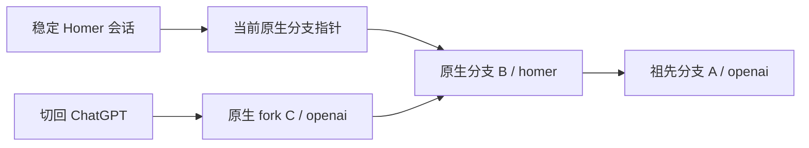

# Codex 0.171 跨来源会话兼容方案

日期：2026-11-16。状态：经用户确认后已集成源码并完成回归；未安装。版本固定为 `0.171.0-alpha.7`，不泛指其他 0.171 版本。

## 问题与边界

本轮源码已更新共享引擎、三平台官方包校验和预发布版本握手，并为会员 GPT-6.1 家族生成 `tool_mode: code_mode_only`。DeepSeek 的目录仍为 `tool_mode: null`，没有全局启用 Code Mode Only。

新版原生恢复会固定历史中保存的供应商。`openai → homer` 或反向切换时：省略供应商仍请求原供应商；显式 `modelProvider` 或 `config.model_provider` 返回原生 `-32600`。这会破坏现有切换来源后继续原会话的行为。依据为固定上游的 [ConfigManager::load_for_resume](https://github.com/openai/codex/blob/73c4af9125a8d5e9aabe5aa900eecf70214ba856/codex-rs/app-server/src/config_manager.rs#L529)，以及隔离实际请求去向对照。

本轮完成源码兼容实现和隔离验证。不安装、重启日常 Homer，不操作日常数据库、历史、授权或配置，实现与原型阶段未提交或发布。兼容实现与原型阶段只使用回环合成响应；后续按单独授权进行的实际会员网关补验见末节与实网报告。

## 采用原生 fork，保留 Homer 会话身份

同供应商继续 `thread/resume`。仅供应商确实变化时，使用原生 `thread/fork`，在新原生线程中继续完整历史。Homer 的用户会话、Worker、任务、消息、附件、订阅和原回执保持原身份；原生线程 ID 单独记录。

原生分页历史使用祖先引用，不要求子 rollout 复制全部历史文本。祖先原生分支必须保留；不得自行扁平化、覆盖或改写 Codex 历史。新分支继承动态工具声明，显式应用当前来源的模型、授权连接、MCP、权限及提示词；分支创建本身不执行模型轮次。

不采用历史导入：该接口被原生协议标为 Codex Cloud 专用，原型还确认它不继承动态工具。也不重定义内置 `openai` 供应商：新版明确拒绝覆盖保留供应商 ID。

## 身份、持久化与执行隔离

1. 保留现有 `meta.mainThread`、`runs.threadId` 及历史、媒体、回执中的 Homer 会话键，不批量替换旧数据。
2. `NativeThreadBindings` 在 Homer 自有 SQLite `meta` 中维护不可变的四字段分支记录：`logicalId`、`nativeId`、`parentNativeId`、`provider`，以及当前指针；只有校验后才发布，不另存一份校验状态。`nativeThreadTurn:v1` 记录每个已签收轮次的实际原生身份，和既有 Main 回执或 Worker 绑定在同一事务提交。原生历史正文仍只由 Codex 保存；不批量改写旧事实，也不增加业务数据库 schema 迁移。
3. 旧会话缺少映射时，其原生 ID 等于现有会话 ID。不能从角色或当前配置推测原供应商；通过原生 `thread/read` 确认。仅允许已授权来源之间的转换。
4. 原父执行及所属进程必须已确认停止；有活跃审批、退出未确认或原生效果未知时拒绝分支发布，保留现有阻塞。不能通过 fork 消除旧操作的不确定性。
5. fork、记忆策略和原生目标状态校验全部完成后，使用当前指针的比较并交换，在一个宿主事务中追加分支记录并切换指针。事务还必须验证同一次启动／准备操作、当前引擎对象、Main 恢复代次或 Worker Run epoch、所属租约以及被选来源快照仍有效；父指针未变不能单独证明迟到回执仍有发布权限。发布前不发送 `turn/start`，也不接受新分支工具或审批。
6. 写入失败或旧指针已变化时，旧指针保持原值，新分支不得执行。崩溃发生在提交前可留下未执行的原生分支，不能自动删除不明来源的原生历史；提交后重启直接恢复已发布分支，不再 fork 或重放工具。
7. `CodexEngine` 是逻辑身份与原生身份的唯一适配边界。对外保留 Homer 会话键；对内 RPC、取消和恢复使用当前实际原生 ID。只处理明确协议字段，不递归替换历史正文或全部 ID。
8. 根线程事件必须匹配当前分支、所属连接及根轮次。只将该根线程投影为 Homer 会话键；历史和真实原生子线程 ID 不改写。Worker 子线程审批沿现有 `WorkerNativeRequests` 的当前父执行／连接授权处理，保留子线程和子轮次的原始身份，不能错误要求它们等于根 ID。旧连接、旧父执行或旧分支的迟到子线程请求同样失效。保留实际 `nativeThreadId / turnId` 供执行、审批和恢复核对；界面投影不修改原始执行身份。

Worker 的命令、文件、MCP、动态工具和图像生成使用 `nativeWorkerEffect:v1` 记录真实 `nativeId / turnId / itemId` 与规范化状态；真实子线程额外保留所属根原生线程和轮次。只保存身份与状态，不保存命令、参数、结果或正文。`executing` 和 `rpc_wait` 都是当前执行；等待另一个审批不能丢失并行操作的开始事实。进程退出不等于操作完成；未确认状态、旧 `worker_reply.execution.status` 的 `unknown / unconfirmed` 和未送回审批继续阻止 fork。

关闭期间只接受当前连接、当前父执行的终态，且只能更新已经存在的准确操作记录，不能创建新操作或接受新授权。leader 退出后、stdout 排空前的准确终态也保留。首次明确的 `completed / failed / declined / interrupted` 不被迟到开始或冲突终态改写；未知状态保持未确认。没有真实终态时保留阻塞，不凭进程停止、成功回复或其他 item 推断结果。

## 记忆与原生目标

fork 默认按当前配置初始化记忆模式，不保证继承父线程。不能把 Main 等同于已开启记忆，也不能把缺少记忆摘要等同于已关闭记忆。

固定版本的公开 Thread/read/list/settings/fork 协议没有记忆模式 getter。分页元数据的原生所有者 [update_thread_metadata.rs](https://github.com/openai/codex/blob/73c4af9125a8d5e9aabe5aa900eecf70214ba856/codex-rs/thread-store/src/local/update_thread_metadata.rs#L160) 将最新状态保存在 SQLite，初始 JSONL 值可能过时。因此方案需要一个**只读且固定版本**的适配器：只从配置指定的 `CODEX_HOME/state_5.sqlite` 参数化读取父线程的 `memory_mode`，不写原生数据库。

在静止父线程中取得模式后，Main 和 Worker 的跨来源续办均原样保留；只有全新的逻辑 Worker 默认禁用。调用原生 `thread/memoryMode/set` 设置子线程，在发布前确认生效。文件、行、模式或版本无法确认就阻塞，不回退到角色猜测。该原生数据库 schema 依赖是本方案需要明确接受的维护成本；将来有原生 getter 时替换它。

原生 goal 需要使用 `deferGoalContinuation: true` 保留目标并禁止初始化自动继续；实际目标状态、预算和冷恢复须有独立断言，不能仅凭协议字段推定通过。保留已撤回记忆、未决操作和原用户授权的现有边界。

## Worker 关闭兼容

新版插件目录启动同步可能遗留 Git 子进程：原生 leader 退出后，所属进程组仍存在，现有 `close(false)` 正确保持停机未确认。不能禁用产品插件或把 leader 退出当作整个执行退出。

隔离原型采用现有进程身份标准：EOF 前、leader 仍存活时，记录同 PGID 且祖先链可追溯到该 leader 的子进程身份；按现有流程关闭后，只在 leader 已证明 ESRCH 时，向身份仍匹配的已记录正 PID 发送终止信号。最终仍必须通过 `leaseOwnerGone`。不向已退出 leader 的旧负 PGID 发信号；新出现、身份变化、无法读取、权限不明的进程继续导致未确认。Windows 原有实现不变。

这是有界所有权清理，不识别或白名单匹配 Git 命令。仅增加等待不能修复该原生后台线程的超时所有者随 leader 消失的问题。现有 `ps` 进程身份检查仍有其竞态限制，不能宣称达到 OS 进程句柄强度。

## 实施与验证

实现位于 `src/engine.ts`、`src/service.ts`、`src/native-thread-bindings.ts`、`src/native-thread-memory.ts`、`src/recursive-tasks.ts` 和 `src/processes.ts`；版本、归档元数据、运行时检查、合成夹具及显式专项入口同步更新。DeepSeek 的工具模式源码不变。环境固定为 macOS ARM64、Node 22.22.0、官方 Codex 0.171.0-alpha.7，使用独立 HOME／CODEX_HOME／runtime 和回环合成上游。

| 当前生产源码检查 | 已观察结果 |
| --- | --- |
| 分支适配故障注入 | 23/23：所有者撤销、同父指针迟到、配置变化、指针冲突、错误分支／供应商／父关系、记忆状态拒绝，均不能发布或执行新分支 |
| 持久绑定与效果事实 | 67/67；记忆只读适配 12/12。真实子线程归属、父／子轮次、first terminal、外层捕获后继续提交的 savepoint 回滚均覆盖 |
| Worker 执行与停止 | 联合 131/131。`rpc_wait` 并行操作、关闭排空终态、已 ACK 的签收失败、ACK 前停止均有红绿回归；保留未知事实和撤销 epoch |
| 生产原生记忆与目标 | 7/7：两角色 × 两种父记忆、活跃 goal 的两次 fork／冷恢复、两种记忆的 0.163 迁移。保留工具回执和完整目标，祖先状态不改，启动无生成或预热 |
| 实际 Homer 连续性 | 渠道 2/2：包含三次切换、四个 Main 原生分支、已有 Worker 续办、订阅、消息、附件及未知发送回执；定时任务 1/1 |
| Code Mode Only 与 DeepSeek | 会员传输／工具闭环 40/40、DeepSeek 11/11、混合来源传输 11/11；不追加真实模型调用 |
| 原生能力、提示词与停机 | 原生协议 6/6；插件启用且捕获子进程清理 1/1；提示词／动态工具 5/5、实际 Homer 目录 10/10 |

此前 scratch 原型用于选择方案；上述检查已改用维护的生产适配器和显式测试入口，不再以 monkeypatch 原型证明产品接线。独立评审发现的续办 Worker 记忆、当前所有者、真实子线程身份、效果未知门禁、审批等待、EOF 排空及签收失败边界均已修复并补充行为回归。最终共享工作树默认核心 2737/2737，零失败／取消／跳过；完整类型检查、服务编译及打包相关检查已通过。首轮失败及修复后的分项结果、可重复命令和平台边界维护在[测试说明](../../testing.md#codex-01710-alpha7-源码升级)。

原生 resume 可能保留旧 developer 上下文，沿用 Homer 已有 `adoptMainPrompt` 追加当前主规则，不重写原历史。检查点中断时可能保留两份当前规则，既有恢复流程没有严格去重承诺；测试保留这一明确边界，同时核对当前规则顺序、后续压缩、原历史字节、附件和动态工具。

## 维护边界与交付范围

- 只读 `state_5.sqlite` 依赖精确原生版本／schema；路径、模式或身份无法确认即失败。后续升级必须重跑此处原生继承和迁移专项。
- 原生分页祖先、映射、轮次与效果审计共同构成恢复依据；不能只搬运子 rollout 或删除祖先。未知操作继续阻止来源 fork，不自动清除或重放。
- Unix 清理依赖现有进程身份标准，仍有 `ps` 检查竞态；不能宣称等于 OS 进程句柄。Windows 未改此清理实现，尚无新版实机证据。
- 最终 Homer 源码已追加实际会员网关 HTTP 验收：本次下发 Main Terra／medium、Worker Terra／high，6 请求全200，双角色代码生成／本地执行／回执与终态匹配通过，见[实网报告](../../member-code-mode-live-validation-2026-11-16.md)。Sol、真实 WS、登录刷新及完整计费不在该结果内。

本阶段按后续授权仅本地提交源码与验证，不安装、不重启、不迁移日常数据，不推送或发布。Mac Intel、Windows 实机及签名安装未运行；最终候选会员网关的补验边界见上述报告。源码、测试和本文是复验依据；不依赖临时原型、源码副本或已下载引擎长期保留。

本地提交仅提取本轮升级与验收片段；独立候选及共享实网快照的证据范围分别见[本地提交复核](../../testing.md#本地提交候选复核2026-11-16)与实网报告。
